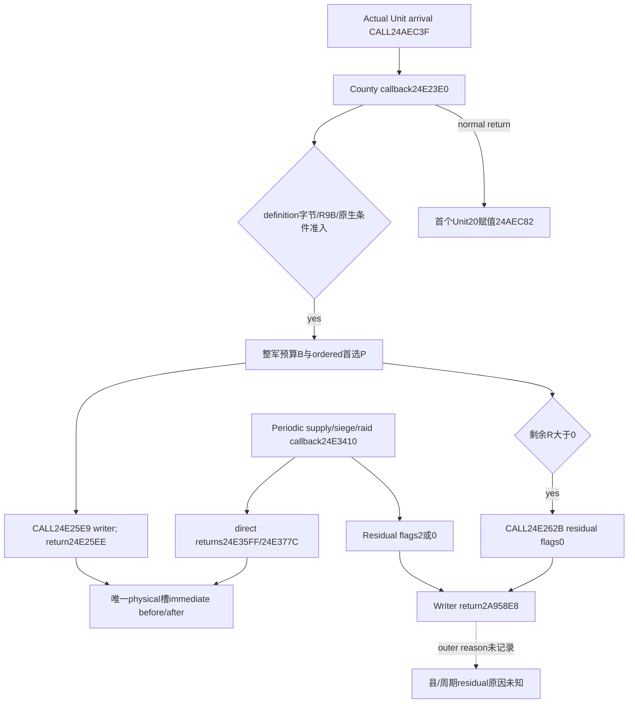

# 四期R04：县进入扣兵与周期损耗分离（1.20.0.4）

县进入的首选扣兵有独立、可识别的实际 caller：`24E25E9 ->2634190`，返回点 `24E25EE`。它和周期供给首选 `24E35FF`、周期围城/劫掠首选 `24E377C` 可按**逐次 writer 来源**分开。县剩余预算也进入通用 `2A957E0`，其 writer 返回点同为 `2A958E8`；现有 journal 没有外层原因，因此不能把 residual 全算成周期或县损耗。日期相同、进入新县、预算相符、军队净少人均不能补上这个缺口。

本包状态为 **exact-build source closed / readonly consumer qualified offline**；县首选、剩余入口及顺序是静态结论，没有新增县进入或实际扣兵实机结果。没有修改游戏、SDK、桌面或生产 journal。

## 精确来源和机器边界

CK3 `1.20.0.4 / Steam25734779`，EXE SHA-256 `98702f88a547cde2eaf29a85f93b85f68ee4cf8148336a4f7afaeb75319dd518`。新结论直接复用本机现存 actual4 指令，不从 `.3` RVA 减20推算。来源机器 `machine_id: desktop-3fevhd2-1c74096080`，首次原件观测 `2026-10-15T08:20:59.552645+00:00`；本包重读与完整性复核 `2026-10-15T14:51:03.254518+00:00`，出处为外置 `high-parallel-county-a01/SOURCE-REUSE.actual.json`。此机器绑定只说明该份来源的读取，不能证明其他机器部署或运行资格。

| 已存实际源码 | 精确范围 / 源字节 SHA-256 | 此包验证 |
|---|---|---|
| `capability-lane/payment-source-a01/FUNCTION-024E23E0.actual.json` | `24E23E0..24E2A6F`，1679B；`6aa9b70a241d6dfbeac6841493f93b8a138f4dca0c58f7523165ef8844ac562f` | 全418条指令连续重建，完整span hash一致；两个CALL的rel32独立求值 |
| `capability-lane/payment-source-a01/FUNCTION-024AEA20.actual.json` | `24AEA20..24AEE39`，1049B；`7a36b994b3b6c266e264ccbee1a00488233365c43844f78eeebe99a2e7594406` | 全242条指令连续重建，完整span hash一致；县回调与Unit20赋值顺序 |

两份JSON均在 `C:/ck3-e04-resume-20261015-a01/` 下。JSON原字节SHA分别为 `22c412e446eb966298646f63c60215edd0cbf725c630854e9e7960e3ebb79573`、`6071145b63744810e75ff5cde30b4661da02985b374d2ce5296215a52f0d34ae`。原件属于已有付款源包，本包仅保存小型指令摘录与引用，新增EXE读取、全EXE哈希、存档或raw读取均为0。

研究记录使用 [现有workflow](research-tooling-workflow.md) 与 `tools/native_research_plan.py`。正常check为plan-consistent；offline-only方案运行 `--for-observation` 被正确拒绝，未伪造live窗口。`open_kaishek: not-applicable`，这里检查编译原生调用来源和已保存journal消费，不含可由脚本运行时代替的语义。

## 实际owner、准入与请求顺序

[到达调用者](unit-next-arrival-transition-12004.md) 在实际CALL `24AEC3F` 传入 `RCX=CArmy`、`RDX=旧Province`、`R8=目标Province`、`R9B=prior170>0`。county callback 在 `24E240F/240C/2409` 保留于 `R13/R14/RSI`。回调完成后，helper才在 `24AEC82` 首次写 `Unit+20=target`。因此county阶段发生于该Province指针转移之前；不能把查询时当前Province当成writer调用时的county owner。

本分支先要求目标和旧省份definition `+1B` 都非零；若 `R9B!=0` 则绕过county预算和全部county扣兵。否则用 `CArmy+1D4==0` 求mode，通过 `CArmy+124 ->CUnit ->+174` 解析实际Character，`+18`核完整ID；在 `24E24A1` 调用 `24E2230(actor,old,target,mode)`。false同样跳过。本包不为definition字节或内部条件发明地形/敌我含义，也不把当前condition=true追认为未来执行已发生。

`24E24B3 ->24E6650(CArmy,nullptr)` 取得有符号32位整军预算B；预算getter的fraction、minimum和cap继续参见 [当前输入合同](army-county-entry-current-inputs-12003.md)，实际 `.4` 绑定为 `24E6650/24E6570/24DD9A0`，loaded minimum为 `5C68C64`。预算先产生，再筛选首选承受者；首选分母不是整军人数。

| 实际指令 | 作用 |
|---|---|
| `24E24D3..24E254D` | 遍历 `CArmy+38/+44` 的完整原始ArRg顺序；storage mask24索引＋完整ID、magic `ArRg`、ID非-1；仅definition `+2A0<=0` 的current38累加到signed32 S |
| `24E254F..24E255C` | signed比较取 `P=min(B,S)`；保存 `R=B-P`，供首选结束后使用 |
| `24E2570/2579` | 当前remaining P或S≤0即停止首选循环 |
| `24E25C9..24E25DF` | 对同顺序合格团，取调用前current C；`IMUL EAX,R15D`为**32位低积wrap**，`CDQ; IDIV R14D`为signed截断，得到q |
| `24E25E2..24E25EE` | signed q扩展后乘100000，`24E25E9 CALL2634190`；真实return `24E25EE` |
| `24E25EE/25F1` | P减**请求q**，S减**调用前C**；不是按writer实际物理debit扣预算，writer skip也不自动返还请求 |
| `24E261E..24E2630` | R>0时，RCX=`CArmy+38`、EDX=R、R8D=0；`24E262B CALL2A957E0`，return `24E2630` |

零预算在 `24E24CA` 跳过分配。原始roster occurrence和顺序必须保留：重复引用可能触发重复调用，不可先按ID去重；物理DATA别名则在**每次writer的物理槽求和内**只计一次。普通非溢出域中的常见分配为 `trunc(C*P/S)`，但Python无限精度乘法不能覆盖32位wrap分支。以当前C=50000、P=50000、S=100000为例，原始低32位积为-1794967296、signed商为-17949；这只是机器整数反例，不是本场发生了负损耗的实机结论。

正常整数尾差反例沿用已冻结 [R0162](army-episode04-periodic-and-county-arrival-loss-r0162.md)：county预算127，首选S2500，顺序C为800/400/100/800/400，ordered请求为40/20/5/41/21。逐团各自乘5%会得到40/20/5/40/20，少2。该历史 `.3` 是端点＋源码推断，`machine_id: unknown`，不能升级成本机 `.4` writer实证。

## journal消费和最小可复用代码

现有 [actual writer journal](army-actual-loss-writer-observation-12004.md) 保存原始 `caller_return_rva`，所以**县首选不需要新字段或新hook**。当前C++ enum把return24E25EE统一标成other；这是尚未分类的字段，不是把physical值读错。新增纯只读 `army_county_entry_loss_evidence_12004.py` 以exact `.4` SHA和原始return分类，保留原native标签，避免修改本轮冻结C++。

物理事实复用R03的 `army_physical_loss_evidence_12004.evaluate_army_physical_loss_evidence_12004`：逐次稳定ArRg、完整DATA到unique physical槽映射、实际原始before-minus-after一致才授该调用的physical debit。cached current delta、requested_raw、预算和军队净变化都不填physical值。完整零和负值原样保留，clock-only失败不抹掉独立physical事实，但 `dated_evidence_ready=false`。

真正物理owner由writer的DATA selector `260DB50` 解析：DATA `+8` 为完整persistent Regi ID，DATA `+C` 为所选chunk ordinal，指向 `Regi+18+ordinal*24`。它可以与其他DATA occurrence共用同一物理槽；不能把query时CArmy人数或persistent owner替换为这个选择。writer `2634190` 按记录顺序读取并调用 `2657E80`，后者在物理槽 `+4` 保存signed current，最后 `2633320` 重算目标ArRg `+38/+3C`。state3且raw current0时effective current可取max，因此effective/cached变化也不能替代原始physical current变化。这些actual4内部源链沿用[已闭合writer专题](army-current-callback-soldier-effects-12004.md)，本包未重采callee。

consumer另外要求保存同一journal初始化的 `after_sequence` 和 `before_unattributed_capture_failures`，拒绝倒退cursor、ring覆盖或failure基线变化造成的完整窗口主张。current query仅返回当前full ArRg membership，不能追认调用时CArmy owner；本模块始终 `army_at_invocation_observed=false`，`county_total_debit=null`、`periodic_total_debit=null`。全局序号中的间隙可以属于其他军队，不要求某军事件连号。

R04后续若需要**整个县进入总额**，最小额外来源是外层执行上下文：在实际county入口到正常return建立invocation ID＋CArmy fullID＋旧/目标Province＋特殊flag，使内层writer包括residual携带该父ID；或在 `2A957E0` 入口记录真实outer return `24E2630`，并将同次residual invocation关联到其内部writer。只加R8 flags无效，因为county和siege/raid residual都是0。不得用日期、相邻序号或“没有别的调用”猜父链。此包不新增这些hook，也不声称已提供owner-at-invocation。

## 已保存样本与实际离线验证

canonical R0173 archive的真实 `day21-final.json`（149329B，SHA `94bf905d0b4b03f6d56b0d074403c71ec33ea0a4a98d572cc95fc53e13a743a5`）是ordinary snapshot，确实不含writer family。当前机器来源为上表machine ID，原件manifest时间 `2026-10-15T13:21:47.228975+00:00`。新consumer对它给 `unavailable / actual_loss_writer_journal_absent`，不会把snapshot里兵数不变推为县损耗0。

新unit cases实际覆盖上述真实拒收、同日county-primary/periodic direct/residual分开、旧 `.3` return不被认作 `.4`、fullID代际、cursor去重与覆盖、alias一次计量、合法零/负值和clock-only分离。伪造debit999但physical100→93的fixture用于验证算术不一致拒收，**不宣称生产native producer曾输出此值或存在实际损兵错误**。测试是纯离线consumer验证，没有新native producer、编译或游戏调用；详见外置 `TESTS.actual.json`。

本包≤8MiB，共用Root已接受512MiB池，出处 `continuation-a05/CAPACITY-ACCEPTED.actual-a01.json`；截止复核 `2026-10-16T07:45:01.597Z`，不自动续期。当前源码与小型结论为后续R04实际窗口输入；不复制save/raw，未删除原件，不向其他机器外推容量。

## 2026-10-15 后续source候选：精确residual父调用

[县residual parent scope](army-county-residual-parent-scope-12004.md) 已完成新的有限353B源读取与defaultOFF候选，选用非零continuation2A957E8，和R05共用typed TLS token。它可把自然allocator的真实直属county return24E2630与周期callback receiver分开，仍沿用现有writer物理账本。三个最终TU syntax与七项Python synthetic-wire消费已通过；native fixture执行、生产compile/link与实机parent source仍NOT_RUN。当前a05及本专题上文的实际归因边界保持不变，不能因源码候选把旧residual回执改判成county。
