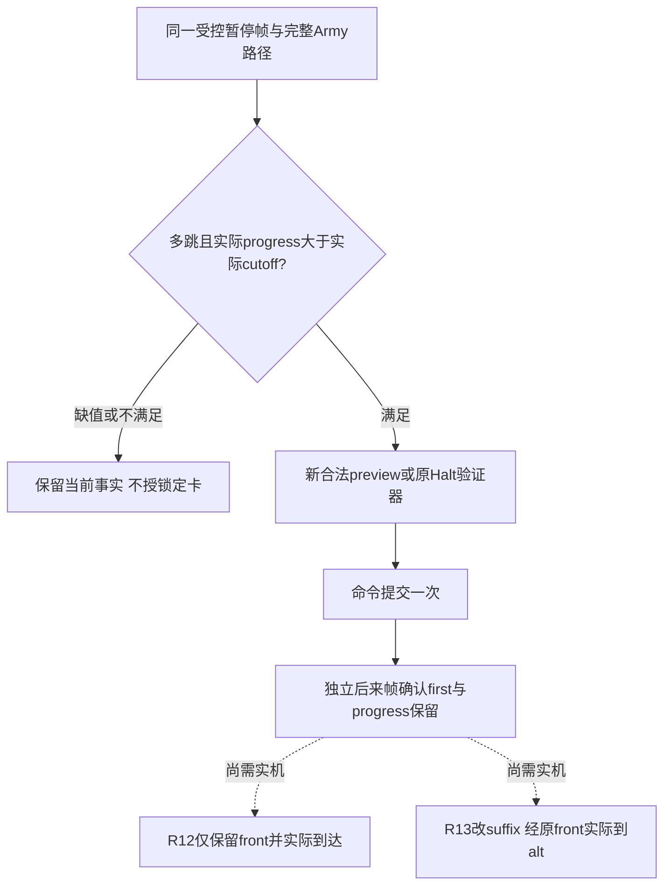

# Episode04：1.20.0.4 锁定 Halt、改道与实际到达

本专题同时服务视频 E4-04 与智能体“是否还可取消当前边、何时改后续路线”的决策。代码入口为[只读验收器及执行手册](../../promo/ck3_native_war_ai/episode-04-march-logistics/tools/review02/locked_routes/README.md)，不依赖某台机器的 C 盘模块、Steam、SDK或桌面。

## 来源与当前资格

历史实机源 `machine_id: desktop-3fevhd2-1c74096080`，2026-10-15，CK3 **1.20.0.4 / Steam25734779**，EXE SHA256 `98702f88a547cde2eaf29a85f93b85f68ee4cf8148336a4f7afaeb75319dd518`。这属于[已归档 R0173 实证](episode04-r0173-boarding-halt-12004.md)；其他机器必须重新核版本、人物、Army与session，不能继承此处安装/离线/实机状态。R12 已锁定 Halt 与 R13 已锁定改道的**新实机闭环仍待取得**。离线验收器合格不将它们升级为已拍摄。

[R0173 清单](evidence/episode04-r0173-20261015/manifest.json)及[精确原始回执 ZIP](evidence/episode04-r0173-20261015/original-receipts.zip)保存可移植的 R11 负控：`day21-summary.json` 中实际 progress9799、loaded cutoff50000（均Q100000），故不满足严格大于；`halt-after-asynchronous.json` 与 `day22-final.json`只证明该次未锁定 Halt 的实际后果。归档来源机器保持原样，不追认为读者当前机器。

## 原生机制与观测口

| 层次 | 可复用事实 | 来源与边界 |
| --- | --- | --- |
| exact .4 工厂绑定 | 原Halt constructor296A190、validate296A2D0、destroy296A200；progress24AB2D0、front24AA7B0、tail24AA800，loaded cutoff全局5C699E8 | [1.20.0.4绑定实现](../../ck3_autonomous_player/native_bridge/src/ck3_12004_military.cpp)按EXE SHA启用；不是用旧.3地址全局平移。 |
| 移动起点选择 | 当前实现用实际progress **>** 实际loaded cutoff时的原front作为有效起点；等号落在另一侧。保留当前边后再构造suffix | [ResolveMilitaryMoveOrigin / NativePreviewMoveArmy](../../ck3_autonomous_player/native_bridge/src/ck3_12002_military.cpp)由.4绑定复用。实现与数值guard的确定性资格不等于已实测.4等号或锁定Halt后果。 |
| 当前可读输入 | normalized_edge_progress、loaded_movement_lock_cutoff、first_route_edge_remaining_duration均为可空signed64/Q100000；只在同暂停clock读取cutoff | [AttachCommittedRouteTimelineToArmyRows](../../ck3_autonomous_player/native_bridge/src/ck3_12002_routes.cpp)先保存cutoff再尝试timeline，timeline失败不吞cutoff；缺值保留unknown。 |
| 普通完整路径 | complete_nonempty的原生契约要求count准确、target observable且等route尾；empty时target可为unknown | [war_contract.py](../../ck3_autonomous_player/src/xar_autoplayer/bridge/war_contract.py)。不得构造“完整非空路径但目标不可读”的不合法fixture，再改生产逻辑适应它。 |
| 真实动作入口 | 普通新Move和R13改道使用现有`ck3_move_army`→service.move_army→typed Driver；preview/Halt走既有step | [MCP入口](../../ck3_autonomous_player/src/xar_autoplayer/bridge/mcp_server.py)、[Driver](../../ck3_autonomous_player/src/xar_autoplayer/bridge/native_driver.py)。generic execute_step未列出的Move被拒绝不代表缺少typed能力。Halt ACK保持postcondition_verified=false。 |

旧[.3 Halt专题](army-halt-native-command-12003.md)可提供原生严格比较的历史研究背景，其地址/实机结果仍属于旧build。这里按当前.4绑定及实际同帧输入准备独立新卡，不把旧版本回放当.4完成证据。

## 双用途 guard 与业务后果

只读 `verify.py` 的 `frame` 连接 exact snapshot/strength/date/revision/owner/PID/generation/episode与原生Army身份；`admit_locked`只接受实际读取的严格比较，不硬编码50000，返回front、tail、实际remaining与 `ceil(remaining)+2` 有界等待。智能体可在自身已验证的当前observation上消费这个纯函数作为锁定判据；本包没有安装自动执行策略，也不授予额外动作权限。

R12必须独立正常新Move形成多跳路径，越实际cutoff后Halt一次；同日期独立后来帧必须只剩原front且进度保留，再自然到front并静止。R13必须另一独立正常新Move；alt不能等当前Province、原front或旧tail，不能借tailshortcut把旧路径当新preview。实际后态须保留first、改变suffix，之后看到原front及**实际到alt且静止**。只给ACK、新route或首段抵达均不能完成R13。

未来manifest显式提供源machine、实际session及证据路径，绝对路径可用；相对证据路径与owned_evidence_roots统一相对manifest自身目录。脚本从任意cwd运行不改变输入含义。historical source ID不会变成新机器资格。单个文件≤16MiB、总输入≤64MiB；使用Army范围ordinary_core查询即可，不提高上限或把false/null改为true。请求计数覆盖operator保留的完整case日志，验收器不独立证明不存在未记录的外部命令或加载。

测试复用原来的numeric below/equal/above（含非50000）、完整帧join、ACK-only、suffix与原front、真实最终到达及归档R11负控；仅新增相对路径CLI在无关cwd运行的检查。所有正例是synthetic fixture，不当实机信用。新的实际研究/录制回执应另建case与机器ID，不回写旧ZIP。

## 视频复用

[导演案](../../promo/ck3_native_war_ai/episode-04-march-logistics/director-plan.md)回链[执行与拍摄手册](../../promo/ck3_native_war_ai/episode-04-march-logistics/tools/review02/locked_routes/README.md)。镜头顺序为新Move路径、暂停同帧实际锁定读数、一次动作、独立路径/进度后态、首段与实际目的地；帧缺失就保留缺口，不以预计ETA、旧R11或每日采样跨过的省份补画实证。
