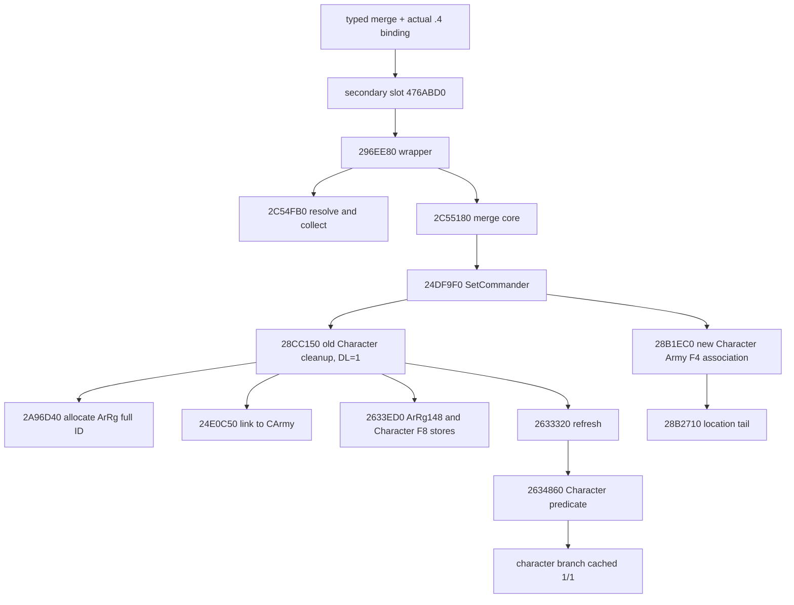

# Episode 04：actual .4 合军、旧统帅与角色 ArRg 出生路径

2026-10-16 更新：actual `.4` 的 `2633ED0` 已补闭完整243B，split secondary executor `296C2F0` 已取得完整2819B普通体。完整分片、空 DATA 构造器、portable source replay 与现场断言见 [actual .4 拆半源码专题](episode04-split-half-source-12004.md)。下文保留 a02 当时的采集与流程边界；“未读/partial”描述的是该轮历史状态。

本页补充 [特殊兵、拆分合并合同](episode04-special-troops-split-merge-12004.md)。状态是 **exact .4 静态源码与离线候选接口**；没有新增实机样本，不把该分支解释成每次合军必然发生，也不追认历史 B 的角色身份。

本次来源机器 `machine_id: desktop-3fevhd2-1c74096080`。观察日期 2026-10-15 UTC，精确起止时间在下述逐次 READ 回执。代码基线 `1463bd9b4b89612d283dd45ac4ec9efbf22f048d`；CK3 1.20.0.4 / Steam build 25734779，EXE SHA-256 `98702f88a547cde2eaf29a85f93b85f68ee4cf8148336a4f7afaeb75319dd518`。复用 Root 对 `frozen-game-12004/IDENTITY.actual.json` 的整文件校验；各次有限读取前后核对 size/mtime/ctime/device/file ID，没有再次整哈希或扫描 EXE。

## 实际调用链

公共 typed `split_army_half` / `merge_armies` 经过已选中的 `.4` MilitaryBindings、`SubmitCommandCopy` clone/queue。`native_bridge/research/ck3_1_20_0_4_military_maa.json` 和实际 `.4` binder 才是入口索引；army-support 分类未收录这些命令，不能据此认定没有来源。

实际读取两个 secondary vtable `+8` QWORD：

| 命令 | slot RVA | 实际 8B | 实际目标 |
|---|---:|---|---:|
| split | `476AEF8` | `f0c2964201000000` | `296C2F0` |
| merge | `476ABD0` | `80ee964201000000` | `296EE80` |

`.pdata` 定位 split `[296C2F0,296CDF3)`，但其 2819B body **没有读取**。不能把下面合军路径外推给拆分。

所有箭头按实际字节中的 CALL/JMP 或已保留 exact .4 源码建立，未用 `.3` 地址平移。

## 可以闭合的字段与条件

`2C55180` 的三处实际 `24DF9F0` 调用分别清来源军队统帅、可能清候选角色原军队统帅、给目的军队设置最终统帅。`24DF9F0` 在 store `24DFAAC` 写 `CArmy+120` **之前**，若旧角色有 `Character+1B8` 扩展，会以 `RCX=&oldCharacter, DL=1` 在 `24DFA6C` 调用 `28CC150`。

`28CC150` 的创建分支需要其首个判定 `28B2150` 为真，并经过这些实际条件：扩展存在、扩展 `+16C` 非零；扩展 `F8` 解析得到的 ArRg 的 `+140 == -1`；扩展 `+108 == 0`；传入 DL 为真；扩展 `F4` 解析成有效 CArmy。`28B2150` 本体未展开，因此保留为未解释的额外门槛。失败或 sentinel 分支不能当创建成功。

创建分支按顺序执行：

1. `28CC332 -> 2A96D40`：从 ArRg registry free slot 分配，generation 加 `0x01000000`，调用 `2632CB0` 构造，写 `ArRg+10` 完整 ID；`ArRg+14C` 写入调用方计算的 kind（此分支为 0 或 2），返回完整 ID。构造器内部未展开，不据它猜 DATA chunk。
2. `28CC33E -> 24E0C50(CArmy,newID)`：先查 `CArmy+38`、计数 `+44` 的 ID 向量；未存在且新对象完整 ID/magic 有效时，调用容器 helper `B02D10(&CArmy38,&newID)`，并在 `24E0CF4` **实际 store** `ArRg+140 = CArmy+10`。容器 helper 内部未展开，不能声称捕获了其内部 count store。
3. `28CC37D -> 2633ED0(ArRg,oldCharacter)`：在已读前缀中，`2633ED6` **实际 store** `ArRg+148 = Character+18`；扩展存在时 `2633EEB` **实际 store** `Character1B8+F8 = ArRg+10`。该方法无包含 `.pdata` 行，逐指令有限读取了前 128B；尚未到 ret/tail，所以只授信这些已见 store，不称完整方法闭合。
4. `28CC3B9 -> 2633320` 刷新。既存 exact .4 全方法源码表明：`2634860` 的角色 predicate 为真时，角色分支得到缓存 1/1；DATA 物理兵数与 chunk 写入属于另一条证据链。
5. `28CC3CF` 清 `Character1B8+F4 = -1`。之后 `24DF9F0` 才继续设置最终 `CArmy+120`。

因此，“合军后多出 1/1”有一条**可证的条件生产路径**：清旧统帅时生成关联旧角色的 ArRg，再刷新角色缓存。它可能不是最终现任统帅的记录。也不能凭 `F8` 关联就称其为原生 Knights 成员。是否真的走到该分支、返回哪个新 full ID、最终是否留在目的 Army，仍需同场前后查询或实际 producer 观察。

曾沿新统帅的 `28B1EC0 -> 28B2710` 路线核查：前者写角色扩展 `F4`，后者更新位置相关域；持有范围没有直接 ArRg 创建调用。它们不是此次已闭合的创建来源，相关有限原件保留，不继续展开无关分支。

## 可复用的只读接口已经接线

`ArmyRegimentReplenishmentRecordsSnapshotV1` 新增可选 `native_character_role_v1`；仅 `.4` exact SHA binder 填入所需 Character registry/fallback。同一次现有 strengths 调用把 **所属 CArmy full ID** 交给 `ReadArmyRegimentReplenishmentRecordsV1`，从已经解析的 ArRg 复制字段，再经现有 `AppendArmyRegimentReplenishmentRecordsSnapshotV1` 输出 literal JSON。没有新增公共动作、native mutator、hook 或过程扫描。

新叶包含 ArRg full ID、所属 CArmy full ID、`ArRg140/148`、实际解析 Character full ID/magic、是否使用 fallback、角色 predicate、扩展是否存在及 `F4/F8`。读取前后确认 ArRg ID/magic/Army backlink/Character reference；角色扩展指针、角色 full ID/magic 与复制的 F4/F8 也做读回。部分/不可用字段保持 null 和实际 reason。旧版本与旧包字段缺席，继续按原合同处理，不补 false。

Python `army_replenishment_records_contract.py` 已接入严格新叶 normalizer：拒绝额外字段、bool 冒充 ID、generation/Army 不合、predicate 与同查询 `native_loss_writer_skipped` 不合、available 缺少读回。`classify_current_regiment_character_role_12004` 接收已绑定同 frame/lifecycle 的 native strengths、all DATA、当前统帅 readback 与可选完整 combat Knights DTO：

| 对象 | 观察来源 | 不可替代的后置条件 |
|---|---|---|
| Character ArRg | 新叶的 `148` + 解析身份 + predicate | 不替代物理 DATA |
| 当前统帅 | 现有 typed commander readback | 独立区分 available / absent / unavailable |
| Knight | 现有完整原生 combat Knights DTO | source ArRg、角色、Army 和 membership 均验证 |
| 真实兵员 | 全部 DATA 的 persistent/chunk 身份与 physical current/max | 不能以缓存 1/1 或 ACK 代替 |

消费者始终输出 `physical_refill_applied: null`、`birth_producer_observed: false`。当前字段观察不会把历史出生补成“已见”。拆分新 Army ID 继续使用前页的 fresh sibling validator，不猜 public ID/native ID。

## 校验与边界

离线小夹具使用生产 all-DATA 读取器和生产 serializer，覆盖有角色的零 DATA 记录、旧调用缺席字段、错误 Army、错误 build。另对本次 strengths 和 actual .4 bindings 修改执行 MSVC `/Zs`。Python 测试包含 literal JSON 严格接收、身份/predicate 拒收、旧包兼容、角色与 commander/Knights 独立性。最终有资格的编译、SYSTEM exact EXE 登记、运行、JSON→Python 回读顺序以外置 `a03` 回执为准，不能用第一次流程错误替代。

本次没有启动游戏，没有 SDK/桌面接触，没有 whole-EXE hash，没有读取 save/raw。候选需要 Root 闭场后合入和新构建才能提供实机字段；当前 DLL 不具有这些新字段，历史 B 仍维持原拒收结论。

## 原件、有限读取与纠错

外置 lane：`C:/ck3-e04-resume-20261015-a01/high-parallel-special-a02/`。`READ-SLOTS`、`READ-EXECUTOR-METADATA`、`READ-MERGE-WRAPPER`、`READ-MERGE-CALLEE-*` 与各 `READ-<stage>.actual.json` 保留 machine/time、实际 RVA/bytes、前后 metadata、实际 argv、reader/plan SHA、调用指令。`FINITE-SOURCE-STATE.actual.json` 保留缓存 `.pdata` 行和全部新增读取；`SOURCE-PLAN-final.actual.json` 是最终源码图。

需要如实保留两项流程纠正：

- 两 target metadata 批处理第二项 `2633ED0` 失败时，第一项 `24E0C50` 已成功缓存。我曾错误归因首项；缓存审计纠正后按三个 CHAININFO 分片取得 `24E0C50`，实际边界合计 191B，到 `24E0D0E ret`。误归因后的 128B 前缀读取在断言前未持久化；该次曝光计入重复读取，不冒充有原始回执。后续 191B 实际原件完整覆盖该地址窗口。
- 初次夹具建在 broker 未允许的 resume 根。SYSTEM 以 `producer-validation: Build/output is outside configured project build roots` 拒绝（files=[]）；客户端因此报 exact requested rows 不符。旧 harness 仍执行合成 EXE，再由 pure Python 读取其 JSON，这是顺序错误；旧结果保留、不授合规验收。依 Root 指示，源码冻结和新 build 改到现有允许根 `C:/ck3-war-episode04-research-20261004-a01/character-role-fixture-20261015-a03/`，未扩 policy/根/权限，必须 exact SYSTEM verified 才执行。

本 lane 与新 fixture root 合计继续计入同一个 8MiB 上限及 Root 的共享 512MiB；原容量截止 `2026-10-16T07:45:01.597Z` 没有续期。闭场清点和实际最终资格见 `ROOT-DELIVERY.actual-a02.json`，失败与遗漏见 `PROCESS-CORRECTIONS.actual.json`。
