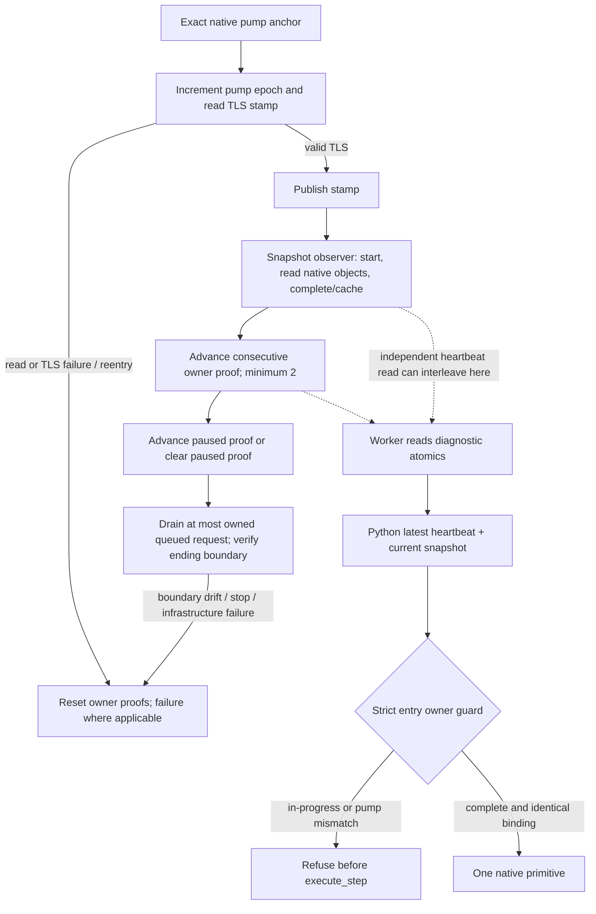

# R0216 UI owner heartbeat refusal — offline attribution

Machine `desktop-3fevhd2-1c74096080`; actual evidence 2026-10-20 03:11:01–03:11:20 UTC; offline observation `2026-10-20T03:24:23.707999+00:00`. Run `desktop-3fevhd2-1c74096080--vanilla--R0216`; runtime/source HEAD `76dcbf7fe4526117fc25f0c892593b570f0a8b68`. This is a knowledge candidate, prepared outside the repository. No source, sealed helper, SDK, screen, input, or game action was changed or executed by this attribution task.

The second independent Army-window query was refused before native submission because the latest heartbeat describes an observer read in progress. The owner thread itself remained `11156`, with PID `37004`, generation `1`, actor `33388`, raw date `53147376`, public revision `3`, native revision `2` and `snapshot_id=native:2`. A full exact entry snapshot was not exported, so consuming heartbeat 1910 is an inference from the complete wire order and explicit latest-heartbeat cache behavior.

| Actual step | UTC | Native result / preceding proof |
|---|---|---|
| Sole select | 03:11:05.572387 | ACK, dispatch invoked, effective_visible=false, verification pending; native pump23461/thread11156/owner+GUI verified |
| First independent query | 03:11:12.580988 | observed, Army0 owned by33388, effective_visible=false; native pump23761/thread11156/owner+GUI verified |
| Heartbeat before query1 | 03:11:12.480932 | pump23756=verified23756; observer complete1688654468, not reading |
| Last public snapshot before query2 | 03:11:16.518706 | unchanged frame; heartbeat1896 pump23926=verified23926, complete observer |
| Latest heartbeat before query2 | 03:11:19.979979 | heartbeat1910 pump24077 versus verified24076; observer started1688662125 > completed1688661859, read_in_progress=true |
| Second independent query | 03:11:20.133087–20.156863 | same requested revision3; owner guard error; **no native execute_step** |
| Public snapshot after error | 03:11:20.352263 | unchanged frame; heartbeat1911 pump24089 versus verified24088, observer again in progress |

The earlier public snapshot at03:11:09.229707 also contains an in-progress observer with owner proof one pump behind, then query1 succeeds at03:11:12. This is consistent with a transient publication phase. It does not establish a permanent owner loss, process change, or seven-second expiry.

The guard is `managed_campaign_title_map_navigation_v1_binding` in `title_map_navigation_contract.py:261–276`. It requires matching owner/current thread, exact current pump proof, a completed observer, matching date/PID, installed/ready and zero failure. It has **no wall-clock TTL**. `native_driver.py:6576–6577` invokes it on the entry snapshot before the primitive try block; `6615–6644` only retries a completed readonly primitive's ending snapshot once under strict same-frame identity fences.

Native owner proof originates in `ObserveMainThreadPumpAndDrainV1` (`main_thread_query_mailbox_v1.cpp:1852`), using exact pump-return anchors and native TLS identity. It increments pump first, publishes stamp, invokes snapshot observer, then advances owner proof (`1921`). The observer samples at250ms cadence and records started/completed independently (`ck3_12002_semantic_adapter.cpp:255–305`). Mailbox diagnostics use independent atomic loads (`main_thread_query_mailbox_v1.cpp:2122`); heartbeat serialization then exposes those values (`bridge.cpp:2642–2748`). Python caches the latest heartbeat wholesale (`native_driver.py:1152–1160,1397–1399`). Thus `ready=true` alone does not prove all stricter contract fields describe a finished observer cycle.

Owner reset/invalidators include pump reentry, failed execution-stamp read, invalid TLS marker/context, explicit proof-reset requests, stop/failure before execution and post-execution identity drift. Unpaused/non-gameplay state clears the paused proof while restoring independently verified application owner. No reset is demonstrated by these R0216 failing heartbeats: failure remains0, owner/TLS/date stay stable, and verified count is only one behind the already incremented pump.

For a later HEAD, consider a bounded readonly wait/resample **before submission**, only when no native execute_step has been sent. Require a newly completed heartbeat and the same machine/run/PID/generation/actor/build/date/revisions/owner; never replay an unknown native action or bypass the guard. Add an exact failed-predicate diagnostic. A coherent completed native diagnostic publication is a separate possible producer fix. No fix or new live gate was applied here; the next map-context take can proceed independently.

The hidden Army window remains a separate unresolved result: ACK and the first query both report `effective_visible=false`; the owner refusal cannot establish why, or what the second native query would have observed. No second native UI receipt exists.

Companion [evidence](evidence/episode04-r0216-ui-owner-heartbeat-20261020.json) contains compact actual tuples, native/MCP line byte offsets, byte counts and SHA-256, bounded-tail source pins and exact source file/blob pins. Raw wires were each read only within their trailing4MiB and were not copied, whole-file hashed, or scanned as executables. These references prove the observations above; they do not guarantee old originals remain available after policy-based reclamation. Consolidate the record under storage policy1.0.0; do not indefinitely retain all R0216 large artifacts for this small issue.
