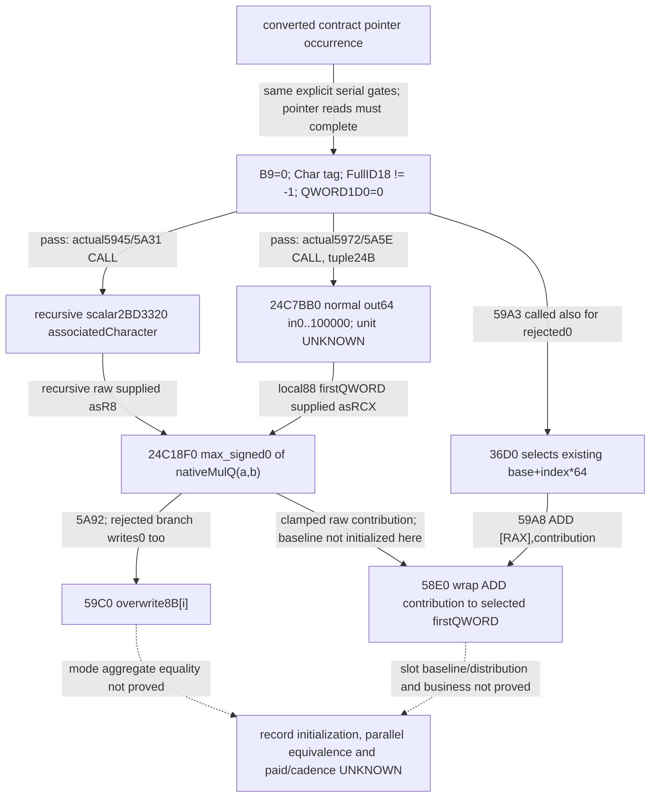

# R08：合同单项raw贡献、过滤与64B槽（1.20.0.4）

这六份静态来源把合同pointer occurrence的**单项raw贡献公式、显式过滤与输出槽写法**接起来。正常贡献非负，仍没有证明资源4是金币、实际已付军费、付款账户或周期。`maintenance_attribution=unclosed`、`paid_military_amount_raw=null`、`cadence=null`；R08整卡与动态分子均不增加。

来源及整合机器 `machine_id=desktop-3fevhd2-1c74096080`；整合时间 `2026-10-16T14:39:26.530244+00:00`，基线 `c743520929d4f9a82c17c908b218075018598e2d`。来源图像为CK3 **1.20.0.4 / Steam25734779 / EXE SHA `98702f88a547cde2eaf29a85f93b85f68ee4cf8148336a4f7afaeb75319dd518`**。各原件自带实际观察时间/来源提交/精确SHA；本次只读冻结包和仓库小记录，零EXE读取/哈希、游戏/SDK/桌面/构建/主仓写入。不把新叶改名为R184/R185已部署或已实机验收。

本页独立追加，不依赖旧专题postimage；前链见[费率resource4静态应用](episode04-r08-rate-resource4-application-12004.md)与[五叶descriptor数据](evidence/episode04-r08-rate-application-12004/descriptor-chain-a03.json)。[本页portable bundle](evidence/episode04-r08-rate-application-12004/descriptor-contribution-a04.json)引用a03精确SHA而不复制它，内含六叶原bytes/完整ASM与ledger、全部SOURCE/勘误/关键capture，以及24C18F0完整过程历史。原JSON/Markdown/ZIP以无损编码保留精确字节；C盘字符串只是来源，不是离线读取前提。跨机器不继承安装、权限、PID、容量或现场资格。

## 新来源及边界

| 叶 | 保存来源 | 窄合同与限制 |
| --- | --- | --- |
| 2BD5370 |448B/109ins/12jump/9call |非空breakdown的范围wrapper；空端点不call，flag3或n恰1到59C0；parallel另走2BD6130，等价未证 |
| 2BD59C0 |241B/63ins/7jump/3call |逐signed32索引过滤、计算，并覆盖写8B[i]；不写count |
| 2BD58E0 |224B/61ins/7jump/4call |同组过滤和两helper链，再由36D0选槽并ADD；初physical-only capture与后来单interval逻辑闭合SOURCE都保留 |
| 24C7BB0 |1417B/342ins/34jump/24call |normal out64在[0,100000]，只能命名bounded_raw_scalar；未知内callee/常量/单位不补业务名，EH未展开 |
| 24C18F0 |**192B capture /190B logical /52reachableins /2RET /0CALL，无独立.pdata** |纯原生fixedpoint乘法后clamp0；capture末2CC余量不计作逻辑体；metadata≤444B/reads≤40，不是精确实际值 |
| 2BD36D0 |320B/82ins/8jump/4call/2RET |token/TLS选择已有base+index*64；无显式record初始化、append或构造；未知helpers不授thread-id/fatal含义 |

所有完整raw及原ZIP SHA在bundle，语义来自作者逐指令合同；校验器只核字节/CFG/连接，不自动证明业务。flags2叶只闭合普通body，异常handler不在范围。其他新研究的24C4150/2C6A810等不偷偷回填本次旧合同，后续应独立追加。

## 两份必须并存的纠正

59C0原SOURCE的`production.helper_parameters`写“localparameter16B”，此措辞错误，原字节未改。附带571B `CORRECTION-parameter-span.actual.json` SHA `01760cd1c226aec6ccb2e31325d43a806e3d0abe2d73073d2e3574d4cb37f674` 明确存储跨度为**24B（到+0x17）**：+0指针8B、+8 DWORD4B、+0x10 QWORD8B；+0xC四字节padding未初始化。已列字段和指令从未改变。58E0从一开始就记录24B，无需追认一份不存在的勘误。24C7BB0自身只把tuple转交286E950，不直接读取其字段；跨度不证明下游消费了全部字节。

24C18F0没有独立.pdata；有限gap计划捕获`[24C18F0,24C19B0)`192B，52条reachable指令的logical highwater为24C19AE，190B SHA `ce9ac1dcfa1f1369f60205a7a329a2db8480ba44b97881b7c90ee8c714a1b4af`。两个RET在1945/19AD，普通CFG无缺边/外跳。首reader拒绝非精确.pdata入口时代码读取0，但逐读ledger没有finally落盘；**不得重构或伪称精确**。作者保守上界合计≤40读、metadata≤444B；最后三次代码读取192B可精确核SHA。SOURCE、最终DELIVERY、PROCESS-HISTORY及完整history ZIP（含旧RED/原plans/脚本/账本）一同保留，校验范围不因新packet而改变。

## 单项公式与原生门

令O为转换数组中的合同profile指针，P=`*(O+20)`为关联Character-shaped endpoint。以下只讨论指针读取和被调用者都正常完成的路径；缺读/坏指针/fault不等于原生显式false。

显式门G依次为：`BYTE(O+B9)==0`、`DWORD(P+1C)==0x43686172`、`DWORD(P+18)!=-1`、`QWORD(P+1D0)==0`。O+30指针在门之前加载；允许后才取参数指针的DWORD+74/QWORD+50。未重复检查合同FullID，不去重、不把fallback单独当0；这些在前级转换与本级显式门各按原source处理。该门不能被改名成“有效玩家/活人/军队”，P也没有被证明是当前player/payer。

G失败时本项contribution=0，跳过递归scalar与两个helper。G通过时：

```text
b = 2BD3320(out80, P, R8=0, R9=0) 的首QWORD raw
a = 24C7BB0(O, out88, tuple24B, optional=0) 的首QWORD raw
c = max_signed(0, MulQ(a,b))
```

其中a的normal-return范围[0,100000]已由24C7BB0 ownbody闭合。H内部经过286E950、两次24C4150、可能的2C6A810/24C4790与未知常量；本包没有将它们的业务定义、参数单位或刷新合同补成已知。a只是bounded_raw_scalar，b来自关联P的递归scalar，不是直接钱包读数；b未被证明必非负。

24C18F0读`a=signed64(*RCX)`、`b=signed64(R8)`，只写原RDX的8B并返回该out指针。Q=100000、W为signed64回绕、T为除Q截向零，原算法为：

```text
S=3037000499
if uint64(a+S)<=2*S and uint64(b+S)<=2*S:
    v=T(a*b)
else:
    high=max_signed(a,b); low=min_signed(a,b)
    q=T(high); rem=W(high-W(q*Q))
    v=W(W(q*low)+T(W(rem*low)))
c=v if v>0 else 0
```

仅额外限定b非负时，结合0≤a≤Q，才能化为`floor(a*b/Q)`且0≤c≤b。其他输入保留fast/slow、wrap与clamp，不以无限精度乘法代替。零可来自门失败、a/b为0、负商clamp，或小正乘积截0；不证明没有合同、未递归、未支付或当日未结算。

## 两个输出模式与槽位

59C0用当前signed32索引i，正常完成每个visited item后覆盖写`result8.data[i]=c`（失败门也写0），并按32位递增直到end相等。空range不触及item/输出；不额外做i≥0、count或capacity检查，也不改result count。

58E0却在每个item（包括c=0）调36D0后执行`ADD QWORD[RAX],c`，保留64bit wrap；不是overwrite。36D0快路径先比较descriptor+3C0 raw token与40F51F0返回EAX，相等时index=`wrap32(count-1)`；慢路径经`GS:[58]`的首TLS区域，guard+3AA0、active+3AA8、index+3AAC、QWORD+3AB0。两路正常返回都是`base+signextend(index)*64`。

TLS首次初始化的active0/index-1/QWORD0是TLS字段，**不是64B record清零**。诊断路径含3F7AB70，未展开，不能命名必fatal或保证不会返回；也没有完整index<count上界门。相同descriptor/token/TLS index可使多个inputs累加同一slot；并未按input append/构造record。源代码不替未来reader免除合法count/index/base/lifetime检查。

因此单项c和局部写法已闭合，但result baseline、slot数量/分配、parallel实际worker方法、两种mode最终总和等价仍未闭。先前shared只证明按实际result count汇总64B首QWORD或8B结果；不能把“空范围/零贡献”直接升级为总额0，更不能升级为实际已付军费。



## 跨机器离线检查

先接a03数据，再接本包；三个新path互不覆盖a03旧专题。仓库根用目标机器项目解释器执行：

```text
<project-python> -B -O docs/ck3-native-ai/evidence/episode04-r08-rate-application-12004/verify_r08_contract_contributions.py
```

候选阶段可把`--bundle`和`--prior-bundle`分别指向两份relative.patch：工具只提取其中完整new-file JSON到内存，不apply/建树/访问历史C盘。也可读JSON或指定ZIP成员。`--extract-originals <不存在的新目录>`能精确还原全部原始JSON/Markdown/ZIP。它核普通CFG、全部保存指令、原件SHA、incoming CALL与24B/192→190/缺失ledger纠正；不执行native代码、不自动证明语义、也不产生实机信用。
