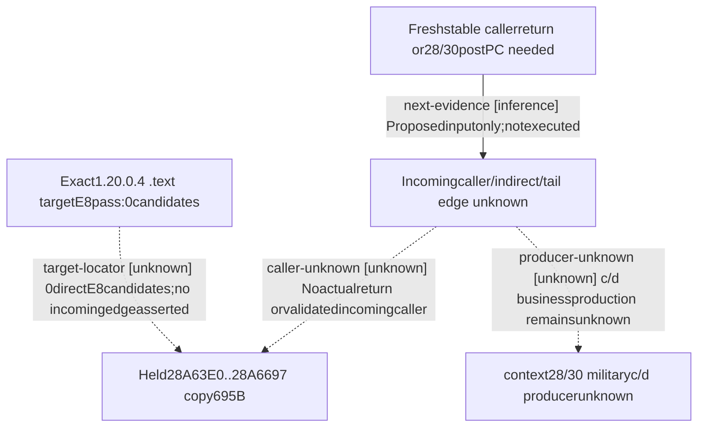

# R08：28A63E0 incoming direct CALL 的有限静态定位

2026-10-16T19:03:55Z，machine_id `desktop-3fevhd2-1c74096080`，CK3 1.20.0.4 / Steam build25734779。来源 EXE SHA256 `98702f88a547cde2eaf29a85f93b85f68ee4cf8148336a4f7afaeb75319dd518`；本次沿用原资格身份并核文件前后 stat，不重新 hash 整个 EXE。源码树记录基线 `6bf30840af44231653f8e914389b59c8798f2cc1`；运行事实只属于来源机器，不能外推其他机器。

一次 target-only locator 实读 `.text` 71,141,448B（约67.85MiB）、17次，寻找 `E8 rel32` 目标等于 RVA `28A63E0`，结果为 **0 个字节候选**。没有读取新 caller body 或新 PE metadata，没有扫描 E9、rdata、间接调用、其他 image。零命中后按原 stop 条件结束。这个结果只收窄此 image、此段、此编码形式，不能证明没有 incoming caller、producer 或费用。定位总量与原先可选的8192B caller-body预算分别记账，不能用后者掩盖约68MiB实际读取。

既有 R08 a01–a07 与本机小记录先做盘点：883份、5,919,600B、13处目标引用，没有已持 incoming direct CALL 或 actual caller-return。复用完整695B `[28A63E0,28A6697)`，raw SHA256 `ffebf7d960edb76b71d2456b7f8722cc09092952b41c565f648410b42a47dede`、147条指令；原先取得的 metadata220B/20reads 属于旧采集。旧完整 ASM、原 source receipt、PE 边界和身份均嵌入下方包。本次没有重新读取该695B。`28A6535 → 28D6170` 是这个 body 的 outgoing CALL，不能反推 incoming caller。

R188 两条同值写的已知对应仍是 `[context+18] → +2C0`（postPC28A645B）与 `[context+20] → +2C8`（postPC28A6466）。这是 copy 的物理写，不是付款、military c/d 分类或 cadence 证明；`+28/+30` 没有 qualified trap 的事实也不证明它们不存在。历史实际窗口保持原样，不追认完整覆盖。

下一项具体可施工输入是：新 fresh window 中，满足现有资格闸的 `known_copy_caller_v1` 稳定返回槽值；或 `+28/+30` 新 qualified writer postPC。现有 source 的可选 `--capture-known-copy-caller` 不等于旧运行 binary 已安装此能力，R188原 argv14没有选择该 flag；本包不执行采样、不归因未采原因。旧 body 的返回槽关系 `RBP+78 = RSP+178` 只供该 exact-image 来源解释，不能借合成返回地址补齐 actual。

原 `native_research_plan check --for-observation` 在任何新增 EXE body 读取前返回 rc2：offline-only 不定义 live window、真实 producer trigger 尚未定位。保留该真实失败。经 Root 对纯静态合同的明确说明，普通静态 check 与同 source render PASS；没有改成假 live window。下方生成图中 observation 表保留原计划意图，实际已读数量与0候选以 final static_result、locator和逐读账本为准。

可移机文件：[portable-source.json](evidence/episode04-r08-copy-incoming-12004/portable-source.json) 与 [verify_incoming_locator.py](evidence/episode04-r08-copy-incoming-12004/verify_incoming_locator.py)。解压/校验无需来源机器 C 盘、第三方依赖或游戏。在新 clone 的仓库根运行：

```text
python -B -O docs/ck3-native-ai/evidence/episode04-r08-copy-incoming-12004/verify_incoming_locator.py
```

验证器精确核所有内嵌原件、ZIP成员、17次连续账本、计划/check SHA、rc2和旧695B，并用已持 outgoing CALL 做正向 rel32 算术互通。可加 `--extract-originals <new-exclusive-directory>` 保全原始字节；其中本机 executor 仅为已执行来源，不应直接移机运行。完整 `.text` 没有入包，因此 **不独立复演零命中扫描**；逐块 SHA 是来源账本，非携带的完整源文本。所有嵌入路径只作历史出处，不是验证器读取依赖。paid、cadence、资源业务义和 military c/d producer 均保持 unknown / unclosed；本包不增加实机或整卡信用。

以下为共享工具从 PLAN.final 原样生成的执行图与结构检查：

# Research plan: r08-copy-incoming-28a63e0

GENERATED from the supplied research plan; no native semantics are inferred.

Question: Oneexact.texttarget-onlypass returned0directE8→28A63E0. What does thisexclude, and what precise nextinput can locatean incomingcaller or militaryc/dproducer?



| Edge | Declared status | Evidence IDs | Open question |
|---|---|---|---|
| target-locator | unknown | locator, ledger | Othercallforms/images areoutside scope;globalcallerabsence notproved |
| caller-unknown | unknown | inventory, held | Freshreturnslotmemorynotheld;do notguessvtable/caller |
| producer-unknown | unknown | held | No qualified28/30writerorcategoryinputsource |
| next-evidence | inference | held | Rootmustseparatelyadmitfreshwindow/installedfeature;noexistingPIDlease reused |

| Observation design | Value |
|---|---|
| mode | offline-only |
| actor_kind | engine |
| owner_scope | Exact-build static incoming caller only; no CK3 runtime owner/actions |
| identity_kind | none |
| identity_lifetime | RVA scoped only to exact admitted EXE SHA; no PID/address reuse |
| producer_trigger | not-applicable |
| producer | Source bytes read only; runtime c/d producer and trigger remainunknown |
| caller | Target28A63E0; incomingdirectcall locator not yet read |
| consumer | Held copy context18/20→2C0/2C8 and alreadyproved fourraw settlement consumer |
| cache_lifetime | Runtime source cache refresh/invalidations unknown; this is a static file lookup |
| expected_signal | One E8 rel32 target equals28A63E0; then one complete caller decodes thisE8 on an instruction boundary and exposes a nearer producer/input relation |
| zero_sample_meaning | No E8 target in this .text excludes only thisdirectrel32 form for thisexactimage; not indirectcalls/tailjumps/otherimages/no producer/no cost |
| stop_condition | Exactly one .text pass71141448B in17reads; no rdata or allxrefscan. If0E8 stop. Otherwise onlyone selectedcaller ordinary.pdata body&lt;=8192newcode,metadata&lt;=512B/48reads; stop before unexpandedcallee/handler. |
| runtime_window_ref | not-applicable: offline file only; Root authorization target-onlylocator message2026-10-17local |

| Evidence ID | Declared layer | File | SHA-256 | Supports |
|---|---|---|---|---|
| inventory | exact-build | INVENTORY.actual-a01.json | a04ff2ba9708521627ee69ac185ed19cdc22495c6d7d9b6908f21571ea77d53c | 883smallheldrecords,13targetmentions,0held incomingdirectcallline |
| locator | locator | LOCATOR.actual.json | c2ddc67b671d870d4dba035d274d6d8b511a1759b4dbee97ed85e37032cc43ba | OneE8target-onlypass reports0bytecandidates;71,141,448B/17reads |
| ledger | exact-build | LOCATOR-READS.actual.ndjson | dfff33c55193c1ef47bb937e34525e6be533706bc493acc5d26431606da6ad1d | Durableper-chunkreadcharges;no fullsectionembedded |
| held | source-contract | SOURCE-SUMMARY.actual.json | faf8f744a6326f0dfc5eb13920088b824be6cafbcbdc95bd6d1a6409820c33a3 | Exactheld695B bodyreused;no newbody needed;oldcopysemantics unchanged |

Check result (file integrity and declarations only):

```json
{
  "schema": "xar.native-research-plan-check.v1",
  "result": "plan-consistent",
  "proof_layer": "record-structure-and-file-integrity",
  "semantic_correctness_verified": false,
  "live_execution_performed": false,
  "observation_plan_issues": [
    "offline-only plan does not define a live observation window",
    "the real producer trigger must be located before live sampling"
  ],
  "declared_edges_by_status": {
    "counter-policy": 0,
    "inference": 1,
    "live-confirmed": 0,
    "static-confirmed": 0,
    "unknown": 3
  },
  "enumerated_native_edges": 4,
  "declared_cases_by_status": {
    "pending": 1,
    "observed": 0,
    "not-applicable": 1
  },
  "checked_evidence_files": 4,
  "limitations": [
    "Evidence layers and conclusions are author declarations; hashes bind bytes, not their truth.",
    "Counts cover this enumerated graph only, not all CK3 branches.",
    "A consistent observation plan is not authorization to run or manipulate CK3."
  ],
  "plan_sha256": "cf382bb0b3b1d35fa68b9c400e83c5921c4562362654dbcd56bdef124f900059"
}
```
