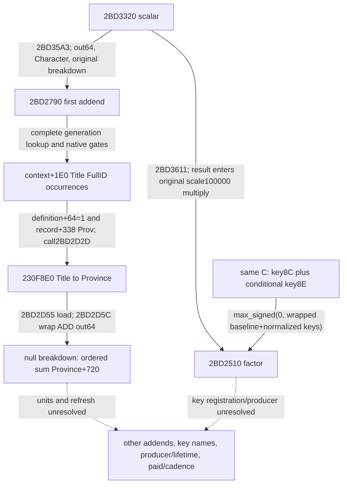

# R08：费率差额到 raw resource4 应用的静态链（1.20.0.4）

四份冻结研究补齐了父函数后段、资源网关、`2BD3320` scalar 与 `2BAFF30` 直接判定体。它们证明一条 **费率差额→context+4A0 加减** 的静态分支；`context+4A0` 的正式资源名、军事已付金额、付款账户与周期仍未闭合。`maintenance_attribution=unclosed`，`paid_military_amount_raw=null`、`cadence=null`；研究整卡、业务与动态验收分子均不增加。

来源机器与本次整合机器均为 `machine_id=desktop-3fevhd2-1c74096080`，整合时间 `2026-10-16T12:39:55.113910+00:00`，只读基线 `163530f1bbcabe5a97854625b3fab7568006ee65`。来源图像为 CK3 **1.20.0.4 / Steam build25734779 / EXE SHA256 `98702f88a547cde2eaf29a85f93b85f68ee4cf8148336a4f7afaeb75319dd518`**。原件各自保留实际观察时间与机器 ID。图像文件身份不等于实机业务资格；本次零 EXE 读取/哈希、零游戏/SDK/桌面/构建、零新运行观察。其他机器可使用这里的字节、合同与校验代码，不能沿用来源机器的安装、权限或实机状态。

## 便携原件与覆盖范围

[sources.json](evidence/episode04-r08-rate-application-12004/sources.json) 内直接保存四段 raw hex，另以无损 zlib/base64 保存六个原始 JSON 和一份原始 ZIP 的精确字节与 SHA。编码只为小包体积；不是重新签写来源。原 JSON 中 C 盘路径是历史出处，离线校验与提取不访问它们。原报告中“尚未展开2BD3320/2BAFF30”等当时缺口保留；本页只追加这两个直接函数如今已持有的范围。

| 冻结输入 | 直接来源 | 尚未闭合 |
| --- | --- | --- |
| caller `853c72e1…8e8f8c` | `28B9950` 完整540B（前516B代码+24B跳表），以及已持完整父函数中的191B后段 | raw resource4 名称、context+4A0业务单位、调度与同次军事付款 |
| keyAE `49643c84…35e1b` | 已持 `24E1E80`/`2C142B0` 的 key174/0xAE消费与 `28C3AC0` 读取合同；本包未新读 EXE | 正式 key 名、注册、具名 writer、刷新、实际当前 raw |
| scalar `3fcf5a83…e8697` | `[2BD3320,2BD36CA)` 完整938B/253指令/26分支/8调用，原 ZIP `699590db…b44614` 完整保留 | raw8B/8D业务名、三个子 scalar、factor 的业务语义与传递副作用 |
| gate `19b0e87a…1ad2c6e`，合同 `c2cc76a6…92c0` | `[2BAFF30,2BAFF66)` 完整54B/16指令，三个显式 AL0出口 | `28C2DF0`内部、副作用、资源/账户业务归属 |

父函数完整1118B的既有来源见 [R0174 SOURCE-SPANS](acceptance/2026-10-16-r0174-maintenance-source/SOURCE-SPANS.actual.json)（文件 SHA `7edca9f87e438aaefa9ffc468fe68b0911e37d9f4171f19b94645f69a2ff89c3`）。当前向量两路来源仍使用 [28C43A0](episode04-maintenance-callee-28c43a0-12004.md)、[2C142B0](episode04-maintenance-callee-2c142b0-12004.md) 与[后处理24E1E80](episode04-maintenance-postvector-24e1e80-12004.md)，不重复计算为新研究。

## 已证调用和物理目标

这里 `Character` 是父函数保存的原始 Character，`context=*(Character+1C0)`；`B`、`M`、`D` 只作本图 raw 变量名，不是收入或军费的命名。

1. 父后段先要求 context非空，调用 `28C2DF0(Character)`，检查返回对象 DWORD+38=`0x4744624F`、QWORD+40 bit41。`28F7C20` 调 `2BD3320(out64, Character, null breakdown)`；`28F7C30` 调 `2C13F60(out80, Character, null breakdown)`。
2. 从前者取 raw scalar `B`，从**完整 current 向量** `+48` 取 `M`（零基槽9，第十槽），算 `D=wrap_i64(B-M)`。不是单独第二向量，也不是已证 gold槽0/treasury槽6。
3. `D>0`：还要求 Character+1B0非空；`28F7C56` 再调 `2BAFF30`，AL真才在 `28F7C66` 对 `context+4A0` 执行 ADD D。
4. `D<=0 && M!=0`：`28F7C8F` 调 `28B9950(Character, resourceRaw4, wrap_i64(-D), componentRaw3)`。网关另查 Character+1B0、amount非零、selector<=5；跳表第4项到 `28B9B29`，`28B9B2C` 再调同一 gate，AL真才由 `28B9B3C` 对 `context+4A0` SUB amount。D为0可到调用，但网关零amount不写。

该地址既不是四 raw 的 `context+28/+30`，也不是网关其他 selector 的个人/领地钱包。未有业务来源时，不能把 raw4、component3 或4A0改名为已付军费/金币。父函数较早的 `28F7934→28A6D10` NET settlement 已在这段之前；后段结果不能充当同一 invocation 更早 ADD 的直接 producer。未知 helper 或跨轮刷新仍未据此排除。

下图由 sources.json 的 execution_nodes/edges 同源生成；虚线只代表缺口。


## Scalar 与判定体的窄合同

`2BD3320` 入口 RCX=out64、RDX=Character、R9=可空 breakdown，返回原 out64 指针。父调用 R9=null 属于无明细呈现路径；入口 R8 在本体使用前已覆盖，不能作为第四业务输入。

本体经 `28C3AC0` 查 rawkey8B（缺键raw0，保留原固定点大数归一化分支）；仅当 context+318 descriptor 的 DWORD+0C非零才加 rawkey8D（context空时使用静态fallback）。随后按机器顺序加 `2BD2790/2BD2DE0/2BD3080` 各out64首QWORD，再乘 `2BD2510` factor，使用原100000固定点快/慢分支写out64；无已证正数钳制。非空 breakdown 才走 `242C370/242C520` 等呈现路径。三个子scalar和factor未展开，不能用代数简化冒充其完整业务公式；本体无直接四项+28/+30、+4A0或wallet访问，也不能据此排除子调用的传递作用。

`2BAFF30` **正常返回时 AL1 当且仅当**：入场 Character+1C0非空；单次 `28C2DF0(Character)` 返回对象 DWORD+38等于magic；同一对象QWORD+40 bit41为1。三个已证失败分支都到 `2BAFF5F` 返回AL0。helper返回空没有显式检查，失败guardread不能当原生定义false；整个RAX也不是规范化0/1。直接本体无非栈store，helper副作用仍未知。父前置的相似检查与后续两次gate不能合并：中间存在 helper 调用/重新读取，不能推断后者恒真。

AE 的已证事实是 consumer 使用 key174，不是找到一个具名producer。`28C3AC0` 的 Character+1B0→extension+258→Model 路径（Model+8校验Character，context在Model+10）、keys/count/values 的读取合同可复用；BF已有名称不能移植给AE。尾处理槽0/6/7及第二向量消费AE，不证明它刷新过、更不证明c/d来自AE。

## 跨机器离线使用与下一条边

仓库根目录，用本机项目解释器执行（此命令无游戏依赖）：

```text
<project-python> -B -O docs/ck3-native-ai/evidence/episode04-r08-rate-application-12004/verify_r08_portable.py
```

可追加 `--extract-originals <不存在的新目录>` 精确还原六个原始JSON与原始ZIP；不会访问原记录中的绝对路径，也不隐式覆盖旧目录。校验范围是原件SHA/字节、指令覆盖、相对branch/call目标与结构，**不是自动证明业务语义或实机**；图中的语义来自作者逐指令合同。

下一条有信息的证据仍是 source-qualified c/d或其军事分量 writer→同一次应用→具体 payer store，并单独证明刷新/周期。仅新getter结果、4A0差额、钱包NET或同值copy都不补这条链。智能体应保持军事已付额unknown；视频可说“已定位费率差额的一个原生状态应用分支”，不能说“已证明每月军费扣款”。本包没有新现场百分比、已付金额或周期资格。

## 追加：首加数2BD2790与末因子2BD2510（2026-10-16）

本节追加两份之后冻结的静态叶，保留上文第一四包当时“尚未展开”的历史范围。[scalar-leaves-a02.json](evidence/episode04-r08-rate-application-12004/scalar-leaves-a02.json)保存完整raw hex、两份原ZIP（含全部ASM/分支/调用账本）、三个原JSON精确字节与SHA；旧sources.json完全不改。观察来源机器仍为 `machine_id=desktop-3fevhd2-1c74096080`，EXE仍为上文精确1.20.0.4/build25734779/SHA；源码冻结提交 `163530f1bbcabe5a97854625b3fab7568006ee65`。原件观察时间分别为 `2026-10-16T12:41:06.981542+00:00` 与 `2026-10-16T12:42:02.373895+00:00`，因子合同补注12:44:45 UTC。本次整合 `2026-10-16T13:26:55.413799+00:00`，未新增EXE/SDK/桌面/构建读取或运行，不改变旧R184的native/runtime来源。

| 新直接叶 | 完整来源 | 窄结论 |
| --- | --- | --- |
| `[2BD2790,2BD2DDE)` | 1614B、355指令、36branch、34call；raw SHA `7347c93d872248272042ca8b111687307a0c9a76755e065b77633a81380f11ad` | 第一加数在null-breakdown路径按原标题occurrences汇总符合门的Province+720 aggregate；不是人数 |
| `[2BD2510,2BD278A)` | 634B、177指令、19branch、3directcall；raw SHA `21e06176ad6c82c2d77a620c15a54e3bb72bfd6fb37da1d9c7c7eaa710b62173` | 同一次C读取的8C/条件8E组成非负末因子；不是AE |

`2BD35A3→2BD2790(out64,Character,breakdown)`：先将out64清零，取context+1E0的4B FullID descriptor（context空时用原生静态fallback）。保留原顺序和重复occurrence。registry5D1DAF8用低24位索引，但仍要求capacity、nonnull、record+10与完整generation ID相等；失败选择5D1DAE0 fallback后继续原生门，不能一律把非法ID贡献填0。descriptor signed count也没有被软件重新定义为“非正即空”，原生循环按start/end执行。

对每项，只接收definition=`record+48`的DWORD+64等于1，且`*(record+338)+85C`为`Prov`。既有同EXE [title-map合同](title-map-navigation-12004-migration.md)及[provider来源](construction-owner-mode3-provider-12004.md)支持Title/tier/Province类型；不是借地址相似猜出类别。null-breakdown时`2BD2D2D→230F8E0(record)`，`2BD2D55`读返回Province的QWORD+720，`2BD2D5C`按顺序wrap64加到out64。空descriptor只使这一个加数为0，不使全部scalar或军事付款为0。+720正式业务单位/producer lifetime仍unknown；1.19的C97 monthly_income命名不能移植到本精确1.20字段。

nonnull-breakdown则可能调`246A050(Province+620,out,row)`再汇总，不能断言其数值始终等于null路径的cache。函数还有展示初始化/清理与全局写，4个间接CALL目标保持null；不把全函数说成“只写out64”。fault尾`2BD2DD8→4232A70;INT3`未展开，不赋予零/false业务语义。

`2BD3611→2BD2510(out64,Character,breakdown)`：入口RCX/RDX/R8分别保存out/Character/optional，正常返回原out指针。唯一`2BD2538→28C3AC0(Character)`所得C供两key共用；keys为C+68 u16、count为C+74 signed32、values为C+D0 signed64。首key8C；仅context+318 descriptor的DWORD+0C **!=0**时再查8E，context空用静态5459D38。该门不是>0，不遍历descriptor，不把负count解释成empty；未读取不等于missing key。missing支raw0，普通/大数原normalization均保留。

用N表示原生normalization、I表示上述非零门，直接关系为 `F=max_signed(0,wrap64(100000+N(8C)+(I?N(8E):0)))`。累加保留64bit wrap，signed正值才经CMOVG写out；无正上界clamp。唯一直接非栈store在`2BD2778`写callerout64；optional两次242C370以及getter传递效果未在本叶展开。F非负不保证父scalar、wrapped乘积或4A0最终变化为正；不能用无限精度算式替代原机器路径。

下图与新bundle的execution_nodes/edges同源；第二/三加数2BD2DE0/2BD3080、key8B/8D/8C/8E正式业务名、Province+720单位/刷新及实际payer/cadence仍是独立缺口。



同一个stdlib命令现在联合核验旧四包与这两叶：父scalar真实CALL目标、完整ASM覆盖、两叶全部55个branch、34+3个call编码/可解析相对目标和原件SHA。4个间接call只保留未知目标，不伪造落点。`--extract-originals <新目录>`可无损还原全部12份原件，不读取其历史C盘路径。新组合验证仍仅源字节/结构，不是自动语义证明或现场资格；不重跑作者旧矩阵。

本体都没有直接结算c/d或4A0/wallet访问，但未知callee作用仍未据此排除。`paid_military_amount_raw=null`、`cadence=null`、`maintenance_attribution=unclosed`；军事已付额、R08整卡与动态分子均不增加。智能体可保留这些原始依赖；视频可以解释省级aggregate首加数和非负因子，不能改成“军队人数计费”或“每月实际已扣军费”。
