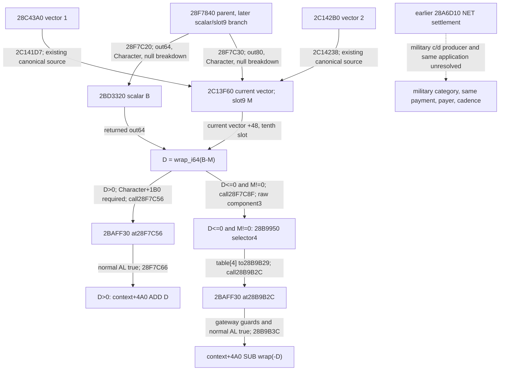
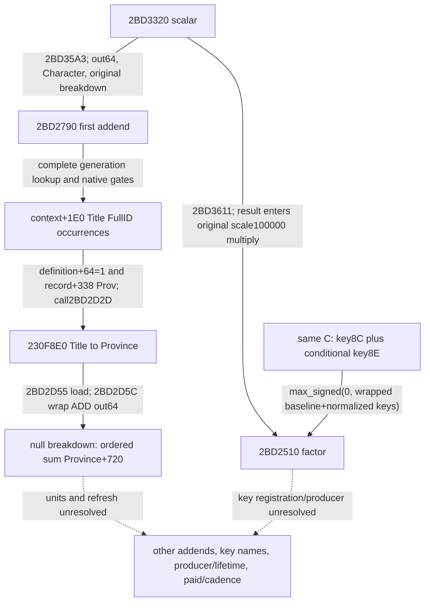
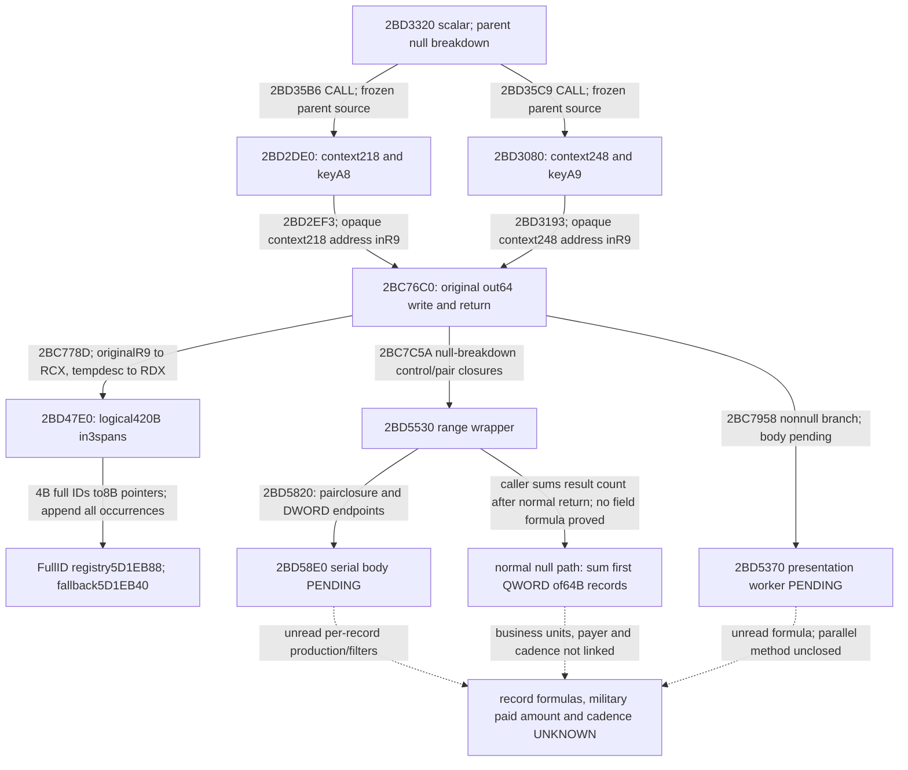

# R08：角色 scalar 与当前向量第十槽之差的 raw resource4 应用（1.20.0.4）

四份冻结研究补齐了父函数后段、资源网关、`2BD3320` scalar 与 `2BAFF30` 直接判定体。它们证明一条 **原始角色 scalar−当前十槽向量slot9→context+4A0 加减** 的静态分支；两项的业务同量纲及 scalar 正式名尚未建立。`context+4A0` 的正式资源名、军事已付金额、付款账户与周期仍未闭合。`maintenance_attribution=unclosed`，`paid_military_amount_raw=null`、`cadence=null`；研究整卡、业务与动态验收分子均不增加。

来源机器与本次整合机器均为 `machine_id=desktop-3fevhd2-1c74096080`，整合时间 `2026-10-16T12:39:55.113910+00:00`，只读基线 `163530f1bbcabe5a97854625b3fab7568006ee65`。来源图像为 CK3 **1.20.0.4 / Steam build25734779 / EXE SHA256 `98702f88a547cde2eaf29a85f93b85f68ee4cf8148336a4f7afaeb75319dd518`**。原件各自保留实际观察时间与机器 ID。图像文件身份不等于实机业务资格；本次零 EXE 读取/哈希、零游戏/SDK/桌面/构建、零新运行观察。其他机器可使用这里的字节、合同与校验代码，不能沿用来源机器的安装、权限或实机状态。

## 便携原件与覆盖范围

[sources.json](evidence/episode04-r08-rate-application-12004/sources.json) 内直接保存四段 raw hex，另以无损 zlib/base64 保存六个原始 JSON 和一份原始 ZIP 的精确字节与 SHA。编码只为小包体积；不是重新签写来源。原 JSON 中 C 盘路径是历史出处，离线校验与提取不访问它们。原报告中“尚未展开2BD3320/2BAFF30”等当时缺口保留；本页只追加这两个直接函数如今已持有的范围。

| 冻结输入 | 直接来源 | 尚未闭合 |
| --- | --- | --- |
| caller `853c72e1…8e8f8c` | `28B9950` 完整540B（前516B代码+24B跳表），以及已持完整父函数中的191B后段 | raw resource4 名称、context+4A0业务单位、调度与同次军事付款 |
| keyAE `49643c84…35e1b` | 已持 `24E1E80`/`2C142B0` 的 key174/0xAE消费与 `28C3AC0` 读取合同；本包未新读 EXE | 正式 key 名、注册、具名 writer、刷新、实际当前 raw |
| scalar `3fcf5a83…e8697` | `[2BD3320,2BD36CA)` 完整938B/253指令/26分支/8调用，原 ZIP `699590db…b44614` 完整保留 | raw8B/8D业务名、三个子 scalar、factor 的业务语义与传递副作用 |
| gate `19b0e87a…1ad2c6e`，合同 `c2cc76a6…92c0` | `[2BAFF30,2BAFF66)` 完整54B/16指令，三个显式 AL0出口 | `28C2DF0`内部、副作用、资源/账户业务归属 |

父函数完整1118B的既有来源见 [R0174 SOURCE-SPANS](acceptance/2026-10-16-r0174-maintenance-source/SOURCE-SPANS.actual.json)（文件 SHA `7edca9f87e438aaefa9ffc468fe68b0911e37d9f4171f19b94645f69a2ff89c3`）。当前向量两路来源仍使用 [28C43A0](episode04-maintenance-callee-28c43a0-12004.md)、[2C142B0](episode04-maintenance-callee-2c142b0-12004.md) 与[后处理24E1E80](episode04-maintenance-postvector-24e1e80-12004.md)，不重复计算为新研究。

## 已证调用和物理目标

这里 `Character` 是父函数保存的原始 Character，`context=*(Character+1C0)`；`B`、`M`、`D` 只作本图 raw 变量名，不是收入或军费的命名。

1. 父后段先要求 context非空，调用 `28C2DF0(Character)`，检查返回对象 DWORD+38=`0x4744624F`、QWORD+40 bit41。`28F7C20` 调 `2BD3320(out64, Character, null breakdown)`；`28F7C30` 调 `2C13F60(out80, Character, null breakdown)`。
2. 从前者取 raw scalar `B`，从**完整 current 向量** `+48` 取 `M`（零基槽9，第十槽），算 `D=wrap_i64(B-M)`。不是单独第二向量，也不是已证 gold槽0/treasury槽6。
3. `D>0`：还要求 Character+1B0非空；`28F7C56` 再调 `2BAFF30`，AL真才在 `28F7C66` 对 `context+4A0` 执行 ADD D。
4. `D<=0 && M!=0`：`28F7C8F` 调 `28B9950(Character, resourceRaw4, wrap_i64(-D), componentRaw3)`。网关另查 Character+1B0、amount非零、selector<=5；跳表第4项到 `28B9B29`，`28B9B2C` 再调同一 gate，AL真才由 `28B9B3C` 对 `context+4A0` SUB amount。D为0可到调用，但网关零amount不写。

该地址既不是四 raw 的 `context+28/+30`，也不是网关其他 selector 的个人/领地钱包。未有业务来源时，不能把 raw4、component3 或4A0改名为已付军费/金币。父函数较早的 `28F7934→28A6D10` NET settlement 已在这段之前；后段结果不能充当同一 invocation 更早 ADD 的直接 producer。未知 helper 或跨轮刷新仍未据此排除。

下图沿用 sources.json 的 execution_nodes/edges；展示标签按2026-10-16语义审查收窄，原封包不改。虚线只代表缺口。



## Scalar 与判定体的窄合同

`2BD3320` 入口 RCX=out64、RDX=Character、R9=可空 breakdown，返回原 out64 指针。父调用 R9=null 属于无明细呈现路径；入口 R8 在本体使用前已覆盖，不能作为第四业务输入。

本体经 `28C3AC0` 查 rawkey8B（缺键raw0，保留原固定点大数归一化分支）；仅当 context+318 descriptor 的 DWORD+0C非零才加 rawkey8D（context空时使用静态fallback）。随后按机器顺序加 `2BD2790/2BD2DE0/2BD3080` 各out64首QWORD，再乘 `2BD2510` factor，使用原100000固定点快/慢分支写out64；无已证正数钳制。非空 breakdown 才走 `242C370/242C520` 等呈现路径。三个子scalar和factor未展开，不能用代数简化冒充其完整业务公式；本体无直接四项+28/+30、+4A0或wallet访问，也不能据此排除子调用的传递作用。

2026-10-16现状补注：上句“未展开”保留第一四包时点。首加数与factor、第二/三加数至SubC关联角色递归的已持来源，见本页后续追加及[合同单项贡献专题](episode04-r08-contract-contributions-12004.md)。业务名/单位、record初值/分配、并行等价、军事c/d、payer和周期仍分别保留缺口。

`2BAFF30` **正常返回时 AL1 当且仅当**：入场 Character+1C0非空；单次 `28C2DF0(Character)` 返回对象 DWORD+38等于magic；同一对象QWORD+40 bit41为1。三个已证失败分支都到 `2BAFF5F` 返回AL0。helper返回空没有显式检查，失败guardread不能当原生定义false；整个RAX也不是规范化0/1。直接本体无非栈store，helper副作用仍未知。父前置的相似检查与后续两次gate不能合并：中间存在 helper 调用/重新读取，不能推断后者恒真。

AE 的已证事实是 consumer 使用 key174，不是找到一个具名producer。`28C3AC0` 的 Character+1B0→extension+258→Model 路径（Model+8校验Character，context在Model+10）、keys/count/values 的读取合同可复用；BF已有名称不能移植给AE。尾处理槽0/6/7及第二向量消费AE，不证明它刷新过、更不证明c/d来自AE。

## 跨机器离线使用与下一条边

仓库根目录，用本机项目解释器执行（此命令无游戏依赖）：

```text
<project-python> -B -O docs/ck3-native-ai/evidence/episode04-r08-rate-application-12004/verify_r08_portable.py
```

可追加 `--extract-originals <不存在的新目录>` 精确还原六个原始JSON与原始ZIP；不会访问原记录中的绝对路径，也不隐式覆盖旧目录。校验范围是原件SHA/字节、指令覆盖、相对branch/call目标与结构，**不是自动证明业务语义或实机**；图中的语义来自作者逐指令合同。

下一条有信息的证据仍是 source-qualified c/d或其军事分量 writer→同一次应用→具体 payer store，并单独证明刷新/周期。仅新getter结果、4A0差额、钱包NET或同值copy都不补这条链。智能体应保持军事已付额unknown；视频可说“已定位角色原始标量与当前向量第十槽之差的一条原生状态应用分支，尚缺军事实付归因”。本包没有新现场百分比、已付金额或周期资格。

## 追加：首加数2BD2790与末因子2BD2510（2026-10-16）

本节追加两份之后冻结的静态叶，保留上文第一四包当时“尚未展开”的历史范围。[scalar-leaves-a02.json](evidence/episode04-r08-rate-application-12004/scalar-leaves-a02.json)保存完整raw hex、两份原ZIP（含全部ASM/分支/调用账本）、三个原JSON精确字节与SHA；旧sources.json完全不改。观察来源机器仍为 `machine_id=desktop-3fevhd2-1c74096080`，EXE仍为上文精确1.20.0.4/build25734779/SHA；源码冻结提交 `163530f1bbcabe5a97854625b3fab7568006ee65`。原件观察时间分别为 `2026-10-16T12:41:06.981542+00:00` 与 `2026-10-16T12:42:02.373895+00:00`，因子合同补注12:44:45 UTC。本次整合 `2026-10-16T13:26:55.413799+00:00`，未新增EXE/SDK/桌面/构建读取或运行，不改变旧R184的native/runtime来源。

| 新直接叶 | 完整来源 | 窄结论 |
| --- | --- | --- |
| `[2BD2790,2BD2DDE)` | 1614B、355指令、36branch、34call；raw SHA `7347c93d872248272042ca8b111687307a0c9a76755e065b77633a81380f11ad` | 第一加数在null-breakdown路径按原标题occurrences汇总符合门的Province+720 aggregate；不是人数 |
| `[2BD2510,2BD278A)` | 634B、177指令、19branch、3directcall；raw SHA `21e06176ad6c82c2d77a620c15a54e3bb72bfd6fb37da1d9c7c7eaa710b62173` | 同一次C读取的8C/条件8E组成非负末因子；不是AE |

`2BD35A3→2BD2790(out64,Character,breakdown)`：先将out64清零，取context+1E0的4B FullID descriptor（context空时用原生静态fallback）。保留原顺序和重复occurrence。registry5D1DAF8用低24位索引，但仍要求capacity、nonnull、record+10与完整generation ID相等；失败选择5D1DAE0 fallback后继续原生门，不能一律把非法ID贡献填0。descriptor signed count也没有被软件重新定义为“非正即空”，原生循环按start/end执行。

对每项，只接收definition=`record+48`的DWORD+64等于1，且`*(record+338)+85C`为`Prov`。既有同EXE [title-map合同](title-map-navigation-12004-migration.md)及[provider来源](construction-owner-mode3-provider-12004.md)支持Title/tier/Province类型；不是借地址相似猜出类别。null-breakdown时`2BD2D2D→230F8E0(record)`，`2BD2D55`读返回Province的QWORD+720，`2BD2D5C`按顺序wrap64加到out64。空descriptor只使这一个加数为0，不使全部scalar或军事付款为0。+720正式业务单位/producer lifetime仍unknown；1.19的C97 monthly_income命名不能移植到本精确1.20字段。

nonnull-breakdown则可能调`246A050(Province+620,out,row)`再汇总，不能断言其数值始终等于null路径的cache。函数还有展示初始化/清理与全局写，4个间接CALL目标保持null；不把全函数说成“只写out64”。fault尾`2BD2DD8→4232A70;INT3`未展开，不赋予零/false业务语义。

`2BD3611→2BD2510(out64,Character,breakdown)`：入口RCX/RDX/R8分别保存out/Character/optional，正常返回原out指针。唯一`2BD2538→28C3AC0(Character)`所得C供两key共用；keys为C+68 u16、count为C+74 signed32、values为C+D0 signed64。首key8C；仅context+318 descriptor的DWORD+0C **!=0**时再查8E，context空用静态5459D38。该门不是>0，不遍历descriptor，不把负count解释成empty；未读取不等于missing key。missing支raw0，普通/大数原normalization均保留。

用N表示原生normalization、I表示上述非零门，直接关系为 `F=max_signed(0,wrap64(100000+N(8C)+(I?N(8E):0)))`。累加保留64bit wrap，signed正值才经CMOVG写out；无正上界clamp。唯一直接非栈store在`2BD2778`写callerout64；optional两次242C370以及getter传递效果未在本叶展开。F非负不保证父scalar、wrapped乘积或4A0最终变化为正；不能用无限精度算式替代原机器路径。

下图与新bundle的execution_nodes/edges同源；第二/三加数2BD2DE0/2BD3080、key8B/8D/8C/8E正式业务名、Province+720单位/刷新及实际payer/cadence仍是独立缺口。

2026-10-16现状补注：本图保留首加数/factor封包时点；第二/三加数的静态调用已在本页后续追加，单项贡献见[六叶专题](episode04-r08-contract-contributions-12004.md)。这些来源进展没有补齐key正式名、Province+720单位/刷新或军事付款链。



同一个stdlib命令现在联合核验旧四包与这两叶：父scalar真实CALL目标、完整ASM覆盖、两叶全部55个branch、34+3个call编码/可解析相对目标和原件SHA。4个间接call只保留未知目标，不伪造落点。`--extract-originals <新目录>`可无损还原全部12份原件，不读取其历史C盘路径。新组合验证仍仅源字节/结构，不是自动语义证明或现场资格；不重跑作者旧矩阵。

本体都没有直接结算c/d或4A0/wallet访问，但未知callee作用仍未据此排除。`paid_military_amount_raw=null`、`cadence=null`、`maintenance_attribution=unclosed`；军事已付额、R08整卡与动态分子均不增加。智能体可保留这些原始依赖；视频可以解释省级aggregate首加数和非负因子，不能改成“军队人数计费”或“每月实际已扣军费”。

## 追加：第二/第三加数与合同指针范围链（2026-10-16）

本节在 c743冻结主仓期间形成外置候选，只追加静态知识，未改旧封包。来源及整合机器 `machine_id=desktop-3fevhd2-1c74096080`，整合时间 `2026-10-16T14:18:45.730735+00:00`，基线 `c743520929d4f9a82c17c908b218075018598e2d`。来源图像始终为上文精确1.20.0.4/build25734779/EXE SHA `98702f88a547cde2eaf29a85f93b85f68ee4cf8148336a4f7afaeb75319dd518`；每叶原始时间和源码提交单独保留在[descriptor-chain-a03.json](evidence/episode04-r08-rate-application-12004/descriptor-chain-a03.json)。本次只读冻结包与仓库小源码，零EXE读取/哈希、游戏/SDK/桌面/构建；来源静态叶不改名为旧R184/R185运行已安装或已通过。

新bundle内有五叶完整raw hex，六个原ZIP（含转换首片旧ZIP）、五个SOURCE、两个SEMANTICS及转换原READ/CONTINUATION回执的精确字节。它通过字节SHA连接已有sources.json和scalar-leaves-a02.json，不复制旧大包；历史路径只作出处，离线验证不访问C盘或游戏文件。旧“callee未持”“worker未读”等原件仍按当时范围保留，本节只推进以下直接来源。

| 直接体 | 完整普通指令来源 | 新增窄事实 |
| --- | --- | --- |
| `2BD2DE0..2BD3079` | 665B /173ins /17jump /11call | 第二加数：context+218或静态54596D8经R9传shared，结果乘wrap64(100000+rawkeyA8)，无非负clamp |
| `2BD3080..2BD3319` | 665B /173ins /17jump /11call | 第三加数同构，但context+248与rawkeyA9不同；历史direct_calls字段含10个E8和1个FF，不能统称direct |
| `2BC76C0..2BC7D46` | 1670B /364ins /25jump /26call | shared使用原R9，入场RDX未消费；普通RET必经out64 store并返回原out指针 |
| `2BD5530..2BD583D` | 781B /189ins /20jump /18call | 范围/任务包装；没有闭合64B record字段公式；14个E8+4个间接call |
| `2BD47E0..2BD4984` | **逻辑420B /121ins /11jump /6call，三物理片155+240+25B** | 合同FullID→指针，保留fallback与重复，不做业务过滤 |

这些.pdata普通体含flags2的叶，其异常handler/unwind路径不在本轮；普通返回合同不推广到异常/fault。原始包SHA、每段raw SHA与全部ASM/控制流账本均已内嵌；不以“校验PASS”代替人工源语义或现场事实。

### 155B FULL标签的明确纠正

转换叶首READ回执确实写 `FULL_SOLE_UNCHAINED_FUNCTION_CAPTURED`，但只覆盖 `[2BD47E0,2BD487B)` 的155B物理.pdata行，**当时完整逻辑函数未取得**。该原回执及ZIP原样保留，不能把后来补齐追认成首片一开始完整。

随后只补真实fallthrough到`2BD487B..2BD496B`的240B，以及跳转/收尾`2BD496B..2BD4984`的25B；普通RET在`2BD4983`。最终logical raw SHA `dc27dd6c6fa67e9c8267ce0f9aba7acf965e5e85280384e696cdb66d3e487900`，累计252B metadata/26reads。新验证器逐片核SHA、拼接420B、完整121指令与全部控制边，同时核首155B仍是原ZIP同字节；保留原FULL历史与新逻辑纠正两个事实。

### 普通null-breakdown链，逐层分开输入与输出

父scalar两条真实调用是 `2BD35B6→2BD2DE0`、`2BD35C9→2BD3080`。二者把callerout64传shared，并在返回后读取该out64，再分别经28C3AC0的A8/A9 lookup与原scale100000固定点乘法回写。missing key raw0、signed wrap和大数分支原样保留，无非负clamp。caller不使用shared的RAX；此前由caller本身只能证明“传out、再读out”，如今shared直接来源才补上其写入/返回ABI。nonnull展示前的volatile RDX含义此前未证，shared新源证明入场RDX根本未消费，仍不能命名成Character/payer。

shared保存RCX原out64、R8可空breakdown、R9输入，`2BC778D→2BD47E0(RCX=原R9,RDX=&转换临时descriptor)`。转换输入是qword0指针与signed DWORD+C count的4B FullID occurrences，使用registry5D1EB88/fallback5D1EB40；低24位只索引，仍查容量、nonnull与对象+8完整generation ID。既有同EXE faction/subject binder来源将其识别为属臣合同registry；未借1.19名称给它添加收入或军费业务语义。

每个occurrence无条件选一个实际/fallback指针追加到8B数组，不drop非法ID、不去重、不额外筛active/类型/业务。输出descriptor是pointer0、capacity+8、count+C。合法已有容量足够时，空输入不追加也不清空旧输出；只有已知旧count=0才可推出仍0。负count没有被重新解释为空，reserve/growth保留原32位wrap。转换RAX未赋业务/returnout语义，shared忽略它；这与shared自身的返回原out ABI是不同层。

shared null分支初始化64B结果容器，准备control与pair closure，`2BC7C5A→2BD5530`正常返回后按结果count遍历64B records，只累加每条首QWORD，`2BC7C8C`写原out64。nonnull分支改走`2BC7958→2BD5370`并汇总8B结果，`2BC7B6E`写原out；普通RET经`2BC7CE3`返回原out。两种结果容器不可混同。只有最终result count确为0才有局部显式sum0/store0；原输入空、转换空、处理范围空和最终结果空尚不是同一个命题。

`2BD5530`只读control的DWORD+8/+C端点、+10 limit、+14 step、+18 mode。端点**相等**即普通返回，不初始化输出；mode==3或计算出的signed n**恰等于1**走serial，不能改成end<=begin或n<=1。n来自原32位wrap的 `(step-begin-1+end)/step` 商与limit的signed较小值，本体没有除零保护。serial真实`2BD5820→2BD58E0(原pairclosure,&DWORD{begin,end})`；其他路径经3F91AD0与任务对象/virtual calls，实际parallel工作方法与serial等价未证。

pair的两个descriptor指针在wrapper本体未被解引用。后续8B临时指针容器与LOCK XADD引用清理不是上游64B输出record遍历，不证明业务过滤、记录首QWORD公式或实际线程数量。**本包未读2BD58E0与2BD5370**；即使并行研究后来取得，也须以后续独立来源追加，不替旧记录填公式。



跨机器新组合命令（与原便携验证器分开，均为stdlib）：

```text
<project-python> -B -O docs/ck3-native-ai/evidence/episode04-r08-rate-application-12004/verify_r08_descriptor_chain.py
```

该命令核五逻辑体4201B、90个jump、72个call、全部ASM覆盖、15份精确原件、155→420历史纠正和8条实际CALL连接；间接目标保持未知。可用 `--extract-originals <不存在的新目录>` 还原全部原件。它不运行游戏、也不计算一个业务军费金额。`paid_military_amount_raw=null`、`cadence=null`、`maintenance_attribution=unclosed`；record字段、军事c/d writer→同次付款→payer/周期仍未闭合，百分比与动态分子不增加。

## 2026-10-16追加：贡献来源与语义审查现状

[合同单项raw贡献、过滤与64B槽](episode04-r08-contract-contributions-12004.md)已独立保存2BD5370/2BD59C0/2BD58E0、24C7BB0、24C18F0及2BD36D0的六叶来源。因此上节“body PENDING”“未读”和record公式待补保留五叶封包的历史时点，当前阅读应转到六叶专题：显式过滤、关联角色递归、bounded raw与原生fixed-point贡献、overwrite/ADD及选槽合同已持有；record初值/分配、并行等价、业务单位与军事实付仍未闭合。旧SOURCE、raw及archive未重写。

[独立语义审查摘要](episode04-r08-semantic-attribution-audit-12004.md)重新核对15条已封CALL及exact4 typed profile：registry5D1EB88/fallback5D1EB40为SubC合同存储，递归计算使用合同+20关联角色，不是自动沿用父函数的原始角色。该链静态返回外层scalar，再参与本页slot9差额；它未连接同次更早的NET军事分量。`paid_military_amount_raw=null`、`cadence=null`、`maintenance_attribution=unclosed`保持不变，无新现场信用。
