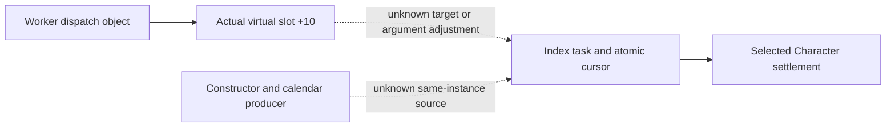

# R08 task selection and dispatch: source boundary

machine_id: desktop-3fevhd2-1c74096080. Source review: 2026-10-19; ba3528fc04621529ed528930623b5d34826a46a4. Historical analysis grants no target-machine runtime qualification.

The a03 correction is authoritative. At 290DC00, task+0 holds an atomic cursor and task+68 a Character-array descriptor. At 3F90A6F, the dispatch object is *(job+38), whose first qword supplies vtable slot+10. Keep these objects separate; task+0 is not a vptr.

The actual virtual target, argument-adjustment thunk and same-instance constructor/enqueue/calendar inputs remain unheld. A future expressly admitted observation must capture the real target and original arguments with session/thread/clock provenance. Stack proximity and matching dates cannot join the objects.

The a02 contract/findings in evidence history retain their original bytes; a03 supersedes their task-vptr proposal. No hook, SDK, query or new EXE read is implemented or authorized. Military paid, payer and cadence remain unknown; R08 credit is unchanged. Link the authoritative correction and historical evidence from this page during authorized intake.

[Authoritative correction](evidence/episode04-r08-task-dispatch-source-gap-12004/SOURCE-CORRECTION.final-a03.json); [historical a02 contract](evidence/episode04-r08-task-dispatch-source-gap-12004/history/TASK-SELECTION.contract.json).

