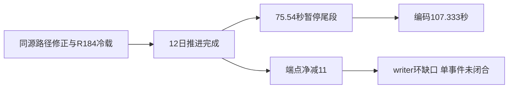

# E04 R190：时长达标、暂停尾段与物理损失证据缺口

R190 实际完成12/12日，1067 Feb21→Mar5（53148144→53148432）。原片编码107.333秒/3220帧，UTC wall110.907522秒；wall110、encoded100通过，encoded110未达。75.542529秒是日期不变的暂停尾段，不能授连续自然100秒、业务正例、clean或签收。研究6/14、业务4/11、动态0/11仍不变。

机器desktop-3fevhd2-1c74096080；源/native6bf30840af44231653f8e914389b59c8798f2cc1/a30；PID26976/create FILETIME134366550237740252/gen1/episode native-31254-3b59435db1a5/actor31254。本次明确从R184 Feb21正常checkpoint冷载，不是接着R189 Apr10继续。来源场次D:/workspace/ck3_native_war_ai_promo_work/e04-r190-window-capture-a01；实际2026-10-16 UTC，即北京时间10月17日。

a01 film config先因同一Windows路径的字符串拼写比较失败，尚无recorder或SDK调用。新a02只把checkpoint_source.save.path改为Path.resolve(strict=True)的canonical拼写，字节/SHA绑定不变，6916B/SHA827ba051559b85ac71c0ca142514522e5a134487555169abcd6a4be9e14e3b2a。两个config与旧/新identity及close包装代码均按exact小原件压入便携ZIP；核验器证明两config除该字段外完全一致。该修正不能替代其他机器自己的路径、版本、权限或文件SHA读回。

首Resume在recorder-ready后3.4636043秒。12份完成回执均每天+24、triggered、零overshoot。before-finish wall110.00066秒，其中75.542529秒暂停；76份只读快照逐一审计为paused、date53148432，额外Resume0。差值34.458131秒还含初始交接和每日暂停，不能改称连续动态片长。便携ZIP保留完整小audit及全部76来源pins，没有把76份大snapshot复制进仓库。

raw64931377B/SHA9b295c45067253da81d476c9ee8fece89722a3a16022f01f73e3dc5e76e74cd0；编码最后PTS107.300、end107.333，无音轨，全AV decode0且stderr空。捕获为gdigrab desktop客户区矩形[640,360,1920,1080]，输出1280×720，不是HWND直接捕获或整桌面录制。媒体worker只直接查看过四格scaled JPEG；本包没有Root后续审阅报告、原尺寸PNG审阅、完整1×或签核。原audit时点的review字段不修改。

端点证据必须分层：实体DATA共21slots，owner一次解析汇总1174/1185→1163/1185，净减11；cached Army/ArRg层则1184/1195→1173/1195，净差也11。ZIP内regiment_strengths合计1173是cached层。before21实体数组已保全；after21实体逐slot数组NOT_HELD，因此外机可重算前态、核对后态owner汇总与来源pin，不能声称已独立逐slot重算后态，也不能从cached1173补造physical1163每个slot。

全局writer latest0→3047、oldest2536、overwritten2535；Army18保留events0。strict physical positive为false，parent join为writer_fence_gap_or_reset，无可授R03的单事件物理writer正例。filtered packet没有全局所有事件日期，不能说3047发生在同一天；空向量也不能证明未发生损失。唯一Army18 callback seq8，passed raw64=300334994204326432，低32位53148192对应Feb23（不是Mar1），仅有补给300→300，没有兵数前后，不能用于净11的因果闭合。

旧endpoint小回执的army_history_evidence为空，是从错误层摘字段；真实rawref位于原SDK envelope顶层。能力代理已各读一次完整before/after并封tiny分析和ZIP，本包只复用这些小原件，禁止因旧空摘录再投请求或重读full。它们是complete Driver结果引用，不是原pipe字节。正常save3974B/SHA052335c16b9b750d45c71e122f7ad78a04ccc3c9c1d7f3e4da12c650fca95ef2、最终游戏exit0、screen release exit0/done/resources[]均独立保留；容量归还仍以原release字段为准。

外机入口为[来源索引](evidence/episode04-r0190-20261017/source-index.json)、[分层事实](evidence/episode04-r0190-20261017/facts.derived-a01.json)和[stdlib verifier](evidence/episode04-r0190-20261017/verify.py)。ZIP逐成员校验exact原字节；不需要游戏、SDK、桌面、原片或存档。仍缺完整单事件writer及parent fence、无独立后21slot切片、无完整人工审片，不能提高研究或业务完成率。
