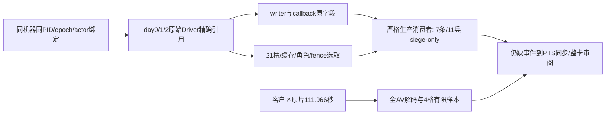

# R191：两日逐日实证与111.966秒客户区原片

机器 `desktop-3fevhd2-1c74096080`；实际观察为2026-10-16 UTC、机器当地2026-10-17（+0800）。run `desktop-3fevhd2-1c74096080--vanilla--R0191`，源码与native a31均为 `60de49f61d23b9c3437af4544c3f12bb28445429`。这份记录是待合入的便携候选；其他机器可复用知识、选取数据与代码，不能继承本机Steam离线、安装、权限、容量或实机资格。

本轮完成1067年2月21→22→23两个精确自然日（raw date 53148144→53148168→53148192），随后正常保存、退出和释放屏幕。关键新研究结果是：第二日取得7条严格、同callback、来源绑定的围城物理扣兵事件，合计11兵；R191单场未另行签出整张R03卡或合格动态镜头，连续1×审阅、整段clean与人工签核仍未完成。既有R0177的R03研究核心资格保持已闭；本轮是独立加强补证，不新增第7张研究卡，也不回退既有R03。当前研究6/14=42.9%、核心业务4/11=36.4%、合格动态0/11、正式ABC0/3保持不变。

| 项目 | 实际证据 | 使用边界 |
|---|---|---|
| 物理DATA | 21个唯一槽，1174/1185→1174/1185→1163/1185，key/max稳定 | 可复算day1/2完整选取DTO；day0只保留槽/角色/fence投影 |
| 缓存ArRg | 1184/1195→1184/1195→1173/1195 | 另有10个已证明角色1/1、无DATA条目，不能当作额外物理兵 |
| 严格writer | seq478/479/480/492/494/495/497，debit1/1/3/1/2/1/2，合11 | 不是只靠端点净差冒充因果 |
| callback | seq/token8，native date low32=53148192，stock300→300 | 不授零库存R05或精确视频PTS |
| 来源预算 | supply0、siege11、combined siege/raid11、raid0，complete且flags0 | 对这7事件闭合siege-only，不宣称全区间所有原因总额 |
| writer环 | 全局latest0/283/513；末态oldest2、overwrite1 | 丢的是旧seq1，本段baseline283以后保全；不能因overwrite非零机械拒绝，也不能外推全世界日期分布 |

严格消费者为 `army_physical_loss_evidence_12004.py`、`army_actual_supply_parent_join_summary.py`、`army_siege_parent_loss_evidence_12004.py` 等9份固定源码，精确SHA在选取证据中。智能体应使用实际来源和调用身份，核定请求量、唯一物理DATA前后值、同callback连接、来源预算与区间fence；cached净差、先后序号、回调结束库存不能单独替代这些输入。实际unknown=[]，但consumer仍明确不授完整区间总损失或完整视频卡。

原片为 `gdigrab desktop` 的CK3客户区矩形 `[640,360,1920,1080]`，输出1280×720/30fps。它不是独立HWND采集，也不包含整个桌面。原片3359帧，PTS0→111.933、末帧end111.966秒；wall115.694511秒，finish前115.0005729秒。encoded≥110与wall≥115分别成立。首次Resume交接3.7233502秒。82.9820883秒是完成两日后的暂停tail，83份读回均paused/date53148192，额外Resume0；不能把它算成110秒自然推进。全可用AV解码exit0/诊断空，无音轨。worker仅直接看过PTS0/2/4/111.933四格缩小样本，当时Root有限媒体review未收到；不能授整段无黑屏、遮挡、clean或人工签核。

原始film-result和媒体audit当时的business=false、准备包sealed=false保持原样。后续严格reader是新增、独立的事件实证，不修改历史回执。reader的96KiB写入守卫曾因单数字正则漏掉day-00/day-01导致派生落盘失败；实际claim核对后总读取次数是day0=1、day1=2、day2=1。曾拟议day0重读的授权未使用。day0已保存摘要被复用，完整normalized DTO未保留，不对null row调用归一化器；day1/2原选取字段可重新归一化和重放。旧attempt、claims、INTENT和纠正均随小包保全。

准备纠错也不能抹平：a31首轮source CRLF拒绝后才由Git-clean修正；scenephase仅将回执输出128→192KiB，未放宽原容量/期限守卫。identity a02超时的原结果未知，a03独立state_changed，a04重新observe+normal-save封身份。原生Select曾只打开围城面板，两次ArmyUI=false；Root按坐标映射点击军队计数后才独立ArmyUI=true。sampling a01/a02 cash state_changed、a03 `army_observer_research_sampling_frame_invalid`保留；a04复用两次实际enable各一次的a02 ACK与a03独立ON，未重放enable，也不把三次RED改成PASS。

闭场小原件证明checkpoint73689246B/SHA `bc3d40861e908ba8b05d5c86094a0ff7a399216ef0e4d0c1a72f166559b40ca2`，game process_exit0、SDK退出、keeper无错、recorder NORMAL_TREE_EMPTY；screen seq5923/done/resources[]。该release回执明确capacity reservation尚未归还，不能据屏幕释放追认容量归还；容量后续由Root按共享政策核对。暖机独立进程历史退出1不冒充最终游戏退出码。

同场结束后的typed preview AVAILABLE路线2635→2645→2644，before/after保持同date/paused/native9/pub10/actor/epoch。实际first edge是2635→2645，同county且native P=false，三stage调用0、额外调用0、Q未观测；没有移动、入县扣兵或R04正例。目标2644的native_resupply_eligible=false，不能当合格休整点或闭合R01。现有成功preview结束仅依据旧R189 generic错误继续扩展constructor ABI的必要；旧失败原因仍unknown。详见同目录 `results.exact-a01.zip` 的preview原件与摘要。

本轮存储实际删除1000个旧a28/a29 OBJ，C:单链接allocation释放372740096B（355.47MiB），logical370675161B，D:信用0；不改registry、不重复计旧释放额。OBJ原件已不可读，精确计划与逐项ID/状态清单已保全。daily按机器当地2026-10-17/+0800手工实际执行一次，157组、0删除，不能称自动GC或证明未来计划触发。当前必要raw/save不因本小包获得无限期保护，按[统一策略](../storage-retention-policy.md)复核。

后续R09两臂使用同一实际验证S0字节，分别独立冷启，forward合回原U、reverse合入新V，逐步比较F0/F1/F2、唯一DATA/缓存/特殊兵/stock/cap/commander与动态镜头。R0176正常postmerge checkpoint目前只是候选，旧hash和stat不能代替新鲜读回、冷载和split/merge合法性。失败则回到R13、R12已闭业务的动态结果镜头。本计划未分配新run，也未预填成功。完整来源是provenance ZIP内 `next-r09/NEXT-THREE-SCENES.md` 与[既有R09路线](episode04-r09-next-special-army-12004.md)。并发拓扑仅记录准备当时4条运行lane（Root独占现场，另三条离线准备/审计/证据），不是将所有历史worker计为活跃。

便携入口：[source-index](evidence/episode04-r0191-20261017/source-index.json)、[机器可读事实](evidence/episode04-r0191-20261017/facts.derived-a01.json)、[离线校验器](evidence/episode04-r0191-20261017/verify.py)、[视频结果](../../promo/ck3_native_war_ai/episode-04-march-logistics/r191-capture-result-2026-10-17.md)。原片、PNG、存档、完整Driver/SDK-ready不随包复制，外部精确path/size/SHA与当前metadata可用性在索引。原始wire_bytes_preserved=false边界保留。

入库后使用 `python -B -X utf8 docs/ck3-native-ai/evidence/episode04-r0191-20261017/verify.py --repo .` 可重放本机固定生产源码；其他源码版本不符时应拒绝。未入库候选支持 `--package R191-PORTABLE.relative.zip --repo <匹配源码仓库>`，不抽取大原件、不访问SDK/桌面；不带repo仍可检查小原件字节、投影算术和闭场/媒体/存储边界，但不声称重新执行生产消费者。

信用归属的逐项窄审原件见[附加审阅](evidence/episode04-r0191-20261017/R191-CREDIT-MAPPING.audit-a01.md)。a01候选曾未限定“完整R03卡”措辞，现明确仅指R191单场的新签出；旧文/旧facts已封入scope-correction-history.exact-a01.zip，不覆盖历史。
