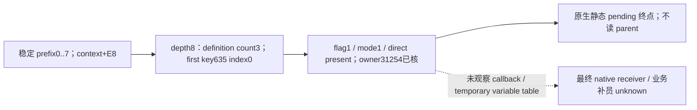

# R194：depth8 已出现静态直接来源，provider 集合为空不再代表来源未到达

2026-10-17T00:09:44Z，机器 `desktop-3fevhd2-1c74096080` 的 R0194 在 R09 拍摄完成、原 recorder `NORMAL_TREE_EMPTY` 后，Root 经 a39 执行了恰好三个顶层请求：fresh snapshot → `ck3_execute_step({step:"activate-ingame-military-v1",expected_revision:6})` → snapshot fence。opener 返回 `verified_visible`，实际后验与同帧 fence 均通过。没有独立 tree 查询、Move、Resume、provider 调用或补员执行。完整来源见[便携证据及独立回放](acceptance/2026-10-17-episode04-r194-r06-frontier/verify_portable.py)。

生产 source 为 `d7135ca3bf40c33c2d5416242ce844077f1e8cbe` / a32；PID30444、creation FILETIME134366683524856952、generation1、actor31254、episode `native-31254-1aff01c8cf5c`。前后均为 date53146632、`snapshot_id=native:5`、native revision5/public revision6。GUI family 另有 owner-thread/frame/GUI-owner stable 和独立双读资格；这些证明仅属于此帧，不向 R186/R189 或之后的新场外推。

## 新观察及原生停止点

全 census 的 source callback 经当前生产 `normalize_callback_binding_rows_12004` 严格消费，endpoint 足够，Driver body 读取次数为0。两个固定补员 expression 均得到以下新段：

| 项目 | 可见叶 | 隐藏叶 |
| --- | --- | --- |
| widget index / path | 220 / `0/0/0/2/3/0/0/0` | 238 / `0/0/0/3/5/0/0/0` |
| effective_visible / enabled | true / true | false / true |
| 原 full candidate | unavailable；parent depth exhausted8 / pass1 / read51 | 相同 |
| 原 prefix0–7 | available、stable double read；各实际边 context+E8 | 相同 |
| 新 continuation | available、stable double read | 相同 |
| depth8 definition / count / first match index | true / 3 / 0 | 相同 |
| 首个 key635 entry mode / flag | 1 / 1 | 相同 |
| direct value / owner FullID / identity verified | true / 31254 / true | 相同 |
| provider present / vtable RVA / slot2 RVA | false / null / null | 相同 |
| stop_reason / stop_depth | static_direct_terminal / 8 | 相同 |
| parent_edge / parent_present / next_context_present | not_read_native_static_stop / null / null | 相同 |

前缀0、4仍是 mode0/flag0/direct false/provider false；1–3的 definition count0；5–7无 definition。depth8的新事实解除的是“已到达但未读 frontier 是否含合格 parent entry”的 unknown：这里确实存在 flag非零、mode1、非空静态直接来源。原 full 的 cap8 unavailable 如实保留；新子叶独立 qualified，不把 full 改成 available。

已闭 `.4 3AC3EF0/3AC1C00` 按 first-key-match 和 parent flag4C 过滤：若 pending 到达该 mode1/flag1 项，resolver 复制 direct pointer 并返回 AL1，原生静态分支至此终止。因此9–11没有读取，parent presence 为 unknown/null；这不是 null_end、depth12截断或9–11已证明没有 definition。表 count3也不代表三个 receiver 候选，只发布了首个 key635 命中 index0。

## 可以据此做什么

实际 eligible provider slot2 RVA 集合为 `[]`，因为本帧来源是静态 direct，不能把空 provider 集合解读为“没有 receiver 来源”。两处都有 source-qualified **静态直接匹配**；可见且 enabled 的 index220 是后续只读资格研究的唯一优先控件，index238 保留为隐藏来源对照，不作为可执行 UI 目标。

`direct_owner_full_id` 来自该 direct 对象+218，经 Character registry 的完整 ID 与 `Char` magic 校验，值31254。它不是 Army18/93 的身份，也没有观察 direct 对象正式类型名或堆指针。`current_variable_table_observed`、`native_receiver_selected`、`provider_invoked` 均为 false；没有执行 callback、CanReplenish、refill toggle 或实际 ADD。不能凭本记录发布补员成功/失败。

下一项最小原生只读施工应复用**同一次合格静态 direct 分支**，在同一 owner/frame/双读/共享预算下继续读取已闭 `receiver+218 → 完整 Character → military+1C0/+4A9` 的资格输入，必要时独立发布 availability；不再加深父链、不寻找 null provider、不执行 provider。最终变量表若仍未观察，字段必须保留 source-candidate 身份，不能改名为 selected receiver。该后续读口尚未实现、尚未取得本场值。

## 文件与验证

[FRONTIER.actual.json](acceptance/2026-10-17-episode04-r194-r06-frontier/FRONTIER.actual.json) 是封存 a38 提取器对全部 census 的真实消费结果。[OPENER-ENDPOINT.actual.json](acceptance/2026-10-17-episode04-r194-r06-frontier/OPENER-ENDPOINT.actual.json) 292859B，SHA `dd3e8b84567b0af2d6b0171ebaf6893eae8e905973044e9d271939d009518f6d`，字节保持 Root handed-off endpoint；包含全部 callback census rows，省略无关呈现字段并保留原 response pin，不冒充原完整 GUI response。

独立 verifier 使用同一提交的两份生产 strict consumer 原字节，逐一核对全部 row、source pins、identity、before/fence、opener实际后验和提取结果；`python -O -B verify_portable.py` 仍执行所有检查。native 总读次数/总字节/耗时本接口未导出，保留 null；4096 reads / 64KiB / 20ms / max12是生产策略上限，不能称实际消耗。未重跑旧矩阵，无新 SDK、Driver、EXE、构建或主树写入。
