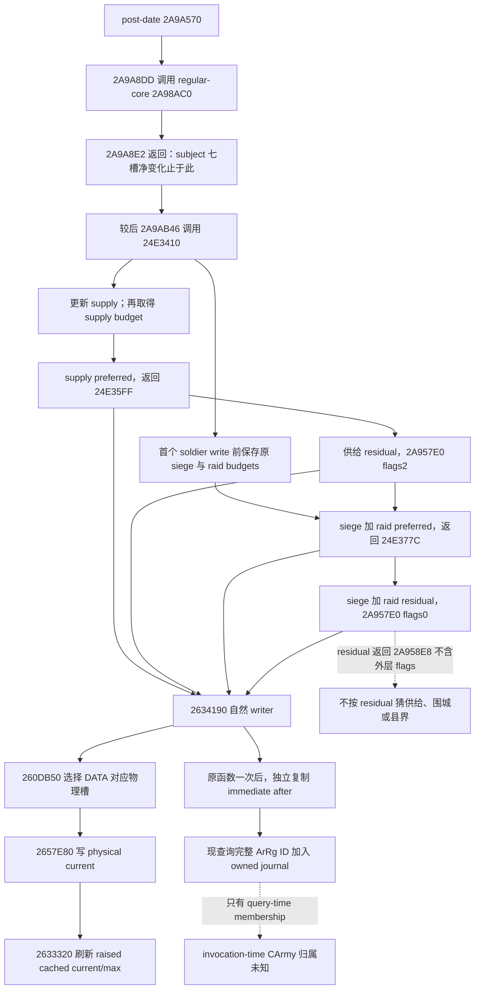

# 围城真实物理扣兵：1.20.0.4 的接受边界与实际拒收

> 2026-10-16 更新：R0177 已观察到同一自然 callback 的7笔 siege-only preferred 物理正扣兵，合计11人；范围、原件与整卡资格见文末。以下2026-10-15拒收保留原历史。

2026-10-15。源码阅读点为 `1463bd9b4b89612d283dd45ac4ec9efbf22f048d`；复用的游戏身份是
CK3 **1.20.0.4 / Steam25734779**，EXE SHA-256
`98702f88a547cde2eaf29a85f93b85f68ee4cf8148336a4f7afaeb75319dd518`。
本包不读取 EXE、存档或原片，不启动 SDK、CK3 或桌面。当前安装和后续现场资格由 Root 的实际运行回执证明。

可立即复用的结论是：**完整、同实例的自然 writer 事件可以证明一次实际物理扣兵；围城预算、Army 净减少和 regular-core 七槽净变化均不能代替它。**
没有发现现有 producer/consumer 对这条边界的具体错误，故未修改它们。新增独立小消费者只选择已有事实，给智能体和影片验收共同使用。

## 从围城分支到真实写回

原生树复用[当前 callback](army-current-callback-soldier-effects-12004.md)、[实际 writer](army-actual-loss-writer-observation-12004.md)及[自然 core](army-natural-regular-core-entry-observation-12004.md)的 exact-build 来源，不从旧版 RVA 推算。



| 代码位置 | 可核验的事实 |
| --- | --- |
| `native_bridge/src/ck3_12004_actual_loss_writer_journal.cpp:76–81` | 读 ArRg magic/full ID 和缓存 current/max；full ID 0 合法，只有 -1 是缺失。 |
| 同文件 `134–187` | 读 DATA header/count，最多64条；真实 selector 取得物理 pointer。同一 pointer 的多个 DATA alias 只建立一个 physical slot。 |
| 同文件 `190–233` | 正常返回后独立读；要求同 ArRg、DATA pointer/count与每条persistent ID/ordinal不变，物理persistent ID/own ordinal/ArRg backlink不变。complete 时才发 signed `sum(before.current-after.current)`。 |
| 同文件 `358–364` | `24E35FF=supply_preferred`；`24E377C=siege_or_raid_preferred`；`2A958E8=residual_allocator`。其余 caller 真实保留为 other。 |
| 同文件 `465–488` | 环512，全局oldest/latest/overwrite/failure；只按**当前**查询的完整 ArRg IDs 关联历史，不观察调用时 Army owner。 |
| 同文件 `496–538` | before→`original(regiment, request_raw)`一次→after→publish。journal 中发布完成的事件本身来自该路径，没有额外的 `original_called` JSON 字段。 |
| `native_bridge/include/xar_bridge/army_strength_v1_serializer.hpp:872–882` | 从现有 owned regiment roster 取得 full IDs，序列化 owned journal；不从 query 调 writer，也不重访游戏对象。 |
| `src/xar_autoplayer/bridge/army_actual_loss_writer_observations_contract.py:57–167` | 严格保留 signed值、legal zero、partial与alias；强制事件属于当前完整 ArRg roster，不用cache delta填physical debit。 |

上述是现有实现及已证明原生树的来源分析；它不证明某个本机自然事件已经发生。
source-contract 文件精确SHA见本包 `SOURCE-PINS.actual.json`；没有新 EXE 字节读取。

## regular-core 覆盖能证明什么

`army_regular_core_passive_12004.cpp:454–545` 的 subject capture 保留全部manager occurrence顺序、重复与fallback，
只对绑定的目标CArmy及其DATA依赖建立物理闭包。双向CArmy↔Unit/full generation/magic/owner见证在
`426–452`，目标ArRg及全部七槽闭包在`507–528`，结束身份复核在`532–542`。
局部complete并不把全局complete改成true，`544–545`仍明确标记scope外未采集。

消费者 [army_subject_physical_coverage_12004.py](../../ck3_autonomous_player/src/xar_autoplayer/bridge/army_subject_physical_coverage_12004.py)
只返回同一自然core entry/return的原始七槽净差，保留
`actual_ADD_observed=false`、`causal_attribution_ready=false`、`full_manager_ready=false`。
它要求独立entry/return、自然parent、同clock/thread/date及稳定完整依赖；不会用returned补entry。

还有直接的时序原因：core CALL/return是 `2A9A8DD/2A9A8E2`，周期损耗callback的CALL是稍后的 `2A9AB46`。
**core七槽窗口结束时，后面的该次围城callback还没执行。** 因此新scope补齐core并不会补齐较后围城writer缺失的事件。
core内还存在实际ADD后的条件pair clear；其净差也不是单条ADD金额，详见[来源与覆盖合同](army-regular-core-subject-capture-12004.md)。

## 数字和原因的四个独立条件

1. **预算是整数请求来源。** siege/raid先各以原整军current算budget，再合并。preferred按definition≤0；residual按自己的合格集合重新计数。
   有序分配使用当阶段的remaining budget/eligible current，signed32乘法、截断向零与余数均保留；不是逐团独立乘显示百分比。
   例如101人分为34/34/33、整军预算1时，顺序请求是0/0/1；对各团独立取整1%会错误得到0/0/0。
   这是条件算术例，不是新实机扣兵。实现入口是 `army_loss_allocation_projection.py:72–124`；actual4沿用核对过的同序内核，原lineage标签保留。
2. **请求不等于physical debit。** native skip、physical特殊state、DATA alias重读以及cache refresh都可能影响结果。
   complete writer的signed raw before-minus-after才是本次实际物理变化；0是该次观察到0，负值是该次增加。
   不要求request等于debit，也不要求cache下降或Army净下降才能承认已观察到的正debit。
3. **围城和饥饿分别判断。** stock高于当前loaded低库存阈值、当前supply budget0只能说明那次读数。
   24E3410先更新stock，再取supply budget；当前0不能代替执行时0。
   source-defined `current_callback_supply_risk_v1` 可供决策比较下一次当前上下文的一次callback风险，仍是conditional，不能升级为实际执行。
   不把历史默认10替代本帧runtime loaded阈值；[实际来源](army-current-callback-supply-risk-12004.md)保留精确分支。
4. **caller是阶段证据。** 正debit且caller为`24E377C`只直接证明combined siege/raid preferred。
   R03以真实围城association、raid=false、充足库存、无战斗/强攻/重组、稳定完整roster的窄窗口共同支持“本例围城周期损失”的来源＋上下文推断。
   这不是额外观察到siege-only原因字段。residual还可能被县界路径共用，不能单凭`2A958E8`、日期或当前位置分原因。

## 可执行的共同消费者

新增 [army_physical_loss_evidence_12004.py](../../ck3_autonomous_player/src/xar_autoplayer/bridge/army_physical_loss_evidence_12004.py)
复用生产strict normalizer。调用者先绑定同一实际进程/创建时间、connection generation、episode、exact build及journal lifetime，再传入真实row：

```python
fact = evaluate_army_physical_loss_evidence_12004(
    army_row, exact_source=actual4_identity_is_bound,
    after_sequence=baseline_writer_latest_sequence,
    date_raw_min_exclusive=baseline_actual_date,
    date_raw_max_inclusive=current_actual_date,
    previously_reported_sequences=already_reported_in_this_journal,
)
```

它机器检查full ArRg membership、retained sequence、可选实际日期窗、same-instance/complete、完整DATA alias到unique slots的覆盖，
并重算unique物理槽signed差。只有正差进入`positive_events`；zero/increase另列，partial/fence外事件保留排除原因。
`caller_stage_source_matched`只核已知return RVA和stage名一致。它从不输出围城-only、调用时Army所有权或完整区间损耗总额ready。
既有历史overwrite不抹掉仍保留的独立正事件，但更不能据保留事件之和制造完整损失流水。

智能体可把`positive_physical_debit_observed=true`用于“已发生这笔物理扣兵”的事实记忆；
拍摄只在新sequence、实际日期、同主体稳定窗及R03上下文同时具备时使用对应动态片段。
若没有日期fence，仍可证明一个保留事件，不能写成这一天新增。不同journal的sequence没有共同执行时钟，不能数值相同就配成同一callback。
本消费者没有接入或改变普通planner策略，也没有新增native hook/schema/MCP。

## 2026-10-15 实际小样本拒收与新增测试

执行机器：`machine_id=desktop-3fevhd2-1c74096080`；观察时间与解释器见小型机器回执。
读取的完整Driver原件是本机R0171 `army-query-29bc48a217464f3ca15c6fe35854f7d5.json`，766632B；
由先前Root sidecar记录的SHA为 `a7dc648b96187d45aed8fa7168834af1526bd7d0b862a0f8d68e71b3e7bdcbc8`。
本包只读该小原件，未复制、未重hash原件；原始pin来源是外置 `query3-retained-coverage-a01/COVERAGE.actual-a01.json`。
本机当前安装未由本包重验；这里仅离线重算该历史actual4会话。

| 完整原件真实值 | 新消费者实际结果 |
| --- | --- |
| U18/CArmy18，query3，public12/native11，raw53144376，generation1，episode `native-31254-2b025c67832d` | 身份保持原值；该历史actor是31254，不回填Robert29829。 |
| writer installed=true，oldest/latest=0/0，failure/overwrite=0，events=[] | `status=no_qualified_invocation`，`positive_physical_debit_observed=false`，缺`retained_matching_writer_invocation`。 |
| regular-core=null；supply callback全局1..2但U18匹配events=[] | 不恢复不存在的event内容，不按全局两条猜“一天一条”，不授R03正例或零损耗。 |

新增selector的9个聚焦测试实际通过，包含alias一次计数、cache净增仍有physical正减、零/负物理差、partial、时间/sequence fence、跨查询去重、clock缺失和保留事件独立于旧overwrite。
所有新测试输入均明确为synthetic，未重跑Native55 producer或旧资格test，不增加live信用。
现有`open_kaishek`不适用此处native identity/owned journal语义；确定性子集由上述Python消费者和合成用例验证，不替代真实CK3分支。

外置可审包：`C:/ck3-e04-resume-20261015-a01/high-parallel-siege-a01/`。
包含实际 `NEW-SELECTOR-TESTS.actual.json`、`QUERY3-ACTUAL-REJECTION.json`、`SOURCE-PINS.actual.json`、研究图与相对补丁。
研究plan为offline-only；普通check仅授record/file integrity，`--for-observation`明确拒绝live窗口，不能拿来启动采样。
仓库记录按通用策略180天复核，可重建helpers闭场48小时评估；外置包受Root已接受的共享512MiB池及
`2026-10-16T07:45:01.597Z`期限约束，不另外预留或延长期限。本包无大型输入保护、无个人/其他任务文件删除。

R03的可执行出口已明确：使用现有full-history查询和已安装writer拿实际正事件即可验physical primitive；
围城解释按同一稳定窗口明确标注来源＋上下文推断。旧.3净−31/−67、预算与离线GREEN均不抵扣新的.4现场和动态镜头。

## 2026-10-16 R0177：已发生的 siege-only preferred 正扣兵

本节是新实机结果；前文2026-10-15的原始缺口和拒收按历史保留。执行机器
`machine_id=desktop-3fevhd2-1c74096080`，Root采样时间为2026-10-15 21:00 UTC前后。
游戏为同一actual 1.20.0.4/Steam25734779及本页EXE SHA；runtime source为
`d9322bcfb3e17a3fe78607cea777bbfaf7be0a11`，native a07构建source为
`b00013c8eb6cca20bfb8c4680a92845d997a4b96`。Root的production qualification实际记录
二者native_bridge diff-empty、两个parent宏启用及生产链接，不把当前文档HEAD冒充采样源码。
本场是历史Robert1128、runtime31254的正常存档续行，PID7240/create134365679117288462、
generation1、episode `native-31254-00b796ef873c`，public/native Army均为完整ID18。

[便携小证据](evidence/episode04-r0177-20261016/r03-preferred-siege-positive.actual.json)
保留前后独立暂停帧、实际消费者结果、一笔完整native writer及其callback，以及全部原件路径/大小/SHA。
Root保留046/047完整Driver原件；本消费者各读一次并核Root给定SHA，没有复制约9.7MB原件。
046为query9/native114/public115/date53147448；047为query10/native117/public118/date53147472。
正常single-Army ordinary profile实际仍包含两个actual journals；`army_observed_phase_coverage=not_requested`
属于另一条省略的phase列表，不能据此否认已安装且available的callback/writer family，也不必每天导出全历史。

新日期前fences是callback186、writer6742。现有
`evaluate_periodic_loss_cause_evidence_12004`与`evaluate_siege_parent_loss_evidence_12004`
直接消费新完整原件，实际选择同一callback188/token188/thread24140/depth1下的七笔：

| writer sequence | 完整ArRg ID | unique物理槽实际减员 |
| --- | --- | --- |
| 6896 | 51 | 1 |
| 6897 | 52 | 1 |
| 6898 | 53 | 3 |
| 6910 | 66 | 1 |
| 6912 | 80 | 2 |
| 6913 | 81 | 1 |
| 6915 | 93 | 2 |

七笔均为自然writer return `24E377C`，parent callback entry `24E3410`、callback return
`2A9AB4B`；不可把callback caller和writer caller混为同一个栈层。实际原预算leaf完整、flags0，
原siege11、combined11、derived raid0、独立original supply0。每笔执行时stock均为30000000/100000；
同token、thread/depth、双FullID、passedDate与physical完整性均由已有strict consumer验过。
这是原预算与实际写回共同限定的`siege`单原因，不再仅靠当前siege/raid上下文推断。

便携第一笔6896的DATA数1、capture数1、alias index0/persistent17292/ordinal0映射unique slot0，
current200→199、max200→200、state0→0、same-instance=true、capturecomplete=true、flags0。
合计11是**这七笔已资格独立writer的物理减员之和**。当前Army1195→1184只作旁证；
消费者仍返回`complete_interval_loss_total_ready=false`、`per_cause_physical_debit_split_observed=false`。
writer全局环已有历史overwrite，不能把保留事件之和变成完整区间流水，也不授未观察的raid或residual正例。

### 本次准入逐项与严格计数

| 现有R03出口条件 | 本次实际值与资格 |
| --- | --- |
| 新自然writer、完整同实例unique physical正差 | **true**；七笔，合计11；完整第一笔随小证据保存。 |
| 新callback及invocation-time Army归属 | **true**；token188、相同thread/depth、双FullID18、实际passedDate均匹配。 |
| 实际围城association | **true，端点**；war4/goal2635/siege12、besieging Army18，省份2635、route空、状态sieging。 |
| 本笔raid贡献为0 | **true**；同一callback原预算leaf的derived raid0。未以当前位置代替原预算。 |
| 本笔库存充足、供给扣兵预算0 | **true**；writer-entry stock300，独立original supply0，callback stock300→300。 |
| 无战斗/强攻 | **true，独立暂停端点**；noncombat、非retreat；siege assault=false/casualties0。连续区间所有可能事件未另作全流水证明。 |
| 完整稳定roster | **端点可核；连续不变unknown**；实际完整21个ArRg IDs及省份siege occurrence保留。physical same-instance不等于整段无重组。 |
| 无补员等其他区间变化、完整整军因果总额 | **unknown/未授**；单笔扣兵无需靠区间净差排除它们，完整区间总额仍false。 |
| raid/residual真实正例 | **false，未取得**；本次不是这些分支的正例，不虚构不存在的额外必做卡条款。 |
| 连续clean、人工1×、合格动态素材包 | **false/未授**；Root已正常闭场，围城正例发生在coastal录制结束之后。 |

目前canonical没有找到独立R03整卡定义，不能自行把单笔正例等同全卡，也不另造“必须所有raid/residual分支实测”的条款。
本包明确给予**实际围城preferred单笔因果正例**，R03整卡保守保留partial，研究总计仍
R00/R02/R11/R12/R13 **5/14＝35.7%**，R03–R13业务实验 **3/11＝27.3%**；
本包整卡、clean、人工1×和新版合格动态包新增信用均为0。后续若明确整卡标准，可按上表重审，不能反向抹掉已观察的七笔正扣兵。

影片可据数据卡说：“这次正常围城的一次周期回调里，七笔实体写回合计扣了11人；该次围城预算11、劫掠预算0。”
不能称已拍到连续扣兵画面、整军完整损失流水或劫掠正例。智能体可把七笔sequence绑定本journal lifetime记为已发生的围城损失；
不能从getter预算、Army净差、旧sequence或缺parent事件授予同样原因。

### 日期与+188勘误

旧外置a11曾同时列出`+188`距30日；该数是观察值，**不构成“满30日才可成功供给”的准入条件**。
`+188`是成功供给更新时间，updater不检查它的间隔；宽限门读取的是`+190` gathering完成锚点，
有符号年龄截断向零后必须严格大于loaded grace，本例125>30。仍须满足Unit170、combat、gathering、Army5C等门；
本tick较早gathering完成也可能改写190。准确来源见[零库存clock专题13–32行](episode04-zero-stock-clock-and-capture-12004.md)。

也不能一般地把stored D加1：`nextRaw=signed32(uint32(raw)+24)`，
`nextD=trunc0(signed32(uint32(nextRaw)-43800000)/24)`，`phase=uint32(nextD)%30`。
本例源日期/D对实际为53147448/D389477/phase17→53147472/D389478/phase18，
真实bucket18中Army18恰一次。此前预测是附条件机会；本次新callback188才证明该机会确实执行。
Root单日sentinel回执记录exact1 tick、ending53147472；最后正常save
SHA `f3a23761175102ddfac1d778e32d7d258cf9075023f2713d7dac2cdcfa4636e0`、72944811B，随后normal exit0。
本包只读小save回执，不读或hash存档；CLOSED原件明确continuous clean/human signoff=false。

外置attempt `C:/ck3-e04-resume-20261015-a01/r03-actual-next-bucket-a12/` 不超过128KiB，
仅现有两个消费者摄取新实际输入与相对补丁check，无SDK/桌面/游戏/构建、无重复旧fixture、无主树写入。
小证据保留首个完整writer/callback及其余已资格fact，不冒充完整原始journal；完整原件继续由Root按统一存储政策保护。
