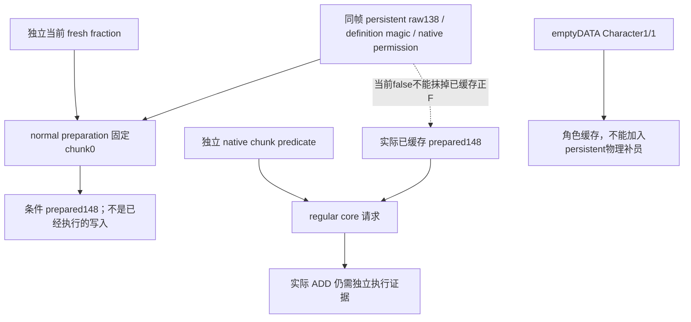

# 四期 R09：特殊兵补员资格、普通 preparation 与缓存时序

机器 `desktop-3fevhd2-1c74096080`，本轮源码取证始于2026-10-15 UTC18:42前后，具体时间见外置 `READ-*.actual.json`；实际观察时刻、机器与 SHA 同时保留。目标为 **1.20.0.4 / Steam25734779**，复用 Root 冻结 EXE SHA `98702f88a547cde2eaf29a85f93b85f68ee4cf8148336a4f7afaeb75319dd518`，未重新整文件 hash。主树 dcda 冻结。本包没有 SDK、游戏、桌面操作、构建或 EXE 执行；只读获准的1454B源码和248B元数据。

本题应按**实际 persistent Regiment 的补员分支**判断。特殊兵、活动/事件兵、MAA 定义、ArRg 的1/1 Character 记录不是同一个分类轴。当前 `.4` 已闭合 `persistent+138==1` 直接拒绝的原生规则。下述18:57来源包当时尚未取得创建 writer；2026-10-16的[spawn原生来源](bookmark1070-spawn-defaults-native-12004.md)现已闭合两条spawn创建路径硬传1并写persistent138，[constructor增量](bookmark1070-event-troop-policy-12004.md#2026-10-16uses_supply真正constructor默认写入已闭合)另闭供给默认值。raw138正式枚举名仍未知；创建时写1不证明此域永久不变。不能用旧1.19 spawn RVA 平移，也不能把“画面叫特殊兵”直接填成这个 raw 值。

## 已闭合的实际调用链

| 阶段 | actual4 来源 | 能证明什么 |
| --- | --- | --- |
| 当前 persistent permission | `262C6E0..262C9A5`709B，复用已持原件 | 原生 CanReplenish 的当前 bool；先 guard138、Army raw flags，再 definition/来源角色开关与资源，部分分支才读 chunk。 |
| 独立 chunk permission | `2657EF0..2658030`320B，新取原件 | 当前物理槽的上限/当前值、状态、关联 Province、ArRg/Army/Unit 与当前位置许可。它不是 persistent permission 的人工第二个 AND。 |
| normal preparation | `2A9A31C→262C680`，复用[实际 pre-date 合同](native71-army-pre-date-prepared-roster-12004.md) | 固定物理 chunk0：guard 非零或 definition magic=`4744624F` 才要求 `262C6E0(P,P+18)`；false 写 prepared148=0，否则取 fresh。guard0且非该 magic 绕过 permission。 |
| fresh fraction | `262C6C8→262CAB0`；本次以7个真实 CHAININFO 片段补足1134B至 `RET262CF1D` | 当前 whole-persistent fraction，独立于能否补员；函数没有调用 `262C6E0` 或 `2657EF0`。正 rate 不等于当前许可。 |
| regular core 请求 | `2A98B44`加载 observed prepared148，`2A98B53→262C9B0`；内部 `262CA14→2657EF0` | F≤0直接 false；F>0才对7物理槽检查独立 chunk predicate。请求计算不重新检查 persistent permission。true 仍可整数 q=0。 |
| 实际 physical ADD | `2A98B88`，既有[refill application](episode04-refill-application-12004.md) | 仍须单独的实际执行观察；本包没有捕获新 ADD、补兵数或自然月窗。 |

## 原生资格分支与兵类边界

| 实际输入 | 源码行为 | 分类可用范围 |
| --- | --- | --- |
| persistent dword138==1 | `262C6F2/6FF`直接false，早于 Army、定义、开关与资源；因此同输入 normal preparation 会写0 | 精确的当前 type-guard 拒绝。不能声明该值永不改变，也不把旧缓存正F反填0。 |
| guard!=1，返回有效Army且 byte1D4或1EC非零 | `262C719/726`false | raw Army 门；本包未给这些 byte 起“活动兵/舰队”等未经 producer 证明的名称。 |
| 越过前述门，`[P+118]+38 !=4744624F` | `262C743`直接true，不调用末尾 chunk predicate，也不读军事补员开关 | 常规 levy 路径的源码输入形状；仅凭定义 absent 仍不能为任意玩家兵团盖“普通 levy”章。 |
| definition magic=`4744624F` | 从 P130/P12C 或来源 Title128 解析真正来源 Character，要求其军事组件+1C0 byte4A9；再走政府/资源 raw 条件，最后 `262C989→2657EF0(original chunk)` | MAA 定义可同时存在于特殊/活动来源中，仍先受 raw138 门控制。不能把来源封臣的开关替换成当前玩家的开关。 |
| fresh getter 读到 raw138==2 | 按 definition 分支选 base，再乘实际加载的 signed32 常量后返回 | 这不是 CanReplenish=true 的证明；枚举正式名称不在本包命名。 |
| fresh getter 读到 raw138==3 | 使用 P120 所链对象的 Province tag及其独立数据/回退，或返回0 | 不能把该对象层级与 field army 当前省混为一谈；本包不根据数字给活动兵/驻军枚举命名。 |
| 其他 fresh 路径 | guard0＋非GDbo＋Prov 才增加该分支来源 modifier；另有 actual Army/Unit position 与来源角色 modifier，最后定点乘法 | 保留原生 fresh 值，不用固定3%/10%替代，不凭正 rate 判断人数会增加。 |
| empty ArRg DATA＋完整 Character predicate/role leaf | 没有可交给 persistent permission 的物理 DATA 项 | 1/1只留角色缓存；不是“特殊兵补1人”，也不是特殊兵 no-refill flag。 |

因此，普通 levy/MAA 可补员、特殊/活动兵不可补员都不能仅靠人数缺额、cap、MAA key 或角色记录概括。当前现场使用原生 bool；解释拒绝原因时联接 raw138/definition。凡正式创建类别尚无来源，继续保留 `player_origin_category=null`。这关闭了当前 eligibility 的消费缺口，未声称建立全游戏的特殊军队类别 registry。

独立320B chunk predicate还明确：maximum==0或current>=maximum先 false；persistent 解析采用完整 generation与原生 fallback；P120所链对象+788不为−1时 false。state3在这些早门之后直接返回 current>0；其他状态另检查+73C，再解析 ArRg。无有效 ArRg会走 true 分支；有效 ArRg才进一步解析 Army，排除1D4/1EC、combat、Unit170>0，并要求 `24ACAA0` 的实际位置谓词。`24ACAA0` 的[actual4 位置/owner→holder合同](army-next-route-replenishment-position-condition-12004.md)继续复用；moving state7本身没有 blanket false。未展开 callee 的业务名称不从 raw offset 猜。

## 已有 MCP 字段已足够，无须再造只读口

生产 `ReadArmyRegimentReplenishmentRecordsV1`按每条 actual DATA 的 persistent FullID＋physical index＋ArRg backlink解析，分别调用两 native bool，另读 fresh 与 observed prepared148。`ck3_12002_army.cpp:1161`已在同次 allDATA 之后读取 `fixed_chunk0_preparation_inputs_v1`，按完整 persistent ID发布 `containing_guard_138_raw`、`containing_definition_magic_38`、真正固定chunk0 permission和fresh；公共 `war_contract` 已严格 normalize。

新[纯消费者](../../ck3_autonomous_player/src/xar_autoplayer/bridge/army_persistent_refill_eligibility_12004.py)要求同 paused snapshot/revision/nativeRevision/date/episode/generation与exact4身份，消费完整 selected Army cohort。它使用原 strict DATA/fixed-chunk0 normalizer与 preparation projection：

- 逐 persistent FullID联接已发布 containing family；missing 保留 unknown，不从 selected 非0槽借一个 fixed0 permission。
- 保留两独立 bool，不合成伪 native final permission。guard1与原生true冲突拒收；guard1的条件 preparation0是源推导，不伪作补员写入已执行。
- observed prepared正值＋independent chunk true即使 current persistent permission=false，仍明确“不能据该false排除 stored-core request”；仍不宣称 q>0或真实 ADD。
- 按 persistent FullID＋physical index去重物理槽，另保留 DATA occurrence；不同别名值冲突拒收。1/1 empty Character 与 unknown empty ArRg单列。

没有 native/DTO/serializer/service 改动或构建候选。现有字段不全时，优先说明当前 leaf 缺口；不建立重复reader。

## Root 现有 R0176 baseline 的实际只读输入

[小投影](evidence/episode04-persistent-refill-eligibility-12004/actual-query-projection.json)只复制 Root 已取得的 selected93那一行、对应 frame与绑定字段；完整五军 raw 原件仍是 response-local `army-query-d6bd219c95234cbf983488bd5b89927c.json`，38751601B、SHA `e7546e83cb79fe33be30a4454a7c65e2f07b4adf1e34c7555ad002e2272e547a`。Root原 response是 `r09-land-baseline-a02-003-baseline-strengths.json`，新本包未提交 query。frame为 native44/revision45/date53146632、R0176；完整原 scope含 unavailable16777321，本包只授 selected93 eligibility字段消费，不授全 roster strengths。

实际 Army93→CArmy85有4个 unique physical DATA槽，containing raw138全部1，两 bool全部false，observed prepared148全部0；条件 normal preparation也全部0。[消费者结果](evidence/episode04-persistent-refill-eligibility-12004/actual-consumer-result.json)保留每槽 fullID和未授资格项。结论是该帧该4条来源受 guard1拒绝；它不证明原生没执行过任何 ADD、不证明所有特殊兵一概永久不补员，也不授 split/merge、动态镜头或未来补兵成绩。

## 跨机器重放与限制

[portable source index](evidence/episode04-persistent-refill-eligibility-12004/source-index.json)带 raw hex、完整指令序列与原件 SHA：permission709B、chunk320B、fraction1134B、request245B，并保存 actual cached148加载/调用片段。新metadata只做两target二分及真实CHAININFO，未扫描表或读取周边；逻辑getter包含7段133/65/7/53/435/286/155B。validator只核文件/指令边界/关键bytes与调用target，不自动证明人工语义或实机执行。

新7个 `-O`聚焦测试覆盖真实旧baseline字段消费、permission false与已缓存正F分离、非GDbo bypass不AND、missing family unknown、empty Character1/1、物理别名、stale/partial/duplicate/guard冲突拒收。修改输入的案例明确为synthetic，不是新的游戏事实。

外置根 `high-parallel-special-refill-a02`上限1MiB，计原共享512MiB/active32/metadata17池，原 `2026-10-16T07:45:01.597Z`截止不延长。Root实际 relay补缺的a02/a03、split角色59→34232后验属于另一已授权包，不混作本源包的新实机采集。此处记录18:57包当时的来源边界；创建writer与constructor的后来闭合见本页首段补注。正式枚举名和类别全生命周期不变性继续未知。

## 2026-10-16：分合军、换统帅与补员开关的决策边界

本增量复用已保留的 exact `.4` 源码，没有新读EXE、游戏查询、动作或构建。
阅读机器 `machine_id: desktop-3fevhd2-1c74096080`，观察时间见
[小来源与决策索引](evidence/episode04-refill-after-reorganization-12004/source-decision-index.json)，
代码基线 `b42afbbd85df3802b1fa6222f7aac403c2adf735`。原采集机器/时间保留在各引用source index。

对**仍解析为同一persistent FullID且当前raw138仍为1**的兵团，普通split/merge、换统帅和打开补员开关都不能作为解除这一门槛的办法。`262C6F2 →262C6FF →262C990`在解析所属Army、补员来源Character及军事开关之前直接返回false；在该输入下，normal preparation若实际执行就写prepared148=0。这里的结论是当前原生资格和条件准备结果，不是“此兵团永远不可能有任何物理ADD”。

| 操作/输入 | 已持有的实际来源 | agent可用结论 |
| --- | --- | --- |
| 普通拆半 | `296C927/936`、`296CAD2/AE5`、`296CC5F/C72`三组detach/attach | 搬移原完整ArRg ID。随后应重新联接真实DATA/persistent FullID，不能按新的ArmyID把它改判为可补员。 |
| 普通合军 | `2C55AA8→24E0D10`、`2C55AB2→24E0C50` | 同样迁移整条ArRg。detach在`24E0DCA`清ArRg140；attach在`24E0CF4`写新CArmy10。ArRg140是归属backlink，不能当成另一个对象persistent138的分类writer。 |
| 换统帅/分合军的统帅处理 | `24DFA6C→28CC150`在`24DFAAC`写CArmy120前运行；角色工厂`2A96D40→2632CB0` | 可能新增空DATA角色ArRg或清理旧关联，缓存1/1另列。它没有提供“重建原物理persistent并改成可补员类别”的来源证明。 |
| 真正补员来源Character的开关已开 | `262C7E2/7F2`是早期raw138门之后的分支 | 开关是后续条件，不能覆盖raw1381。不是所有兵团都读取玩家开关，guard0非GDbo分支还会绕过该开关。 |
| 补给/容量/合军权重变化 | supply字节persistent141与refill分类persistent138分开；merge stock/权重来源另见[专题](episode04-split-merge-stock-weight-order-12004.md) | 能用补给、进入合军权重或换帅后容量改变，均不能证明CanReplenish改变；不要拿这些量替代原生许可。 |

已持有的[完整split普通体与迁移叶](episode04-split-half-source-12004.md)、[merge/角色生产链](episode04-merge-commander-character-record-producer-12004.md)没有给出普通迁移分支上的persistent138重分类writer。它们也没有授予“所有下级永不改物理记录”的全局证明：`28CC460→2A97180`处置尾部、容器/资源callback未全部展开；已有refresh链`24E8100→2633320`会刷新缓存，也可能移除无效DATA。因此本知识采用**逐个实际FullID、当前分类值**，不为补齐“永久”结论扫描未知函数。

R06/R09使用同一个现有[eligibility消费者](../../ck3_autonomous_player/src/xar_autoplayer/bridge/army_persistent_refill_eligibility_12004.py)：先绑定同帧、完整DATA和真正fixedchunk0 family，再保留native persistent bool、独立chunk bool、observed prepared148及fresh。raw1381与native true冲突应拒收；缺少family是unknown。重组后重新读取，不能沿用动作前的分类。R0176 baseline只证明当帧Army93的四条物理DATA均为raw1381、两bool false、cached148=0；[实际split/merge](episode04-r09-selected93-micro-actual-12004.md)证明其物理DATA/身份守恒，没有顺带证明操作后raw138已再次读取。

还必须保留缓存时序例外：regular core `2A98B44/53`使用已存prepared148，request不再次调用persistent permission。当前persistent false但实际cached148>0、独立chunk true时，不能据当前false排除stored-core请求；q可能为0，实际ADD继续按[R06来源合同](episode04-refill-application-12004.md)单独验收。cached148=0只排除该读取时刻以该F进入的请求，不证明过去或未来整个窗口没有ADD。

不能外推的“永久”结论包括：全部事件兵/特殊兵都是raw1；raw1枚举正式名就是can_reinforce布尔；所有后代/替换记录继承原资格；同ArRg的DATA指针/成员终生不变；别的build或机器具有相同现场结果。新persistent FullID、generation、DATA引用或raw138变化都重新判定。若真的观察到分类转换，最小下一入口是该实际动作的writer/callsite及同对象前后态；当前没有一条已持普通分合军/换帅direct call指向raw138转换writer，不猜一个新RVA。

本增量仅追加既有知识路径，不改事件策略、动作或消费者。外置lane≤128KiB计Root active32MiB，原复核截止`2026-10-16T07:45:01.597Z`不延长；到期按通用存储策略复核。
