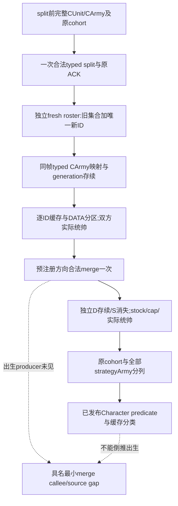

# 四期 R09：1/1、特殊记录、拆分合并与实际统帅

2026-10-15。供第四期视频和普通 agent 决策共同使用的只读合同。目标 build 为 CK3 **1.20.0.4 / Steam25734779**，复用 Root 已核 EXE SHA-256 `98702f88a547cde2eaf29a85f93b85f68ee4cf8148336a4f7afaeb75319dd518`；本包没有读取、散列或连接游戏 EXE，也没有新的 SDK、桌面、游戏日或实机动作。

本次离线复核机器 `machine_id=desktop-3fevhd2-1c74096080`，实际观察时间 `2026-10-15T14:46:30.339186+00:00` 起；机器 ID 来自 `tools/ck3_live_run_id.py machine`，命令与测试回执在 `C:/ck3-e04-resume-20261015-a01/high-parallel-special-a01/`。此 ID 只绑定本次离线操作，**不追认历史 R0175 来源机器**。旧 R0175 记录缺机器 ID，继续写 `machine_id: unknown`、所属机器未核实。

## 可说的结论

`regiment_strengths` 的 **1/1 是一条完整 ArmyRegiment（ArRg）的 current/maximum 缓存**，不是“一条 DATA 的物理兵数”。DATA 可以真实 count0/records[]，该 ArRg 仍实际为1/1。若同一完整 ID 的 `native_loss_writer_skipped=true` 被真实只读口发布，已闭合的 Character 分支可以解释其1/1缓存语义；仅凭1/1、MAA type absent、DATA为空或统帅换人，均不能替它填 true，也不能命名为骑士、事件兵或统帅。

合军后多出一条1/1，首先是实际 ArRg 身份/缓存总量的变化。它不自动成为 physical refill、不自动是新招募，更不能据此宣称某个 persistent Regiment 新增一名士兵。合军时谁创建/附加该 ArRg 是独立出生 producer 问题；自然 regular-core 的后续刷新也不能倒推此前出生调用。

补给容量、军队总人数、目的军加权权重及省级供给用量使用不同原生输入。合军可能自然选出另一位统帅，而当前容量 getter 使用实际统帅 modifier。**1/1本身不是容量修正**；“合军后容量300→100”和“额外1/1”可同时发生，不能互作已证独立原因。

## 来源和版本边界

| 问题 | 已有实际 .4 来源 | 本包可使用的范围 |
| --- | --- | --- |
| Character predicate | [army_support manifest](../../ck3_autonomous_player/native_bridge/research/ck3_1_20_0_4_army_support.json) 的 `writeradmission_2634880`：实际 `2634860`，完整86 B、whole logical topology相等 | 已有只读 `native_loss_writer_skipped` 的含义；不把旧 .3 RVA平移为新证据 |
| 原始采集 | [regular-core合同](army-natural-regular-core-entry-observation-12004.md)；[producer](../../ck3_autonomous_player/native_bridge/src/army_regular_core_passive_12004.cpp) 的 `CharacterPredicate`、`ArRg` | ArRg148完整 Character handle→实际 registry/fallback→Char tag和完整ID；true保留空遍历，null保持未知 |
| 当前容量 | 同 manifest `support_2C53C10`：实际 `2C53BF0`，1545 B完整本体 | 只读当前真实容量；闭合本体不扩成所有外部callee的新实机资格 |
| 合军D角色权重 | 同 manifest `support_24E0160/24E02A0`：实际 `24E0140/24E0280`，306/221 B完整本体 | 两个实际D权重分量；不能把S的D getter当S角色权重 |
| 当前统帅 | [实际 .4 metadata合同](commander-movement-metadata-migration-12004.md)和现有 typed `army_commander_candidates.current_commander` | 读真实 assigned Character；候选、movement context、preview不是赋任后验 |
| 原始物理补员与缓存刷新 | [regular-core实际源追加](army-natural-regular-core-entry-observation-12004.md#2026-10-15-physical-refill-source-and-bounded-export) | physical ADD `2A98B88`与后续pair clear独立；refresh `24E8100→2633320` 的 `26338A0/26338A3`缓存store不是physical refill |

完整 .3 [half split树](army-split-half-supply-inheritance-12003.md)与[merge树](army-meeting-merge-supply-inheritance-12003.md)是历史源知识。它们证明当时 split不必等兵数/团数、库存复制及将领选择，merge保留D/吸收S、选将、两阶段定点加权及容量clamp。当前持有的 .4 getter映射**不会自动给 .3 split/merge executor及出生callee授 .4 整链资格**。R09新正常Robert场仍要独立前后读回；本包没有虚构该场已发生。

## 三层数量和特殊标志

| 层 | 真实字段/身份 | 解释合同 |
| --- | --- | --- |
| ArRg缓存 | 完整 `army_regiment_id`、`current_soldiers/maximum_soldiers`、`scale=1` | 当前整军人数的实际缓存行；所有行汇总必须等于Army current/max |
| DATA关联 | 完整ArRg→native count、按record_index保存的 `(persistent_regiment_id,chunk_index)`及独立内容 | count0可为available；不得造persistent ID或零兵槽。首record旧口不能代替all records |
| physical persistent兵槽 | persistent完整generation/physical token、七个真实槽、current/max/state/q、别名和顺序 | 真正物理ADD/clear及其局部执行证据；整次callback净差不能替代单次ADD amount |

`native_loss_writer_skipped` 是原生Character分支的已知布尔，不是“所有特殊军队不损耗/不补员”的总标志。未知为null；原生false与字段未发布不同。`maa_type_status=absent` 也不补成该布尔。骑士与 linked Character 的独立原生stat链见[骑士receiver研究](knight-effectiveness-receiver-association-12004.md)；本合同没有把任意1/1连到具体人物。

跨split/merge逐ID保留这个布尔和type/DATA状态，报告原有行的谓词变化及新增/缺失行；不能删去extra行来制造守恒。即使某新增行已证Character predicate true，仍只标Character分支，出生来源与玩家类别分别保持unknown，直到具名生产链闭合。

## 为什么总人数、权重、用量和容量不能混用

1. `current_soldiers` 是全部实际ArRg缓存的总数；某个无DATA的1/1可在这里贡献1。
2. 当前省usage由原生Province roster、owner/relation admission和每个ArRg的 `native_supply_loss_eligible` 等实际输入决定。该资格布尔与Character writer-skip是不同字段。只在真实资格为true并有相应roster上下文时，这个缓存才参与相应usage；不能全军人数减去“看起来像特殊兵”的数量来代算。
3. merge的D角色权重是专用getter；S角色为来源军的实际current aggregate ×100000。旧B的D实际3344人、D权重3341×100000，S实际3345人、S角色权重3345×100000；S自己的D getter3343×100000不用于S角色。差值不能未经来源分类就命名为骑士数。
4. 当前capacity由实际assigned commander等当前输入决定。容量不是两军相加，也不是把D旧cap固定给新军。旧 .3 merge选将质量的稳定同分顺序等规则只作历史源知识，.4正式结果直接查询实际commander与capacity。
5. stock是absolute supply units，raw/100000，不是stock/cap百分比。旧 .3正权重公式有逐军share截断和逐军term截断，再以**合后实际cap**截断。算术吻合不证明全部出生/统帅机制，也不替代 .4新动作后验。

省级序列/资格与条件投影的现有实现是 [usage消费者](../../ck3_autonomous_player/src/xar_autoplayer/bridge/army_current_province_supply_usage_projection.py)。它保留每个原生occurrence、别名与资格，不以独立去重ArRg集合替代Province用量。当前观察、条件投影和实际阶段应用继续分开。

## split新 Army ID 的 fresh 确认

原生 `SubmitSplitArmyHalf` 只返回 `split_submitted`，不携带可信新publicID。当前 [driver split分支](../../ck3_autonomous_player/src/xar_autoplayer/bridge/native_driver.py)用immediate roster的新ID差集发布sibling；该快捷结果不是R09完整身份证据。它没有在该split分支逐项实施merge分支已有的same episode、新public/native revision、旧军完整存续等独立后验。本包不改冻结driver，也没有声称已复现错误实机；由下列只读helper供R09直接补足实际消费。

必须从同一正常生命周期拿到：

1. 动作前完整paused snapshot及同帧typed strengths，记录public CUnit→native CArmy完整generation。
2. split只提交一次，保存原始请求与ACK。ACK/unknown后态不能触发重复提交。
3. 独立读取新paused snapshot；保持actor、date、episode、process、connection。snapshot变、新public/native revision都严格推进；原有完整玩家ID全部保留，且只有一个新ID。
4. 对旧军和新增军确认实际owner/control/province；新ID是集合差得到的实际值，不用0、170、204、递增计数或旧run的ID。
5. 同新frame的typed strengths确认两个完整CArmy映射互异，原source CArmy generation仍相同。query没有返回映射时保持未确认，不把publicID写成nativeID。
6. 两军完整ArRg strength/DATA并集、交集、每ID current/max另行核对；随后对每军做独立typed current commander查询。身份已确认不能替代兵团/统帅已确认。

process creation time、实际loaded EXE/DLL、machine、pipe/session/GameState及正常save来源由Root该场runtime binding继续保存。helper中的snapshot/diagnostics检查不伪造缺少的process creation证明，不单独授整场实机资格。异步未完成时只等只读新帧，不为制造后态resume时间；仍无法确认就保存未完成，而不是猜child后移动它。

## R09合军与新B政策

split前→两军→merge前→merge后，每个边界分别保存自己的F/typed commander，不将不同query revision抹成同帧。合军方向预先固定为D/S实际ID，最终合法性由原生命令判断。合后独立确认D存续、S消失、其他玩家ID不变及实际位置/owner，接着读stock/cap/全队列/current commander。

从该新微实验的正常baseline独立反向试验，不能把已经合完的终态临时当反向baseline，也不能在正式ABC看完结果再选有利方向。将领自然变化与特殊记录若属于已解释的合法处理结果，作为策略结果报告；原cohort与全部strategyArmy分列。若决定统一重任命，所有臂同阶段走合法typed assign，记录实际时间/代价及后读；不“修复”旧B。

未闭合且会改变主要比较的新增记录仍使controlled ABC不准入。普通agent可继续自身合法OODA；不把视频实验的精确cohort合同新增为所有战争的永久等待门槛。



## 真实旧B拒收样例与代码

重放输入直接读取仓库内[原生小证据包](../../promo/ck3_native_war_ai/episode-04-march-logistics/evidence/r0175-B-merge-upper-cap/index.json)的 `sources/pre-observation.json`、`fresh-post-observation.json`、独立typed commander及原terminal，未复制大save/raw/media。历史版本 **1.20.0.3 / actor33388**、episode `native-33388-23726fbd8a80`、raw53149344、machine_id unknown；**不能升级成 .4 / Robert29829 / 新R09**。

| 原B真实读取 | 重放结果 |
| --- | --- |
| 原27个ArRg全行及37条DATA | 原strength行、DATA内容均未变；原cohort6689/6747→6689/6747 |
| extra完整ID16778273 | 1/1、MAA type absent；旧包未发布Character predicate，分类 `unclassified_1_1` |
| 全军 | 6689/6747→6690/6748；保留额外1/1，不删行 |
| D实际typed current commander | 27357→33388；S合前33388。只授实际身份改变，不赋出生因果 |
| 原结场 | `STOPPED_GATE_INCOMPLETE`、+38日、deadline_reached=false、尚余52日；非90日censored、无London抵达比较/赢家 |

新增 [只读module](../../ck3_autonomous_player/src/xar_autoplayer/bridge/army_split_merge_observation_12004.py)提供 `classify_regiment_observation`、`identify_split_sibling`、`compare_split_merge_cohorts`、`read_bound_current_commander`。输入是已normalize的原DTO，函数不改原件、不发动作、不造physical写入证明。比较函数要求完整strength/all-DATA，拒绝partial和重复FullID；分别返回extra/missing/原行变化/Character predicate变化、原cohort与全军数。`actual_physical_refill=null`表示本比较没有这种原因证据；已知无统帅返回null，而不可读统帅查询直接拒收，二者不混用。

[聚焦测试](../../ck3_autonomous_player/tests/unit/test_army_split_merge_observation_12004.py)在 `python -B -O` 下实际6个方法PASS：真实旧B拒收、1/1不升级类别、true/false/unknown区分、fresh split差集与CArmy map、partial/duplicate拒收、已知无统帅与不可读区分。合成身份反例明确为synthetic，不是新实机。所有输入/验收失败使用显式ValueError，不依赖可被 `-O`移除的assert。`open_kaishek`对本native DTO比较/ABI没有可覆盖脚本子集，not-applicable。

```text
python -B -O -m unittest discover -s ck3_autonomous_player/tests/unit -p test_army_split_merge_observation_12004.py -v
```

## 仍待施工的精确入口

- **出生producer**：既有 .3 merge树的 `296EEA0→2C54FD0→2C551A0` 是最小定位路线，先取得已持有 .4对应完整caller/callee证明再决定是否需有限新读取；不得按统一地址delta绑定。目标是新增ArRg的create/append与具体Character来源，毋需重开全军机械研究。
- **新正常 .4 R09**：Root现有typed口即可完成前后ID、原cohort/extra及actual commander事实；若Character predicate未发布/不可读，记录该局部缺口并由现有strengths/all-DATA能力补观测，不能由1/1回填。
- **actual refresh与physical应用**：当前getter/projection不能替代历史instruction证据。只在具名自然refresh调用/输入/返回/结果足够时授该次Character1/1刷新；它仍不授merge出生。physical ADD与后续clear分别需要原始执行观察，净差不能拆成原因。
- **特殊兵上限/跨合并规则**：无DATA Character record、事件特殊兵不补员flag、MAA定义、统帅和省级资格是不同域；本包没有完整特殊军队种类/可合并上限registry。下一查询针对实际缺失flag/来源，不以泛称“特殊兵”补齐全部机制。

本小型record按通用存储策略180天复核；外置helper为可重建derived，闭场48小时评估。共享容量只消费Root已接受512MiB池内本lane8MiB，上限和既有 `2026-10-16T07:45:01.597Z`复核不自动续；没有创建额外重型预留、清理或永久保留。
