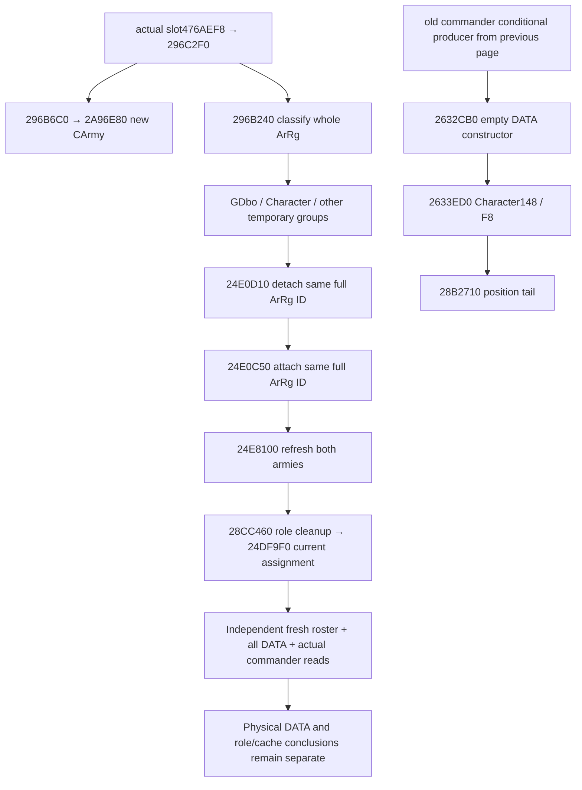

# Episode 04：actual .4 拆半、角色记录与物理 DATA 后置

2026-10-16 CST 更新（本次采集时间均保存为 2026-10-15 UTC）。本页补闭 [合军角色生产路径](episode04-merge-commander-character-record-producer-12004.md) 中的两个旧洞：`2633ED0` 尾部与 actual secondary-vtable split `296C2F0`。状态是 **实际 exact .4 静态源码闭合 + 纯 Python 离线校验**；没有游戏、SDK、桌面、构建或 EXE 执行，不授新增实机资格。

来源机器 `machine_id: desktop-3fevhd2-1c74096080`，由本轮 `tools/ck3_live_run_id.py machine` 重新读回。CK3 1.20.0.4 / Steam build 25734779，EXE SHA-256 `98702f88a547cde2eaf29a85f93b85f68ee4cf8148336a4f7afaeb75319dd518`。本轮复用 Root 冻结 EXE 的既有整哈希，每次有限读取前后验证 file ID/device/size/mtime/ctime；没有再整哈希、扫描表或邻域。代码依赖 `dcda9fde1afa1effb75d46fe99bba4bcd9aeabcb`。

## 本轮闭合的源码

| 函数 | 完整普通路径 / 原件范围 | 本轮结论 |
|---|---|---|
| `2633ED0` | `[2633ED0,2633FC3)`，243B；复用前128B，新增115B | 仅 `ArRg148=Character18`、可选 `Character1B8.F8=ArRg10` 两个写点；尾部解析 ArRg→CArmy140→CUnit124→位置20，再 `JMP28B2710(Character,location,0,0)`。全部条件分支已在范围内闭合，本体无 DATA 写。 |
| `296C2F0` | `[296C2F0,296CDF3)`，2819B，actual secondary slot `476AEF8` 已在上轮实读绑定 | 完整普通执行体到 ret；先建新 CArmy，再分类、排序、搬整条 ArRg，分别刷新两军，最后独立处理角色/统帅。EH/resource callback 不在本轮展开。 |
| `296B240` | 三个 CHAININFO 分片 `54+1077+12=1143B`，到 `296B6B7` | 输出临时分类/计数向量，没有拆持久 chunk。优先有效 `ArRg18` 的 GDbo 类型；否则检查 `ArRg148` 的有效 Character；最后进入其余组。 |
| `296B6C0` | `[296B6C0,296B990)`，720B | 调 `2A96E80` 得新 CArmy；复制来源 `180/188/190` 等状态，包含 stock180 的实际复制。没有按兵数把 stock180 除二。是否限幅须看独立 supply/capacity 来源。 |
| `2A96E80` | 六个元数据分片，合计756B，到 `2A97174` | 分配新的 CArmy 完整 generation ID；实际 `2A970DD` 写 CArmy124=CUnit10、`2A97117` 写 CUnit178=CArmy10。该段受 CArmy124 sentinel 条件控制，不替代现场双向身份验证。 |
| `24E0D10` | `[24E0D10,24E0E89)`，377B | 按完整 ArRg ID 查来源向量；存在时移动后续 ID 并 `DEC CArmy44`，有效 ArRg 则写140=-1。另有当前战斗集合清理调用，不能省略现场战斗状态边界。 |
| `28CC460` | 七个元数据分片，合计363B，到 `28CC5CB` | 角色扩展108/FC 分支可能清集合成员及108/FC；另一分支以扩展F8 ID尾跳 `2A97180`。该下级处置方法未展开，不把此调用冒充“无物理效果”。 |
| `2632CB0` | `[2632CB0,2632D81)`，209B | 完整 ArRg 构造器：DATA20=0，QWORD28=0 同时清 capacity28/count2C；QWORD38=0 清缓存 current38/max3C；140/148 置无关联 sentinel。构造空记录本身没有创造物理 chunk。 |

`296C2F0` 的前三组迁移各有实际 `24E0D10(source,id) → 24E0C50(destination,id)` 调用。已持有的完整 attach `24E0C50` 在 `24E0CF4` 写 `ArRg140=CArmy10`。迁移携带的是原完整 ArRg ID；本体没有把一个持久 chunk 平分成两个。分类 helper 的临时向量分配/计数写入不能当游戏物理兵数写。

角色分类使用 `Character+EC` 作为该组排序/平衡权重；普通与 GDbo 组使用 `ArRg+38`。这与角色缓存 1/1 是不同输入。这里保留原始字段名，不仅凭角色关联把 `EC` 命名为某项玩家属性，也不称其必为 combat Knights。

末尾 `2C119F0` 返回的有效角色可经 `28CC460` 清理后，由 `24DF9F0(newCArmy,CharacterID)` 设置统帅。选择 helper 未展开，因此不预言原统帅必到哪一军。现任统帅仍必须独立原生查询；候选、角色 F4/F8、移动预览上下文不能代替实际任命。



## 视频 claim 与智能体结论

| 可用结论 | 需要的证据 | 不能顺带声称 |
|---|---|---|
| 源码中的拆半会迁移整条 ArRg，分类权重不同 | 本页完整普通体及 actual calls | 每军 UI 数字严格各半、每个持久 chunk 被平分 |
| 角色 ArRg 构造时 DATA 是空的 | 完整209B构造器 + 已持有的条件角色创建调用链 | 所有带 Character predicate 的现存记录都必无 DATA |
| 本次现场拆分前后物理 DATA 守恒 | 独立 fresh frames、两军完整 DATA、完整身份和 chunk backlink | 抓到了出生或物理写指令、以后拆分一定守恒 |
| 新增空 DATA 角色 1/1 与物理兵数分开 | 新叶可用、Character identity/predicate/Army backlink一致、count0/records[] | 已证明它是现任统帅或 Knight、已经物理补兵 |

源码仍保留明确的下级边界：`2A97180` 处置、`24DE6D0` CArmy constructor、`2AD6790` CUnit factory、通用容器/allocator callbacks、`2C119F0` 角色选择，以及 `28B2710` 的地域 helper。新增源码已闭到本任务所需的实际字段与调用；这些边界不妨碍严格验证现场结果，也不能被静态模型补成实际发生。

## 可直接消费的现场断言

新增 `army_split_transfer_assertions_12004.assert_fresh_split_transfer_12004`，依赖现有 `identify_split_sibling`、全 DATA normalizer、`compare_split_merge_cohorts` 和 `read_bound_current_commander`，没有新增公共动作。

输入是 before/after 各自实际 frame、各自 strengths packet、拆分前原军的 actual commander packet、拆分后每个子军各自的 actual commander packet。它要求同日暂停、episode/player/process/connection 连续、两级 revision 递增、独立 snapshot；新 public CUnit ID 只从完整 roster 的唯一集合差分得到，并验证来源 CArmy generation 存活和两个子军 CArmy 分离。没有接受猜测的新 Army ID 或 ACK。

验证再分成三件事：

1. 原始有 DATA 的 ArRg 按完整 ID 保留 DATA chunk 身份、顺序、值和 backlink。持久 `(Regi full ID,chunk ordinal)` 别名只计一次物理合计，同时单独检查每条 ArRg 的 DATA occurrence，不能靠重复行冲高或冲抵兵数。
2. 加/减的 ArRg 只有在完整 count0/records[]、native Character predicate、可用的角色叶及缓存1/1全部对应时，才列为空 DATA 角色变化。未知谓词、缺叶、非空 DATA 不获豁免。
3. 原军与新军的现任统帅分别取 actual readback；absent 与 unavailable 不混同。Knights 留为未知，需要现有完整 combat Knights DTO 才能另作成员判断。

完整但物理数量/身份改变时返回 `accepted:false` 与具体原因；schema、身份、freshness 或查询失败抛 `ValueError`。它不建议重提结果未知的命令。成功也只给 `FRESH_SPLIT_DATA_CONSERVED_WITH_SEPARATE_ROLES`，`birth_producer_observed:false`、`physical_soldier_write_observed:false`、`actual_physical_refill:null`。

该函数是一次同日拆分后的微实验断言，不改变普通自动游玩对整日推进、补给损耗、补员或战斗的既有处理。普通时间已经推进、战争/战斗状态改变时，需要对应事件证据链，不应用本断言“修复”为同日守恒。

## 跨机器离线复放

相对索引 [source-index.json](evidence/episode04-split-source-12004/source-index.json) 携带13个完整普通体的8509B原始字节（文本 hex）、逐条指令、实际元数据分片及原始采集 machine/time。包含本轮8个函数，也包含上一轮5个相关 source caller/callee 原件。没有 EXE、存档、绝对输入路径依赖或第三方反汇编器运行依赖。

```text
python -B -O tools/validate_episode04_split_source_12004.py --machine-id <当前执行机器ID> --output <新外置回执.json>
```

校验器逐 byte 核对 raw SHA、instruction SHA、完整连续覆盖、相对 CALL/JMP 目标、条件分支目标边界与23个关键指令合同。外部无条件 JMP 是该分支真实 tail，不要求它恰好排在整个方法最后。索引的 source machine 只证明来源机器采集时的输入；在另一机器成功复放不会授予其游戏版本、安装、SDK、部署或业务资格。

本轮纯 Python `-O`：现场断言5个测试方法通过；源包回放2个方法通过，包含错 build、改原始字节、改指令、路径越界拒收。没有编译或运行任何 EXE。新断言仍待真实现场包调用，不能把合成测试计作 R09 实机完成。

采集/测试/存储回执：外置 `C:/ck3-e04-resume-20261015-a01/high-parallel-special-a04/` 的 `START.actual.json`、`READ-*.actual.json`、`SOURCE-REPLAY.actual.json` 和最终交付清单。新 lane ≤8MiB，继续计入 Root 原共享512MiB，原截止 `2026-10-16T07:45:01.597Z` 不延长。完整 EXE 未再次哈希；所有新 source 读取都沿实际 call/branch/fallthrough 或既持有的 exact .4 元数据，不从 `.3` 平移。
