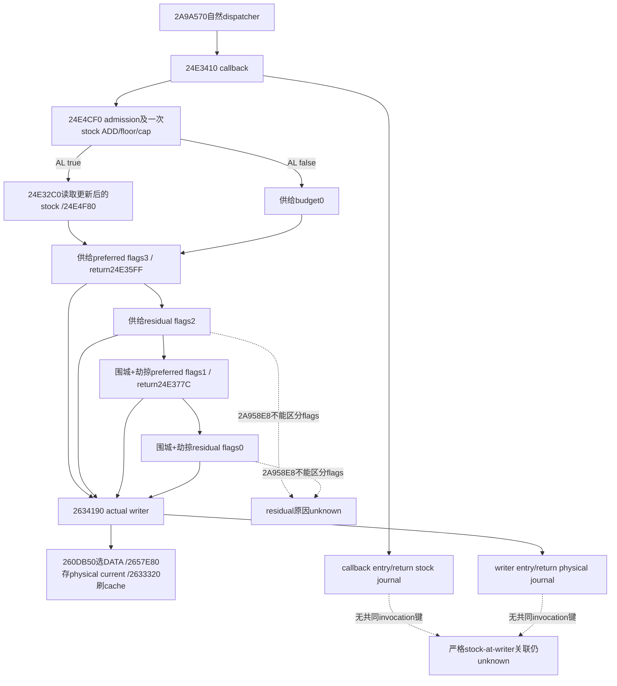

# 第4期 R05：严格低于10供给与物理扣兵证据

本包为离线来源审阅和独立只读消费谓词。阅读冻结为 `1463bd9b4b89612d283dd45ac4ec9efbf22f048d`；目标 CK3 **1.20.0.4 / Steam25734779 / EXE SHA-256 `98702f88a547cde2eaf29a85f93b85f68ee4cf8148336a4f7afaeb75319dd518`**。它不重新验证当前安装，也没有读取EXE、游戏/SDK/pipe/桌面、启动游戏、编译native或产生新实机样本。历史 `.3` 文档只作为来源解释，不直接授予 `.4` 资格。

执行机器 `machine_id: desktop-3fevhd2-1c74096080`，2026-10-15T14:46:42.936468+00:00 由 `tools/ck3_live_run_id.py machine` 实读；出处为外置 `high-parallel-starvation-a01/TASK-START.actual.json`。本包所有机器相关事实仅绑定此ID。源研究历史未标机器身份的记录仍为 `machine_id: unknown`，不追认其安装、路径、编译或实机效力。

## 阈值与单位

`.4` 的 `24E4F80` 使用**运行时加载的**levels/fractions表。输入供给为signed int64/Q100000，先向零除100000，再窄化到signed32，按原始levels顺序选第一个 `integer>=level`；无匹配时回退最后一项。不能先用float四舍五入，也不能把容量比例当绝对库存。历史原版表 `[60,10,0] / [0,0,5000]` 对普通非负库存给出：

| raw供给 | 实际供给 | integer | state/base |
|---:|---:|---:|---|
| 999999 | 9.99999 | 9 | 2 / 5000 |
| 1000000 | 10.00000 | 10 | 1 / 0 |
| 1000001 | 10.00001 | 10 | 1 / 0 |
| 0 | 0 | 0 | 2 / 5000 |
| −1 | −0.00001 | 0 | 2 / 5000，不能称正常更新后库存 |
| −100001 | −1.00001 | −1 | 无匹配，回退2 / 5000 |

因此严格边界是 `0<=raw<1000000`；exact10不属于低阈值正例。负数不等于未知，也不能悄悄改0：标记实际读到的负值及来源。成功updater先加signed Q64 rate再floor0/cap，正常post-update负库存不在已闭合域内。极端值还有低32窄化：`(2**32+10)*100000` 选integer10，不能用 `raw<1000000` 替代原生state算法。本包分别输出原始阈值谓词与原生state选择。

实际loaded表可以变化。现有current-risk fixture已特意覆盖levels `[60,7,0]`：9.99999仍为零base。因此只看“低于10”或硬写5%不够；R05表述必须同时保全当次loaded数组。base/component/整数预算/物理写入是不同证据层。将领修正、fleet suppression、合格人数与整数取整可使低库存实际供给预算为0。

## 哪个阶段读取库存，哪个阶段实际扣兵

完整`.4` caller `[24E3410,24E3A3C)`先在 `24E3430` 调updater，`24E3437`测AL，成功才在 `24E343E`调budget。budget读取**更新后**库存，不读取callback entry的旧库存。围城/劫掠整数预算在首次soldier写入前产生；四轮按顺序改变current，不能把结束时的Army人数或getter比例反算成各轮预算。

现有writer caller映射可直接区分 `supply_preferred /0x24E35FF` 与 `siege_or_raid_preferred /0x24E377C`。`residual_allocator /0x2A958E8`没有flags上下文，不能计入供给或围城任一侧。county-entry `.4` actual caller在本包未独立闭合，不猜旧RVA；任何其它caller均不授R05供给分量。

物理扣兵只取完整、相同实例的unique physical slots之 `SUM(before.current-after.current)`，保留有符号值并与native公布合计核对。DATA aliases不重复计数。request Q100000、cached current delta、Army净人数、显示损耗比例和条件投影都不填此列。部分读、capture flags、65 records截断、未覆盖slot、身份变化或合计不一致保留unknown。

## 现有日志的可验范围与缺口

`actual_supply_callback_observations_v1`记录callback的entry/return库存及双Army FullID；`actual_loss_writer_observations_v1`记录writer caller、时钟和物理slot前后。两者sequence各自独立，不能比较大小来排序。writer的Army成员关系来自**查询时完整ArRg roster**，没有invocation-time CArmy owner。callback return库存也不是直接采到的budget-read或writer-entry库存；它不直接发布updater AL。

独立谓词 `assess_episode04_starvation_loss_12004`消费现有normalized families及显式端点extract，只输出：已核供给preferred物理debit、观察到的callback return非负S<10、可供人工审阅的 `source_endpoint_candidate`。它的 `strict_starvation_causal_attribution` 固定保留 **unknown**，因为当前family没有共同invocation键或stock-at-writer捕获。本包不把这个候选升级为R05执行闭环或本场实机正例。

机械拒绝包括：exact build不符、身份/会话/完整有序roster变化、非exact+24、同窗county arrival、重组、战斗、gathering、移动或缺少这些实际观测；每个journal缺自己的fence、有reset/gap/未知capture failures；同窗多次callback；非供给preferred caller；残余或围城caller；物理coverage/合计不完整；loaded表不是所述原版10阈值。围城存在本身不抹去独立供给preferred primitive；但围城debit不会加入供给合计，混合窗口不升级为单原因总损失。窗口extract中unknown不能填false/true来放行。

最小下一入口：在既有自然callback wrapper给当前thread保留一个entry token、双Army FullID与receiver作用域；writer wrapper仅在精确供给preferred caller中复制该token及**当时receiver+180 stock**到owned event，按已有RAII恢复嵌套上下文。新增字段必须有exact-build source/生产wrapper fixture和真实paused捕获，不能只加消费者接受一个外部 `linked=true`。这样无需推导净兵数或猜跨journal顺序；原有未连结记录仍unknown。此为具体待施工入口，本包没有改native/SDK或请求Root中断有效构建。

## 新增验证与交付

外置候选为 `high-parallel-starvation-a01/candidate/`，只新增本页、一个独立consumer与一个聚焦unittest文件；相对patch和精确pins在同包。首次 `py -B -O .../test_episode04_starvation_loss_12004.py`为 **7/7 GREEN**，unittest 0.005s / process 0.3213566s；均是新纯Python人工fixture，不是native producer、真实journals或实机样本。覆盖strict等号/负值/scale/低32wrap/loaded覆盖、physical alias、cache上涨而physical−5、county同日与围城/residual拒绝、错误slot合计、partial/漏环/重复callback/重组以及空史unknown。普通模式与后续必要修正结果见机器可读回执；历史首轮不回写。

未新增live、游戏日、录制、R05正例或整个daily/monthly执行信用。主树、Git refs、游戏、Steam和SDK均未写。包上限8MiB已由Root纳入统一512MiB预留；小record180日复核、可重建helper48小时复核，无删除、无永久保护。

可复用来源：[当前callback及loaded表](army-current-callback-supply-risk-12004.md)、[soldier阶段顺序和physical writer](army-current-callback-soldier-effects-12004.md)、[actual writer journal及membership边界](army-actual-loss-writer-observation-12004.md)、[actual supply callback journal](army-actual-supply-callback-observation-12004.md)、[原研究`.3`阈值解释](army-supply-depletion-update-and-state-12003.md)。

## 2026-10-15后续：共同调用观测候选已实施

上文“最小下一入口”是第一批包的真实状态。用户随后明确授权继续实施，现已在外置候选完成默认OFF的TLS parentjoin、writer当场库存捕获、optional strict合同及独立keyed消费，见[实现、原调用来源与新窄fixture](army-actual-supply-parent-join-observation-12004.md)。旧无共同键的日志及第一批谓词仍保持unknown；新候选已经有ON/OFF窄编译、SYSTEMverified后typed-local执行和wire消费资格，但尚未部署或取得新CK3实机样本。本补充不把静态fixture改写为自然饥饿正例。
