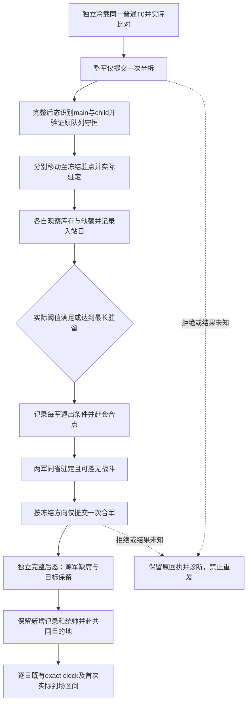

# 第4期 R10 策略 B：拆分、休整、会合与重并

本文件定义离线操作账本与最小决策输入，沿用[同起点比较合同](episode04-comparison-contract-12004.md)和[导演案](../../promo/ck3_native_war_ai/episode-04-march-logistics/director-plan.md)。它没有新增实机结果、游戏日、R09 机制或 R10 通过信用。适用的冻结游戏身份是 1.20.0.4 / Steam build25734779 / EXE SHA `98702f88a547cde2eaf29a85f93b85f68ee4cf8148336a4f7afaeb75319dd518`；这只是输入合同，不能证明任一机器的实际安装与加载。

可复用入口为 [strategy_b.py](../../promo/ck3_native_war_ai/episode-04-march-logistics/tools/review02/comparison/strategy_b.py)。它复用现有 R10 schema、相对路径小证据读取、完整逐团整数 / DATA 和独立暂停 snapshot 校验；不修改共同比较 consumer，不导入 SDK，不访问进程、游戏、桌面、网络、存档或媒体。顶层输入限定小于等于 16 MiB 的 JSON，证据引用仍遵守既有相对路径及 bytes/SHA 上限。

## 冻结输入与角色

使用现有 `xar.e04.r10.plan.v1` 的完整正式计划，以及现有 schema 中一个 `label=B` 的 arm。执行前冻结普通保存 SHA、来源与实际 source/DLL、T0、完整原始 ArRg ID、目的地、两处已有真实库存增长证据的驻点、最低 stock、最大缺额、最长驻留、会合点、合军方向和统帅政策。工具能核证据字节和字段一致性；现有 R09 / 驻点证据的业务资格由其原始证据链承担，不因被引用而重授资格。

`rest_province_ids` 的顺序在本入口具有角色语义：第一处属于原主军 main，第二处属于实际拆出的 child。新军 ID 在冷载后重新发现，不预填历史 public ID 或 native CArmy FullID。支持的合军方向为 `destination-main` 与 `destination-child`；其他自由文本方向须先实现具体解释，不能用同一字符串回显代替方向检查。`commander_policy` 原样冻结并记录；R09 负责具体统帅 / 新增兵团 producer 的机制解释，本入口不自动换将补齐公平性。

每臂重新绑定 machine/PID/create-time/generation/episode/player，并读取实际冷 T0。原队列、DATA、统帅、库存 / 容量、位置 / 路线、战争、钱包和加载特性必须与共同基线一致。新军识别要求完整 query 中 `status=available`、`native_army_resolution_v1.status=available`、`ready=true`、`entry_full_id == native_carmy_id`。public ID 与 CArmy FullID 分列；未查询的公开 roster 行单列，不能当零人军队或用于识别 child。拆军后的主军保留原 native 身份，仅新增一个已解析 child；原始逐团 ID / current / max 完全守恒，任何额外 roster 变化保留为诊断失败。

## 合法状态机



`ACK` 之后必须有独立暂停 snapshot 与完整 Driver query。命令后态不跨日期 tick；命令以实际前态的 public revision 提交。移动后必须看到真实 route/target 或已实际抵达，不能用 Move ACK、相机位置或 ETA 替代。后续无动作观察可以沿此前观察到的路线前进；没有已观察移动指令时的位置跳转拒收。

每军休整从实际驻定帧计日。退出仅允许真实 stock 达标且缺额不超上限，或真实达到冻结最长驻留；当前月 getter 为正不等于库存已增长。达到最长驻留仍未恢复是该策略的实际后果，不能重开来挑好结果。两军退出之后才允许在冻结会合点重并。

合军完成要求原始回执 `merge_applied / postcondition_verified / source_army_id_absent`，且提交帧与独立前态绑定、observed revision 被独立后态包住；独立 roster 中源军实际缺席，目标 public/native 身份保留，所有合军前逐团整数不变。新增团与其完整 DATA 必须列出，不静默删除。每个观察同时列原始 cohort 与全部 strategy current/max、逐军 stock/cap、当前统帅。库存不相加或平均成“整军补给”；源军消失表示身份合并，不表示其士兵死亡。

同一逻辑 split / move目标 / merge 和 request_id 不允许重复。`rejected` 或 `unknown` 回执会终结该 trace，并输出 `retry_allowed=false`；后续只读诊断不能自动授权重发。独立诊断显示动作已完成时，应保留原失败 / 超时回执和新证据，由原操作者明确续接实际状态，不伪造第二次动作成功。

## 事件账本与使用

事件文件 schema 名为 `xar.e04.r10.strategy-b-events.v1`，含 `plan_sha256` 和有序 `events`。`plan_sha256` 绑定原始计划文件 bytes，不能重新序列化后代替原字节。事件字段如下：

| kind | 输入 | 额外字段 |
|---|---|---|
| split | `before/after` 为现有 endpoint；`request/response` 为相对 pin；`outcome=applied/rejected/unknown` | 真实 request 的 `split-army-half-<main>` |
| move | 同上 | `unit_id / target_province_id`；真实 `move-army-<id>-to-<target>` |
| rest-enter | `endpoint` 为完整实际到站 endpoint | `unit_id / province_id` |
| rest-exit | `endpoint` 为完整实际退出 endpoint | `unit_id / province_id / reason=threshold或maximum_rest_days` |
| merge | 同 split | `destination_army_id / source_army_id / merge_destination_policy / commander_policy` |

请求 pin 指向保存的 `{request_id,tool,arguments}`，response 可为原始 SDK 记录或其完整 body 外壳；若 response 自带 request，必须逐字段相等。结果未知可以没有 `after`，但不能标成 applied。所有 applied 后态仍须带完整 DATA；absent first-record 不能补零。

从仓库根使用项目已验证且具备 `jsonschema` 的 Python：

```text
<verified-python> -B promo/ck3_native_war_ai/episode-04-march-logistics/tools/review02/comparison/strategy_b.py --plan-only --plan PLAN.frozen.json --evidence-root SMALL_EVIDENCE_ROOT --output B.recipe.new.json
<verified-python> -B promo/ck3_native_war_ai/episode-04-march-logistics/tools/review02/comparison/strategy_b.py B.events.json --plan PLAN.frozen.json --arm B.arm.json --evidence-root SMALL_EVIDENCE_ROOT --output B.audit.new.json
<verified-python> -B -m unittest discover -s promo/ck3_native_war_ai/episode-04-march-logistics/tools/review02/comparison -p test_strategy_b.py
```

输出 exclusive-create；新运行使用新文件。`strategy_b_split_rest_merge_verified` 只表示供应事件中的拆分、休整及重并链一致，可以输出 `B_rest_exit_records` 给现有比较账本复核；不是 `prespecified_policy_followed` 的自动替身。目的地首次到场、全部逐日时钟、D90、费用和三个独立冷载结果仍由原比较 consumer 验证。本工具固定 `live_execution_performed=false / research_card_closed=false / R09_mechanism_qualified=false / R10_comparison_qualified=false`，不生成 winner 或影片通过结论。

## 历史边界

旧 [B gate-stop 原小记录](../../promo/ck3_native_war_ai/episode-04-march-logistics/evidence/r0175-b-gate-stop/closed-terminal/B-closed-terminal-values.json)属于 1.20.0.3 的历史实测，`machine_id: unknown`，所属机器未核实；不能据历史路径追认当前机器。其 +38 日合军实际执行，新增第 28 个 1/1 兵团及统帅 27357→33388 导致当时冻结门槛停止；原预算还剩 52 日，London endpoint 为 null。它不是 90 日截尾，不是新版 B 结果。其精确 producer 与当前 .4 的 R09 验收由独立专题承担，不能由历史样本直接外推。

测试只在临时目录构造带 synthetic 标识的 native 形状 JSON，覆盖正常状态链、新增 1/1 / DATA / 统帅保留、冷 T0 偏移、影子 / alias 拒收、ACK无后态、未知动作不重发、实际阈值与最长驻留、移动缺口、反向合军及源军仍在。测试不读取大存档、EXE/DLL、原片或桌面，不把合成数据当正常存档。
