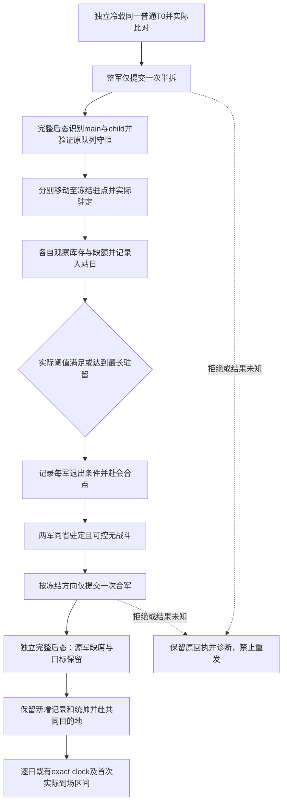

# 第4期 R10 策略 B：拆分、休整、会合与重并

本文件定义离线操作账本与最小决策输入，沿用[同起点比较合同](episode04-comparison-contract-12004.md)和[导演案](../../promo/ck3_native_war_ai/episode-04-march-logistics/director-plan.md)。它没有新增实机结果、游戏日、R09 机制或 R10 通过信用。适用的冻结游戏身份是 1.20.0.4 / Steam build25734779 / EXE SHA `98702f88a547cde2eaf29a85f93b85f68ee4cf8148336a4f7afaeb75319dd518`；这只是输入合同，不能证明任一机器的实际安装与加载。

可复用入口为 [strategy_b.py](../../promo/ck3_native_war_ai/episode-04-march-logistics/tools/review02/comparison/strategy_b.py)。它复用现有 R10 schema、相对路径小证据读取、完整逐团整数 / DATA 和独立暂停 snapshot 校验；不修改共同比较 consumer，不导入 SDK，不访问进程、游戏、桌面、网络、存档或媒体。顶层输入限定小于等于 16 MiB 的 JSON，证据引用仍遵守既有相对路径及 bytes/SHA 上限。

## 冻结输入与角色

使用现有 `xar.e04.r10.plan.v1` 的完整正式计划，以及现有 schema 中一个 `label=B` 的 arm。执行前冻结普通保存 SHA、来源与实际 source/DLL、T0、完整原始 ArRg ID、目的地、两处已有真实库存增长证据的驻点、最低 stock、最大缺额、最长驻留、会合点、合军方向和统帅政策。工具能核证据字节和字段一致性；现有 R09 / 驻点证据的业务资格由其原始证据链承担，不因被引用而重授资格。

`rest_province_ids` 的顺序在本入口具有角色语义：第一处属于原主军 main，第二处属于实际拆出的 child。新军 ID 在冷载后重新发现，不预填历史 public ID 或 native CArmy FullID。支持的合军方向为 `destination-main` 与 `destination-child`；其他自由文本方向须先实现具体解释，不能用同一字符串回显代替方向检查。`commander_policy` 原样冻结并记录；R09 负责具体统帅 / 新增兵团 producer 的机制解释，本入口不自动换将补齐公平性。

每臂重新绑定 machine/PID/create-time/generation/episode/player，并读取实际冷 T0。原队列、DATA、统帅、库存 / 容量、位置 / 路线、战争、钱包和加载特性必须与共同基线一致。新军识别要求完整 query 中 `status=available`、`native_army_resolution_v1.status=available`、`ready=true`、`entry_full_id == native_carmy_id`。public ID 与 CArmy FullID 分列；未查询的公开 roster 行单列，不能当零人军队或用于识别 child。拆军后的主军保留原 native 身份，仅新增一个已解析 child；原始逐团 ID / current / max 完全守恒，任何额外 roster 变化保留为诊断失败。

## 合法状态机



`ACK` 之后必须有独立暂停 snapshot 与完整 Driver query。命令后态不跨日期 tick；命令以实际前态的 public revision 提交。移动后必须看到真实 route/target 或已实际抵达，不能用 Move ACK、相机位置或 ETA 替代。后续无动作观察可以沿此前观察到的路线前进；没有已观察移动指令时的位置跳转拒收。

每军休整从实际驻定帧计日。退出仅允许真实 stock 达标且缺额不超上限，或真实达到冻结最长驻留；当前月 getter 为正不等于库存已增长。达到最长驻留仍未恢复是该策略的实际后果，不能重开来挑好结果。两军退出之后才允许在冻结会合点重并。

合军完成要求原始回执 `merge_applied / postcondition_verified / source_army_id_absent`，且提交帧与独立前态绑定、observed revision 被独立后态包住；独立 roster 中源军实际缺席，目标 public/native 身份保留，所有合军前逐团整数不变。新增团与其完整 DATA 必须列出，不静默删除。每个观察同时列原始 cohort 与全部 strategy current/max、逐军 stock/cap、当前统帅。库存不相加或平均成“整军补给”；源军消失表示身份合并，不表示其士兵死亡。

同一逻辑 split / move目标 / merge 和 request_id 不允许重复。`rejected` 或 `unknown` 回执会终结该 trace，并输出 `retry_allowed=false`；后续只读诊断不能自动授权重发。独立诊断显示动作已完成时，应保留原失败 / 超时回执和新证据，由原操作者明确续接实际状态，不伪造第二次动作成功。

## 事件账本与使用

事件文件 schema 名为 `xar.e04.r10.strategy-b-events.v1`，含 `plan_sha256` 和有序 `events`。`plan_sha256` 绑定原始计划文件 bytes，不能重新序列化后代替原字节。事件字段如下：

| kind | 输入 | 额外字段 |
|---|---|---|
| split | `before/after` 为现有 endpoint；`request/response` 为相对 pin；`outcome=applied/rejected/unknown` | 真实 request 的 `split-army-half-<main>` |
| move | 同上 | `unit_id / target_province_id`；真实 `move-army-<id>-to-<target>` |
| rest-enter | `endpoint` 为完整实际到站 endpoint | `unit_id / province_id` |
| rest-exit | `endpoint` 为完整实际退出 endpoint | `unit_id / province_id / reason=threshold或maximum_rest_days` |
| merge | 同 split | `destination_army_id / source_army_id / merge_destination_policy / commander_policy` |

请求 pin 指向保存的 `{request_id,tool,arguments}`，response 可为原始 SDK 记录或其完整 body 外壳；若 response 自带 request，必须逐字段相等。结果未知可以没有 `after`，但不能标成 applied。所有 applied 后态仍须带完整 DATA；absent first-record 不能补零。

从仓库根使用项目已验证且具备 `jsonschema` 的 Python：

```text
<verified-python> -B promo/ck3_native_war_ai/episode-04-march-logistics/tools/review02/comparison/strategy_b.py --plan-only --plan PLAN.frozen.json --evidence-root SMALL_EVIDENCE_ROOT --output B.recipe.new.json
<verified-python> -B promo/ck3_native_war_ai/episode-04-march-logistics/tools/review02/comparison/strategy_b.py B.events.json --plan PLAN.frozen.json --arm B.arm.json --evidence-root SMALL_EVIDENCE_ROOT --output B.audit.new.json
<verified-python> -B -m unittest discover -s promo/ck3_native_war_ai/episode-04-march-logistics/tools/review02/comparison -p test_strategy_b.py
```

输出 exclusive-create；新运行使用新文件。`strategy_b_split_rest_merge_verified` 只表示供应事件中的拆分、休整及重并链一致，可以输出 `B_rest_exit_records` 给现有比较账本复核；不是 `prespecified_policy_followed` 的自动替身。目的地首次到场、全部逐日时钟、D90、费用和三个独立冷载结果仍由原比较 consumer 验证。本工具固定 `live_execution_performed=false / research_card_closed=false / R09_mechanism_qualified=false / R10_comparison_qualified=false`，不生成 winner 或影片通过结论。

## 历史边界

旧 [B gate-stop 原小记录](../../promo/ck3_native_war_ai/episode-04-march-logistics/evidence/r0175-b-gate-stop/closed-terminal/B-closed-terminal-values.json)属于 1.20.0.3 的历史实测，`machine_id: unknown`，所属机器未核实；不能据历史路径追认当前机器。其 +38 日合军实际执行，新增第 28 个 1/1 兵团及统帅 27357→33388 导致当时冻结门槛停止；原预算还剩 52 日，London endpoint 为 null。它不是 90 日截尾，不是新版 B 结果。其精确 producer 与当前 .4 的 R09 验收由独立专题承担，不能由历史样本直接外推。

测试只在临时目录构造带 synthetic 标识的 native 形状 JSON，覆盖正常状态链、新增 1/1 / DATA / 统帅保留、冷 T0 偏移、影子 / alias 拒收、ACK无后态、未知动作不重发、实际阈值与最长驻留、移动缺口、反向合军及源军仍在。测试不读取大存档、EXE/DLL、原片或桌面，不把合成数据当正常存档。

## 2026-10-16：R0177 coastal S0 的可行动 B 分支

本增量只增加机器决策输入与资格边界，不改已封存next adapter / staged relay，不重跑或新增它们的测试信用。源基线`d9322bcfb3e17a3fe78607cea777bbfaf7be0a11`。本次离线核对机器`machine_id=desktop-3fevhd2-1c74096080`（`tools/ck3_live_run_id.py machine`），观察时间自`2026-10-15T20:57:35Z`起；没有游戏、SDK、桌面、EXE、存档或原片读取。

R0177实际S0来源是`live12004-logistics-source-a01/normalprepare93-stages/newstationary-commonS0.actual.json`（Root receipt时间`2026-10-15T20:25:31.384013Z`），不是旧episode seed、初始53146632或之后推进的帧。正常checkpoint为**71,631,396 B / SHA `e6ee95c3184c00989af660c5d765a27622fd5b93f9e8930fdc5a5ed56e157d67`**，S0 raw**53146848**，普通vanilla生命周期；本包只读小回执，没有重哈希save。该机器的当次PID7240/create-time134365679117288462/generation1/episode`native-31254-00b796ef873c`只绑定历史R0177，后续独立freshload须重新绑定，不能复用这些运行时身份。

| S0已取得 | 证据与限度 |
|---|---|
| 当前玩家31254；Army public93 → native CArmy85 | 小回执与035原snapshot。typed动作使用public93，不能把85当public ID。后续coldload重新实读映射。 |
| 2624、regular、可控、无combat/retreat、complete empty route/target null | 035暂停endpoint实际`native:33 / public34 / native33 / raw53146848`。地图soldiers为null，不能据它填0。 |
| 缓存250/250、4 ArRg、总4 DATA、whole_DATA_ready=true、stock100 | 小回执的完整query摘要，原Driver pin为7,865,022 B / SHA`4441f765d196a6bfdc8868f23e10f5e92efae0e2d7739d8ddd1a1be6af3f1a49`；本包未重复解析它。总4 DATA不证明每团恰好1条，更不证明物理兵数250。 |
| cap100、月getter+20、实际统帅34232 | Root本轮输入摘要。后续freshload仍需同帧typed strengths / assigned commander原包绑定；035的当前strength数组为空，不能拿它补这些字段。 |
| 钱包raw25455910 / scale100000，War4 | 035原snapshot。钱包不是独立军费账，只有一个窗口值不能推费用。 |
| 2619是该次正常准备的origin，2624是实际到达站 | 小回执binding保存了origin2619、initial date53146632和target2624。只证明当次准备路线已实现，不授反向当前preview或2619休整资格。 |

可复用的小型输入账本见[coastal S0 decision inputs](evidence/episode04-B-coastal-s0-12004/decision-inputs.r0177.json)。其`readiness=HOLD_FORMAL_B_UNBOUND`是本切点，不是原生split禁令。

### 现实候选与合法性

首个不猜地图的两站候选为：**main保留2624，实际child把2619作为返程preview候选**；会合点可先评估已实际驻定的2624，最后目标仍须与A/C预先共同冻结。2619与2624均来自本场原生证据；本包没有把地图邻接、返程陆路、补给友好或最终goal猜成已知。若fresh native preview表明反向需登船、绕路、接敌或不可行，就保留实际结果，并从现有campaign root / war occupation等真实候选集合筛下一站，不能伪造固定邻接表。

S0四个ArRg使“原生半拆”成为现实可检验候选，但**4团/250人本身不是CanExecute=true**。继续使用当前fresh capability中精确的`split-army-half-<publicFullID>`与实际`.4` `SubmitSplitArmyHalf→validate_split296CF40`；原生validator在提交前裁定，拒绝不绕过、不重发。兵团整体搬移，不预设125/125或2团/2团；旧`.3`分组/权重树仅作来源知识，当前`.4`实际两军及ordered DATA后态才授本次分区事实。新child ID、双方统帅、cap、current/max均重新读取。

两站正式准入仍按原合同：each site须有自己的实际stock增长资格证据、冻结最低stock/最大缺额/最长驻留、实际route与风险输入。**当前2624只有正月getter且库存已满，不等于已观察stock增长；2619目前更没有该项驻点证据。** 因此不能把上述候选直接填为两站GREEN，也不能给它预造正式B结果。普通agent可以消费已知状态做合法OODA；视频controlled B仍保持该具体门槛，不把它升级成普通军队行动的永久等待条件。

### 满库存的停止条件，不制造“恢复”

当前输入100/100、250/250意味着没有已知缺口需要补满。已有代码已经支持以下分支，无需新功能或重复测试：

1. 若冻结`minimum_stock_raw<=10000000`且`maximum_deficit>=0`，在实际到站时仍满足这些数值，**该帧即可threshold退出，休整0自然日合法**。先记录actual rest-enter，再记录同日rest-exit；不能为获得好看镜头强等一次+20或增加未冻结的最低等待天数。
2. 若以后自然移动确实消耗stock，才以该军实际到站stock/cap和缺额重新判断；不把当前+20、origin holder、目标usage或split前capacity当未来保证。实际增长须同Army/完整generation、同驻地与上下文跨真实结算前后读数证明。
3. 若冻结最低stock高于该军**当帧实际cap**，在cap不变的那些帧不能将条件写成已恢复。仍保留原最大驻留；到时退出原因`maximum_rest_days`、`recovery_threshold_observed=false`。不能事后降低门槛、换将抬cap或让一臂额外等待来修公平。
4. child的capacity可能因实际统帅上下文不同而变化，不能从main cap100复制；split复制库存、选将和容量clamp的具体结果逐军读。库存100/cap300若真实出现，与100/cap100是不同缺口，绝不把百分比或两军库存求和作为整军恢复。

如果本S0按冻结条件导出零等待或最长驻留仍未恢复，这就是本次B策略结果。若影片还需要“分兵后实际正恢复”的机制镜头，应另取经过正常准备的有缺口输入并明确来源，不能故意删兵、改档、浪费补给后把它剪成同S0。也不能为拍恢复把另一S0的A/C当同起点对照。

### 现有selector与最小下一读

`current_replenishment_army_selector_v1.select_current_replenishment_army_v1`先按实际兵力选择；仅对同兵力、不同驻地、完整同帧prepared148 ordered inputs比较**当前条件性refill机会**，缺输入保持既有稳定选择。它不是休整地点搜索器，也不把+20当恢复、把250缓存当物理兵槽或给下一月补兵保证。不要为本小案例再建一个site-score平台。

035的`player_armies[].soldiers`实际为null；不能只把该地图行传给selector后，声称它按250兵或prepared refill作过比较。当前250来自独立完整query摘要；使用已有projection/selector时仍需其真实同帧strength输入和各自readiness，不能手填地图null或把稳定ID fallback称为补员优化。

实际生产调用还有明确边界：d932 `strategy.py:10265`仅在没有unsafe或threatened stationary军队时，为quiet-pursuit调用上述selector。其`_split_merge_recovery`在两军分开且无已证明安全会合意图时返回`native_war_merge_rendezvous_blocked / safe-exact-rendezvous`（10997起）；刚拆完仍同省时可能直接选择`native_war_merge_recovery`重并（11017起）。因此本正式实验由已有B stages独占其命令与会合意图，不能同时交普通auto-turn另发恢复命令，也不能宣称普通planner已自主实现完整split-rest-route。把B意图正式接入普通planner是独立后续能力边界，不是本回放重写已封composer或全局策略的理由。

当前已有接口足够继续，真实缺字段时再补同一口：

- 独立cold S0：snapshot、完整`ck3_query_army_strengths([fresh source ID], expected_revision, profile=ordinary_core_v1)`及typed current commander；完整四个ArRg的current/max、type、ordered all-DATA和Character role按原ID保存。
- 两军实际分开后：各军同帧`current_land_resupply_v1.native_resupply_eligible`、`current_land_supply_rate_inputs_v1`、`current_province_supply_contributors_v1`的native usage/limit、当前stock/cap/月getter，以及自身actual owner/province/commander。usage不能用我方两军人数和代替。getter+20只筛候选，真正恢复仍看库存更新。
- 去2619的route合法性、成本和ETA沿现有native preview / stored route / actual到站链；`current_first_route_target_supply_contributors_v1`只观察当时目标上下文，不授抵达后usage或整程安全。原生owner/holder resupply admission与统帅是两个不同输入。
- 保持absolute deadline=`53146848+90*24=53149008`；重新运行脚本不重置。首次到场区间、D90、competition/measurement stop继续由共同比较器决定。

### 与A/C费用可比的最少证据

至少冻结共同e6ee **正常存档SHA**、三次独立cold runtime、实际同actor/date/war、钱包、主军完整cohort/DATA、stock/cap、将领与loaded features；源/DLL/build相同。Root接下来的freshload实读是新的准入，R0177准备期或后续推进天数不能代填。

三臂共同goal、report days、D_end、post-arrival policy及`compare_fees`在结果前冻结。A整军直达、B上述两站/休整/会合、C真实waypoint；B不承诺比A/C更省或更多兵。

费用列需要同账户、各臂真实窗口内board/maintenance **实际应用账**、其他收入/支出和钱包对账，并沿R07/R08既有qualification。250/250及拆军后总数相同不证明维护相同：role、物理DATA、MAA/levy定义、取整、登船与实际日数分别保留。preview金额、月率、零条未覆盖ledger或钱包净差不能补actual费用。无登船付款也须在合格覆盖下观察，不能因候选看似陆路填0。

各臂到场表比较的是各自不同暴露时长的真实代价；同日表只在三臂同报告日都有读数时作横向对照。完整expenses/NET已含军费不能再扣一次。某项仍unknown就保留null及资格hold，不看完结果后关闭费用列、不改S0或B退出策略。本增量没有发现需要改composer/selector的功能缺口；这轮不新增测试、构建、live或旧测试重复信用。
