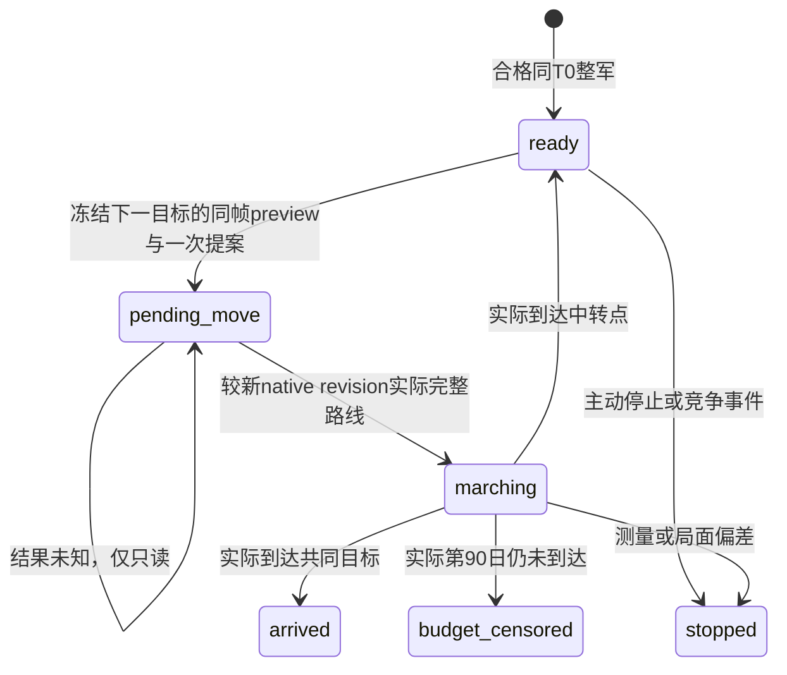

# 第4期 R10 策略 C：整军经替代路径（1.20.0.4）

策略 C 仍是导演案与[比较合同](episode04-comparison-contract-12004.md)中冻结的 `whole-via`：保持整军，依次前往实际合法的中转点，最后抵达三臂共同目标。**本项没有把 C 改成“等补给或补员达标后出发”**。补给、兵员与费用是观察结果；没有新设休整阈值、重试或为了得到好结果而重开。

本次为纯离线代码与知识交付。实现见 [strategy_c.py](../../promo/ck3_native_war_ai/episode-04-march-logistics/tools/review02/strategy_c/strategy_c.py)，反例见 [test_strategy_c.py](../../promo/ck3_native_war_ai/episode-04-march-logistics/tools/review02/strategy_c/test_strategy_c.py)。没有启动、查询或推进 CK3，没有 SDK/桌面、EXE/存档/原片读取，没有增加 R10 实机、视频或人工签核信用。

## 旧 C 的采样偏差与可保留结论

[原始小型归一结果](../../promo/ck3_native_war_ai/episode-04-march-logistics/evidence/r0176-c-descriptive-march/normalized_C_result.json)列出 **15 次** `planned_max_days=1`、`actual_days=2`、`one_day_eligible=false` 的偏差；不是“每 15 日采样”。窗口依次是 `(12,14]`、`(20,22]`、`(29,31]`、`(34,36]`、`(40,42]`、`(45,47]`、`(49,51]`、`(53,55]`、`(57,59]`、`(60,62]`、`(63,65]`、`(66,68]`、`(70,72]`、`(72,74]`、`(75,77]`。

共同 T0 为 raw `53148432`。最后未抵达观察是第 75 日 raw `53150232`，首次已抵达观察是第 77 日 raw `53150280`：两端相隔 48 raw、即两自然日。第 76 日没有合格独立读数，故实际抵达仍为 **`(75,77]`，精确 tick unknown**。第 77 日是首次观察到抵达的日期，不能改称精确抵达日；也不能靠终点完整兵团、截图、Move ACK 或事后估计插补第 76 日。

旧结果保留 `controlled_comparison_eligibility=NOT_GRANTED`、15 次偏差及 `winner=null`。它在第 77 日抵达，仍剩 13 日，不是第 90 日预算截尾。旧记录自身没有 `machine_id`，故此记录按 **`machine_id: unknown`、所属机器未核实**处理；本次执行机器的身份不追认旧结果所属机器。

终点观察仍可描述该主力原 27 团/37 DATA：6689/6747、补给 raw10190260/Q100000、容量300。T0 到终点的净人数变化、净钱包变化各有意义，却不是实际 physical ADD、损耗死亡或军事费用原因账。实际扣费及补员应用账仍为 null，原影片与历史失败不改写。

当前 [exact-day 时钟专题](exact-day-native-clock-12004.md)解释了另一个已定位案例中 Python 轮询等待到暂停时已越日的机制，并给出已有 native deadline 修复。不能据那个案例断言旧 C 每一次偏差的内部原因已单独证明。对于旧 C，本项只认其实际两日窗口；对于新 C，必须使用当次 native 一日 sentinel 与独立暂停读数。

## 准入与目标来源

先使用共享比较器完成普通存档同 SHA、exact `.4`、实际 source/DLL、独立 cold session 与 T0 资格；本模块不会把传入 plan 的意图当作已经做完这些事。C 的 `waypoint_province_ids` 顺序、共同 `goal_province_id`、原始 cohort、统帅与 route preview 在正式结果前冻结。目标来自这份计划及当次原生 preview，不从相机中心、历史绝对路径、旧军队 ID 或合成测试值推导。

`read_observation(plan, runtime, endpoint_record, evidence)` 直接调用仓库相邻的共享 `r10_compare.endpoint`，使用其精确小文件 pins 和同帧完整 Driver JSON→snapshot 联接。它再取当前 public Army 与完整 native CArmy、PID/创建时间、connection generation、episode、snapshot/public/native revision，以及实际 `controllable/in_combat/retreating/move_target_observable`。进程创建时间仍来自经过独立资格的 runtime 回执，文件哈希不能证明操作员的会话保管声明。

每一段仅接受同一 paused frame 上的实际 available native preview：Army、origin、target、date、snapshot/revision/generation/episode必须吻合，完整路径末端须为冻结的下一目标。可接受原生路径在首项包含当前 origin；只去除这一个展示性首项。preview availability 不等于独立 `CanMove` 布尔，真正 Move 仍须原生命令最终 validator 接受。预览 deferred/rejected/过期时不下令、不换未冻结目标。

模块只返回 `ck3_move_army` **提案**，不执行。调用方必须在提交前持久保存 pending 状态和决策展示，然后最多提交一次，并保存实际 request/result；ACK 既不是路线生效，也不是抵达。实际独立后态必须在相同暂停日期的较新 native revision 中显示完整预期路线、原 origin、moving 状态和正确 target，才转为 marching。结果未知时继续只读，不自动重发。该条件要求实际 route 生效读回，不能用空白的“accepted”声明补齐。



## 每日后态与沿途结果

`observe` 接受同日独立后态或下一日后态；实际跨日必须绑定已有 date-only `terminal_or_sentinel`、army0/combat0 的 R10 时钟合同，实际 start/target/trigger/end相隔24，speed5、tick1、overshoot0、暂停来源与新 generation完整。缺日或跨两日即拒绝 exact-day 资格，不重置 T0 或丢弃原读数。公开运行者仍按事件政策处理普通事件；本 guard 不改事件策略，也不要求整个 NPC 世界逐帧相同。

marching 中的剩余完整路线必须仍是实际已应用路线的后缀，且目标仍为该段冻结目标。每个中转点及最终抵达均要求**实际 current Province**、冻结 arrival state、完整空 route和该 native source合同的null target；相机中心、路过目标但仍 moving均不算抵达。每段保留 `(最后未到,首次已到]`，宽度至多一天，始终 `exact_arrival_tick=null`。独立的 shared checker仍扫描每天的 snapshot，不能择取较晚一次到场冒充首次。

这里不能额外要求空route的 `move_target_observable=true`：[Route源码](../../ck3_autonomous_player/native_bridge/src/ck3_12002_army.cpp:166)先将其置false，count0时以`complete_empty`直接返回；只有完整非空route才置true并取route.back为目标。因此正常静止终点的false/null允许通过，原值仍保留，**不能将null称为另一个独立原生target-clear getter已证**。非空route则必须true且target等于末端，partial/invalid route仍由共享reader拒收。这是现有原生投影语义，没有新增getter或资格放宽。

| 输入 | 可据此记录的事实 | 不能据此宣称 |
| --- | --- | --- |
| 当前 stock/cap 与 Q100000 | 同一军队当前补给与容量 | 月率为正就保证途中恢复，或容量永远300 |
| 原 cohort ArRg scale1 current/max | 物理人数、缺额和净变化 | effective/pending/prepared值已经成为实际兵员 |
| 完整 DATA 与补员权限/比例 | 当前数据覆盖及条件输入 | 已完成 physical ADD、保证下月补员 |
| 新增实际1/1团 | 原 cohort与全strategy总人数分列保留 | 用新增人数抹平原cohort缺员，或悄悄删掉它 |
| 钱包余额 | 当帧现金及独立净差 | 行军、登船或维持军费已归因 |

没有 supply/refill wait 分支：低 stock 或缺员不会把原 C 偷换成等待策略。未知供给、缺原始cohort、partial DATA、身份变化则没有完整观察资格；保留诊断和既有真实后果，不能填0。自然新增记录应作为world event独立保存，不将其原因猜成分兵、合军或补员。完整 DATA 的来源资格沿用共享 endpoint；本项不新增 native采集。

若保留费用比较，仍需冻结 `compare_fees=true` 与真实 R07/R08资格、相同账户/区间的 applied ledger及钱包对账。当前月率、单个正例费率、generic caller或 callback净差不替代军事费用；完整 expenses/NET中已含军费时不重复扣除。策略输出的 `actual_military_fees`、physical ADD/debit原因保持 null；合格费用列由共享比较器独立生成。

只有真实到第90日且未到达才叫 budget-censored。主动stop、测量失格、战斗/战争结束、owner/统帅等变化分别记录；本模块抛错时调用方保全该输入及错误，并以 `stop` 记明确原因，不将拒绝写成某个策略败绩或90日截尾。

## 到达表与同日表的边界

C 第 X 日的抵达状态只能进入 C 自己的抵达表。A 第 Y 日、B 第 Z 日的终点不能和它拼成“同日比较”；抵达前费用也不是同长时间纯费率效果。共同日期表继续交给共享比较器，只在三臂都有第7/14/21/28日等预注册实际读数时横向列示。未预注册统一到达后政策或未实际续至第90日，D90保持null。此模块没有winner或普遍最优推荐输出。

使用入口为纯函数 `start → propose_move → observe`；`stop` 明确收口，`outcome`只返回最后实际观察的分列数值与unknown。运行反例：

```text
<verified-python> -B -X utf8 promo/ck3_native_war_ai/episode-04-march-logistics/tools/review02/strategy_c/test_strategy_c.py -v
<verified-python-with-jsonschema> -B -X utf8 promo/ck3_native_war_ai/episode-04-march-logistics/tools/review02/strategy_c/test_strategy_c_reader.py -v
```

测试全部为显式合成的普通 Python 数据；唯独旧 C 拒收反例读取仓库内已跟踪的微型历史结果，不接触它的保存、原片或历史外置路径。本项没有安装公共自动执行路由，合成通过不能增加实机/成片完成百分比。

本轮执行记录绑定 `machine_id=desktop-3fevhd2-1c74096080`；实际观察时间、解释器、测试结果、源SHA及容量读回由本外置包的 `DELIVERY.actual.json` 保存。机器 ID 来源为 `tools/ck3_live_run_id.py machine`。容量沿用协调者 `continuation-a05/CAPACITY-ACCEPTED.actual-a01.json`（2026-10-15T14:13:24.287431Z），本子包上限8MiB，已计入共享512MiB，不另预留；该准入不是研究资格，也不代表其他机器容量。代码与知识可复用，部署、游戏版本和实机结果必须在目标机器重新验证。
