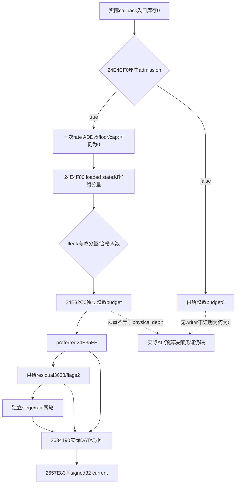

# 第4期R05：零库存仍可发生供给扣兵（1.20.0.4）

**这条普通供给损耗链没有为stock==0增加独立倍率，也没有因库存已经为0而跳过损耗。** updater若成功把库存0加负rate并floor回0，仍返回true；callback随后照常读取更新后的供给分量、算整数人数预算，再进入writer。库存0→0与“这次没有更新/没有扣兵”是不同事实。

本包为新源码研究，基线 `dcda9fde1afa1effb75d46fe99bba4bcd9aeabcb`。机器 `machine_id: desktop-3fevhd2-1c74096080`；2026-10-15T17:09:16.016889+00:00 对Root已绑定冻结原件 `C:/ck3-e04-resume-20261015-a01/frozen-game-12004/ck3.exe` 做6个具名body、共3748B和368B PE头的有限只读。版本1.20.0.4/Steam25734779、101040248B、SHA `98702f88a547cde2eaf29a85f93b85f68ee4cf8148336a4f7afaeb75319dd518` 复用该根 `IDENTITY.actual.json`，没有重算整EXE hash、扫描pdata/xref/string或触碰实机。精确新slice SHA在外置 `high-parallel-starvation-zero-a04/FINITE-READ.actual.json`，零执行/SDK/桌面/游戏日。历史Z路径原件未被冒称本机可读。

## 0的真正执行路径

| 精确指令 | 实际含义 |
|---|---|
| updater `24E4E6F` | 对CArmy+180做signed Q64 rate ADD。 |
| `24E4E8B..24E4EA0` | 负结果写0，**AL=1**返回；普通非负结果在 `24E4EA1..24E4EB6` 与current capacity比较后也AL=1。库存0且rate0仍是成功路径。 |
| callback `24E3430 /24E3437 /24E343E` | 调updater、只测AL；true才调24E32C0。失败在3448给供给budget0。这里没有库存0的额外early return。 |
| component `24E4FA9..24E4FBB` | signed stock/100000向零截断；后续EDX比较就是signed32整数库存。 |
| `24E4FD3..24E4FE0` | 按runtime loaded levels原顺序选第一个integer>=level；无匹配回退最后level。 |
| `24E5007..24E5014` | 读取该state的loaded base fraction；**被test零的是base fraction RBX，不是库存。** |
| `24E5131..24E5145` | 有效将领路径的分量clamp0..100000；absent/invalid将领分支515E返回原base。 |
| budget `24E3345..24E334E` | 分量<=0返回0；否则按真实有效/合格ArRg current累加。 |
| callback `24E34C5..24E34C8` | 只有供给整数budget>0才进入供给preferred轮。 |
| writer `26341C2..26341C7` | 这里检查的是**ArRg+38当前兵数==0**，跳到refresh；不是CArmy+180供给==0。两种0不能混读。 |

原版loaded表若实际为 `[60,10,0] / [0,0,5000]`，stock0与0.00001、9.99999同属5% base，exact10属于零base的上一档。没有“0再加一档”的源分支。实际runtime表、将领modifier和fleet suppression仍须保全；静态默认表不是每次运行已读事实。stock0在callback entry后若得到正补给并升到10以上，本次budget读取新库存，不能用entry0归因为饥饿。

因此同样的stock0可以出现不同合法结果：updater被combat/gathering/retreat/grace等门拒绝；更新成功但fleet抑制；有效分量归零；合格人数太少被截为0；或者确有非零供给budget并发生物理扣兵。单个当前getter、byte22=1、库存delta0或Army净人数不能区分这些路径。

## 真正的整数截断点

设Q=100000，普通非负且无溢出域内，实际分量为F、供给合格人数E：

1. **库存选state**：`trunc0(stockRaw/Q)`再取signed32，边界是绝对库存；不按capacity比例、不四舍五入。
2. **将领分量**：`24E50C9..24E50DE`普通路径先乘再向零除Q；大值另有 `24E50E3..24E512E`分解路径，不能套其它low-operand helper。无将领分支不补自造clamp。
3. **整军供给预算**：`24E33BF`以signed32累加E；`24E33DE`保留低64乘积，`24E33E2..24E33F0`向零除Q，`24E33F3..24E33F5`比较低32结果与E取较小值。普通域是 `B=min(E,floor(E*F/Q))`。19名合格兵×5%=0，20名×5%=1；没有每次最少扣1人的这里规则。
4. **分配到ArRg**：preferred先算其合格总人数P、cap=min(B,P)、overflow=B-cap。`24E35E9`只保留signed32乘积，`24E35ED` signed IDIV分母；整数请求再于35F3乘Q送writer。后续remaining budget减**请求量**，分母减当次writer前的旧current。写入被skip也不会自动把请求退款给residual。
5. **physical DATA**：`2634259..2634325`包含Q除法的普通/溢出支路；按DATA顺序和unique物理alias的当前值运行，再cap到chunk有效current及remaining raw budget。`263433D..263434E`再次向零除Q并从raw current作signed32减法；setter `2657E83`直接写physical chunk+4。它不是统一把每个chunk乘5%，也没有在store后补一个“current至少0”的clamp。
6. **第二遍与refresh**：`2634376..2634379`只在remaining<0时跳过第二遍，remaining==0仍可进入并进行零变化写入；447F/4482调用current/max refresh。合法角色skip、无DATA、current0、state3/current0使用maximum等支路分别保留。state3可从raw0减到负数，不外推为普通兵死亡规则。

ordinary、非负、无溢出、所有选中writer准入且DATA正确时，整数请求×Q和chunk cap×Q会给整数兵数存储；本链没有在这些store中保存被截掉的“小数兵”carry。这不否认未研究的其它兵员生产/特殊生命周期；界面比例、预算、request、physical debit及cache refresh仍是不同层次。

## 同一次混合callback的四个来源

围城与raid预算在首个soldier writer前分别按原始whole current独立取整；之后按**已经改变的current**分配，不能将合计fraction乘一次总人数。

| 阶段 | writer内return | allocator外return /flags | 能授的分量 |
|---|---|---|---|
| supply preferred | `24E35FF` | direct | supply |
| supply residual | `2A958E8` | **24E3638 /2** | supply |
| siege+raid preferred | `24E377C` | direct | combined siege_or_raid |
| siege+raid residual | `2A958E8` | **24E37B3 /0** | combined siege_or_raid |
| county residual | `2A958E8` | **24E2630 /0** | county_entry |

新held callback精确证明call3633传R8B2、call37AE传R8D0；复用本机county包353B residual原件证明内writer唯一return2A958E8。因此同一日期、同一个periodic parenttoken、同一个stock0，仍可能有不同分量；inner return本身不够。a06现有 `residual_parent_context_v1`已经保存外return、flags和实际身份/array membership，故细分不要求新native字段。

新增独立纯consumer `classify_actual_loss_component_12004`只输出source component/phase，补足旧join仅识别preferred的用途；它不join callback、不读取库存、不把request当physical debit、不授历史完整性。使用时先跑现有keyed parentjoin并核complete unique physical capture，再要求 `stock_at_writer_entry_raw==0`，最后按本分类分列。residual还核实际typed source、外return/flags、直接父token/thread及双FullID；冲突一律unknown。4项全新source形状反例在`-O`下通过，没有重跑旧fixture组。

假设例：199名合格普通兵、供给5%、围城1%、preferred集合只有3人，供给预算9=preferred3+residual6，围城预算1在供给之后进入combined residual1。两个residual都从2A958E8返回且库存均0，但外return/flags不同。独立预算总10；把6%统一乘199会得到11。此例是明确假设的算术说明，**不是实机人数或预测结果**。

## 最小采样增量与阴性证据边界

详细机器可读卡见同包 `R05-ZERO-SAMPLING-DELTA.json`。当前a06原生字段已经足够取得positive：自然出现stock0的军队、一次自然callback、精确供给preferred或已闭合supply residual、当时stock0、实际physical debit>0。每exact日drain完整history；**不能因stock0→0或drain0跳过该日callback/writer events**。各journal用自己的fence，既有原始alias/FullID、缺口/overwrite/失败完整保留。

若stock0但没有供给writer，现有callback entry/return不能单独说明是updater拒绝、budget截0还是其它抑制；无保留事件也不证明整个窗口零loss。新的最小可选增量已与R03同owner协商：在既有direct siege/raid preferred writer hook，复制其native callback frame原供给整数budget，**不增加entry detour**。`24E344E`唯一保存callback RSP+20，直到37C9才读回；writer原return-address slot+0x28即该DWORD。R03计划leaf一并读原siege(+0x88)、combined(+0x90)，共12B；该点能给混合callback实际supply预算，即使其为0。不得从helper自己的栈取偏移或重算一个预算冒充actual。

这项可选leaf只在该writer自然发生时有样本，不能证明无writer的callback选择了什么。真零事件阴性若仍阻断高价值判断，下一具名入口是source `24E3437`的实际AL/`24E344E`的实际budget决策见证；需另行窄源计划、完整寄存器/XSTATE守护或已有合格外部只读采样方案，不能在本包偷偷插新mid-function hook或调用updater制造样本。

## 视频与智能体可用范围

视频源码解释可说：“供给耗尽不会让这条损耗链停止。一次成功更新后即使仍显示0，军队仍可能按低供给状态计算损耗；人数先取成整数，再分到具体兵团。”只有取得自己的真实stock-at-writer=0和完整physical debit后，才能说“这一次在0供给时实际损失X名兵员”；不统一称死亡，不把混合siege/raid或县损失相加叫饥饿。不能说0比9.99999多一档、固定每月第一天扣5%、每团各扣5%，或净少X全由饥饿造成。

智能体可直接使用：当前原生stock/capacity/rate、loaded表/实际suppression与合格人数、当前context的既有conditional risk；实际历史用完整keyed物理扣兵和本source component分类分别对账。source允许把stock0视作低库存风险，而不是“已经没有补给可扣所以安全”。未来rate、更新机会、写入结果、完整战争局面与缺失历史仍不由静态公式补齐。库存0前后兵数未变，可以记录净变化0；只有完整actual决策/写入证据才授具体零budget或零physical debit。

本包静态source闭合及9个新纯算术案例不授production-live R05。新增SDK/游戏/桌面/EXE执行/完整构建/旧fixture replay均0；主树无写。小slice和可重建分析按统一策略48小时复核，小型结论180日复核，8MiB lane沿Root512MiB共享预留，截止2026-10-16T07:45:01.597Z未延长。

## 正常准备入口：候选容量与更低起始库存

[候选容量到零库存的决策卡与最少步骤](episode04-commander-capacity-zero-preparation-12004.md)复用现有 R05 agent 入口，比较已100库存军队与正常换将后的实际容量/负率。它分别保留候选条件量、正常动作ACK、独立当前统帅/容量读回和自然updater结果；不以cap裁剪当耗给或兵员损失，也不承诺固定日数归零。R0177小型来源仅作机器/场次绑定输入，a08候选新叶尚未实机观察。
