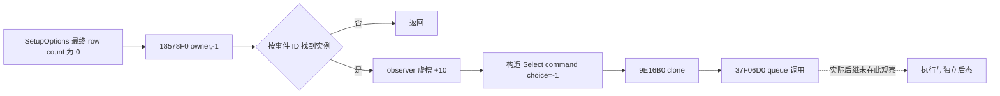

# 事件选项：原始候选、显示顺序与当前 Java 消费边界

记录时间：2026-10-25 21:43 UTC；`machine_id: xenoamess-full-tower-eb9d2c1186`。
本轮只读源码与已有证据，未读取新的 EXE 字节、未运行 mapper、未连接游戏或提交动作。
版本目标为 CK3 1.20.0.4 / Steam 25734779 / EXE SHA-256
`98702f88a547cde2eaf29a85f93b85f68ee4cf8148336a4f7afaeb75319dd518`。
本轮 `formal_release/INSTALLATION-WITNESS01.json` 只是当前文件身份与既有 SHA 的元数据见证，
不授加载进程、ABI 或事件现场资格。

## 当前已经核对的链

原版已加载定义中的 authored option 列表、GUI 已物化的 displayed option 列表和我方继续策略是三层不同输入。
本轮把现有源码的实际消费者接到已有 .4 原生字段证据上，并把尚未研究的原生候选生产入口单独列出。

| 层次 | 本轮读回的实际行为 | 仍不能据此声称 |
| --- | --- | --- |
| 原版定义 | 既有 named operand 证明 `EventData+0x1A0` authored vector | 全部 authored 项都会显示、显示仍按该顺序、trigger 使用何种 scope |
| 原版物化字段 | 旧 .4 来源在 `0x18589C3` 写 `r15d -> item+0x1B0`；`0x18589CA` 写 `r14b -> item+0x1B4` | `r15d/r14b` 如何产生、隐藏条件、append 顺序和刷新条件 |
| 共享 native reader | `ReadMatchingData` 遍历现存物理行；行位置成为 `rendered_index`，另读 `native_option_index` 与 `enabled`；校验 authored 边界、owner、唯一 native index | 执行 trigger、重建列表、重新评分，或空列表代表没有 authored 候选 |
| .4 factory | `BindEventWindowImage12004` 向共享 reader 装入真实 .4 Core/Event prefix、vptr 与只读回调 | 复用 `.2` 文件名即可复用 `.2` ABI；非当前窗口也具有相同选择 |
| Java 普通 collector | R5 `EventPolicies.firstDisplayedPlan` 实际调用 `planFirstDisplayed` | 默认 `plan()` 的 legacy first-enabled 入口等于实际普通调用者 |
| Java continuation | 在 shown rows 中先取最小 rendered index，再判断该行 enabled/advertised；`option_number = native_option_index + 1` | rendered0 等于 native0；disabled first 会被跳过；已有提议等于执行或后态 |

当前 first-display 路径在没有 `TrustedEventSourceContext` 时仍保留同帧显示选项、原处理缺口和第一显示项映射，
进入现有通用继续提议。`EventPolicies.java:217` 的实际无 registry 分支没有增加强制 registry 前置。
已有专用动作继续优先；第一显示项禁用、缺当前原生显示数据或缺真实后态合同分别保留诊断。
这项源核对没有修改策略，也没有把 registry 缺失改成整局暂停。

当前 R5 使用 first-display 的事实与[2026-10-15 历史 Python first-enabled 记录](unhandled-event-continuation-2026-10-15.md)
应分别阅读。两者的真实调用者不同，不能根据同名 `plan()` 或旧说明推定当前 Java 路由。
隐藏选项的 authored index 与显示 index 分离，是必须保留两个字段的直接消费合同；本轮尚未把任何具体隐藏分支标为原生已闭合。

## 原生生产者的下一条有限问题

现有 .4 迁移包关闭的是 consumed fields 与只读 getter；它没有证明完整 `SetupOptions` 候选循环。
历史 .2 manifest 为 named `SetupOptions` 记录 `0x18528C0..0x1852FD1`，1809 B，
body SHA `8B09B0989E56793A482E031A2053E98BEFAAF69B9F122C5B6B57329B57BDB92F`。
旧 .3 consumed operands 在 `0x1852903/0x185290A/0x1852914` 指向 authored-list 访问。
这些信息只用于定位下一 named body，不能将历史 .2 长度追认为 .3 或 .4 完整函数。

新有限声明要求先读取既有 `.pdata` 记录确认旧 .3 的真实边界，再生成 .4 候选，优先复用 held cache。
same ordinal 只负责给出候选；需逐指令核对非相对操作数、完整解码、本地分支拓扑和实际 rel/RIP 目标。
首批只回答 authored vector、循环 index、visibility/enabled 分支、append/fallback 顺序和最终 native index 来源。
发现 boundary 差异或缺 callee 时保留真实缺口，不自动扩大扫描范围。
实际 callers 与刷新/失效条件另需有限声明；GUI 物化链不代替 NPC AI 评分与事件执行链。

后续窄提取已找到 held OLD 元数据的真实 `.3` row `[25503936,25505745,85642368]`，
即 `[0x18528C0,0x1852FD1)`，1809 B；NEW row 为 `[25503904,25505713,85642612]`，
即 `.4` 候选 `[0x18528A0,0x1852FB1)`，1809 B。
既有 actual4 `new-018528E3-018528F7-INSTRUCTIONS.json` 的完整 20 B 解码直接读取
ActiveEvent `+1B0`、definition `+1A0`、vector count `+C`，位于该候选内部。
这些 held metadata/前沿证据收录 `BOUNDARIES67.json`，已交唯一 executor；没有新增 EXE read，
也没有从长度相同或位移相同追认整函数语义。

Root 已将本轮新增静态 EXE window 的唯一执行者指定为 `b64_execution`。
本 owner 只交付候选声明，没有调用旧 mapper 或向其固定 Z cache 写入字节。
独立事件执行 ACK、嵌套命令和 manager 后态时序由 `outcome_archive` 研究；incoming notification 左侧按钮由 Known owner 研究。

## 可重用记录与验证范围

外置包：`D:/codex-ck3-background/ck3-java-g2-resume-r4-20261025/resume61/native_schemes_events/options67/`。

- `research-plan.json`，SHA `16213f24bb4e9617531b91f0090e03edeea5ae4cc29707a80962a7bd14acdb8e`：原生未知边与软件已知边来自同一记录；02 仅把复核时间收紧到本轮 08:00Z，01 原件仍保留。
- `DECLARED-SCOPE67.json`：交给唯一静态 window executor 的 named body 声明；1809 B 明确标为历史 locator bound。
- `CHECK67-02.json` / `GRAPH67-02.md`：现有 `native_research_plan.py check/render` 实际 exit 0；7 份引用文件哈希一致。旧 CHECK67/GRAPH67 对应保留的 research-plan01。

工具结果仅是 `record-structure-and-file-integrity`：2 条 software/static 边、3 条 unknown 边、1 条既有我方策略边；
3 个案例均 pending，`semantic_correctness_verified=false`、`live_execution_performed=false`。
计划是 offline-only，真实 producer trigger 尚未定位，所以它不具备 live observation 资格。
没有 Java/Native 编译、JUnit、SDK、CK3 查询、选择、存档或新游戏日；G2 实机完整验收仍为 0/8。

## 同轮 Natural 失败读取接线

Natural65 source02 保留同一实际读调用的失败 DATA 原件，ABI 源码未变。
实际位置参数为 **7 个**：`same, actual, current, contract, request, observer, work`；旧交接的“8 参数”是 prose 计数错误。
回调仍携带原来的 6 个对象，不重建 request、reader 或 Runtime。
Known68 已交正式 source-only map；M2 final10 保留，新增 journal 失败回归由 M2 单独拥有。
M7 确认尚无 genuine `Managed PendingInputsProducer`，因此 Natural scope 清理、延迟回调跨过期和真实私有 Source 的端到端回归
仍是 `NOT_SUPPLIED_NOT_RUN`；本轮不以 fake Source、手工 Current admission 或单独 helper 通过替代。

本包限期复核为 2026-10-26 08:00 UTC，源码/记录按仓库统一存储策略处理；不删除旧失败或冻结源。

## 22:20 UTC：实际 .4 SetupOptions 源码续审

唯一静态 executor `b64_execution` 已实际取得 `.4 [0x18528A0,0x1852FB1)` 的 1809 B，
结果为 `resume61/b64_execution/BATCH02-RESULT01.json` 的 window 53。
本岗只读取它生成的 raw 文件，没有另读 EXE。1809 B 完整解码到 `RET 0x1852FB0`，
完整区域解码不等于所有 callee、实际 caller、缓存生命周期或玩法效果已经闭合。
此处不是根据旧 .3 同 ordinal 或相同长度外推的语义。

实际流程如下，字段的脚本名称未从 parser 证实，故保留偏移：

1. `0x18528CF..0x18528E0` 清理 owner `+10` 的旧 rows 并把 count 清零。
   该函数会重建缓存，不能作为重复调用的只读 getter。
2. `0x18528E3` 起从 ActiveEvent `+1B0` 取得 EventData，再读 `+1A0` authored vector，
   为每个原始选项初始化两个临时字节。第一遍按 authored index 递增。
3. 如果 option `+381` 非零，要求 `+380` 等于 ActiveEvent `+1C0`，再以实际 ActiveEvent
   调用 `372DF10(option+80, ActiveEvent)`。主判断成功的行标为 `(true,true)` 并计数。
   第一个主判断成功且 option `+383` 非零的行，会先清空既有分类、计数，再保留当前行；
   此后循环提前跳过 `+383==0` 的选项。不能把该字节直接命名为某个脚本关键字。
4. 主判断失败或 mode 不匹配时，只有 option `+19C` 的 dword 非零，且
   `372DF10(option+150, ActiveEvent)` 成功，才标为 `(false,true)`；否则保持 `(false,false)`。
5. 第二遍 `0x1852BA1..0x1852D1B` 同样按 authored index 递增。
   第二字节为零的行不进入列表；第一字节为真总是进入，为假则仅在计数低于原始 `R9D` 阈值时进入，
   进入后递增计数。因此，禁用候选可能完全不出现在物化列表中。
   调用 `185D060` 时明确传递原始 authored index 的地址、第一字节的地址、实际 option 和 ActiveEvent。
6. 只有正常生成的 row count 仍为零，才扫描所有 authored `+382!=0` 项，
   以 `true` 调用同一助手，并给返回 item 的 `+1B5` 置位。
   该后备路径没有重新执行普通候选的两次判断。仍无 row 时会调用 `18578F0(owner,-1)`；
   已有迁移源码将此识别为原生选择命令构造，当前源码只证明这次调用，不证明窗口或事件已结束。

两个生成 pass 的**调用次序**均为 authored 递增，正常候选内没有排序/评分调用。
物理 row 的实际追加仍在 `185D060` 内，尚未把调用次序追认为最终显示次序。
`+410` 参与 owner `+2C` 的默认索引设置；它不是已知的 cancel 字节 `+412`。
这些 GUI 缓存行为没有证明 NPC AI 权重、脚本效果或独立后态。

下一有限来源为实际 call `0x1852C00`、`0x1852D8D` 指向的
`.4 [0x185D060,0x185D347)`，743 B。held current4 runtime-function row 78843 为
`[25546848,25547591,85645024]`，边界与两个 call 均已具名封入 `BOUNDARIES71.json`。
已交唯一 executor 后继批，不自动扩展 helper、caller 或 RTTI 范围。
原始 `R9D` 来源、`372DF10` 判断实现/副作用、脚本字段名称、重算触发和缓存失效仍为 unknown。

对应 `options67/SOURCE-ANALYSIS71.json` 为人工源审，SHA
`71992c275e071935526b8852ad64cab781a46b086418592f14010285db94f568`。
`research-plan71.json` SHA
`e9610c647da0b5bf518cb8bfaa48c0902abe222603c05653431ee9d60359e5e0`，
`CHECK71.json` 和 `GRAPH71.md` 已由现有工具实际 check/render，均 exit 0；
证明范围仍为记录结构及文件完整性，语义源审由作者承担，没有实机执行。
该续审只增加原版来源知识，不改变 first-display 策略，不引入 registry 强暂停。

选项执行与移除时序由其他 owner 独立持有。可复用
[event removal 后继86](event-removal-container-segments-12004.md)：ledger 的
`resume61/ledger_writer/EVENT-MANAGER-REMOVAL-ACTUAL86.json`（4834 B，SHA
`ea489414ce03fa63f87470a78481e60c60a6c53f00511978a441b4af775a8df6`）
已核为当前 .4 静态记录。它闭合合法非空索引路径的清尾槽、旧 selected 清理调用、尾指针填 selected、
wrapper 清理残余尾指针及 count 递减；相同尾槽只清理一次。
OA 的 Select 源审把这段放在嵌套命令返回之前，外层随后才调用 `37BA990`。
此处引用其人工源审，不冒充本岗重新解析字节或运行游戏：窗口/容器消费不能直接作为物质效果完成，
最终释放、ID map、复用、保存和选项实际结果仍需各自来源与后态。

## 23:06 UTC：尾部构造与扩容搬移已核

batch04 window 0 实际提供 `[185D060,185D347)`，743 B，SHA
`7888d5abe0f9db39f1b0469b2ad6798275cba84a2717e56bceeca15598c07a56`。
完整区域解码显示两个 capacity 分支均向 `18586D0` 传入尾部位置：

- 不扩容时，`185D2DD..185D309` 计算 `data+old_count*1B8` 作为构造接收者，
  原 index 解引用进入 `R8D`、option 进入 `R9`、实际 ActiveEvent 和 bool 通过栈传递，随后 count 递增。
- 扩容时，`185D097..185D113` 先分配新容量，仍在 `new_data+old_count*1B8` 调用同一构造函数；
  `185D140..185D2A8` 再按原位置递增搬移旧行，没有 sorted insertion。
  原行 `+1B0/+1B4/+1B5` 分别明确复制到新行相同字段，原顺序不变。
- `185D318..185D326` 返回 `data+(count-1)*1B8`，所以 SetupOptions 的后备 `+1B5` 写入针对新尾行。

这一步闭合 helper 中的尾部位置与旧行搬移顺序。新行的 index/bool 最终写入仍须核
实际构造函数 `18586D0..1858F3A`，2154 B：需把真实 `R8D`、栈 bool 和 receiver
连到既有 `18589C3/18589CA` stores，不能只把参数名当作数据流证明。
该实际 call 前沿已在独立 `DECLARED-SCOPE74.json` 中交唯一 executor；不扩展 caller/trigger。

共用人工源审为 `resume61/native_schemes_events/BATCH04-SOURCE74.json`，4481 B /
SHA `4aba837aca0957502010b67a32a540e032438f8f28152a7df98765d3abee721b`。
`options67/research-plan74.json` SHA
`b0629b6fa6712fbdee6cd50c97c6b5c29c7524b3a1a03e36c20ccf2743a325da`，
既有工具 check/render 均 exit 0，引用核验不替代人工语义审阅。
实际 caller 阈值、谓词实现、缓存重算和新行构造数据流仍为 unknown，没有策略/游戏状态改动。

## 23:31 UTC：构造参数到字段的数据流闭合

batch05 window 19 已实际取得完整 2154 B 构造区域，raw SHA
`06715f880290d1f471e91bc612f603f2e9029b16a25a2bf74267148e8e7b813f`。
`18586FD` 将 incoming `R8D` 保存到 `R15D`，`1858703` 将 receiver `RCX` 保存到 `RDI`；
两者在 `18589C3` 之前没有被重新定义。该 store 因而把真实传入 authored index 写到 receiver `+1B0`。
构造帧 `RBP=entry_RSP-88`，`1858768` 读取 `[RBP+C0]`，即第七个栈参数的 bool，保存到 `R14D`；
到 `18589CA` 没有再定义它，故原样写入 `+1B4`。
`18589D1` 将 fallback `+1B5` 清零；SetupOptions 的独立后备分支随后只给返回的新尾行置真。

完整本地分支复核显示，正常 `RET 1858F2D` 的本地路径均经过这两个 store。
此检查不模拟异常结果，也不授予游戏效果。现在 authored 分类、原始 index/bool、尾构造、扩容保序、
reader 的 displayed/native 映射已静态连通；仍不能用 authored0 代替当前 displayed0，
因为前面的分类、清空重选与禁用项阈值会改变实际列表。

人工源审 `BATCH05-SOURCE76.json` 为 6726 B / SHA
`d4cd81ca108f6edd8fdbc00969b88db7d3aff6dae145099000c4b6d12efdf526`。
`options67/research-plan76.json` SHA
`366e8e2f3a60cd78c16935b0076a528caa2473ed263f947528402e3b7b86f8a3`，
check/render 均 exit 0，仅记录/引用范围。没有再申请选项构造或追加助手的重复字节。
实际 caller 的 `R9D`、缓存刷新/失效、谓词语义、脚本字段名称及 NPC AI 权重仍为 unknown。

执行末端另见 OA 的[actual4 final option dispatch](event-final-option-dispatch-12004-20261026.md)。
其独立源审保留 definition `+208` 与 selected option `+310` 的裸偏移，不猜脚本域名；
最终分派 body 没有直接读取 materialized enabled，不等于下游允许执行禁用选项。
本篇的 GUI 物化资格与该后继执行合法性分别成立，现有 first-display 的 enabled 检查继续保留。

后续来源可复用 OA 的[context/type gates](event-option-context-type-gates-12004-20261026.md)与
[context record writes](event-option-context-record-writes-12004-20261026.md)。
前者在下游 `3765E50` 看见 context/tag 前置 callback、目标 type/mask gate 后才进入虚调用 `+B0`；
后者闭合 postprocess 的32 B/80 B记录向各自 keyed storage 的更新/追加。
这些记录的 `+18/+48` 标记不是本篇物化行的 enabled 字段，不能把记录写入追认为禁用选项执行许可或物质后态。
此处引用 OA 的独立静态源审，没有重读其 raw；实际 `+B0` 执行对象和业务结果仍须各自证据。
NPI 本轮也未持有 `18528A0` 的具名直接 caller/xref，RF边界不能证明原 `R9D` 来源，故该阈值仍保留 unknown。

## 04:12 UTC：空列表的负选项会进入原生命令队列

复用已有完整缓存后，可以把 `SetupOptions` 的最后一条空列表分支继续连到命令队列。
没有新增 EXE 读取、采样、编译或游戏调用。当前源审机器为
`xenoamess-full-tower-eb9d2c1186`；历史缓存的采集机器未在这些原件中标明，记为 `unknown`。
版本身份复用原 `EVENT-ACTIONS-NATIVE-CLOSURE.json` 已绑定的 `.4` / build `25734779` /
EXE SHA `98702f88a547cde2eaf29a85f93b85f68ee4cf8148336a4f7afaeb75319dd518`，不据此重认当前运行时资格。

完整 `Select_UI` 缓存位于旧 upstream 包 `event-actions-12004/Select_UI-new-018578F0-01857AB6.bin`，
454 B，SHA `74ceb18556553a7cc46abdc75712b0fe8ae8104fde848d16f10428dbfca91fae`。
它与 held NEW-RF row `[25524464,25524918,85643928]` 相符，并有既有完整解码 `Select_UI-DETAIL.json`。
这里复用实际 `.4` 字节和原迁移闭包，没有从旧版本的相同 ordinal 推断语义。

`185790E` 将 incoming choice 保存到 `R15D`，整个函数没有再定义它。
先按 owner 的事件 ID 调用 `29C56F0`；查无事件直接返回。
事件存在时，先遍历 owner `+730/+73C` 的 16 B observer 行，调用每个对象的虚槽 `+10`，
参数中仍带该 choice。observer 的具体对象和窗口作用尚未闭合。

之后两个分支都构造同一 `CSelectEventOptionCommand`，primary `47733E0`、secondary `4773540`、
flag byte 0、事件 full ID 位于 command `+20`。`1857A38` 或 `1857A82` 将原 `R15D` 写到 command `+24`。
因此 caller 给入的 `-1` 会原样进入命令，而不是在此转成某个显示选项。
事件 `+1C1` 非零且 `+1B8` 等于实际解析的 played character 时传入参数 7；其余分支传入 14。
两者都调用 `9E16B0`，不能把后一个分支命名为本次事件已经被 ACK 或窗口已关闭。

已持有的 `shared-span-cache/new-009E16B0-009E1728.bin` 为完整 120 B，SHA
`a25a94b9434eb2866b5e93978ccb6ba00d703f04213750a750ff6d4e3a13a3d3`，RF row
`[10360496,10360616,85060636]`。其先调用 primary 虚槽 `+40` 克隆，再把克隆对象和原参数交给
`37F06D0`。同包 typed Select table 将此克隆槽绑定到 `29BE2B0`；已持有的完整 123 B clone
在 `29BE313..29BE31B` 原样复制 choice `+24`，不会把负值归零。
因此当前闭合的是：**原版重建列表最终仍为空时，确有负选项命令的 clone→queue 调用路径**。
队列接纳、具体调度、事件后态和物质结果仍各自需要证据。

若后继确实调度到 `37BA990`，OA 已有 [final option dispatch](event-final-option-dispatch-12004-20261026.md)
才可用于说明：负 choice 会绕过 selected option `+310` 分支，非空 definition `+208` 的独立调用仍可能执行。
所以不能把 `-1` 解释为整次命令无效果，也不能由它推定公共效果的脚本名称或结果。

当前公共 bridge 的 `ck3_12004_events.cpp:98` 明确拒绝负 option index；本次没有修改该合同。
本段研究的是原版 `SetupOptions` 的状态修改路径，不证明任何公共只读查询会调用它，
也不提供通过普通 `select-event-option-N` 模拟该内部负值的资格。
first-display 的当前物化映射、enabled 检查、UNKNOWN 不重放与无 registry 强暂停继续保留。
精确引用与分支范围见 `resume61/native_schemes_events/options67/EMPTY-OPTIONS-SOURCE85.json`。
同目录 `research-plan85.json` 为本次有限源连接的记录，SHA
`7c51a9c8a9d797662145abdcb803c28ae01da44ea4f456e33ef0b7236f9835d7`；
现有工具生成 `CHECK85.json` / `GRAPH85.md`，check/render 均实际 exit 0。
检查仅核对 4 份顶层引用与记录结构，人工另核 85 内的 10 份引用；3 条静态边、2 条未知边、
1 个 pending 案例均不是覆盖率。没有实际 producer trigger 或运行窗口，不能把该离线计划用于实机采样。

## 04:35 UTC：semantic option_count 与空显示列表分别生产

Known owner 继续核对实际 Java 空列表消费者时，复核了 frozen Source60 的三个生产叶。
以下是源码可达形状，没有取得新的游戏实例、wire 或窗口后态：

| 输出 | 实际来源与分支 |
|---|---|
| semantic `active_event.option_count` | `ck3_12004_snapshot_foundation.cpp:53-63`：current event `+1B0` definition，再读 definition `+1AC`，是 authored count |
| semantic `active_event` 是否为空 | 同叶 60 只拒绝 `id<=0` 或 `count<0`；count 为 0 仍置 `has_active_event=true`。`bridge.cpp:5962-5979` 只按该布尔值分支，因此会序列化对象、count 0 和 `option_indexes:[]` |
| window context `options` | `ck3_12002_event_window_context.cpp:775-798` 独立读取 materialized data `+1C`；`ValidVector` 239-243 允许 count 0，此时不要求 data 非空，且不会进入逐行循环 |
| window context available | reader 1049-1052 只要求前缀中的事件存在且 ID 相同；物化窗口匹配恰好 1、scope/identity/前后帧等检查均通过时，1195-1211 可返回 available 且 options 为空。匹配窗口为 0 走 1155-1159 的 `event_window_not_materialized`，两者不同 |

因此，85 的“显示行最终为空”不能改写为 semantic authored count 为 0。
authored count 大于 0 而物化行数为 0，仍属于不同字段来源的正常可表达组合。
authored count 为 0 且事件对象存在，也是上述生产源码允许的形状；本次没有证明自然事件实例出现过该组合。
Java 若要求 semantic count 为正，应单独处理其生产输入边界，不能用它排除所有空显示列表，
也不能依据空列表推造公共负选项提交或已消费后态。

三个 frozen Source60 精确源为：foundation 9642 B /
`73c712d4d7be7d2e8846810121fbe342bd72d27745035b60fe34b4f120927720`；
shared window reader 53608 B /
`bf522f5d131f2c98d95d1ac342ed1e66fd9825c5150b7f75175bb728802851c5`；
bridge 1612990 B /
`c4b78a7e9fa1e51752fbca374fa30e7f09bfec65eeb3776d5cf478f523c1284c`。
这里不重新授予后继 mutable Native 图的编译、运行或实机资格；实际 Java 修复与回归由 Known owner 独占。

## 当前软件接口的事件实例 ID 域

2026-10-26T08:32:12Z 补注，`machine_id: xenoamess-full-tower-eb9d2c1186`。R04 只读复核生产调用链，Events 同步文档；无新 EXE、采样、构建或实机资格。

当前 `.4` 软件 API 将事件实例限定为正 int32：共享 `ck3_12002_event_window_context.cpp:1023–1025` 拒绝 `expected_event_instance_id <= 0`，其 `DefinitionIdentity:223–226` 直接 `LoadAt<int32>` 并完整比较。`ck3_12004_events.cpp` 的 `ReadPlayedEvent:43–66` 从 `+1BC` 读取 int32 且拒绝 `full_id <= 0`；`SubmitSelect:100–106` 将该 full ID 原样写入 int32 `command.instance_id`。共享 `ParseEventWindowContextRequestV1:1218–1226` 的目标也是 int32，使用正值 parser。

这证明当前 producer/parser 域与 Java `EventWindowModels.Binding` 的正 int32 守卫一致；不证明 engine allocator/validator 的全部可用域。不能从 CUnit 的零值规则或 NativeCharacterId 的 signed int32、仅 `-1` 缺席规则，推导事件实例可用 uint32、零或其他负数。若将来需要扩事件域，先闭合该事件实例 allocator/validator 与实际持有完整 ID 的生产者，再同步 parser、reader、选择提交、Java 绑定和真实后验；本轮没有扩大域。
