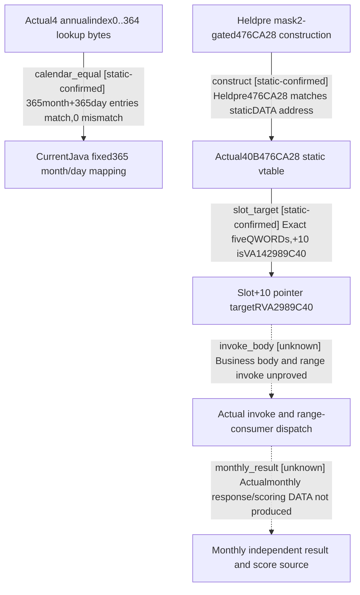

# Research plan: campaign-calendar-vtable-actual02

GENERATED from the supplied research plan; no native semantics are inferred.

Question: Do actual4 consumed365 month/day bytes equal currentJava fixed365 mapping, and what target is stored in the distinct monthly callable slot+10?



| Edge | Declared status | Evidence IDs | Open question |
|---|---|---|---|
| calendar_equal | static-confirmed | comparison, month_data, day_data |  |
| construct | static-confirmed | held_pre, comparison, vtable_data |  |
| slot_target | static-confirmed | comparison, vtable_data |  |
| invoke_body | unknown | comparison | 32B invokeprefix and385B1A34A30 rangeconsumer separately requested throughb64;not supplied yet. |
| monthly_result | unknown | comparison | Staticbytes/callreturn cannot substitute independent actualmonthlyresponse/create-onlyslot/score producer. |

| Observation design | Value |
|---|---|
| mode | offline-only |
| actor_kind | engine |
| owner_scope | Static image DATA and held daily pre/date consumers; no Game owned |
| identity_kind | none |
| identity_lifetime | Static exact-image RVAs and rawbytes only |
| producer_trigger | not-applicable |
| producer | b64 batch02 exact40B vtable and365+365B calendar DATA capture |
| caller | Held22A0EDA/22A0EF7 andpre2988366/2988373 consume tables;pre29887E0 constructs476CA28 |
| consumer | CurrentJava CampaignCalendar constants and heldmonthly callable slot+10; invoke business body unknown |
| cache_lifetime | Immutable bytes preserved as exact770B readback copies; no runtimecache assumption |
| expected_signal | 365 entries in each table match zero-basedJava mapping;slot+10 targets2989C40 |
| zero_sample_meaning | No runtime monthly sample;zero mismatches is static byte agreement only |
| stop_condition | Read3 suppliedraw windows and currentJava source only;no new EXE/Game invocation byworker |
| runtime_window_ref | None |

| Evidence ID | Declared layer | File | SHA-256 | Supports |
|---|---|---|---|---|
| comparison | source-contract | SOURCE-COMPARISON.json | 002c7b4e4b87838d67afa2062423020473de4a4296c79e31e6939ba22bd0e400 | Manual exactraw/currentJava365entry comparison and static slot+10 target, source-only limits |
| month_data | exact-build | month-table.raw | 218539a9f584e576a0912771d97ac39c5042fc9169e2b5d250069a88d1478f0a | Actualmonth bytes, managedbatch02 window006 |
| day_data | exact-build | day-table.raw | 49cfa7734c595821c26db19fac8d0427fa12adc3e8988e04e0d94198d8f35517 | Actualday bytes, managedbatch02 window007 |
| vtable_data | exact-build | monthly-vtable.raw | aca5f0945dd0fbff48ffa42dc071dc3d61ed68a9b6a959192af525c12d902add | Actual40B476CA28 vtable, window005 |
| held_pre | source-contract | ../held-dispatch-detail.json | 3e4d7459cb94322c2be07c872f769704991c705cb9befabbb7af9675d5366a96 | Reviewed actualpre constructs476CA28, forwards container/count;prior normalreturn limits |

Check result (file integrity and declarations only):

```json
{
  "schema": "xar.native-research-plan-check.v1",
  "result": "plan-consistent",
  "proof_layer": "record-structure-and-file-integrity",
  "semantic_correctness_verified": false,
  "live_execution_performed": false,
  "observation_plan_issues": [
    "offline-only plan does not define a live observation window",
    "the real producer trigger must be located before live sampling"
  ],
  "declared_edges_by_status": {
    "counter-policy": 0,
    "inference": 0,
    "live-confirmed": 0,
    "static-confirmed": 3,
    "unknown": 2
  },
  "enumerated_native_edges": 5,
  "declared_cases_by_status": {
    "pending": 1,
    "observed": 0,
    "not-applicable": 1
  },
  "checked_evidence_files": 5,
  "limitations": [
    "Evidence layers and conclusions are author declarations; hashes bind bytes, not their truth.",
    "Counts cover this enumerated graph only, not all CK3 branches.",
    "A consistent observation plan is not authorization to run or manipulate CK3."
  ],
  "plan_sha256": "554554bda7302284cd4c56176a7131f703ea3d5657742e853d823e3e95417df8"
}
```
