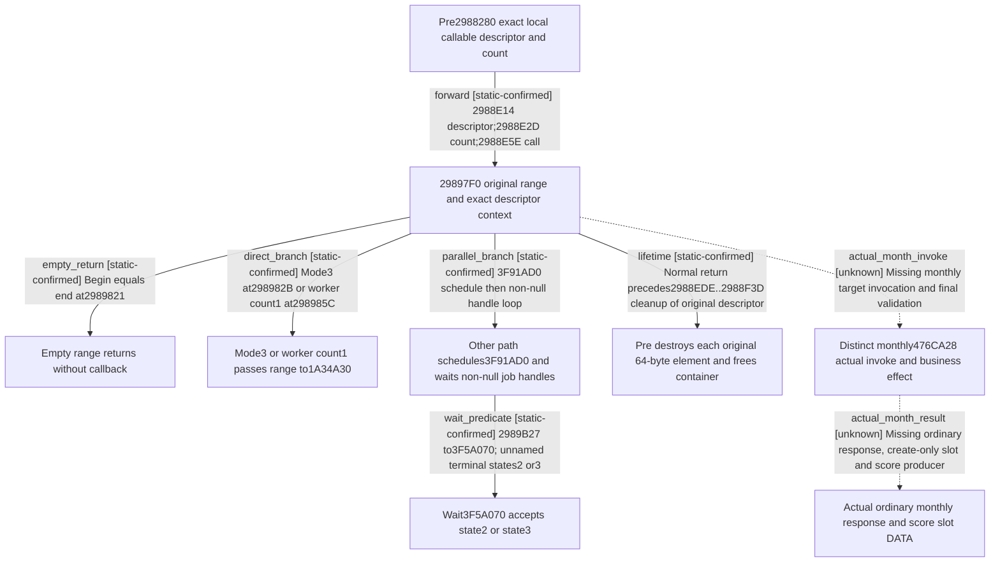

# Research plan: campaign-goal-clock-dispatch-20261026

GENERATED from the supplied research plan; no native semantics are inferred.

Question: What does the held actual4 pre-command&#x27;s callable-container dispatch normal return prove before date execution, and which monthly-result edge remains unproved?



| Edge | Declared status | Evidence IDs | Open question |
|---|---|---|---|
| forward | static-confirmed | held_dispatch |  |
| empty_return | static-confirmed | held_dispatch |  |
| direct_branch | static-confirmed | held_dispatch |  |
| parallel_branch | static-confirmed | held_dispatch |  |
| wait_predicate | static-confirmed | held_dispatch |  |
| lifetime | static-confirmed | held_dispatch |  |
| actual_month_invoke | unknown | held_dispatch | The 1A34A30 range consumer and476CA28 target invoke are not in this held bundle. The distinct476C9E0 manager functor cannot substitute for them. |
| actual_month_result | unknown | held_dispatch | No source-bound monthly response or scoring DATA publisher has been executed; a native flag, planned cap or wait return cannot supply its actual result. |

| Observation design | Value |
|---|---|
| mode | offline-only |
| actor_kind | engine |
| owner_scope | Exact-build CDailyTickCommand pre-command local callable container; no Game or process is owned |
| identity_kind | none |
| identity_lifetime | Pointers are source-local stack/container identities; no persisted or cross-process identity is asserted |
| producer_trigger | daily-tick |
| producer | Held pre-command 2988280 constructs 64-byte callable elements; mask2 gates the distinct target vtable476CA28 |
| caller | Held pre2988E5E passes range configuration and the context containing the exact RSP+30 descriptor to 29897F0 |
| consumer | 29897F0 direct range branch or parallel scheduling/wait path, then original pre container cleanup; actual monthly target invoke remains absent |
| cache_lifetime | Local descriptor and callable objects are consumed and destroyed before the pre-command normal return; callback effects and exception cleanup remain outside this record |
| expected_signal | Literal count/context forwarding, direct versus parallel branches, wait terminal predicate, and original container cleanup source |
| zero_sample_meaning | No runtime samples are collected. An empty configured range has an actual early return and cannot prove any callback or monthly business result |
| stop_condition | Decode only the six named slices already held in the 5319-byte phase-a04 bundle; no EXE scan, source acquisition, new runtime observation or worker build |
| runtime_window_ref | None |

| Evidence ID | Declared layer | File | SHA-256 | Supports |
|---|---|---|---|---|
| source_identity | exact-build | ../episode04-r08-task-construction-20261021/phase-a04/SOURCE.actual.json | 74fa41d46d2e2faf81f93ce126c0c5a36b29694a127ea1fa29df237b26e9398d | Original desktop-3fevhd2-1c74096080 source machine, exact4 image identity, finite source offsets and bundle slice hashes; no current-machine installation proof |
| held_dispatch | source-contract | held-dispatch-detail.json | 3e4d7459cb94322c2be07c872f769704991c705cb9befabbb7af9675d5366a96 | Manually reviewed literal source: exact local count/context forwarding, empty/direct/parallel dispatch paths, per-handle terminal wait and same original 64-byte element cleanup; distinct monthly invoke body remains absent |

Check result (file integrity and declarations only):

```json
{
  "schema": "xar.native-research-plan-check.v1",
  "result": "plan-consistent",
  "proof_layer": "record-structure-and-file-integrity",
  "semantic_correctness_verified": false,
  "live_execution_performed": false,
  "observation_plan_issues": [
    "offline-only plan does not define a live observation window"
  ],
  "declared_edges_by_status": {
    "counter-policy": 0,
    "inference": 0,
    "live-confirmed": 0,
    "static-confirmed": 6,
    "unknown": 2
  },
  "enumerated_native_edges": 8,
  "declared_cases_by_status": {
    "pending": 1,
    "observed": 0,
    "not-applicable": 1
  },
  "checked_evidence_files": 2,
  "limitations": [
    "Evidence layers and conclusions are author declarations; hashes bind bytes, not their truth.",
    "Counts cover this enumerated graph only, not all CK3 branches.",
    "A consistent observation plan is not authorization to run or manipulate CK3."
  ],
  "plan_sha256": "e4e0c91f554a29b630c865cb29187f496e074d5eb73aa74848a0145a3e9fcdcf"
}
```
