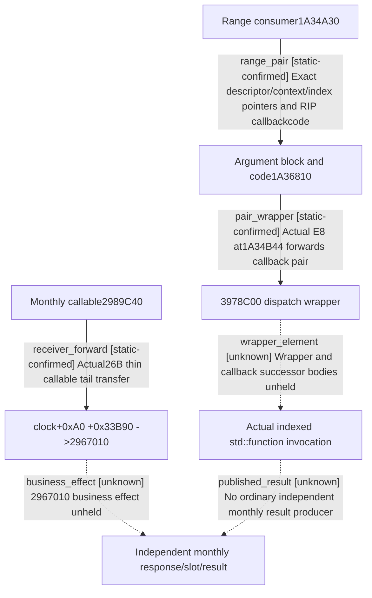

# Research plan: campaign-monthly-invoke-range-actual03

GENERATED from the supplied research plan; no native semantics are inferred.

Question: What exact receiver and callback object does actual monthly callable and range consumer forward, before unheld successors?



| Edge | Declared status | Evidence IDs | Open question |
|---|---|---|---|
| receiver_forward | static-confirmed | review, invoke |  |
| range_pair | static-confirmed | review, range |  |
| pair_wrapper | static-confirmed | review, range |  |
| wrapper_element | unknown | review | Does wrapper invoke pair code synchronously and how does1A36810 select/invoke original container element? |
| business_effect | unknown | review | What exact receiver business operation occurs? No business success from source-local tail transfer. |
| published_result | unknown | review | Actualresponse binding and single create-only slot remain absent; no date/score credit. |

| Observation design | Value |
|---|---|
| mode | offline-only |
| actor_kind | engine |
| owner_scope | Static exact-image CODE417B and held pre/vtable only; no Game owned |
| identity_kind | none |
| identity_lifetime | Static exact-image RVAs and rawbytes only |
| producer_trigger | not-applicable |
| producer | b64 batch03 exact32B monthly invoke prefix and385B range consumer |
| caller | Held pre/dispatch -&gt;1A34A30; actual476CA28+10 -&gt;2989C40 |
| consumer | 2967010 inline receiver and3978C00 callback pair/1A36810; successor effects unheld |
| cache_lifetime | Exact417B readback copies and source review; no runtimecache assumption |
| expected_signal | Complete prefix and range-body dataflow, independently computed rel32 and callback RIP target |
| zero_sample_meaning | No monthly runtime sample; static normal return does not grant business success |
| stop_condition | Review2 suppliedraw windows only; successor requests coordinated separately, no EXE/Game byworker |
| runtime_window_ref | None |

| Evidence ID | Declared layer | File | SHA-256 | Supports |
|---|---|---|---|---|
| review | source-contract | SOURCE-REVIEW.json | 9b6b36d9ba5cc9e1a1ede4acaa565ebc7ae4de09b1cc47440b0e5315ea2cbff9 | Manual complete114instruction review and exact forwarding/unknown limits |
| invoke | exact-build | monthly-invoke.raw | 90647d91cef5d0c6b4c70f478b5fc5a8a1c0983ae989a62dec73802464957a2d | Actual32B monthly callable prefix |
| range | exact-build | range-consumer.raw | f17b4c32a5ba9da81f3852ed9daf989ae36baa8e8962a145cd2f69029755d94a | Actual385B runtime-function range consumer |

Check result (file integrity and declarations only):

```json
{
  "schema": "xar.native-research-plan-check.v1",
  "result": "plan-consistent",
  "proof_layer": "record-structure-and-file-integrity",
  "semantic_correctness_verified": false,
  "live_execution_performed": false,
  "observation_plan_issues": [
    "offline-only plan does not define a live observation window",
    "the real producer trigger must be located before live sampling"
  ],
  "declared_edges_by_status": {
    "counter-policy": 0,
    "inference": 0,
    "live-confirmed": 0,
    "static-confirmed": 3,
    "unknown": 3
  },
  "enumerated_native_edges": 6,
  "declared_cases_by_status": {
    "pending": 0,
    "observed": 0,
    "not-applicable": 1
  },
  "checked_evidence_files": 3,
  "limitations": [
    "Evidence layers and conclusions are author declarations; hashes bind bytes, not their truth.",
    "Counts cover this enumerated graph only, not all CK3 branches.",
    "A consistent observation plan is not authorization to run or manipulate CK3."
  ],
  "plan_sha256": "1d4987329b9c6742ef60cde61a01258e775b4f764273dcf6a4d58bd4cddf43ba"
}
```
