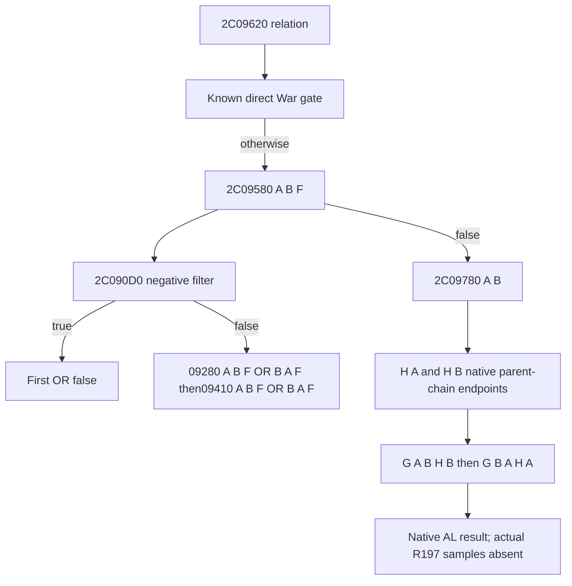

# R04 OR static source, exact1.20.0.4

This is shared research and proposed offline consumer code. It adds no live collector, publisher, Driver route or production consumer. Read source-index.json for exact ZIP member pins and contracts.json for typed source facts; the decision tree is below. The original checked plan stays exact in acquisition-provenance.exact.zip!nested/RESEARCH-PLAN.static-closed-a03.json, with its original paths and checks, rather than pretending a new path-rewritten plan was checked. All local-machine observations retain machine_id desktop-3fevhd2-1c74096080 and their original timestamps. A second machine may reuse knowledge/code; its installed EXE, runtime, paths, permissions and filming qualification require its own evidence.

R197 actual OR inputs/returns are UNKNOWN. Its outer relation ALfalse is not backfilled into an OR leaf. R04 physical positive remains FALSE. No R198 runtime, natural call or filming result is claimed here. The optional proposed Python module is copied byte-for-byte (8110B/f84f0dc857622b238f789c00b2370a337fff19724a7382f885b7a842b663434b); its historical one defaultunknown self-check group is not a production/wire qualification. No checks, EXE reads or builds were repeated during consolidation.

First OR uses complete IDs, rejects on D0true, and explicitly reloads originalF before each alternative. Its2C09280/2C09410 bodies remain unexpanded. Second OR uses the independent H returns and does not expose a justified entryR8/auxiliary contract.

D0 chooses the first descriptor matching A (W+20 preferred; W+80 tested only after first false), then tests B only against that chosen descriptor. It is not symmetric two-descriptor OR. Its true rejects the first OR. No explicit+358/ID-1 gate exists in D0. M2494B40 remains opaque; the source does not justify naming an active-war/enemy filter.

G rejects same IDs and true prefilters2911DD0/29131C0; the latter call does not reloadR8. The positive pair2C458C0(A)&&2C4BD20(B) is distinct from fallback2C10020(A,&slot=F). Fallback checks only Character magic and ID!=-1, with no returned-ID==B, returned-pointer==F or null guard. A/B hierarchy business roles remain unknown.

H's independent152B/40-instruction leaf has no exact pdata row, calls, stack/nonvolatile use or memory writes. Its disjoint96B+64B reads close a parent-chain fixed point; read160B includes8B tail padding beyond the body. Its context parent path is C+1C0 -> context+1C0 -> object+28, with Character magic/ID checks; otherwise C+1B8 -> object+C8 completeID is resolved against character storage. It returns current Character on invalid parent or self link. Entry fallback returns immediately, but an in-loop fallback is processed through the ordinary loop. Native validity assumptions and absence of a general cycle bound remain. This matches adopted Campaign/TitleHolder top_liege naming. R08 expense-context is a separate adopted alias; military payer remains unproved.

Six newly named lower bodies remain UNKNOWN:2494B40,2911DD0,29131C0,2C458C0,2C4BD20,2C10020. Earlier first-OR alternatives2C09280/2C09410 are also unknown. Do not silently count those as closed.

The first batch read256B code+256B metadata. The second read607B code including8B tail padding and retained44B unwind; its failed initial metadata ledger was reconstructed afterwards, not originally persisted. Keep exact PARTIAL-READ-RECOVERY and the failed H96 closure. H cannot borrow the next function's pdata/unwind.

For the video these sources can explain the observed negative condition and the remaining gap. They do not supply a county-loss positive narration, natural arrival, physical writer reduction, clean span or dynamic shot. Agent decisions may consume the strict unknown state; no new route is certified by these bytes. The next runtime step remains a separate original-entry/return observer inside existing P TLS, without extra predicate calls or route scans.

## Subsequent source increment, 2026-10-17

The earlier statement that2C09280/2C09410 bodies were unexpanded records this package's original boundary. Their complete bodies are now held separately: see [the directional increment](../episode04-county-or-directions-12004/README.md) and [its portable source index](../episode04-county-or-directions-12004/source-index.json). New lower bodies2C09360/2C0FEC0 remain unknown. The six previously named lower bodies remain unknown; R197 actual OR remains unknown and physical positive remains false. Original contracts and exact archives above retain their original source facts.
