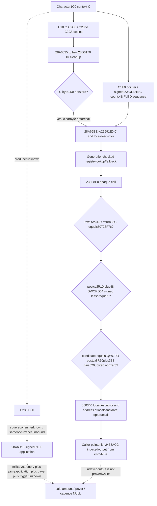

# R08 context-owner candidate29591E0: actual source result

machine_id: desktop-3fevhd2-1c74096080. Static exact4 source only; no game action.

Only the snapshot copies are proved context writes here. The225B source has stack stores but no direct nonstack store; its two opaquecalls remain opaque. Exactly54 saved instructions span three genuine extents; both continuations explicitly CHAININFO to29591E0. All saved ordinary branches resolve within the225B union, ending RET29592C0. This does not expand callee/exception effects or infer runtime execution.

The1D8 gate is a raw source branch, not a proved business dirtyflag or payment trigger. A helper running later in this invocation cannot produce the already-completed earlier copies; cross-invocation effects remain unknown.
