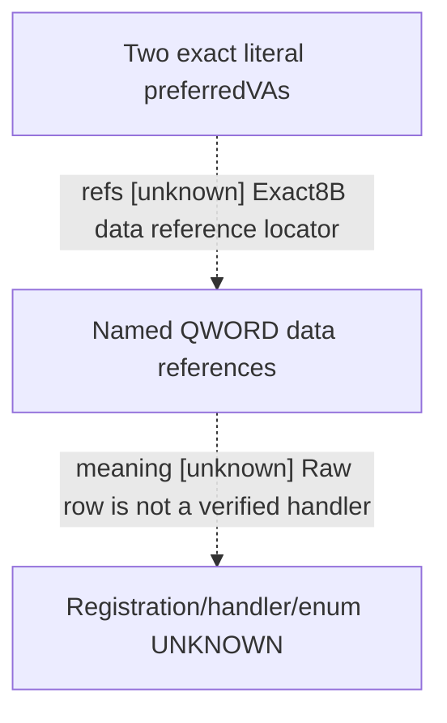

# Research plan: e04-two-pinned-literal-QWORD-refs-data

GENERATED from the supplied research plan; no native semantics are inferred.

Question: Does .data contain QWORD preferred-VA references to the two held standalone GetCurrency/barter_goods literals?



| Edge | Declared status | Evidence IDs | Open question |
|---|---|---|---|
| refs | unknown | literal | Any actual data references to the two literalVAs? |
| meaning | unknown | literal | What actual schema/registration/handler does the row encode? |

| Observation design | Value |
|---|---|
| mode | offline-only |
| actor_kind | engine |
| owner_scope | Root-approved fifth scope: only.data8571392B, two exact pinnedVAs; no.rdataRVA32 or new strings/callee/body |
| identity_kind | definition-key |
| identity_lifetime | Same exact image/file identity as first literal packet; preferredVA neverruntimeVA |
| producer_trigger | not-applicable |
| producer | Exact QWORD patterns derived from pinned literal receipt; no instruction boundary or business interpretation |
| caller | GetCurrency44DB128 and barter_goods450BB80 exact literal locations from prior scope |
| consumer | Potential native named registration/enum rows, not yet source-confirmed handlers |
| cache_lifetime | Static bytes only |
| expected_signal | &lt;=32 raw QWORD-reference rows with&lt;=128Bcontext each; any0/truncation remains explicit |
| zero_sample_meaning | No QWORD match in .data only, not absence of native name binding or business resource. |
| stop_condition | One.data8571392B read; &lt;=16rows/96B; cumulative185103872B sections/9reads; header608B separate; body0; package&lt;=131072B. Zero/no named handler closes this lane. |
| runtime_window_ref | None |

| Evidence ID | Declared layer | File | SHA-256 | Supports |
|---|---|---|---|---|
| literal | locator | LITERALS.actual.json | af76ea5a7e69ea52048dc6ed80e6c78de7244e19ed02346a8f095cf378e47121 | Actual two name literal RVAs and static preferredVAs; no handler mapping |
| corrected-RIP | locator | NAMED-RIP.overlap-complete.actual.json | 243302d54fe3bda5f476dcbd61e2ee0892c741f5a727f594c55684778423b4e1 | No named8B/8D RIPcandidate in complete specified matcher; no semantic closure |

Check result (file integrity and declarations only):

```json
{
  "schema": "xar.native-research-plan-check.v1",
  "result": "plan-consistent",
  "proof_layer": "record-structure-and-file-integrity",
  "semantic_correctness_verified": false,
  "live_execution_performed": false,
  "observation_plan_issues": [
    "offline-only plan does not define a live observation window",
    "the real producer trigger must be located before live sampling"
  ],
  "declared_edges_by_status": {
    "counter-policy": 0,
    "inference": 0,
    "live-confirmed": 0,
    "static-confirmed": 0,
    "unknown": 2
  },
  "enumerated_native_edges": 2,
  "declared_cases_by_status": {
    "pending": 1,
    "observed": 0,
    "not-applicable": 1
  },
  "checked_evidence_files": 2,
  "limitations": [
    "Evidence layers and conclusions are author declarations; hashes bind bytes, not their truth.",
    "Counts cover this enumerated graph only, not all CK3 branches.",
    "A consistent observation plan is not authorization to run or manipulate CK3."
  ],
  "plan_sha256": "7a3b77f2de90ffc642ee9a7db768cf2220274aa7b5139e05b30d9a76108880b9"
}
```
