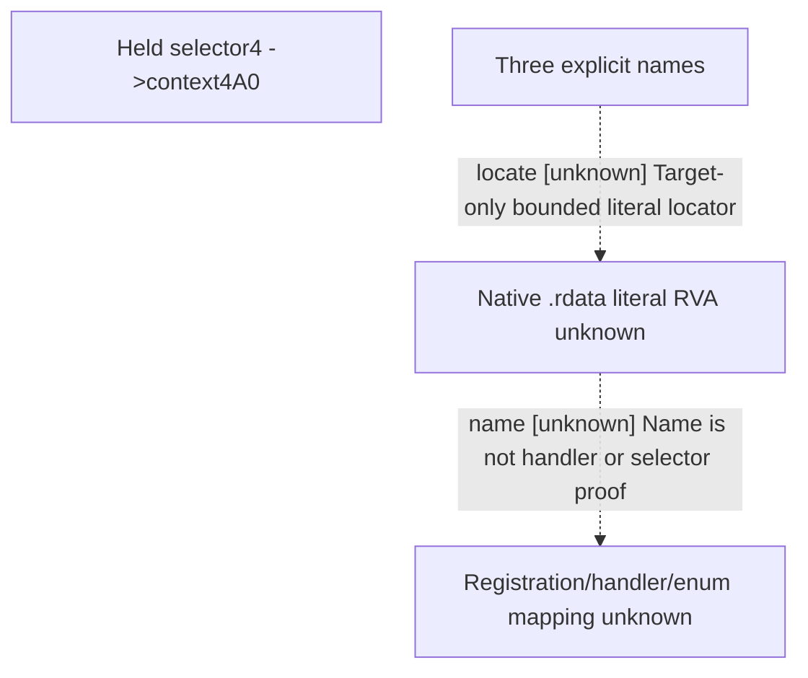

# Research plan: e04-resource4-three-name-rdata-locator

GENERATED from the supplied research plan; no native semantics are inferred.

Question: Locate only three named native currency/flag literals for a later explicit registration/handler proof of selector4; no business naming from positions.



| Edge | Declared status | Evidence IDs | Open question |
|---|---|---|---|
| locate | unknown | held | Are named literals in actual .rdata? |
| name | unknown | held | Which actual registration rows and source handlers connect to selector4? |

| Observation design | Value |
|---|---|
| mode | offline-only |
| actor_kind | engine |
| owner_scope | Root authorized exact file metadata and target-only .rdata literals; no .text, SDK, desktop or build |
| identity_kind | definition-key |
| identity_lifetime | Exact image/current same-file identity only; no runtime pointer/session qualification |
| producer_trigger | not-applicable |
| producer | Literal registrations not yet located; exact targets GetCurrency/barter_goods/government_use_barter_goods only |
| caller | Held28B9950 selector4 writes context4A0 via2BAFF30 |
| consumer | Vanilla HUD GetPlayer.GetCurrency(barter_goods); native registration and enum connection unknown |
| cache_lifetime | Static file bytes; no runtime cache/cadence claim |
| expected_signal | Exact literal RVA/encoding and &lt;=128B context to nominate a later bounded data-pointer registration proof |
| zero_sample_meaning | Zero literal hits in this actual .rdata scope does not prove no registration, no currency, zero payment or alternate encoding elsewhere |
| stop_condition | PE headers/sectionmap&lt;=65536B; literal read&lt;=134217728B/32reads; &lt;=32 output hits,&lt;=128B context each; zero .text/wholehash; output&lt;=131072B |
| runtime_window_ref | None |

| Evidence ID | Declared layer | File | SHA-256 | Supports |
|---|---|---|---|---|
| held | source-contract | D:\workspace\ck3_eternal_recurrence\docs\ck3-native-ai\episode04-r08-rate-resource4-application-12004.md | 598c6d12bfd6d6225209b88a98d33a9cbbf229ffeb6b9fe4f01f51bcf7956311 | Existing selector4/context4A0 direct source, with business name explicitly unknown |

Check result (file integrity and declarations only):

```json
{
  "schema": "xar.native-research-plan-check.v1",
  "result": "plan-consistent",
  "proof_layer": "record-structure-and-file-integrity",
  "semantic_correctness_verified": false,
  "live_execution_performed": false,
  "observation_plan_issues": [
    "offline-only plan does not define a live observation window",
    "the real producer trigger must be located before live sampling"
  ],
  "declared_edges_by_status": {
    "counter-policy": 0,
    "inference": 0,
    "live-confirmed": 0,
    "static-confirmed": 0,
    "unknown": 2
  },
  "enumerated_native_edges": 2,
  "declared_cases_by_status": {
    "pending": 1,
    "observed": 0,
    "not-applicable": 1
  },
  "checked_evidence_files": 1,
  "limitations": [
    "Evidence layers and conclusions are author declarations; hashes bind bytes, not their truth.",
    "Counts cover this enumerated graph only, not all CK3 branches.",
    "A consistent observation plan is not authorization to run or manipulate CK3."
  ],
  "plan_sha256": "39d162434c2e91111b2e06b1e3c584d22a966c963d3286ef7e8beac9d6657197"
}
```
