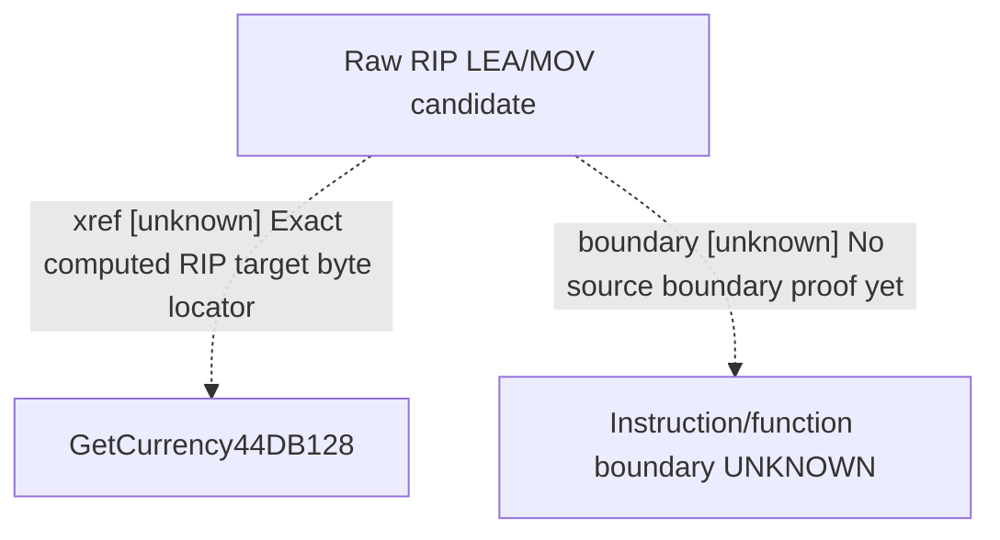

# Research plan: e04-GetCurrency-only-named-RIP-locator

GENERATED from the supplied research plan; no native semantics are inferred.

Question: Which raw .text LEA/MOV RIP-relative byte patterns target exactly the already-held GetCurrency44DB128 literal?



| Edge | Declared status | Evidence IDs | Open question |
|---|---|---|---|
| xref | unknown | literal, data | Any matching target-only LEA/MOV pattern? |
| boundary | unknown | literal | Use genuine site to locate containing.pdata and decode from function entry later |

| Observation design | Value |
|---|---|
| mode | offline-only |
| actor_kind | engine |
| owner_scope | Third Root-approved locator only; one.text read, one exact target, no new string or callee/body expansion |
| identity_kind | definition-key |
| identity_lifetime | Exact image and same native file identity; preferred offsets not runtime frame |
| producer_trigger | not-applicable |
| producer | Raw LEA/MOV candidate site; function/instruction boundaries still unknown |
| caller | Unknown named registration wrapper; previous .rdata GetCurrencyQWORD refs0 |
| consumer | Potential named GetCurrency registration/handler route, not actual selector mapping |
| cache_lifetime | Static locator bytes only |
| expected_signal | &lt;=16sites/96B each with computed RIP target44DB128; no semantic proof from raw candidate |
| zero_sample_meaning | Zero means no matching retained byte pattern in this one.text scope; not no native registration or absent currency |
| stop_condition | Single71141888B.text read, one read; cumulative105390592B sections&lt;128MiB; no callee/hash/body expansion; output&lt;=131072B |
| runtime_window_ref | None |

| Evidence ID | Declared layer | File | SHA-256 | Supports |
|---|---|---|---|---|
| literal | locator | LITERALS.actual.json | af76ea5a7e69ea52048dc6ed80e6c78de7244e19ed02346a8f095cf378e47121 | Unique exact GetCurrency literal44DB128 |
| data | locator | QWORD-REFS.actual.json | b2903c63f08fcc6d5a3e59e7beae4214c54f54bc3ec273974a058fed3716da79 | No same.rdata QWORD data reference for GetCurrency; need explicit named RIP locator |

Check result (file integrity and declarations only):

```json
{
  "schema": "xar.native-research-plan-check.v1",
  "result": "plan-consistent",
  "proof_layer": "record-structure-and-file-integrity",
  "semantic_correctness_verified": false,
  "live_execution_performed": false,
  "observation_plan_issues": [
    "offline-only plan does not define a live observation window",
    "the real producer trigger must be located before live sampling"
  ],
  "declared_edges_by_status": {
    "counter-policy": 0,
    "inference": 0,
    "live-confirmed": 0,
    "static-confirmed": 0,
    "unknown": 2
  },
  "enumerated_native_edges": 2,
  "declared_cases_by_status": {
    "pending": 1,
    "observed": 0,
    "not-applicable": 1
  },
  "checked_evidence_files": 2,
  "limitations": [
    "Evidence layers and conclusions are author declarations; hashes bind bytes, not their truth.",
    "Counts cover this enumerated graph only, not all CK3 branches.",
    "A consistent observation plan is not authorization to run or manipulate CK3."
  ],
  "plan_sha256": "7030ea1d4fdb8d28146a4d5e5fcb08cc79d7a3802668a7376fa7905aaac93db3"
}
```
