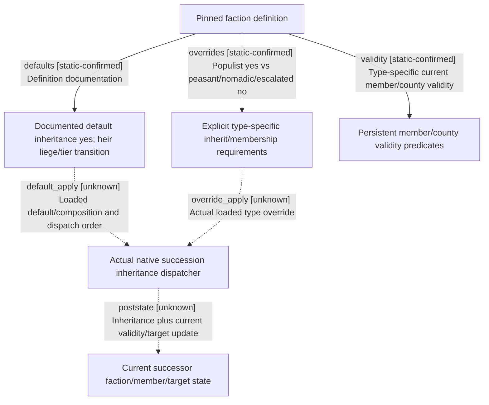

# Research plan: g2-m1-faction-membership-inheritance-12004-resume61

GENERATED from the supplied research plan; no native semantics are inferred.

Question: What do inspected faction definitions say is inherited by member heirs, and which post-succession validity/targeting semantics remain native unknown?



| Edge | Declared status | Evidence IDs | Open question |
|---|---|---|---|
| defaults | static-confirmed | info, classic, dissolution |  |
| overrides | static-confirmed | populist, peasant, nomadic |  |
| validity | static-confirmed | classic, dissolution, populist, peasant, nomadic, common_validity |  |
| default_apply | unknown | info | Locate exact .4 native parse/default and actual succession caller before asserting which heir inherits. |
| override_apply | unknown | populist, peasant, nomadic | No current loaded definition/mod override or actual succession observed. |
| poststate | unknown | common_validity | Member-heir transfer does not specify target retargeting; actual current state and revalidation cadence remain unobserved. |

| Observation design | Value |
|---|---|
| mode | offline-only |
| actor_kind | engine |
| owner_scope | Pinned local 1.20.0.4 classic, dissolution, populist, escalated-peasant, peasant and nomadic definitions; no current Game. |
| identity_kind | definition-key |
| identity_lifetime | Definition keys stay bound to inspected source SHA; live faction/member FullIDs and successor owner frames require separate current observation. |
| producer_trigger | unknown |
| producer | Definition inherit_membership and membership requirements; native succession inheritance dispatcher is unlocated. |
| caller | Actual native succession/liege-tier transition caller remains unknown; definitions are not a call trace. |
| consumer | Current member validity and faction county/character requirements, whose actual native execution order remains unknown. |
| cache_lifetime | No inherited runtime vector lifetime or immediate invalidation cadence is proven by the inspected config. |
| expected_signal | Exact type-specific override/default matrix and explicit boundary between member-heir inheritance and target retargeting. |
| zero_sample_meaning | No runtime samples. A type with requires_character=no may have no ordinary character members while county membership still supports its existence; this is source semantics, not a current state claim. |
| stop_condition | Seven named source files only; no raw, EXE scans, live queries/actions or extra native windows. |
| runtime_window_ref | None |

| Evidence ID | Declared layer | File | SHA-256 | Supports |
|---|---|---|---|---|
| info | source-contract | Z:/SteamLibrary/steamapps/common/Crusader Kings III/game/common/factions/_factions.info | fb47457aabe7c7df78555b4dfba74b8932dae468c45ebb2d1381caddc2b7e019 | L305-337 defines inherited membership default yes for heirs whose liege/tier changed through succession, separate from requires county/character/leader defaults. This does not define target retargeting or actual native call order. |
| classic | source-contract | Z:/SteamLibrary/steamapps/common/Crusader Kings III/game/common/factions/00_factions.txt | c604b3fcf3fe315516483a9da45fe8c0e38db2031dc683ba6edd569c120b377b | Inspected independence/liberty/claimant definitions contain no explicit inherit_membership override; character validity uses common validity. Claimant special-character handling is separately owned and is not re-researched. |
| dissolution | source-contract | Z:/SteamLibrary/steamapps/common/Crusader Kings III/game/common/factions/00_nation_fracturing_faction.txt | 195e160d2c534f00d62e75ae1a44b88dc54fee01650d481bd8ea20560aa1d336 | No explicit inherit_membership override; is_character_valid L39-46 uses common validity and valid-member checks. |
| populist | source-contract | Z:/SteamLibrary/steamapps/common/Crusader Kings III/game/common/factions/00_populist_faction.txt | c67853a56bcea26ed90427cdba7ed4a51968ee085ec88e34fe2976ce5437dd4d | Populist explicit inherit_membership=yes L1136; escalated_peasant explicit no L1832. Their required member categories, player allowance, county validity and character validity differ, L62-170 and L1182-1273. |
| peasant | source-contract | Z:/SteamLibrary/steamapps/common/Crusader Kings III/game/common/factions/00_peasant_faction_new.txt | abcfd7119d00285660818e7e26aed230c78ace863f714a746a1ee99ea9672aa4 | Explicit inherit_membership=no L766 and county_can_switch=yes L768. Requires county yes/character no L39-40; county validity L46-63 targets direct holder except named restored-Rome branch. |
| nomadic | source-contract | Z:/SteamLibrary/steamapps/common/Crusader Kings III/game/common/factions/00_nomadic_faction.txt | 74be9ae0df2cfc89b5b5c99c57c2c567786af0b390339843224921ea26f0e858 | Explicit inherit_membership=no L575; requires county yes/character no L24-25; county validity L31-52 uses holder.top_liege and nomad/herder holding rules. |
| common_validity | source-contract | Z:/SteamLibrary/steamapps/common/Crusader Kings III/game/common/scripted_triggers/00_faction_triggers.txt | dd7b3a650b559b26959ed1708fc7cacd009d1cbb6735fa9d27905fb40570c517 | L30-76 persistent member validity uses current target liege or active contract, current tier/block/relations. Membership inheritance config alone does not establish the post-succession current state. |

Check result (file integrity and declarations only):

```json
{
  "schema": "xar.native-research-plan-check.v1",
  "result": "plan-consistent",
  "proof_layer": "record-structure-and-file-integrity",
  "semantic_correctness_verified": false,
  "live_execution_performed": false,
  "observation_plan_issues": [
    "offline-only plan does not define a live observation window",
    "the real producer trigger must be located before live sampling"
  ],
  "declared_edges_by_status": {
    "counter-policy": 0,
    "inference": 0,
    "live-confirmed": 0,
    "static-confirmed": 3,
    "unknown": 3
  },
  "enumerated_native_edges": 6,
  "declared_cases_by_status": {
    "pending": 2,
    "observed": 0,
    "not-applicable": 0
  },
  "checked_evidence_files": 7,
  "limitations": [
    "Evidence layers and conclusions are author declarations; hashes bind bytes, not their truth.",
    "Counts cover this enumerated graph only, not all CK3 branches.",
    "A consistent observation plan is not authorization to run or manipulate CK3."
  ],
  "plan_sha256": "c8377df8f5636c5922c08c1795d1f39bd3fe4a87826fa7a6f71a54b332ce2e65"
}
```
