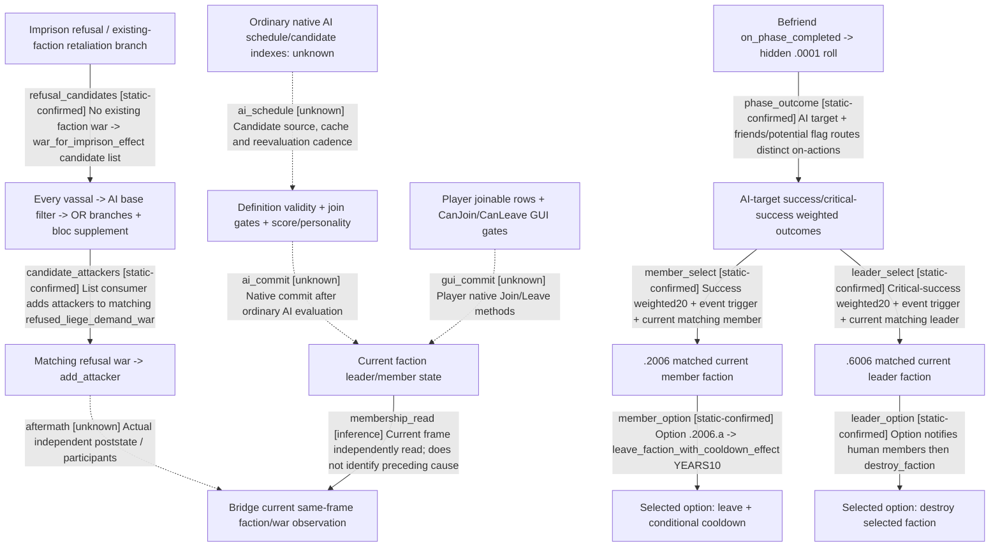

# Research plan: g2-m1-membership-callers-12004-resume61

GENERATED from the supplied research plan; no native semantics are inferred.

Question: Which inspected callers actually change faction membership or recruit revolt-war participants, and which only publish qualification or current membership?



| Edge | Declared status | Evidence IDs | Open question |
|---|---|---|---|
| ai_schedule | unknown | info, ai | Locate exact .4 native scheduler, final validation and member-removal callers; UPDATE_INTERVAL_DAYS documentation alone is insufficient. |
| ai_commit | unknown | triggers, rules, ai | Actual .4 code composition/order and forced-member exceptions remain unproven. |
| gui_commit | unknown | gui | GUI binding is source-confirmed; final exact-build native method implementation is not located here. |
| phase_outcome | static-confirmed | befriend_scheme, befriend_events, befriend_caller |  |
| member_select | static-confirmed | befriend_caller, befriend_events |  |
| leader_select | static-confirmed | befriend_caller, befriend_events |  |
| member_option | static-confirmed | befriend_events, effects |  |
| leader_option | static-confirmed | befriend_events |  |
| refusal_candidates | static-confirmed | prison, interaction_effects, triggers |  |
| candidate_attackers | static-confirmed | interaction_effects |  |
| aftermath | unknown |  | No live refusal, current participant set or loaded bridge captured; static effects do not prove business postcondition. |
| membership_read | inference | info, gui | Actual current bridge/source/frame and producer lineage must be supplied by formal runtime; this source-only map grants no loaded qualification. |

| Observation design | Value |
|---|---|
| mode | offline-only |
| actor_kind | engine |
| owner_scope | Inspected local 1.20.0.4 faction and character-interaction scripts; AI candidate branches and human event/GUI routes are labelled separately. No active Game session. |
| identity_kind | definition-key |
| identity_lifetime | Definition keys belong to the pinned local source files; current FactionID/CharacterID membership requires a separately bound runtime frame. |
| producer_trigger | unknown |
| producer | Befriend outcome on-actions, faction definition validity/score blocks, and refusal-war scripted effects; native ordinary AI candidate scheduler remains unlocated. |
| caller | befriend_success/critical_success -&gt; outcome events; prison/revoke refusal -&gt; war_for_* -&gt; every_vassal -&gt; joining_vassals -&gt; add_attacker. Native AI/GUI method bodies are unknown. |
| consumer | Explicit leave_faction/destroy_faction/add_attacker effects; GUI uses separate CanJoin/CanLeave method gates. Bridge only observes current rows. |
| cache_lifetime | joining_vassals and war_to_join are effect-scope lists. No inspected source proves ordinary AI score cache lifetime, membership update cadence or engine index coverage. |
| expected_signal | Pinned source caller -&gt; candidate enumeration/filter -&gt; effect chain, retaining unknown native scheduling edges. |
| zero_sample_meaning | No runtime sampling. Absence of UPDATE_INTERVAL_DAYS in common/defines does not prove absence of a native default or update scheduler. |
| stop_condition | Finite source inspection and integrity check of the named files only; no new raw capture, executable scan, Game query or action. |
| runtime_window_ref | None |

| Evidence ID | Declared layer | File | SHA-256 | Supports |
|---|---|---|---|---|
| info | source-contract | Z:/SteamLibrary/steamapps/common/Crusader Kings III/game/common/factions/_factions.info | fb47457aabe7c7df78555b4dfba74b8932dae468c45ebb2d1381caddc2b7e019 | L57-98 describes update/leave callbacks and score scopes; L173-208 separates persistent validity and join gating; L305-337 documents inheritance and membership requirements. Not an actual native call body. |
| ai | source-contract | Z:/SteamLibrary/steamapps/common/Crusader Kings III/game/common/defines/ai/00_ai.txt | 3af5d4100789bad56570e05c5852f35783605813957de7a5129d23142a116120 | L1845-1899 documents AI join/create thresholds and personality factors; no scheduler/candidate collector body. |
| rules | source-contract | Z:/SteamLibrary/steamapps/common/Crusader Kings III/game/common/scripted_rules/00_rules.txt | c7ba2ae71e4461e88c6d5c86d8fc15fa7ccc73edae1e28fb3b65f0e362c4560f | L265-349 defines global hard and soft join/create blocks, including alliance, hook, friendship and chaplain blocks; actual ordinary native invocation order remains unknown. |
| triggers | source-contract | Z:/SteamLibrary/steamapps/common/Crusader Kings III/game/common/scripted_triggers/00_faction_triggers.txt | dd7b3a650b559b26959ed1708fc7cacd009d1cbb6735fa9d27905fb40570c517 | L30-118 separates retained member validity and additional join gates; L295 onward defines rebellion-specific AI candidate filters, not ai_join_score. |
| effects | source-contract | Z:/SteamLibrary/steamapps/common/Crusader Kings III/game/common/scripted_effects/00_faction_effects.txt | c7f853b9c8cf836cfc6b635c58bfa3c31a686528e99f5628e320a1d97a5efc70 | L41-58 leave_faction_with_cooldown_effect performs leave first and adds joining_faction_block only for non-adventurers. |
| befriend_caller | source-contract | Z:/SteamLibrary/steamapps/common/Crusader Kings III/game/common/on_action/schemes/befriend_on_actions.txt | 58ce2cc8c86c5370da15c9f5fbb8ebf9dac89201fd4758f17254162040136b6d | L158-187 lists faction leader outcome .6006 under critical success and member outcome .2006 under success, both weight20 among other outcomes; no universal success probability follows. |
| befriend_scheme | source-contract | Z:/SteamLibrary/steamapps/common/Crusader Kings III/game/common/schemes/scheme_types/befriend_scheme.txt | ea109e5bba6052225f72e24474f5c49fa12678342dda05445c07b7f3cd684fb4 | Current on_phase_completed saves scheme/target/owner and triggers hidden befriend_outcome.0001. That event L162-206 routes AI friends-&gt;critical_success, AI potential-&gt;success, while human targets use a choice event. The old file comment saying on_ready is not the current scheme callback. |
| befriend_events | source-contract | Z:/SteamLibrary/steamapps/common/Crusader Kings III/game/events/scheme_events/befriend_scheme/befriend_scheme_outcome_events.txt | 63263e27e46ea4500164528e3f3718839f6bd87c3298ae5eab642cf952927e9d | L872-929 member success selects a matching current targeting faction, then option makes target leave with10-year cooldown; L1953-2015 leader critical success selects matching leader faction then option destroys it. Both require AI target/direct liege and no travel. |
| interaction_effects | source-contract | Z:/SteamLibrary/steamapps/common/Crusader Kings III/game/common/scripted_effects/00_interaction_effects.txt | 4247f484295988b50098a43869d4c4056b7e0855bf8d5fa6ec0755cb996d7e82 | L751-900 imprisonment refusal starts refused_liege_demand_war, enumerates every_vassal and adds selected AI candidates as attackers; L1113-1410 revoke/retraction and bloc supplement use related but distinct filters. No join_faction effect occurs in this shown consumer. |
| prison | source-contract | Z:/SteamLibrary/steamapps/common/Crusader Kings III/game/common/character_interactions/00_prison_interactions.txt | 1bb43b3c2061212af8d41b11314ff4e569af2a3506319f820d05877a7762abc5 | L600-630 existing-faction retaliation is attempted first for eligible existing member; war_for_imprison_effect follows only with no joined_faction.faction_war, or the nonmember branch. |
| strength_preview | source-contract | Z:/SteamLibrary/steamapps/common/Crusader Kings III/game/common/script_values/00_interaction_values.txt | 52a7cf8ef212c835bfc5bc5ce049af2e33d7586eb9d477343e8eedacf58ebd66 | L525-536 revoke_refusal_war_rising_strength_value uses every_powerful_vassal plus base+tyranny filters; actual effect enumerates every_vassal plus OR branches and bloc supplement. Equality is not established. |
| gui | source-contract | Z:/SteamLibrary/steamapps/common/Crusader Kings III/game/gui/window_factions.gui | 6cc1a21deda0ae4e02bd152d65ef4e56d6d0f4f77107b2e96167b5d2e9deed9f | L336-337 supplies player joinable rows; L741-744 routes CanJoinFaction/JoinFaction; L845-851 routes IsPlayerMember/CanLeaveFaction/LeaveFaction. Native method bodies and AI callers are not implied. |

Check result (file integrity and declarations only):

```json
{
  "schema": "xar.native-research-plan-check.v1",
  "result": "plan-consistent",
  "proof_layer": "record-structure-and-file-integrity",
  "semantic_correctness_verified": false,
  "live_execution_performed": false,
  "observation_plan_issues": [
    "offline-only plan does not define a live observation window",
    "the real producer trigger must be located before live sampling"
  ],
  "declared_edges_by_status": {
    "counter-policy": 0,
    "inference": 1,
    "live-confirmed": 0,
    "static-confirmed": 7,
    "unknown": 4
  },
  "enumerated_native_edges": 12,
  "declared_cases_by_status": {
    "pending": 4,
    "observed": 0,
    "not-applicable": 0
  },
  "checked_evidence_files": 12,
  "limitations": [
    "Evidence layers and conclusions are author declarations; hashes bind bytes, not their truth.",
    "Counts cover this enumerated graph only, not all CK3 branches.",
    "A consistent observation plan is not authorization to run or manipulate CK3."
  ],
  "plan_sha256": "d87e3372e15c76901ca12937512ea58d718333ee1ead050080a3bedf0d5d8b9d"
}
```
