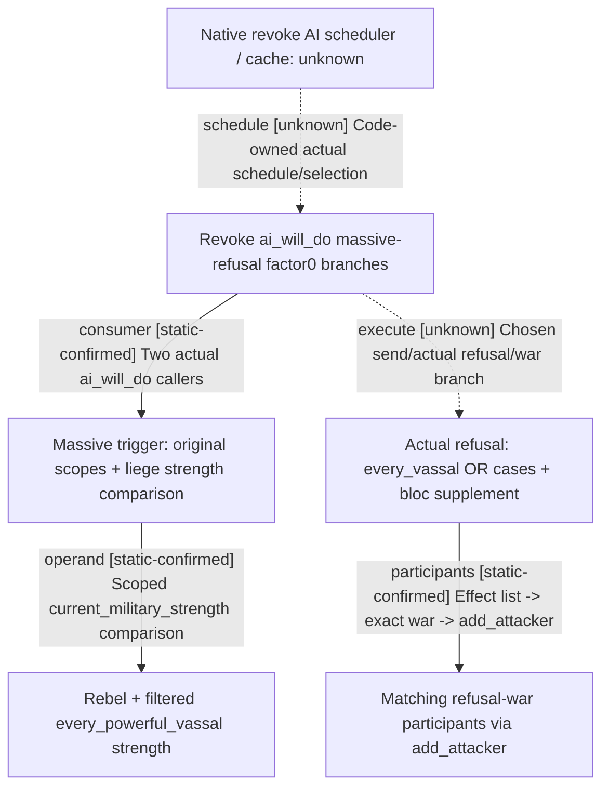

# Research plan: g2-m1-revoke-refusal-ai-consumer-12004-resume61

GENERATED from the supplied research plan; no native semantics are inferred.

Question: Who actually consumes the rising-strength estimate and how does its candidate scope differ from actual refusal-war recruitment?



| Edge | Declared status | Evidence IDs | Open question |
|---|---|---|---|
| schedule | unknown | ai, interaction | Exact native scheduler and cache remain unlocated; config comments are not a call trace. |
| consumer | static-confirmed | interaction, trigger |  |
| operand | static-confirmed | trigger, value |  |
| execute | unknown | interaction, effect | No actual AI selection, native final validation or recipient refusal observed; willingness evaluation does not execute the effect. |
| participants | static-confirmed | effect |  |

| Observation design | Value |
|---|---|
| mode | offline-only |
| actor_kind | ai |
| owner_scope | Native AI liege considering revoke-title interaction; actual human legality and GUI preview are separate and unproven by these branches. |
| identity_kind | definition-key |
| identity_lifetime | Definition keys bind inspected source; liege/rebel scopes are current effect context, not portable identities. |
| producer_trigger | unknown |
| producer | revoke_refusal_war_rising_strength_value: rebel strength plus current powerful-vassal subset. |
| caller | revoke_title_interaction.ai_will_do -&gt; revoke_refusal_war_would_be_massive_trigger -&gt; value. Native scheduler/config cache remains unknown. |
| consumer | Two scripted willingness factor0 modifiers; actual refusal-war list/add_attacker consumer is independently traced. |
| cache_lifetime | No native AI cache generation or invalidation body is located. REVOKE_TITLE_TICK comments describe configuration intent only. |
| expected_signal | Actual source consumers, scope-setting trigger, candidate subset and refusal-war effect differences. |
| zero_sample_meaning | No runtime samples. ai_frequency0 does not mean disabled: source explicitly says code owns scheduling. |
| stop_condition | Five pinned source files and finite caller searches only; no current EXE read, native call or Game. |
| runtime_window_ref | None |

| Evidence ID | Declared layer | File | SHA-256 | Supports |
|---|---|---|---|---|
| ai | source-contract | Z:/SteamLibrary/steamapps/common/Crusader Kings III/game/common/defines/ai/00_ai.txt | 3af5d4100789bad56570e05c5852f35783605813957de7a5129d23142a116120 | L62-69 documents REVOKE_TITLE_TICK by tier and next-day reconsideration after a revocation or imprisoning a vassal; exact native scheduler is not located. |
| interaction | source-contract | Z:/SteamLibrary/steamapps/common/Crusader Kings III/game/common/character_interactions/00_revoke_title_interaction.txt | ea5771400d123c89348aceb8ab1aa98e47fa257f00babf52bd5c7cd5ba6c3e1b | L962-972 declares AI vassal recipients, ai_frequency0 handled via code and scripted willingness; L1474-1500 applies massive-refusal trigger in two factor0 willingness branches, not a proven GUI preview or player-legality gate. |
| trigger | source-contract | Z:/SteamLibrary/steamapps/common/Crusader Kings III/game/common/scripted_triggers/00_interaction_triggers.txt | c0ec5a6d1446fe9e654549dfddf7bdde60123baf01f8747b66ae006025256ea7 | L198-205 actual massive trigger requires no revoke reason, no no_powerful_vassals flag, stores original liege/rebel scopes and compares liege current_military_strength against the scripted value. |
| value | source-contract | Z:/SteamLibrary/steamapps/common/Crusader Kings III/game/common/script_values/00_interaction_values.txt | 52a7cf8ef212c835bfc5bc5ce049af2e33d7586eb9d477343e8eedacf58ebd66 | L525-536 sums rebel.current_military_strength plus every_powerful_vassal passing base+tyranny filters. This is the actual AI trigger operand, not a complete participant catalog. |
| effect | source-contract | Z:/SteamLibrary/steamapps/common/Crusader Kings III/game/common/scripted_effects/00_interaction_effects.txt | 4247f484295988b50098a43869d4c4056b7e0855bf8d5fa6ec0755cb996d7e82 | L1113-1410 actual revoke/retraction refusal starts war then enumerates every_vassal with additional OR cases and bloc supplement; L866-900 selected list consumer adds attackers to exact matching refusal war. |

Check result (file integrity and declarations only):

```json
{
  "schema": "xar.native-research-plan-check.v1",
  "result": "plan-consistent",
  "proof_layer": "record-structure-and-file-integrity",
  "semantic_correctness_verified": false,
  "live_execution_performed": false,
  "observation_plan_issues": [
    "offline-only plan does not define a live observation window",
    "the real producer trigger must be located before live sampling"
  ],
  "declared_edges_by_status": {
    "counter-policy": 0,
    "inference": 0,
    "live-confirmed": 0,
    "static-confirmed": 3,
    "unknown": 2
  },
  "enumerated_native_edges": 5,
  "declared_cases_by_status": {
    "pending": 2,
    "observed": 0,
    "not-applicable": 0
  },
  "checked_evidence_files": 5,
  "limitations": [
    "Evidence layers and conclusions are author declarations; hashes bind bytes, not their truth.",
    "Counts cover this enumerated graph only, not all CK3 branches.",
    "A consistent observation plan is not authorization to run or manipulate CK3."
  ],
  "plan_sha256": "fc0ee00745d6377eb2e2bf628f8d7d2f3a2975578a38f0851ca4095f6a67e729"
}
```
