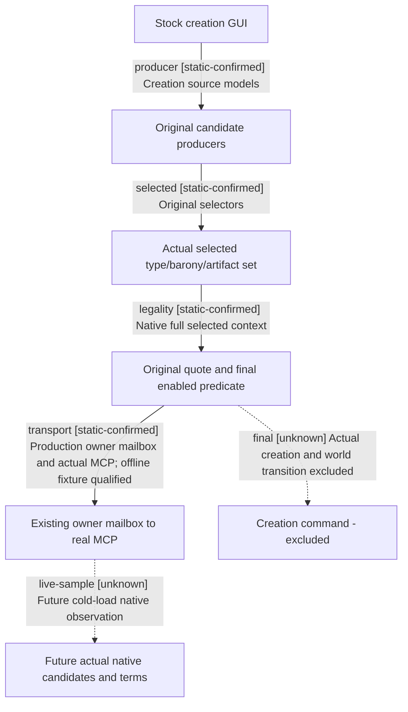

# Research plan: holy-site-creation-candidates12004

GENERATED from the supplied research plan; no native semantics are inferred.

Question: Which actual stock creation models, selected state and native terms can be exposed to the existing planner without executing creation?



| Edge | Declared status | Evidence IDs | Open question |
|---|---|---|---|
| producer | static-confirmed | source |  |
| selected | static-confirmed | source |  |
| legality | static-confirmed | source |  |
| transport | static-confirmed | source, sdk |  |
| final | unknown | source | Original callback located, but no Create submit or actual world postcondition in scope. |
| live-sample | unknown |  | No actual live creation-window sample, visibility or selection acquired; query offline qualification is separate. |

| Observation design | Value |
|---|---|
| mode | offline-only |
| actor_kind | human |
| owner_scope | Existing paused current GetPlayer/UI owner mailbox; Root exclusively owns live CK3. This lane only static source and offline fixtures. |
| identity_kind | generation-id |
| identity_lifetime | Creation window and complete Faith/Title/Artifact IDs only during current paused callback; definition type key separate. |
| producer_trigger | paused-query |
| producer | Original Faith typed OpenGameViewData -&gt; creation SetData builds native models; query reads cached models and final native enabled/tooltip without opening or submitting. |
| caller | Exact4 original publisher B0EB80/factoryB16A50, AA typedFaith; registered enabled/tooltip methods -&gt; original command vtable+30 validator. |
| consumer | Owned production reader/serializer -&gt; existing paused owner religion mailbox -&gt; actual Driver/Service/MCP; new core and SDK qualified with synthetic native I/O only. |
| cache_lifetime | SetData/reset and original selectors rebuild window state/cost. Query neither forces cache refresh nor claims freshness; no pointer survives callback/reload. |
| expected_signal | Complete original native type/barony/artifact models and selected set, original enabled/tooltip and bypass, cached quote separately freshness-unobserved. |
| zero_sample_meaning | No live samples in this lane. Unavailable is unknown, not empty or illegal. Synthetic empty/false remain distinct from unobserved. |
| stop_condition | Source/docs8MiB and own fixture hard64MiB inside admitted shared512MiB; no whole clone/EXE copy, no game/desktop. New source stage under8MiB; no old test replay. |
| runtime_window_ref | None |

| Evidence ID | Declared layer | File | SHA-256 | Supports |
|---|---|---|---|---|
| source | source-contract | source-contract.json | 7add888e9607df317b8f9981ab15a34f97723c2c63ed5db31ed949f483f1920b | Manual exact4 caller/producer/consumer layouts and ownership contract; not live |
| pins | exact-build | loaded-pins.json | 64555e4d708379684ff55c49e04f5489baefedacbd3a44583f6dd716daa6fb09 | Twenty-three exact cached byte prefixes used by production loaded-image guard |
| sdk | offline-fixture | query-qualification.json | 19f22a4d9e5402d57afa7119a62583faf0c02970709701e6d35a4f8ba71f1c18 | Actual production reader and real MCP consumer qualification with synthetic native I/O; no game |

Check result (file integrity and declarations only):

```json
{
  "schema": "xar.native-research-plan-check.v1",
  "result": "plan-consistent",
  "proof_layer": "record-structure-and-file-integrity",
  "semantic_correctness_verified": false,
  "live_execution_performed": false,
  "observation_plan_issues": [
    "offline-only plan does not define a live observation window"
  ],
  "declared_edges_by_status": {
    "counter-policy": 0,
    "inference": 0,
    "live-confirmed": 0,
    "static-confirmed": 4,
    "unknown": 2
  },
  "enumerated_native_edges": 6,
  "declared_cases_by_status": {
    "pending": 2,
    "observed": 0,
    "not-applicable": 1
  },
  "checked_evidence_files": 3,
  "limitations": [
    "Evidence layers and conclusions are author declarations; hashes bind bytes, not their truth.",
    "Counts cover this enumerated graph only, not all CK3 branches.",
    "A consistent observation plan is not authorization to run or manipulate CK3."
  ],
  "plan_sha256": "e0ef9bbbda7ab4b1404b6627fc22fffe56447549f811cbe091d0e0c4024bd531"
}
```
