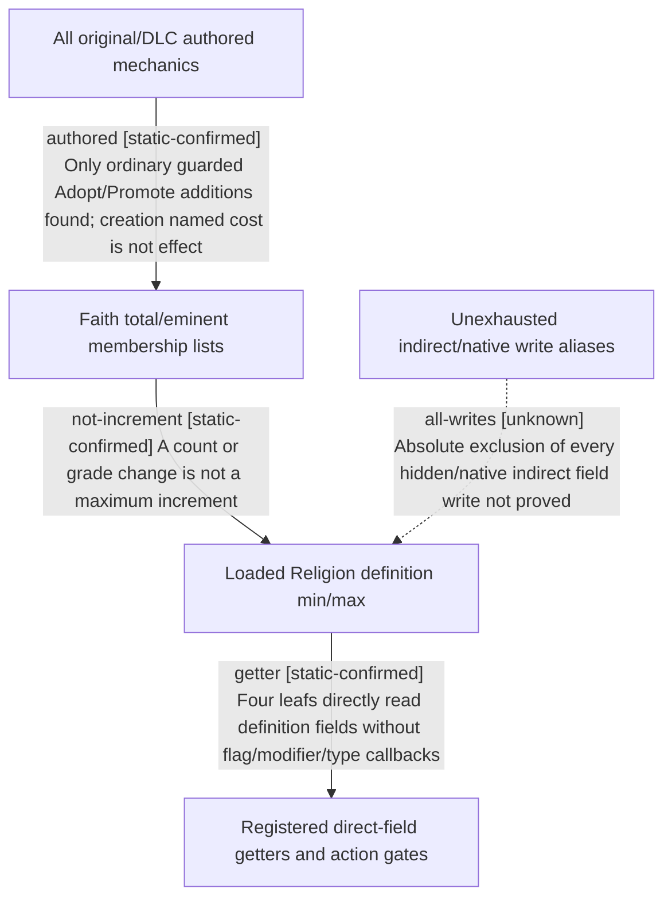

# Research plan: holy-site-dynamic-capacity-changes

GENERATED from the supplied research plan; no native semantics are inferred.

Question: Do any original CK3 1.20.0.4 decision/event/effect/parameter/modifier mechanisms increase loaded total/eminent HolySite maximums, versus merely modifying membership?



| Edge | Declared status | Evidence IDs | Open question |
|---|---|---|---|
| authored | static-confirmed | dynamic |  |
| getter | static-confirmed | dynamic |  |
| not-increment | static-confirmed | dynamic |  |
| all-writes | unknown | dynamic | Other owner aliases, generic reflection and bulk-copy paths were not fully typed; no absolute runtime write invariant claimed. |

| Observation design | Value |
|---|---|
| mode | offline-only |
| actor_kind | engine |
| owner_scope | Player-derived Faith Religion definition capacity and original authored mutation routes |
| identity_kind | definition-key |
| identity_lifetime | Exact-image and installed-script source byte lifetime |
| producer_trigger | not-applicable |
| producer | Previously closed ReligionType constructor/finalizer; exhaustive original authored mechanics scan |
| caller | Native script-value registered leafs, ordinary decision legality and CanCreate |
| consumer | Current total/eminent capacity comparisons |
| cache_lifetime | Existing immutable exact-image cache; no live model refresh or sampling |
| expected_signal | No authored capacity-mutating progression; list mutation routes independently identified; explicit unknown for hidden native writes |
| zero_sample_meaning | Zero setters in the enumerated authored/literal-name scope only, not absolute absence of every native alias/write |
| stop_condition | Complete authored mutation/capacity scan plus exact getter dependency closure and bounded same-displacement locator report; unknown indirect native paths separated |
| runtime_window_ref | None |

| Evidence ID | Declared layer | File | SHA-256 | Supports |
|---|---|---|---|---|
| dynamic | source-contract | SOURCE-CONTRACT-DYNAMIC-a01.json | b8f1243bb45ded54420e0d614fbab584a4345f22c146a1c00829c7967f4440f3 | Enumerated original progression routes, exact getter dependency and explicit native-write boundary |

Check result (file integrity and declarations only):

```json
{
  "schema": "xar.native-research-plan-check.v1",
  "result": "plan-consistent",
  "proof_layer": "record-structure-and-file-integrity",
  "semantic_correctness_verified": false,
  "live_execution_performed": false,
  "observation_plan_issues": [
    "offline-only plan does not define a live observation window",
    "the real producer trigger must be located before live sampling"
  ],
  "declared_edges_by_status": {
    "counter-policy": 0,
    "inference": 0,
    "live-confirmed": 0,
    "static-confirmed": 3,
    "unknown": 1
  },
  "enumerated_native_edges": 4,
  "declared_cases_by_status": {
    "pending": 0,
    "observed": 0,
    "not-applicable": 1
  },
  "checked_evidence_files": 1,
  "limitations": [
    "Evidence layers and conclusions are author declarations; hashes bind bytes, not their truth.",
    "Counts cover this enumerated graph only, not all CK3 branches.",
    "A consistent observation plan is not authorization to run or manipulate CK3."
  ],
  "plan_sha256": "4a69d99718ba6410f2cf9d64100f348b91167563128c87b151f03443137de4b8"
}
```
