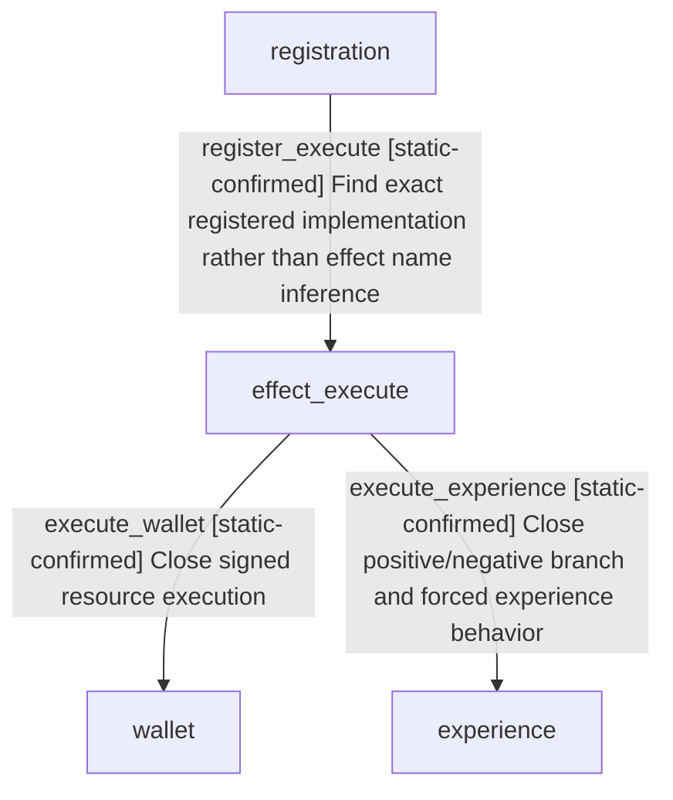

# Research plan: holy-site-add-piety-negative-experience-12004

GENERATED from the supplied research plan; no native semantics are inferred.

Question: Exact1.20.0.4 add_piety versus add_piety_and_experience: which signed branch writes wallet and devotion experience, and what remains unknown about adjusted net totals?



| Edge | Declared status | Evidence IDs | Open question |
|---|---|---|---|
| register_execute | static-confirmed | consumer |  |
| execute_wallet | static-confirmed | consumer |  |
| execute_experience | static-confirmed | consumer |  |

| Observation design | Value |
|---|---|
| mode | offline-only |
| actor_kind | engine |
| owner_scope | original character resource effects, piety and piety experience native consumers |
| identity_kind | generation-id |
| identity_lifetime | session/fullID generation for game objects; exact EXE build for code; no cross-reload pointer reuse |
| producer_trigger | unknown |
| producer | Exact effect registration and factory to compiled+B0 execute; normal negative callback closed |
| caller | 2D52F60-&gt;28BDB70-&gt;28D6FE0-&gt;28CDCD0;2D52AF0-&gt;28D6FE0-&gt;28CDC70 |
| consumer | wallet extension+110; experience extension+118 read by26979D0 kind0 and existing bound progress provider |
| cache_lifetime | Callback directly writes owned raw resource fields; common wrapper may trigger level-change effects; no runtime observation or total poststate claim |
| expected_signal | Complete exact body/branch/source pins, actual callsites on instruction boundaries, per-slot contribution/zero reasons, and explicit cache write/read sites; numerical examples separately static/pending/live history |
| zero_sample_meaning | No process/runtime samples are taken. No new callsite found in bounded static set does not prove the engine never refreshes or refreshes on a calendar cadence. |
| stop_condition | at most24 small primary bodies, 64 string locators, 2MiB new outputs; no broad exports; report remaining unknown |
| runtime_window_ref | None |

| Evidence ID | Declared layer | File | SHA-256 | Supports |
|---|---|---|---|---|
| baseline-native | source-contract | C:/workspace/ck3_eternal_recurrence/docs/ck3-native-ai/holy-site-relic-management-ai-opinion-12004.md | 595eda1e4b2b4b56b573bb5efb08fa493da2458ad2f52252fc9bddf65efad5cd | existing conditional4to3 callbacks, -750 wallet sum and total devotion uncertainty |
| consumer | source-contract | C:/workspace/ck3-faith-and-power-20261017/episode01/revision-v4-20261018/rarity/piety-consumer-a01/SOURCE-CONTRACT.piety-consumer-a01.json | 609ba43f90a374bd66652c1289ad17d06a8c7b63edf3bcb7dfbb21a40cc23f54 | Fresh exact registration-&gt;factory-&gt;compiled execute-&gt;signed callback-&gt;wallet/experience field and consumer closure; actual net pending |

Check result (file integrity and declarations only):

```json
{
  "schema": "xar.native-research-plan-check.v1",
  "result": "plan-consistent",
  "proof_layer": "record-structure-and-file-integrity",
  "semantic_correctness_verified": false,
  "live_execution_performed": false,
  "observation_plan_issues": [
    "offline-only plan does not define a live observation window",
    "the real producer trigger must be located before live sampling"
  ],
  "declared_edges_by_status": {
    "counter-policy": 0,
    "inference": 0,
    "live-confirmed": 0,
    "static-confirmed": 3,
    "unknown": 0
  },
  "enumerated_native_edges": 3,
  "declared_cases_by_status": {
    "pending": 3,
    "observed": 0,
    "not-applicable": 0
  },
  "checked_evidence_files": 2,
  "limitations": [
    "Evidence layers and conclusions are author declarations; hashes bind bytes, not their truth.",
    "Counts cover this enumerated graph only, not all CK3 branches.",
    "A consistent observation plan is not authorization to run or manipulate CK3."
  ],
  "plan_sha256": "8e57cd043ec70000a17592d3b094129c3cb1c8e82d57be37d4a32d71c5ad911d"
}
```
