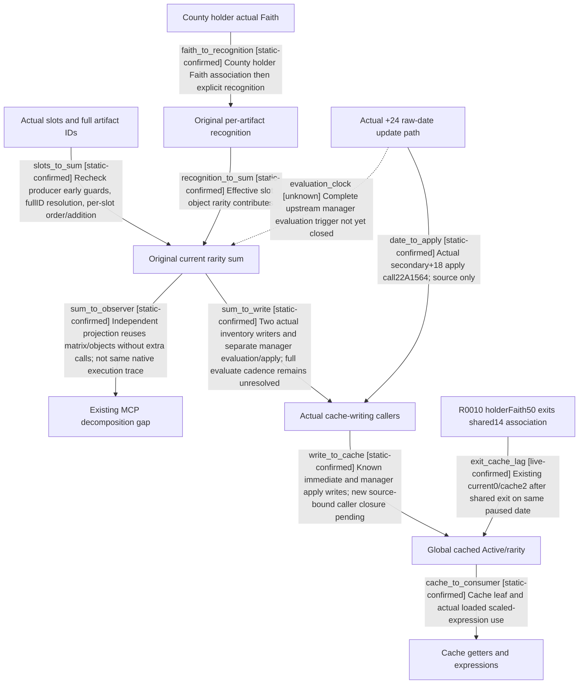

# Research plan: faith-e01-rarity-decomposition-v4

GENERATED from the supplied research plan; no native semantics are inferred.

Question: Exact1.20.0.4: how do actual slots, full artifact identities, county-holder Faith association and per-Faith recognition produce each rarity contribution/current sum, which actual callers update global caches, and which consumers read cache rather than recompute?



| Edge | Declared status | Evidence IDs | Open question |
|---|---|---|---|
| slots_to_sum | static-confirmed | new-contract |  |
| faith_to_recognition | static-confirmed | new-contract |  |
| recognition_to_sum | static-confirmed | new-contract |  |
| sum_to_write | static-confirmed | new-contract |  |
| write_to_cache | static-confirmed | new-contract |  |
| cache_to_consumer | static-confirmed | new-contract |  |
| sum_to_observer | static-confirmed | new-contract |  |
| date_to_apply | static-confirmed | new-contract |  |
| exit_cache_lag | live-confirmed | history-after |  |
| evaluation_clock | unknown | new-contract | Where exactly is registered interface+8 evaluated, with which update cadence/list lifetime? |

| Observation design | Value |
|---|---|
| mode | offline-only |
| actor_kind | engine |
| owner_scope | One shared fullID HolySite and embedded Inventory; actual slot artifact IDs, county holder/current Rite Faith, associated Faith edges; no CK3 process access |
| identity_kind | generation-id |
| identity_lifetime | session/fullID generation for game objects; exact EXE build for code; no cross-reload pointer reuse |
| producer_trigger | unknown |
| producer | Freshly rechecked265A3F0 per-slot producer; manager secondary+8 evaluation and+18 apply; exact evaluate cadence remains unknown. |
| caller | Fresh inventory22E57F1/22E4F2B and actual date-path22A1564 -&gt; secondary47748C0+18; complete upstream evaluation invocation remains unresolved. |
| consumer | site+18/+1C getters and scaled HolySite expression inputs, distinct from live beneficiary aggregate; no assumption that Active gates every consumer |
| cache_lifetime | Read-only current calculation never writes. Valid inventory paths recalc/write immediately; normal +24-date path calls manager apply. Existing R0010 shows association change can leave old cache on paused date. Last refresh and evaluate cadence remain unknown. |
| expected_signal | Complete exact body/branch/source pins, actual callsites on instruction boundaries, per-slot contribution/zero reasons, and explicit cache write/read sites; numerical examples separately static/pending/live history |
| zero_sample_meaning | No process/runtime samples are taken. No new callsite found in bounded static set does not prove the engine never refreshes or refreshes on a calendar cadence. |
| stop_condition | At most128 finite function bodies/64 caller candidates, only focused byte windows, no full EXE copy or full disassembly; output16MiB total ceiling; stop caller expansion when an exact scheduler boundary or explicit unknown is recorded. |
| runtime_window_ref | None |

| Evidence ID | Declared layer | File | SHA-256 | Supports |
|---|---|---|---|---|
| new-contract | source-contract | C:/workspace/ck3-faith-and-power-20261017/episode01/revision-v4-20261018/rarity/rarity-source-contract-v4.json | bf20ada972a837e855b4ebb225850696d3068aa4eef6ae94de749cda8344e146 | New manually reviewed exact algorithm, primary/secondary interface correction, actual date-path apply and cache consumers |
| fresh-byte-comparison | exact-build | C:/workspace/ck3-faith-and-power-20261017/episode01/revision-v4-20261018/rarity/exact-probe-baseline-a01.json | 8087bb926e57adbb0c99f78be080d9846151083c90ef508a4d9a5aea627bd13b | Actual current EXE finite9body byte matches to retained exact source, not standalone semantics |
| scripts | source-contract | C:/workspace/ck3-faith-and-power-20261017/episode01/revision-v4-20261018/rarity/script-consumer-a01.json | c885231af5075918112c3eb53c03d25b2c5af4088c6fe19bd4345dbc023f1349 | Actual installed scale definition and cached integer callback contract |
| history-after | action-postcondition | C:/workspace/ck3-faith-and-power-20261017/episode01/revision-v4-20261018/rarity/history-r0010-a02.json | 512aba0818b6972a0052556ebcb86f7f4cc6df4c6cc819f6ba76719e8d678e65 | Existing same-machine R0010 shared14 departure changes current sum2-&gt;0 but cache remains2 |
| examples | source-contract | C:/workspace/ck3-faith-and-power-20261017/episode01/revision-v4-20261018/rarity/examples-analysis/static-examples.json | 179deeec9cd62c42151fcf406057464a19bb258f2f679f53f3104d14e54c7bed | Declared static arithmetic examples only; no engine fixture/live observation |

Check result (file integrity and declarations only):

```json
{
  "schema": "xar.native-research-plan-check.v1",
  "result": "plan-consistent",
  "proof_layer": "record-structure-and-file-integrity",
  "semantic_correctness_verified": false,
  "live_execution_performed": false,
  "observation_plan_issues": [
    "offline-only plan does not define a live observation window",
    "the real producer trigger must be located before live sampling"
  ],
  "declared_edges_by_status": {
    "counter-policy": 0,
    "inference": 0,
    "live-confirmed": 1,
    "static-confirmed": 8,
    "unknown": 1
  },
  "enumerated_native_edges": 10,
  "declared_cases_by_status": {
    "pending": 2,
    "observed": 2,
    "not-applicable": 0
  },
  "checked_evidence_files": 5,
  "limitations": [
    "Evidence layers and conclusions are author declarations; hashes bind bytes, not their truth.",
    "Counts cover this enumerated graph only, not all CK3 branches.",
    "A consistent observation plan is not authorization to run or manipulate CK3."
  ],
  "plan_sha256": "e14adaa398b010bbe0b356d0d141b59309d7d01ec1a9081f44b424c03181c6e3"
}
```
