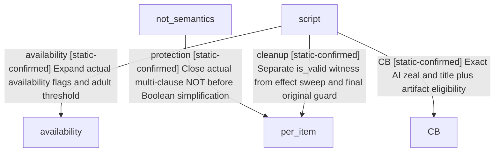

# Research plan: holy-site-ai-removal-conditions-v5

GENERATED from the supplied research plan; no native semantics are inferred.

Question: What exact actor and per-item conditions admit AI relic cleanup, what does multi-clause NOT compute, and what are reclaim-relic AI zeal/title thresholds?



| Edge | Declared status | Evidence IDs | Open question |
|---|---|---|---|
| availability | static-confirmed | stock, logic |  |
| protection | static-confirmed | stock, logic |  |
| cleanup | static-confirmed | stock, logic |  |
| CB | static-confirmed | stock, logic |  |

| Observation design | Value |
|---|---|
| mode | offline-only |
| actor_kind | engine |
| owner_scope | AI cleanup actor, directly held county, HolySite association and per-item recognition; separate reclaim CB attacker |
| identity_kind | generation-id |
| identity_lifetime | session/fullID generation for game objects; exact EXE build for code; no cross-reload pointer reuse |
| producer_trigger | unknown |
| producer | Fresh stock ai_remove decision; original NOT/NOR shareCNot and HasAnyVariable family semantics |
| caller | Existing exact remove script effect guard/receiver reused, no native calls |
| consumer | Complete per-item actual Boolean filter, original guarded remove consumer reused; reclaim AI&gt;=100 and highestHeld&gt;=duchy |
| cache_lifetime | Script full-file SHA binds conditions; live object facts and natural eligibility are not inferred |
| expected_signal | Complete exact body/branch/source pins, actual callsites on instruction boundaries, per-slot contribution/zero reasons, and explicit cache write/read sites; numerical examples separately static/pending/live history |
| zero_sample_meaning | No process/runtime samples are taken. No new callsite found in bounded static set does not prove the engine never refreshes or refreshes on a calendar cadence. |
| stop_condition | 2MiB maximum; reviewed focused NOT/NOR family and one availability HasAnyVariable family only, at most20 small functions/chunks/windows; no general script compiler/variable platform |
| runtime_window_ref | None |

| Evidence ID | Declared layer | File | SHA-256 | Supports |
|---|---|---|---|---|
| prior | source-contract | C:/workspace/ck3-faith-and-power-20261017/episode01/revision-v4-20261018/permissions-ai-opinion/ai/ai-callgraph-review.md | 5fa36b1bc1ba265f1168bce06c94ca3dbf1912018090e6844571923d93965f5a | Prior exact AI script-to-guard/receiver and explicitly unresolved multi-clause NOT |
| stock | source-contract | C:/workspace/ck3-faith-and-power-20261017/episode01/revision-v5-20261018/relic-ai/stock-source-excerpts-a01.json | 562ef57bdaddd17f0b993276032b1126880a47f7efc0bb5ed588a71431657a7e | Fresh exact stock decision, availability, defines and CB full-file hashes and numbered excerpts |
| logic | source-contract | C:/workspace/ck3-faith-and-power-20261017/episode01/revision-v5-20261018/relic-ai/SOURCE-CONTRACT.logic-not-a01.json | 77308320c316155969ddadbfaed9d948e4aeb32db7252f05b7933cda061f69bc | Reviewed NOT/NOR registry-&gt;factory-&gt;bool semantics plus HasAnyVariable receiver; no live invocation |

Check result (file integrity and declarations only):

```json
{
  "schema": "xar.native-research-plan-check.v1",
  "result": "plan-consistent",
  "proof_layer": "record-structure-and-file-integrity",
  "semantic_correctness_verified": false,
  "live_execution_performed": false,
  "observation_plan_issues": [
    "offline-only plan does not define a live observation window",
    "the real producer trigger must be located before live sampling"
  ],
  "declared_edges_by_status": {
    "counter-policy": 0,
    "inference": 0,
    "live-confirmed": 0,
    "static-confirmed": 4,
    "unknown": 0
  },
  "enumerated_native_edges": 4,
  "declared_cases_by_status": {
    "pending": 1,
    "observed": 0,
    "not-applicable": 0
  },
  "checked_evidence_files": 3,
  "limitations": [
    "Evidence layers and conclusions are author declarations; hashes bind bytes, not their truth.",
    "Counts cover this enumerated graph only, not all CK3 branches.",
    "A consistent observation plan is not authorization to run or manipulate CK3."
  ],
  "plan_sha256": "5f8eced8d5af487218e7ced680f829a3368b4f32380c8b0825a4b9a04466f27d"
}
```
