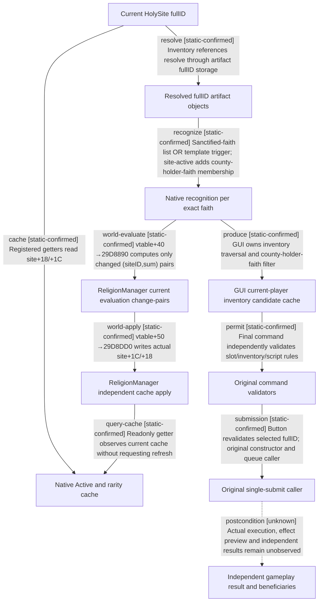

# Research plan: holy-site-relic-readonly-12004

GENERATED from the supplied research plan; no native semantics are inferred.

Question: Can exact4 original getters, candidate producers and callers close the smallest holy-site relic observation gap without claiming adoption implies active benefits?



| Edge | Declared status | Evidence IDs | Open question |
|---|---|---|---|
| cache | static-confirmed | contract, native |  |
| resolve | static-confirmed | contract, native |  |
| recognize | static-confirmed | contract, native |  |
| produce | static-confirmed | contract, native |  |
| permit | static-confirmed | contract, native |  |
| submission | static-confirmed | contract, native |  |
| postcondition | unknown |  | Need typed implementation, exact receiver closure and new before/action/independent-after evidence |
| world-evaluate | static-confirmed | contract, native |  |
| world-apply | static-confirmed | contract, native |  |
| query-cache | static-confirmed | contract, native |  |

| Observation design | Value |
|---|---|
| mode | offline-only |
| actor_kind | engine |
| owner_scope | Current played human and explicitly resolved HolySite/artifact/faith objects; no runtime connection in this package |
| identity_kind | generation-id |
| identity_lifetime | Native fullID per storage namespace, bound to current process/generation/frame; pointers never survive reload |
| producer_trigger | unknown |
| producer | CReligionManager vtable+40 calculates changed sums; vtable+50 writes site caches; inventory mutation also updates directly. Complete upstream phase dispatch timing remains unknown. |
| caller | Registered HolySite/Artifact/HolySiteWindow callbacks and original enshrine/remove command constructors/validators |
| consumer | Proposed independent religion read-only C++/transport/MCP; no native invocation or implementation yet |
| cache_lifetime | Current object caches are mutable across inventory/faith/holder/world updates. Static evaluation/apply consumers closed; exact upstream schedule and last refresh time remain unknown; queries never force refresh. |
| expected_signal | Exact byte-bound cached getters, artifact fullID resolution, dynamic/template recognition OR, candidate filtering and separate final legality |
| zero_sample_meaning | Zero new runtime samples cannot exclude relics, actions, legal candidates or benefits in the current save |
| stop_condition | Finite reached source bodies and 21 script files; no process, screen, Steam, lease, game input or native calls |
| runtime_window_ref | None |

| Evidence ID | Declared layer | File | SHA-256 | Supports |
|---|---|---|---|---|
| contract | source-contract | ../../holy-site-relic-native12004.md | a7035ba134c0fd7af5933ea1028103d4a6c9d85b8af62c641bed3fb5265f1d2e | Reviewed native producers/callers/consumers and explicitly unresolved paths |
| native | exact-build | source-pins.json | b5d60d5f73cdc0ca5e6871ac40fbaf4c20dfa70fb384b34794334211525e52f8 | Exact original native code bodies and byte identity, without native invocation |
| scripts | source-contract | script-planning-contract.json | 0e6fac4b752cfc921e8d84bad178fd9f1404e79f04b881971965412078fea37a | Source-bound static planning knowledge with native requirements unobserved |
| manifest | exact-build | script-source-manifest.json | bb34fa8174138473ed64ab0f8d9d612440b47402f6e8db3459a6229ed7f7ea16 | Installed resource version, full hashes and exact line ranges |

Check result (file integrity and declarations only):

```json
{
  "schema": "xar.native-research-plan-check.v1",
  "result": "plan-consistent",
  "proof_layer": "record-structure-and-file-integrity",
  "semantic_correctness_verified": false,
  "live_execution_performed": false,
  "observation_plan_issues": [
    "offline-only plan does not define a live observation window",
    "the real producer trigger must be located before live sampling"
  ],
  "declared_edges_by_status": {
    "counter-policy": 0,
    "inference": 0,
    "live-confirmed": 0,
    "static-confirmed": 9,
    "unknown": 1
  },
  "enumerated_native_edges": 10,
  "declared_cases_by_status": {
    "pending": 2,
    "observed": 0,
    "not-applicable": 0
  },
  "checked_evidence_files": 4,
  "limitations": [
    "Evidence layers and conclusions are author declarations; hashes bind bytes, not their truth.",
    "Counts cover this enumerated graph only, not all CK3 branches.",
    "A consistent observation plan is not authorization to run or manipulate CK3."
  ],
  "plan_sha256": "e1cc08c8ab760b6429590dc875ba8e1529d2ccfc4b82a2be0843b6a1bbb2d6a1"
}
```
