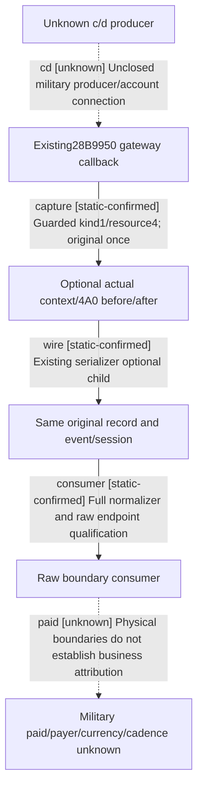

# Research plan: resource4-gateway-context

GENERATED from the supplied research plan; no native semantics are inferred.

Question: Can the existing resource4 gateway callback retain its own physical context and4A0 endpoints without inferring currency, military paid, payer or settlement?



| Edge | Declared status | Evidence IDs | Open question |
|---|---|---|---|
| capture | static-confirmed | capture |  |
| wire | static-confirmed | wire |  |
| consumer | static-confirmed | consumer |  |
| cd | unknown |  | Need actual c/d writer source and same payment/account binding |
| paid | unknown |  | Formal resource name, military component, payer and cadence remain unknown |

| Observation design | Value |
|---|---|
| mode | offline-only |
| actor_kind | engine |
| owner_scope | Offline source/producer-shaped wire only; future Root-owned callback needs independent cold-load admission |
| identity_kind | generation-id |
| identity_lifetime | Actual PID/create/generation/window/CharacterFullID and before/after context; no cross-load reuse |
| producer_trigger | not-applicable |
| producer | Existing kind1/resource4 original callback with qualified bindings, owner filter and Permit |
| caller | Existing InvokeWarPaymentGateway12004; true caller stays in the same record, no active getter |
| consumer | RecordJson -&gt; normalize_journal -&gt; consume_resource4_wallet_contexts |
| cache_lifetime | Existing bounded journal512; same sampling/window epoch, clear invalidates evidence |
| expected_signal | Same callback context+4A0 raw endpoints with complete same-owner/session/context reads |
| zero_sample_meaning | No qualified boundary in the retained window, not zero balance or absence of payment |
| stop_condition | Offline source and five focused full-envelope tests only; no SDK/game/native build/live sampling |
| runtime_window_ref | None |

| Evidence ID | Declared layer | File | SHA-256 | Supports |
|---|---|---|---|---|
| capture | source-contract | ../../../../ck3_autonomous_player/native_bridge/src/war_payment_passive_12004.cpp | 2cac759bebdd8b58638c8bf558bf5290cb444b47a4e5b1b32461c6bffdd8af46 | capture implementation boundary only; coherent native build and live remain pending |
| wire | source-contract | ../../../../ck3_autonomous_player/native_bridge/src/war_payment_json_12004.cpp | caa087fd123bdbb2cb9a12a052b05f7d7dc550c1b741fb8de2137f24b7ce7191 | wire implementation boundary only; coherent native build and live remain pending |
| consumer | source-contract | ../../../../ck3_autonomous_player/src/xar_autoplayer/bridge/war_payment_resource4_wallet_v1.py | 48be37aa5bd9621502f5879b3906f4058f52c6a88967d13401c19815807c37f8 | consumer implementation boundary only; coherent native build and live remain pending |
| focus | offline-fixture | ../../../../ck3_autonomous_player/tests/unit/test_war_payment_resource4_wallet.py | 2bfc215f1525cfc18cb7b18fe9428431b414cd352d97e35d9a1944a8054cdbbb | focus implementation boundary only; coherent native build and live remain pending |

Check result (file integrity and declarations only):

```json
{
  "schema": "xar.native-research-plan-check.v1",
  "result": "plan-consistent",
  "proof_layer": "record-structure-and-file-integrity",
  "semantic_correctness_verified": false,
  "live_execution_performed": false,
  "observation_plan_issues": [
    "offline-only plan does not define a live observation window",
    "the real producer trigger must be located before live sampling"
  ],
  "declared_edges_by_status": {
    "counter-policy": 0,
    "inference": 0,
    "live-confirmed": 0,
    "static-confirmed": 3,
    "unknown": 2
  },
  "enumerated_native_edges": 5,
  "declared_cases_by_status": {
    "pending": 0,
    "observed": 0,
    "not-applicable": 0
  },
  "checked_evidence_files": 4,
  "limitations": [
    "Evidence layers and conclusions are author declarations; hashes bind bytes, not their truth.",
    "Counts cover this enumerated graph only, not all CK3 branches.",
    "A consistent observation plan is not authorization to run or manipulate CK3."
  ],
  "plan_sha256": "418bfa7690848e8e87a605a6de63be3ee7f5cbb68d6ec38a2a52558297c0cb93"
}
```
