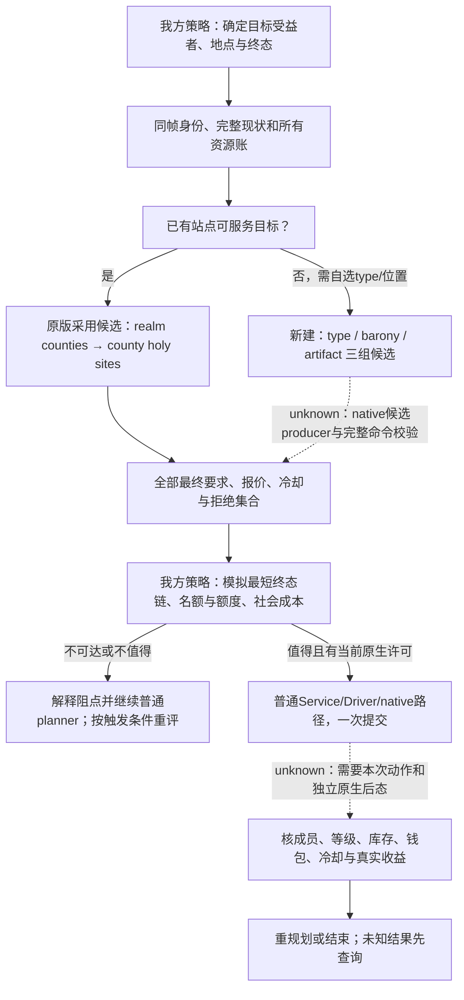

# 第一期规划合同：圣地不是打下来就算，谁能把它变成自己的？

2026-10-17，目标版本 1.20.0.4。本文件承接[圣地基础合同](faith-and-power-holy-sites-12004.md)，只补第一期 H01 的**决策顺序、资源账、拒绝分支与可恢复实验**。原版GUI/AI路径的完整综述留在基础合同；这里的流程是我方待消费的规划设计，不能冒充原生AI算法。

所有游戏内案例均为 `pending`。没有执行采用、新建、晋升、降级或放弃，没有本期实机数值、片段时码或成功信用。配套[主张与来源JSON](evidence/faith-and-power-episode01-planning/claims.json)冻结每条静态主张、源行号/完整SHA及原生观察缺项，可供MCP知识查询和未来采样引用。

## 本轮来源与机器范围

`machine_id: 4-8e1c2f1861`，`tools/ck3_live_run_id.py machine` 于本轮重新读回；开始时仓库HEAD为 `7ba029435c54ef53ab484be86186ba45ebcad3bf`，工作树干净。本轮仅在外置 `C:/workspace/ck3-faith-and-power-20261017/episode01/research` 写候选，未改受管游戏所用工作树。

`2026-10-17T07:43:15.609093+00:00`，重新读取既有manifest的55份实际安装资源并计算SHA，55/55仍与冻结值一致。manifest SHA为 `1b225c6e89556948ea4560e480ae7a7197c4c95d3ae35f2741d465fa5b37e566`，同版本镜像commit为 `074429b3f6d9352a3cf4c5671725fee2f41267ba`。另为创建费用、首都机会提示、社会成本与大分裂参数读取5份补充原版定义，仅冻结本机字节，未声称作过镜像比较。安装/EXE证据沿用本机前轮带时间回执；本文件不据此判断当前运行进程、加载mod或Steam模式。

存储沿用统一策略1.0.0。本机 `2026-10-17T07:42:01.084338+00:00` 的外置输出卷 `shutil.disk_usage` 为总量 `511776722944` B、空闲 `126479089664` B；这只是小型研究写入前的容量观察，不是录制预留或他人写入准入。候选、patch和回执合计上限300 KB，不复制游戏资源。小型研究记录于2027-04-15复核，外置派生patch在owner实际应用并核验后按48小时派生物策略复核。

## H01要回答的决策问题

“打下来”只改变领地关系中的若干项。智能体还要问：当前操作的有效actor是谁、有没有宗教管理权、县主是否同faith、目标是否已在自己的网络、宗教关系是否许可、地理/总额是否容纳、成本与冷却是否允许、做完以后能否达到原经营目的。无需为了补一个视频镜头改变主战役的正常战争/防御/政务优先级。

| 镜头 | 给智能体的判断，而非名词展示 | 必须新增的同帧观察 | 主张ID |
| --- | --- | --- | --- |
| H01-01 灰按钮 | 先区分“没有候选”“候选存在但被拒”“动作未出现在公共列表”“原生接口尚不支持”。 | 目标HolySite完整ID；GUI入口/隐藏决议身份；原生完整要求与失败原因。 | E01-C01、C02 |
| H01-02 三种归属 | 把战争控制、county holder的faith、faith→HolySite关联分别列账；不能把其中一项当另外两项。 | 县主/顶级领主/男爵/县民的各自faith与rite；完整faith关联集合。 | E01-C03 |
| H01-03 同址双faith | 同一实例对不同faith可以有不同等级；当前存档列表优先于初始配置。 | site/type/Inventory IDs、nestorian/sunni的当前关系和等级；不能只看中文名。 | E01-C03 |
| H01-04 权限树 | 将全部失败条件保留为集合，先判低成本可补项，再判断整条计划是否值得。 | 独立/管理权的有效actor、HoF/puppet链、容量、兼容见证faith、信众见证faith、kingdom记录。 | E01-C01、C04 |
| H01-05 A/B/C | 无兼容、任意采用参数、定向综摄三种可达配置分别解释；不能先决定改革再找理由。 | 每臂改革/配置引起的全部差异；原生rite参数、敌意方向和最终要求。 | E01-C04 |
| H01-06 个人/核心 | 同名个人信条不自动给予礼仪核心权限。 | 实际actor.rite参数与个人参数分别读；禁止从显示名称补权限。 | E01-C04 |
| H01-07 采用后 | 先验证“关联确实新增”，再验证等级、实例、库存和实际付款；不预写“默认普通”。 | 前后成员/等级/ID/Inventory、其他faith、钱包/free/cooldown、used kingdoms。 | E01-C05、C10 |
| H01-08 新建 | 需要自选类型/位置才比较新建；原生三组候选是独立缺口。 | 可用type、潜在barony、可供奉artifact；每组完整性/过滤原因、最终许可。 | E01-C06、C07 |
| H01-09 额度 | 以整条操作链预算免费次数与每个action的冷却；不为凑“额度耗尽”破坏母案。 | 每步付费者、报价、free前后值、该决议冷却或创建变量。 | E01-C08、C09 |
| H01-10 名额/退还 | 晋升/降级与新增/退出改变不同账；先预测终态，再执行最短可行链。 | 总数/主要数及宗教上下限、每件artifact去向、县主、kingdom记录和社会modifier。 | E01-C11、C12、C13、C14 |
| H01-11 不可直接撤销 | 最后faith退出可能让旧站点再也不满足采用的关联信众条件；不能用反向动作承诺复原。 | 剩余关联faith是否为空；有无活跃县信众；回载基线能否恢复。 | E01-C13、C15 |
| H01-12 最终计划 | 输出当前最短可行方案、阻点、代价和下一次重评触发；没执行的部分明确为计划。 | 完整before/action/after与未解决字段；原片及最终片的时码仍待拍摄方填写。 | E01-C16 |

H01-11/12是对原镜头矩阵的研究补充编号，不宣称已新增合格素材。优先闭合H01-01→04→07；新建和重规划支线只在原生能力、可恢复输入和拍摄预算满足时扩展。

## 采用与新建的规划分流

先明确终态目标：仅纳入既有地点、增加一个本faith主要站点、在特定地理位置取得某模板的收益，还是腾出总额。若目标只要求纳入既有地点，优先评估采用，不把“想改类型”偷偷塞进采用动作。若目标要求自选动态type/位置，则另走新建候选和圣物账；两者不共享完整候选合同。

图中实线也不代表该设计已经部署。采用的范围收缩来自S01 588–616；创建三组model来自S10。完整原生命令入口由专责native工作包定位，不能用本图猜RVA，也不能用Python布尔模型替代原生拒绝。

### 新建：首都提示与完整创建候选不能互换

S17 1514–1574给出一个真实、可学习的上游机会producer：`action_can_found_holy_site_in_capital`。它只检查actor首都，要求landed、没有创建锁、首都barony未出租且非圣地、管理权、总额与王国规则通过；圣物从自己的artifact中检查未装备且本faith认可，组合为一件famed及以上，或至少一件masterwork及以上并至少两件合格物，或至少三件合格物。通过后创建important action，动作effect打开`holy_site_creation`。

这条首都提示可以作为**低成本机会线索**，不能替代完整`GetPotentialBaronyTitles`。它没有检查支付能力，也不覆盖其他地点。对现有普通planner，可以先用这类原生提示发现机会，再取完整terms；没有提示时不能据此宣布所有地点都不能创建。原生prompt当前是否存在、调度频率、何时重建仍需实际context。

创建GUI明确分开type/barony/artifact三组model和选择回调，并以`CanPickHolySiteType`、`IsCreateButtonEnabled`与tooltips显示许可。S04 28–45的脚本子规则只声明管理权、无创建变量锁、王国规则；重复type/barony、同县已有本faith圣地、圣物数量/稀有度、库存归属、租借及总量等完整检查仍需原生terms，不能因该子规则没写就省略。S09声明初始稀有度门槛3，S18声明三个holy-site槽；数字不能代替实际candidate可选性。

创建成本注释与GUI`HOLY_SITE_FAITH_REGULAR_NEW`显示普通圣地的静态意图（S08 770–777，S10 881）；本案后态仍要读真实等级。免费额可以使创建成本为0，但S04无条件检查已有`holy_site_creation_cooldown`变量，因此不能把“还有免费次数”当作忽略已存在创建锁的理由。

### 对灰按钮怎样诊断

| 观察到的状态 | planner解释 | 可以考虑的下一步 |
| --- | --- | --- |
| 专用接口缺失/名单partial | `observation_unavailable`；不能说没有合法对象。 | 保留目标，登记缺口；完善原生query或等同帧可读入口。 |
| actor不独立 | 采用的最终脚本失败。晋升/降级/放弃没有同一条显式独立要求。 | 解释当前身份阻点，不在本研究中默认发动独立战争。 |
| 无管理权限 | 即使征服县或有任意采用参数也不够。 | 读取HoF/puppet/puppeteer与无HoF替代路线的真实状态，另评估可达成本。 |
| 县主不是本faith/领属不符 | 领地控制与县主faith仍有独立缺口。 | 另评估治理/外交路径；不把自动改信当无成本前置。 |
| 兼容失败 | 任意采用rite参数，或某关联faith的定向兼容支尚未满足。 | 对全部关联faith枚举存在性见证；只在整体收益值得时考虑改革/综摄路线。 |
| 没有任何关联faith有县信众 | 目标的活跃关联条件失败。 | 不是靠补采用权限就能修复；不尝试反复提交。 |
| 总额/主要额满 | 新增和晋升是两个容量问题。 | 先求合法终态链；不能用降级腾总数，也不能用晋升腾总数。 |
| kingdom记录占用 | 是faith variable list的地理条件。 | 同时查看该faith在该王国的全部圣地；不能保证放弃某一个即释放。 |
| 费用/冷却失败 | 当前原生报价、付费者或动作key不可用。 | 等待真实到期或资源变化；不能拿其他决议已解锁当本动作可用。 |

兼容见证faith与“有县信众”的见证faith可能不是同一对象：两个存在性条件分别保存见证ID，防止用一个综合布尔掩盖原规则（S01 521–534、S02 1964–1987）。

## 整条链的名额、额度与代价

令 `N` 为当前faith关联圣地总数，`E` 为其中主要数；上下限取**当前宗教实际值**。1.20.0.4 defaults为 `Nmax=9, Emax=3, Nmin=1, Emin=1`（S09 919–926），info里的 `eminent_holy_sites_min=0` 是格式示例，不是默认。加载mod或宗教override存在时不硬编码此默认。

| 操作 | 终态意图与必要空间 | 脚本层关键前提 | 额外代价 |
| --- | --- | --- | --- |
| 采用/新建 | 纳入新关联；N应有余量。新关联默认等级仍须本案后读，不能提前把E变化写死。 | 采用见完整合同；新建是独立原生命令。 | 采用基准1000虔诚，新建2000；免费额分支另算；新建投入所选圣物。 |
| 晋升 | 普通→主要；不减少N，需要 `E<Emax`。 | 本faith普通；管理权限；HoF或barony领属条件；county holder同faith。 | 基准1000；actor与非本人县主的社会修正。 |
| 降级 | 主要→普通；不减少N，不释放地理记录；需要 `E>Emin`。 | 本faith主要、管理权限、主要最低数。 | 基准1000；同样需要记录社会负项。 |
| 放弃 | 移除本faith关联，不能直接用于主要站点；需要 `N>Nmin`。 | 本faith普通、管理权限、总数最低值。 | 基准1000；社会负项；最后关联faith还涉及全部库存给县主。 |

该表描述原版脚本的目标状态及已知前提，不保证native执行成功。每个边都要用独立后态核对，保存当前真实数量，不能根据想象补 `after.N=N+1`。

先按依赖求最短链：

- 要把新关联变为主要，先确认总额和主要额都可达，再采用/新建、后读等级，只有需要时才晋升；不要预定一次“必需晋升”浪费额度。
- 主要满而想换主要，只有 `E>Emin` 且相关动作就绪时才考虑“旧主要降级→目标晋升”。它不腾总额。如果总额也满，可能还要在合法降级后放弃某普通，单独计算那一步。
- 若旧站点是最低数量中的主要（`E=Emin`），应先晋升一个合格替代者、后读，再降级旧站点；若`N=Nmin`也不能先放弃，应先取得替代关联。先判断替代动作的总额、主要额和许可，否则不开始这条链。
- 若自定义宗教 `Emin=Emax` 且已在边界，先降级和先晋升都可能被拒；不能把两个单步非法动作包装成“原子交换”。
- 想腾某王国的记录，不能只降级。放弃后仍有该faith任何圣地位于同一王国时，release effect不清记录；共享站点的add/remove回调还会依据剩余关联faith数量补记。先读真实variable list，动作后再次核对。

免费额是faith共享变量，不是每actor三次。新faith回调设置3；每次定义中的消费只在当前仍有额度时减1（S07 228–243，S06 1285–1294）。每个候选计划保存 `free_before, quoted_free_use, free_after_observed`。从q=1跨到0时尤其要核实际冷却，不凭源码公式假造付费/到期顺序。

采用、晋升、降级、放弃各有自己的decision cooldown；有免费额时脚本报价/冷却为0，否则基准5年。新建另用actor变量 `holy_site_creation_cooldown`。不同动作key与有效actor分别读，不能把5年当全部动作共享锁，也不能认为换puppet就能跳过新建锁。新建回调的额度消费/变量设置须独立后读（S05 13–27，S07 2048–2064）。

**最低动作数不等于最低总代价。** 晋升给非本人县主 `holy_site_elevated_county_holder_opinion`，定义+50、衰减10年；降级/放弃对应-50、衰减10年。actor获得的10年modifier分别声明同faith zealot意见+30，或同faith zealot/parochial意见各-20（S14/S15；施加时点S01）。这些是新读的原版定义，不是已观察人物关系。相同modifier重施是刷新、覆盖还是叠加仍未知，不能把“降级+放弃”直接算成两倍负项。

降级还有宗教局势风险：actor.faith为`faith:christian_faith`且目标县rite属于当前大分裂双方时，调用`pam_change_great_schism_progress_effect`，输入参数值1（S01 253–265、S03 354–363、S16 9277）。这里只证明触发条件、调用和输入参数，实际局势进度变化仍须独立后读；晋升没有对称抵销声明。来回升降不能被规划器当成世界无副作用的undo。

因此planner的成本向量应至少为：虔诚/实际货币、免费额、各动作等待、被移出的主要收益、圣物所有权/个人装备机会成本、县主和派系意见、不可直接恢复性。不能只按总虔诚给候选排序，也不能为拍摄“耗尽额度”执行经营无益的动作。

## 最后一教退出不是一个安全undo

1.20.0.4 放弃effect在移除本faith之前检查**是否还有任何其他关联faith**；不检查其他faith有没有县信众。因此一个已无县信众但仍关联的faith，也会阻止最后一教返还支。只有没有其他关联faith且有county holder，才把每件供奉artifact `set_owner=county_holder`，接着移除关联（S01 373–396）。接收者不必是操作actor。

此后“重新采用”并不是通用反向操作。采用要求至少一个关联faith有县信众；若当前关联集合已空，这条来源条件即失败。原脚本注释也说明最后faith退出后旧site仍可能存在但不可再达；是否保留运行时实例要实读，不能凭注释补ID。

可恢复性应由**同一冻结母档的独立实验臂**提供。不能通过“再晋升回去”“再采用一次”“再把圣物放回去”承诺复原：额度已花、动作可能冷却、地理记录可能未释放、意见/actor modifier已施加、圣物可能归别人，甚至旧站点已不再有活跃关联。实验回载也必须重新绑定generation/site/artifact身份，不能沿用上臂pointer。

## 已授权母案：867 阿拔斯、Sunni内 hanafi→maliki、nadjaf

用户已明确允许“独立机制实验存档，明确标注准备内容”。本小节把E01-A/B接到该母案，**仅授权这份标明准备内容的独立机制实验**；Robert普通战役的约束和成绩不由此改变。本文没有操作存档；屏幕/Steam/运行资格仍由实际owner另行取证。

[场景主张包](evidence/faith-and-power-episode01-planning/scenario-867-abbasid.json)冻结以下定义来源。历史ID只用于选择和核对输入，不能当作运行时完整角色ID：

| 定义来源 | 已核静态事实 | 必须原生实读 |
| --- | --- | --- |
| `history/characters/levantine.txt` 8581–8610 | 历史34014为Al-Mu_tazz、house_abbasid、rite=hanafi。 | 当前角色完整ID、history ID映射、在世/成年/有效actor、faith/rite。 |
| `history/titles/00_other_titles.txt` 1739、1833–1838；5236、5327–5332 | d_sunni与e_arabia定义的866–869持有人是历史34014，适合作867母案候选。 | 实际持有头衔、独立、当前Sunni HoF、puppet/管理权限；历史持有不授当前许可。 |
| `common/religion/rite_types/00_rite_types.txt` 567–586、608–626 | hanafi与maliki都指向faith=sunni；maliki核心含tenet_adaptive，另有教义差异。 | 准备前后实际faith/rite、核心/个人参数、敌意、HoF与全部连带变化。 |
| `common/religion/holy_site_types/00_holy_site_types.txt` 842–865 | nadjaf固定county=c_kufa、barony=b_an-najaf。 | 实际HolySite/type/县/男爵/Inventory完整ID、当前关联faith和等级。 |
| `common/religion/faith_types/00_faith_types.txt` 2596–2642 | Sunni初始名单不含nadjaf；Shia初始将其列为主要。 | 当前存档名单、全部相关faith及县信众、兼容见证；不从初始定义断言当前列表。 |
| `history/titles/k_mesopotamia.txt` 555–568；levantine 8693–8696 | c_kufa在866起定义holder=34017；该角色定义rite=hanafi。 | 实际县主、faith/rite、top liege和相对actor领属；不能用历史链跳过当前realm判断。 |

关键对照是“同一Sunni faith中的不同rite和其核心参数”，不是改成另一个faith。它适合展示县主与actor可以不同rite而仍同faith，也适合解释“个人顺应”和“核心顺应”不同；这些都是待本案观察的问题，不能预填结果。hanafi→maliki还改变tenet和doctrine组合，不能把整次转换称为只改一个布尔变量。

准备回执必须先冻结：母档SHA、历史选择来源、实际actor/faith/rite/site IDs、操作者、方法、每一项before/after和准备原因。rite更换是准备内容；若采用原生合法转换，实际支付和副作用也记入准备。若采用独立存档fixture准备，画面与记录标注fixture，不能冒称自然游戏行为。原版采用条件、费用公式和冷却实现均不改写。

虔诚仅在真实报价有缺口时准备：先读原生quote与余额，记录所补精确差值、方法及前后值，不预填一个大额钱包来遮住费用。**Sunni内换rite不等于新建faith，不能据此给自己认定三次免费额度。**free_holy_site_actions、创建变量与各决议冷却一律实读；准备虔诚不消除其他拒绝。

本案按两个独立臂拍，不以反向转换当恢复：

1. **A臂：867准备输入、hanafi现状。**锁定同一nadjaf对象，读取所有采用要求、Sunni成员表、c_kufa实际县主/faith/rite、完整相关faith与县信众、管理权、容量/kingdom、报价/free/cooldown。只展示真实拒绝；如果原生实际许可，保留反例，不强造灰按钮。
2. **B臂：同母档的maliki准备输入。**记录全部准备差异后，对同一对象重新读取全部条件。只有本次原生最终许可与报价完整时提交一次采用。不得因adaptive静态定义存在就自动提交，也不得为了镜头擅自放宽其他条件。
3. **独立后态。**证明Sunni成员关系确实新增后，分别核默认等级、同site/type/Inventory、其他faith关系、所有artifact owner、实际虔诚/free/cooldown/kingdom记录。ACK与窗口文字不是结果。若操作未知，先查operation/world后态，不重复请求。
4. **收口。**本段只把实证闭合的条件和变化用于口播；没有实读的数字、默认等级、库存保留和跨faith效果继续pending。若扩展晋升/退出，另从保留母档开臂，避免损坏采用母案。

可以提前冻结的旁白仅限来源与方法：“这是独立准备的867机制实验，我们保留原版采用规则，比较同一faith中两种rite的要求。”不能提前冻结“换成maliki后按钮全绿”“已经支付1000”“采用后默认为普通”或“库存保持不变”。实际运行身份、Steam离线、录制与最终时码继续绑定owner的新鲜回执。

## 可恢复实验：以一个问题为单位开臂

每臂包含同一母档SHA、branch ID、准备动作及其全部副作用、独立episode/有效actor/faith/rite/日期与完整before。未知结果先查询再决定，不重复提交；旧臂不与新臂剪成一次自然长局。

| 实验 | 原生前提与最小动作 | 后读和停点 | 恢复方法 / 不可宣称 |
| --- | --- | --- | --- |
| E01-A 灰按钮→合法采用母案 | 已有站点明确ID，完整要求可读；先记录真实拒绝。配置达到许可后一次采用。 | 成员新增、等级/type/site/Inventory/其他faith、真实付款/free/cooldown/kingdom记录。结果未知即停提交，只query。 | 配置变化单列；没做到只交真实拒绝，不用源码替代后态。 |
| E01-B 兼容 A/B/C | 同母档分臂：无兼容、任意采用、定向综摄；其余可固定的输入固定，连带改革差异全列。 | 每臂完整原生条件及见证faith，最多一次合法采用。 | 非法臂只查询不提交；不能把多字段改革叫单变量。 |
| E01-C 免费边界 | 选择本来有经营用途的动作；q>0与q=0优先用不同现成可恢复场景，必要时人工准备独立臂。 | 原生报价、payer、free与实际余额、相应冷却。 | 不在主母案连续乱花三次；不把准备额度场景称自然战绩。 |
| E01-D 主要互换 | 先证明旧主要可降、目标可升且Emin/Emax和两个cooldown允许。 | 降级后重读；目标仍许可才晋升。每步社会modifier、数量与实际效果分开。 | 失败保留中间态后回载母档，不自动试更多动作undo。 |
| E01-E 放弃/归属 | 两独立臂：共享站点仅本faith退出；最后关联faith退出。站点须普通且N>Nmin。 | 全部关联faith、每件artifact owner、county holder、N与used kingdoms、原site可否再进入候选。 | 最后一教臂必须母档恢复；不承诺artifact归actor，不宣称可立即重新采用。 |
| E01-F 新建 | 原生type/barony/artifact候选与最终许可全部可读；先在独立臂只读比较总稀有度2与3的terms，再选择一个符合真实目标的位置和模板，一次合法创建。 | 新site完整ID、默认等级、选中宝物去向、实际费用/free/创建变量、特殊槽与地理记录。 | 拒绝臂不提交disabled动作；不把特殊槽变化称送了完整建筑；候选producer或许可缺失则只交界面/接口缺口。 |

这些是可执行时的输入和验收设计，当前全部pending。没有为本专题启动游戏、事件、fixture或控制台。

## 原生query与普通planner需要保存的字段

现有静态知识查询只能给版本绑定的脚本解释，`native_legality=null`、`action_ready=false`。本期不能把它作为动作准入。以下是需求字段，**不宣称当前API已经返回**；native专责工作包若闭合某字段，以其实际schema/回执为准，不另建视频专用旁路。

| 对象 | 至少需要的字段 |
| --- | --- |
| 信封 | machine_id、build/EXE SHA、loaded source identity、session/generation、episode/date、public snapshot revision、native revision。 |
| 行动者 | player、effective actor、puppeteer/puppet、payer各自完整ID；faith/rite、独立、HoF与管理权原生结果。 |
| 列表 | realm counties→county holy sites完整候选身份/枚举来源/partial标记；本faith全部站点及等级。 |
| 条件 | 每条条件pass/fail/unknown、原文和source；兼容见证faith与活跃县信众见证faith；current limits和used kingdoms。 |
| 新建 | available types、potential baronies、enshrinable artifacts各自完整性；selected trio、location/type/artifact拒绝原因和最终quote。 |
| 事务 | operation ID、action/decision key、目标site或barony/type、artifact/slot、expected native revision、实际quote、冷却owner。 |
| 后态 | independent frame；成员/等级/site/inventory/artifact owner；余额/free/冷却/地理记录；相关modifier ID/到期与真实效果。 |

返回空名单必须携带 `complete=true` 才能作为“当前范围无候选”的证据；unknown与partial不能静默转为无候选。动作返回ACK后，先通过独立后态判断 `applied/rejected/unknown`；不知道结果时保留operation ID并查询，不再提交第二次。

重评触发至少包括：actor/faith/rite/puppet/holder变化、关联等级/名单变化、圣物或认可变化、free/cooldown/资源变化、kingdom记录变化、读档或generation更新。缓存失效是我方保守设计；没有把它称为还原原版缓存。

## 来源与交付边界

下表均为原版资源相对`game_root`的路径，完整SHA和逐主张source refs在配套JSON；沿用55文件中已有的来源身份，不重复保存原文。

| ID | 路径 | 本期关键行 |
| --- | --- | --- |
| S01 | `common/decisions/50_holy_site_decisions.txt` | 晋升25–163；降级191–309；放弃337–459；采用488–634 |
| S02 | `common/scripted_triggers/00_religious_triggers.txt` | 1964–2023 |
| S03 | `common/scripted_triggers/pam_scripted_triggers.txt` | 354–363、1294–1347 |
| S04 | `common/scripted_rules/02_holy_sites.txt` | 28–45 |
| S05 | `common/script_values/00_holy_site_values.txt` | 13–27 |
| S06 | `common/scripted_effects/00_religion_effects.txt` | 1285–1340 |
| S07 | `common/on_action/religion_on_actions.txt` | 228–243、1948–2013、2048–2064 |
| S08 | `common/scripted_costs/00_costs.txt` | 770–791；本轮新增local-only SHA |
| S09 | `common/defines/00_defines.txt` | 919–932 |
| S10 | `gui/window_holy_site_creation.gui` | 447–463、510–567、596–640、712–714 |
| S11 | `localization/simp_chinese/gui/holy_site_window_l_simp_chinese.yml` | 72–84；仅是拒绝词汇声明，不是完整validator |
| S12 | `common/religion/faith_types/00_faith_types.txt` | 1156–1174、2596–2614 |
| S13 | `common/religion/religion_types/_religion_types.info` | 15–18；字段示例与defines默认值分开 |
| S14 | `common/modifiers/00_religion_modifiers.txt` | 7–16；本轮新增local-only SHA |
| S15 | `common/opinion_modifiers/00_religious_opinions.txt` | 4–15；本轮新增local-only SHA |
| S16 | `common/script_values/pam_values.txt` | 9277；本轮新增local-only SHA |
| S17 | `common/important_actions/pam_actions.txt` | 1514–1574；本轮新增local-only SHA |
| S18 | `common/artifacts/slots/01_holy_site.txt` | 7–20 |
| S19 | `gui/window_faith.gui` | 1660–1671 |
| S20 | `common/religion/tenet_types/00_tenet_types.txt` | 1753–1780、4199–4216 |
| S21 | `common/religion/tenet_types/00_pam_tenets.txt` | 1638–1649 |
| S22 | `gui/window_holy_site.gui` | 612–618 |
| S23 | `common/script_values/00_basic_values.txt` | 1131–1136 |
| S24 | `common/on_action/inventory_on_actions.txt` | 322–329 |

本文件的原生问题继续引用既有offline-only研究记录，不授新采样窗口。可交付的当前成果是MCP可引用的规划知识、动作前置与后置需求、失败诊断和分支实验；已拍raw、合格clean、成片和人工签核由实际拍摄回执分别证明。
