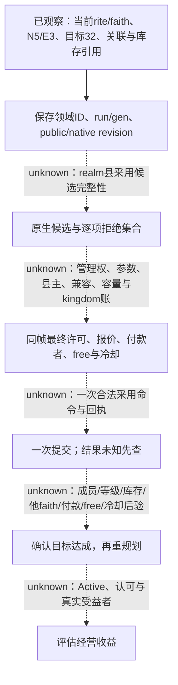

# 第一期 R0001：准备与圣地原生观察

`machine_id: 4-8e1c2f1861`，CK3 `1.20.0.4`，EXE SHA-256 `98702f88a547cde2eaf29a85f93b85f68ee4cf8148336a4f7afaeb75319dd518`。本页只消费 owner 冻结回执，不发新游戏命令。查询截止 `2026-10-17T08:55:42.660411Z`；闭场截止 `08:57:50.012207Z`；编写时于 `09:02:01.715998Z` 再读机器 ID。编写 checkout 为 `2cee05a67426e0a9f56ee60da74b26f5a478a0d9`、当时 clean；该提交不是对实际加载 DLL 来源的替代证明。

原件根为 `C:/workspace/ck3-faith-and-power-20261017/episode01/live/4-8e1c2f1861--faith-and-power--R0001`。配套[观察记录](evidence/faith-and-power-episode01-r0001/observations.json)固定15条主张、75处 JSON pointer、各原件完整 SHA/字节数/时间及读回 revision；JSON SHA-256 为 `f9213a509081733916c0e46683baba22ae197994354be3238ea773945442edd6`。这些补充[第一期静态规划合同](faith-and-power-episode01-planning.md)，不改写其待验案例。

**本场已读到宗教身份、当前 faith 圣地关联、加载目录、显式 HolySite32 和嵌入式库存引用。采用执行为0；正常退出 RED；资源已释放；合格素材为0。** 活动/圣物收益、原生采用候选和最终许可没有因此完成。普通 auto 的宗教执行闭环、Robert 战役成绩均不增加。

## 实际观察与可以消费的范围

所有下表查询均为 CK3 PID `18236`、connection generation `1`、玩家 runtime ID `15893`、`date_raw=51394920` 的暂停状态。`prepare-a-religion-a01` 与 `prepare-a-holy-sites-a01` 绑定 `native:6` / public revision `7` / native revision `6`；显式 `prepare-a-nadjaf-a01` 绑定 `native:7` / public `8` / native `7`。不同修订号分别保存，不能把 public revision 当作 native revision。

| 观察 | 原件/主张 | 对规划器的意义 |
| --- | --- | --- |
| 当前 rite `13`，faith `50`/`sunni`，faith main rite `13`。 | `prepare-a-religion-a01.json`；O01 | A分支没有本组实证证明已转 Maliki。历史角色定义34014与 runtime15893分别存储，历史ID/分支文件名不能代替当前身份。 |
| faith50 的关联为 `[26,27,0,14,29]`，其中三个 eminent。 | `prepare-a-holy-sites-a01.json`；O02 | 可建立当前 `N=5/E=3` 资源账；有效上限、剩余额度、used kingdoms、管理权与冷却尚缺，不能计算可执行的“剩余名额”。 |
| Jerusalem 的完整 HolySite ID 为 `0`，库存 owner 也为 `0`。 | 同上 `/result/current_faith_sites/2`；O03 | HolySite 不能用通用 `if id` 或全局 `id > 0` 丢弃对象；其他ID领域的0是否有效不由此推断。 |
| loaded roster 中 nadjaf32 与 kufa35 同 barony6650。query32 显式解析为 nadjaf32。 | 同上与 `prepare-a-nadjaf-a01.json`；O04 | 位置不是实例键。保留 run/generation/full HolySite ID；同址不能推断同一实例、共享库存或相同 faith 关系。 |
| nadjaf32 的关联列表只有 faith51、eminent=true；玩家faith50列表没有32。 | `prepare-a-nadjaf-a01.json`；O05 | 这是当前关联观察。玩家权限、县主faith、礼仪核心参数、敌意方向/兼容见证等仍需同帧原生读取。 |
| 加载目录326项；slot_count1024、unreadable_slots0；`registry_roster_is_native_adoption_candidates=false`。 | `prepare-a-holy-sites-a01.json`；O07 | 326是这份目录解析出的条目数，1024是槽位数。两者都不是 realm 县过滤后的采用候选或可采用数量。 |

O编号的完整前缀为 `E01-O`，详见观察JSON。查询工具为 `ck3_query_player_religion_context_v1`、`ck3_query_player_holy_site_v1`；本次结果 `read_only=true`、`advertised=false`。成功范围是当前精确build/单场回执，不外推任意存档、其他机器或全部宗教接口。

| HolySite | type | barony | faith50 eminent | 库存artifact IDs |
| --- | --- | --- | --- | --- |
| 26 | mecca | 8518 | true | `[60]` |
| 27 | medina | 8492 | true | `[61,62]` |
| 0 | jerusalem | 8857 | true | `[63]` |
| 14 | baghdad | 6687 | false | `[64]` |
| 29 | sinai | 8836 | false | `[65]` |
| 32 | nadjaf | 6650 | 玩家faith50未关联 | `[]` |

上述库存均为 `identity_kind=embedded_holy_site_inventory`，`owner_kind=holy_site`，owner full ID 与对应站点一致；没有单独可消费的 Inventory ID。`artifact_objects_resolved=false`，因此不能从这六个artifact引用生成名称、稀有度、本faith认可、供奉/移除许可或实际收益。纳杰夫空库存也不构成不能采用的理由（O06）。

显式 query32 的 `window_model.available=false`，原因 `holy_site_window_type_or_backlinks_unavailable`；`rendered_visibility_observed=false`。它的 `selection_source=explicit_full_reference`，不是GUI已经打开/已选中该站点的证明。`active_state_observed`、`relic_recognition_observed`、`beneficiaries_observed`、`adoption_legality_observed` 全为 false；false描述“尚未观察”，不应转成对应机制值false（O12）。

## F/A准备、事件后验与恢复边界

用户已允许明示准备的独立机制实验。`prepare-save-f-a01` 于 `08:53:48.015587Z` 取得 `status=saved`，50,308,970 B，SHA `786afb9eb40e8952d8aeade35eebd869ad7c7383fc28894389e2859451f750f1`；其冻结副本为 `episode01/scenario/saves/F-pending-prepare.ck3`。保存后的原生快照仍有准备事件 instance1，两项 native indices `[0,1]`、enabled均true。

`prepare-a-choice-a01` 一次提交 `event_instance_id=1, option_number=1`；原生映射 index0，`status=event_instance_advanced`、`postcondition_verified=true`，后态 `active_event=null`。这支持“该准备事件已推进”的窄结论；不是采用的 ACK 或采用后验。本组snapshot选项标签为null，实际显示文字需采用原先事件context证据，不能补写标签（O08）。

`prepare-save-a-a01` 于 `08:55:22.756327Z` 保存 A，50,214,831 B，SHA `8cadd902d3360995ecfb1541013a72b80408ff041e25b9627592553e2cf9f662`；冻结副本为 `episode01/scenario/saves/A-hanafi-prepared.ck3`。F/A原生保存与各自小型copy回执SHA一致，A后态事件为空；读取 piety `225000000 / 100000 = 2250` 只证明该余额，不证明采用费用、准备增量或免费次数（O09、O10）。本lane未复制或重新加载这两份大存档。

**两份保存的 `driver_state_replace_receipt` 都是 `unconfirmed/save_binding_mismatch`，`save_binding_verified=false`。** 存档成功、冻结copy和完整driver恢复绑定分别记账；下次加载必须独立读回玩家、日期、rite/faith、事件、关联/库存/资源以及driver绑定，再允许后续动作。不能把文件存在或SHA一致当作已验合恢复包（O13）。

## 原始RED与退出资源账

原启动合同因先出现 `fp3_struggle.0051` 而失败；[同进程恢复专题](faith-episode01-same-process-startup-recovery.md)保留原诊断、续行与严格后续准备观察。`startup-packets-revalidation-01.json` 是**离线复核owner保留包**：`original_host_run_green=false`、`fixture_target_identity_proven=false`、`product_acceptance_proven=false`。后续单项查询取得实际观察，不能把原startup转绿或追认历史角色→当前角色完整身份链（O11）。

`08:55:42.853911Z` 发起 `ck3_query_normal_exit_context_v1`；`08:55:43.164582Z` 查询报错。精确提取件 `episode01/runtime-audit/r1-native-exit-query-failure/precise-extract.json`，SHA `d1ec1678de73eebdaad08afdfe61a985a5ff6e9b5718769e55b4d835ebc120bd`，实际库存验证指出游戏改写 `profile/pdx_settings.txt`。按上述恢复专题定位，该拒绝在Python预验层，尚未发送原生退出请求；它不是圣地abandon失败。

异常结束诊断hold后，受管收尾记录 CK3 exit1、cleanup_proven=true，`normal_exit_qualified=false`。正常关游戏仍RED，不能以清理成功替代正常退出资格。原keeper父等待exit0、thread_exited=true/failure=null，录制 `completed_takes=[]`；`root-screen-release-a02.json` 于 `08:57:50.012207Z` 记录 CAS11222/task done/resources[]。可以关闭资源占用账，不增加宗教业务、正常退出或素材分子（O14、O15）。

## 下一条能够执行的规划链

下一轮优先修复精确的运行期可写配置/不可变输入分类，取得正常退出资格；用新attempt重核F/A加载恢复与玩家身份。H01-02/03所需的关联、实例、库存部分字段已有当前观察；H01-01/04的候选/完整terms与H01-07采用后态仍未完成。不得为视频把这些缺项猜成许可，静态MCP知识继续保持 `source_reviewed_static`、`native_legality=null`、`action_ready=false`。

本外置候选遵守统一存储策略1.0.0，不复制游戏资源、存档或巨型wire日志。小型记录于2027-04-15复核；patch在owner应用并核验后按48小时派生物期限复核。容量观察和来源可读性边界在配套JSON；pin不保证未来原件永久保留。
