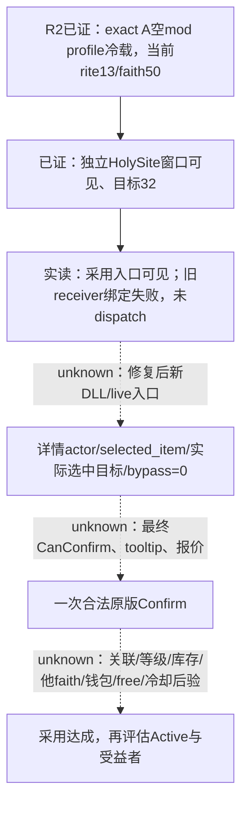

# 第一期R0002：A冷载、可见圣地与最终许可缺口

`machine_id: 4-8e1c2f1861`。本页只读owner冻结包，查询截止2026-10-17T09:36:07.439944Z，闭场截止09:57:27.528005Z；本次实际build为1.20.0.4，EXE SHA `98702f88a547cde2eaf29a85f93b85f68ee4cf8148336a4f7afaeb75319dd518`。R2实际运行源码为 `201606305bfb2f8ec4f4730e20d751c8ce68e288`；后合源码不追认已加载DLL。

[机器可读观察](evidence/faith-and-power-episode01-r0002/observations.json)固定10条主张、逐字段JSON pointer、19份原件SHA及3份本机原版GUI源SHA/行号。原件根 `C:/workspace/ck3-faith-and-power-20261017/episode01/`。本页离线整理过程没有发游戏命令或复制存档/原片；Root实际操作以下列原始回执为证。[R1观察](faith-and-power-episode01-r0001-observations.md)的startup/退出RED仍保留。

## 已经取得的规划输入

R2从50,214,831 B、SHA `8cadd902d3360995ecfb1541013a72b80408ff041e25b9627592553e2cf9f662` 的A-Hanafi输入冷载。独立新profile为 `ck3-saved-campaign-vanilla-profile-v1`，`enabled_mods=[]`、`product_files=[]`，实际 `dlc_load.json` 同为空mod；A本身仍是明示准备的独立机制实验状态，空mod启动不抹去其准备历史，也不计Robert普通战役成绩。

`runtime-audit/r2-cold-restore-observation-a02.json` 于09:35:40Z观察、09:36:02Z汇总：`ACTUAL_SAVED_CAMPAIGN_CURRENT_CONTEXT_BOUND`，09:34:02.853422Z完成owner-frame/root准入。实际新CK3 PID952、connection generation1、owner_tid20932；玩家15893、date_raw51394920、local_player1、native:2/public revision3/native revision2，map_ready/paused均true、active_event=null。`saved_campaign_identity_proven=true`，`product_acceptance_proven=false`。这是R2自身成功冷载证据，不是R1进程恢复、主菜单画像日志或旧Start的ACK（R2-O01）。

随后R2独立root/religion查询确认玩家独立、root ready，rite13、faith50/sunni、main rite13。当前faith网络重新读到 `[26,27,0,14,29]`；加载目录明确不是原生采用候选。身份、独立性与现状可供规划建账；管理权、兼容见证、县主faith、额度/冷却仍未由这些值回答（R2-O02/03）。

09:35:50.484643Z开HolySite32只返回`acknowledged_verification_pending`；09:35:51.132706Z独立窗口查询才确认 `effective_visible=true`、`subject_id_available=true`、`current_subject_id=32`、`status=observed`。窗口打开及目标后验已取得，采用详情与采用结果另计（R2-O04）。

## 灰叉、入口失败与真实拒绝怎样区分

直接审阅原始截图 `r2-frame-20261017T093557Z.png`，可见“纳杰夫 / 什叶派的主要圣地”、采用入口灰图红叉、三处空供奉槽和右侧可供奉宝物列表。截图是像素观察；原生树没有rendered text，不用OCR或鼠标补原生许可（R2-O05）。

原版 `gui/window_holy_site.gui:611–620` 用 `MakeDecisionTypeWithParam('adopt_holy_site_decision','selected_item',HolySite.MakeScope)` 建详情入口；`window_decisions.gui:384–417` 用 `DecisionTypeWithParams.IsPossibleForPlayer` 控制灰图、灰标题与叉。该段没有把它绑定为按钮enabled；最终确认由 `window_decisions_detail.gui:211–222` 的 `DecisionDetailView.CanConfirm`、tooltip与Confirm回调另行控制。三个完整SHA和行号均在观察JSON，源来自本机实际安装原版。灰叉不能写成已读到最终CanConfirm=false，按钮enabled也不能写成最终许可true。

本次采用开详情请求的原生结果：`adopt_visible=true`，Regular/Eminent=false，但 `receiver_bound=false`；09:36:06.991290Z在dispatch前返回 `adoption_entry_receiver_not_unique`，`native_dispatch_attempted=false`。这是一条技术绑定拒绝，不是玩家不满足采用条件（R2-O06）。

563个控件的保留树与离线诊断显示，四条有序OpenGameViewData→Close双回调shortcut均来自原生producer选择的fallback组，只有 `1/3/1/3/4/0`及祖先可见启用；旧primary-only过滤错排唯一receiver。修复及来源审查见[原生采用专题](holy-site-adoption-native12004.md)。该路径只作本帧诊断，不能变成跨存档硬编码目标；本页不猜新ABI。源码合入不代表当前DLL已变或修复已获新live资格（R2-O07）。

09:36:07.439944Z详情查询明确 `adoption_detail_definition_unavailable_or_different`；`native_can_confirm=null`、`normal_requirements_legality_observed=false`、`normal_requirements_can_confirm=null`、`native_resource_quote_available=false`、`action_ready=false`。`decision_confirm_invoked=false`、`adoption_completed_observed=false`。未知必须保留null，不能把它规范成拒绝或用灰叉猜失败条件（R2-O08）。

对智能体：遇receiver绑定失败应修接口，不花资源改信仰或领地去“解决条件”。下一场保留A输入，先新鲜核身份/窗口/完整参数，读取普通条件开关与最终terms；结果未知先查，不能重放Confirm。候选完整性、实际费用/付款者、免费数、冷却、Active与受益者仍缺。普通auto宗教动作闭环、H01采用成功次数均仍0。

## R2实际正常收尾与素材边界

R2 `case-output/normal-close-result.json` SHA `c752526f594b81a34e913cebce608703c0d6e42dacd94787f3a4132ad7681b8b` 记录一次原生GUI退出及独立原始HANDLE：PID952/create_time1792229352.939842、exit0，native `process_exit0`、cleanup_proven=true、normal_close_qualified=true。Root的09:56:56.359620Z审阅说明保留实际确认与取消退出自动保存的画面。`public-run-r2-a01/original-exit.json` 原Popen实际等待0；keeper原父等待0；09:57:27.528005Z CAS11251/task done/resources[]。这只授R2正常收尾，不把R1正常退出RED改写为成功（R2-O09）。

录制回执为 `ENCODED_UNREVIEWED`，原片存在、recorder `NORMAL_TREE_EMPTY`；clean_spans_certified/native_business_verified/human_review_performed均false，合格素材0。不能把没有采用后态的原片计为采用业务或最终镜头通过（R2-O10）。

本候选遵循通用存储策略1.0.0，仅小型文档/JSON/patch；源pin不保证原件无限期存在。记录2027-04-15复核，应用并核验后的派生patch按48小时期限复核；原始媒体与活跃输入仍由owner按统一策略管理。
