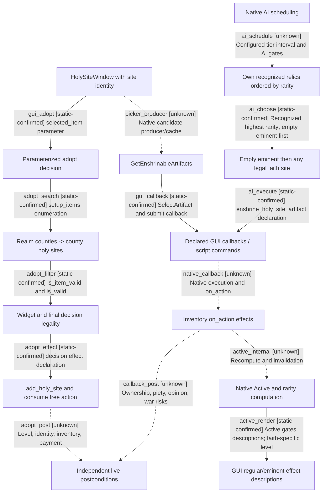

# 1.20.0.4 圣地、圣物与智能体经营决策合同

2026-10-17。本专题把[拍摄交接](../../promo/ck3_faith_and_power/shooting-handover.md)转为可复用的规划知识。当前交付是**实际安装资源的静态合同、候选来源、MCP 数据需求和最小实证方案**。本轮没有启动游戏、提交宗教动作或取得宗教业务实机后态；没有把源码声明晋升为成功操作或可用镜头。

## 本次身份、来源和证明范围

执行机器为 `machine_id: 4-8e1c2f1861`，由 `tools/ck3_live_run_id.py machine` 本轮读回。安装观察来自 `C:/workspace/ck3-version-and-sync-20261017/inspect-01/result.json`，时间 `2026-10-17T05:24:26.108488+00:00`，同一机器 ID；安装版本为 **1.20.0.4 (Crozier)**、Steam build **25734779**、分支 `1.20.0`。这不是运行中 CK3 身份或加载资格。

本轮 `2026-10-17T05:28:26.017308+00:00` 对实际文件重新计算 EXE SHA-256：`98702f88a547cde2eaf29a85f93b85f68ee4cf8148336a4f7afaeb75319dd518`。实际资源根为 `C:/Program Files (x86)/Steam/steamapps/common/Crusader Kings III/game`。当前加载 mod、DLC 生效集合、存档、玩家、日期、运行时连接 generation 均尚未观察，不能据安装 DLC 清单推断已经加载。

[source-manifest.json](evidence/faith-and-power-holy-sites-12004/source-manifest.json)绑定实际源文件、大小、完整 SHA、观察时间和安装回执 SHA。本机重新读了旧来源锁的 46 份文件与 6 份扩展选题文件，**52/52 与同版本镜像基线逐字节一致**；另有 3 份本机补充来源只冻结本地字节，未宣称镜像比较。第三方资源镜像 commit 为 `074429b3f6d9352a3cf4c5671725fee2f41267ba`，它不是引擎 C++ 源码。历史来源锁属于机器 `xenoamess-full-tower-eb9d2c1186`；本次匹配由本机重新核验，没有继承它的安装或实机结论，也没有作全安装 clean attestation。

Root 后续补注（同一 `machine_id: 4-8e1c2f1861`，2026-10-17T05:37:23.994984Z）：另对上述 3 份补充文件从固定镜像 commit 实际读取原始字节，`_religion_types.info`、`00_basic_values.txt`、`window_faith.gui` **3/3 与本机冻结 SHA 相同**，详见[追加比较回执](evidence/faith-and-power-holy-sites-12004/additional-mirror-comparison.json)。本轮选取的 55 份来源由此均有同版本匹配；原 manifest 的三个 null 保留其最初观察范围，未覆盖改写。没有把有限文件比较扩为全安装证明。

[research-plan.json](evidence/faith-and-power-holy-sites-12004/research-plan.json)按[原版优先提示词](vanilla-first-implementation-prompt.md)和[研究工具流程](research-tooling-workflow.md)编制；[结构检查](evidence/faith-and-power-holy-sites-12004/research-plan-check.json)只验证记录与字节。`offline-only` 不具备采样窗口，不能作为 `--for-observation` 准入；5 项业务案例仍为 pending。

存储策略为 `docs/storage-retention-policy.json` 1.0.0。本机 `2026-10-17T05:28:26.017308+00:00` 的 `shutil.disk_usage('C:/')` 读回总量 `511776722944` B、空闲 `5489659904` B；这低于本卷适用安全余量，不能批准录制或其他重型写入。本工作包仅保存小型文档/JSON，不复制原版文件或完整导出，JSON 总预算 <300 KB；容量协调及实机由根执行者负责。记录类证据于 `2027-04-15T00:00:00Z` 复核，继续保留理由是智能体和正式拍摄的来源绑定。

## 五层对象必须分开

| 层 | 稳定来源 / 运行时身份 | 规划含义 |
| --- | --- | --- |
| 类型定义 | `HolySiteType` definition key，如 `baghdad`、`site_of_wisdom` | 定义地点默认值、固定/缩放修正和额外参数。采用动作没有重新选择 type 的脚本。 |
| 地理实例 | 运行时 `HolySite` 完整 ID、county、barony、Inventory ID | 同县不等于同实例。`baghdad` 与 `ctesiphon` 同为 `c_baghdad`，后者显式指定 `b_an-nahrawan`，模板不同。 |
| faith 关系 | `(faith_id, holy_site_id, eminent/regular)` | 主要/普通是某 faith 与站点的关系；不能给整个站点只存一个全局等级。初始定义中巴格达为 nestorian 主要、sunni 普通。 |
| 控制与认可 | county/barony holder、top liege、clerical region holder、各自 faith/rite、artifact 认可集合 | 县民信仰、县主信仰、男爵信仰和玩家信仰不能互相替代。采用权限与认可库存圣物是不同条件。 |
| 实际消费者 | 县、县主、全 faith 角色、参数消费者、特殊建筑各自独立结果 | UI 描述、`IsActive`、实际人物属性、建筑启用并非同一事实；逐项取证。 |

定义依据为 T01/T02/F01，行号及完整 SHA 在文末。不要在规划数据库中用 county key 代替 HolySite ID，或用显示名称代替 artifact/faith/rite ID。

## 原版玩家 GUI 路径

### 采用候选从哪里来

1. 信仰窗用 `GetSelectedRiteHolySiteItems`、`GetOtherRiteHolySiteItems`、`GetOtherFaithHolySiteItems` 三个 model 展示列表；点击列表项把具体 HolySite 传给圣地窗。GUI 对 model 的引用已确认，C++ model producer、底层索引、缓存建立/失效时点未定位（G02 1568–1648、2074）。这三份展示列表不自动等于完整采用候选目录。
2. 圣地窗通过 `MakeDecisionTypeWithParam('adopt_holy_site_decision', 'selected_item', HolySite.MakeScope)` 打开 decision_detail（G01 612–618）。这里已经给定目标，不能把它称为搜索全世界站点。
3. 采用决议 widget 的 `setup_items` 从 **actor 的 `every_realm_county` → 各县 `every_county_holy_site` → 排除 actor.faith 已关联站点 → item_list** 产生候选（D01 588–601）。这是一条可复用的范围收缩依据；它没有证明引擎迭代器内部采用什么索引或复杂度。
4. `is_item_valid` 再过滤：非己 faith 已关联站点、县主与 actor 同 faith、至少一个关联 faith 有县信众、法理王国记录可用（D01 603–616）。它不包含最终合法性的所有条件，不能单凭出现在 picker 中就提交。
5. 最终 `is_valid` 要核完整合取条件、费用、该决议冷却和当前身份（D01 488–553）。实际 GUI/native decision 执行器如何在最后重验与消费费用，C++ 尚未定位；MCP 实现必须调用已定位原版入口并保留真实拒绝，不能在 Python 端算出 true 后直接写存档。
6. 声明效果为 `root.faith.add_holy_site {target, actor}`，随后消耗一份尚存在的免费额度（D01 555–562）。它不声明 type、默认等级、运行时实例或库存复制规则。上述各项必须动作后重新读取。

widget 的 `ai_item_will_do` 在兼容/任意采用权限与王国记录通过时由 0 加到 100（D01 618–631）。这说明脚本评分，没有证明通用 widget 引擎怎样选择、排序、重验或缓存 item_list。

### 供奉、替换、移除

圣地窗绑定 **`HolySiteWindow.GetHolySite.GetInventory`**（G01 12–14）；槽位 model 为 `GetSlots`，候选 model 为 `GetEnshrinableArtifacts`（425、740、781）。选择 artifact 与 slot 后，按钮分别使用 `IsEnshrineButtonEnabled` / `IsRemoveButtonEnabled`、tooltip，并调用 `OnEnshrineButtonClicked` / `OnRemoveButtonClicked`（860–881）。替换与供奉共用 enshrine callback，`HasSelectedFilledSlot` 决定显示的动作。以上是当前原版 GUI 名称，**不是已经定位的 ABI、RVA 或现成 MCP 工具**。

`GetEnshrinableArtifacts` 从哪个 inventory 产生、是否先按圣物筛选、如何包含不可用项、排序/失效条件和 command 的完整最终校验尚未还原。GUI 自动展开条件中的控制资格、候选非空及槽数只是展示条件（G01 34–37），不能替代候选 producer 和合法性证明。

脚本子规则 R01 明确：

| 操作 | 已确认脚本权限 | 不能据此自动补出的引擎条件 |
| --- | --- | --- |
| 供奉 `can_enshrine_artifact` | 县主=actor，或县主.top_liege=actor，或该县 clerical_region_title.holder=actor；并且 actor.faith 已关联该站点。 | artifact 是否属于 actor、槽位与替换对象是否有效、是否须认可、是否能支付、并发身份/最终命令验证。 |
| 移除 `can_remove_enshrined_artifact` | 同上三种控制资格之一。该子规则未要求 actor.faith 关联站点或认可该 artifact。 | 不能因此宣称可移除任意 inventory 的 artifact，或移除没有成本/外交后果。 |

R01 这两个脚本入口与 AI 所用 `can_enshrine_holy_site_artifact` / `can_remove_holy_site_artifact` 原生 trigger 名字不同；当前仅核脚本内容及调用声明，完整 native wrapper 仍待定位。

## 原版 AI 路径与我方桥接分开看

### 采用 AI

D01 473–480 配置 tier interval（empire/hegemony 为 24，较低 tier 为 0）；565–580 的 `ai_potential` 要求独立、可管理、虔诚至少 `monumental_piety_value`，且总数小于 `religion.holy_sites_max - 1`，明确为玩家留一格。widget 候选来源和评分见上节。实际调度器、interval 的消费调用、最终抽样和重算时点未定位，不能据这些字段宣布自然 AI 已采用某站点。AI 的 piety 前置也没有因免费额度在脚本中自动豁免；这与最终费用为零是两层条件。

### 供奉 AI

D01 637–736 是明确的 AI-only 决议：

1. `is_available_ai_adult`、持有 artifact；至少一件 `is_holy_relic=yes` 且 `is_holy_relic_for=root.faith`，在本 faith 站点里能通过 `can_enshrine_holy_site_artifact`（655–675）。
2. effect 再对自有且被本 faith 认可的 artifact 执行 `ordered_character_artifact {max=1, order_by=artifact_rarity}`，注释意图为取最高稀有度（677–686）。不要擅自把前一个 any 的临时 artifact 当成最终被选择对象；两次枚举不同。
3. 优先随机选择 `total_active_artifact_rarity_sum=0` 且原生许可通过的主要站点（691–704）；这里的“空”判断是**有效稀有度为零**，不一定物理库存为空。
4. 若未选中，再从全部本 faith 圣地随机选择许可通过者（706–721）；最后调用 `enshrine_holy_site_artifact`（726–729）。该过程没有比较所有站点的经济、军事收益或个人装备机会成本，不能把它当作经营最优解。

county 配置 interval=24、duchy及以上=12（642–649）。这些是脚本配置值；本轮没有测过原生调度或取样分布。最高稀有度 artifact 是否恰为前置 any 找到的可合法供奉对象，还需原生最后验证，不能用脚本注释保证成功。

### 移除 AI

D01 741–908 从**自己直接持有县**的 county holy sites 枚举，要求 AI 可用成年、与 top liege 同 faith、top liege 为 AI、HoF 不存在或为 AI，且 `zealous` 或 `ai_zeal>=25`。候选分两支：自己 faith 站点有不被自己 faith 认可的 artifact；或有活跃县信众的敌对 faith 站点中有该 faith 的圣物。`is_valid` 用原生 remove trigger 检查可行样本；effect 扫描所有匹配项并声明移除。敌对分支额外保护“同一站点也属自己 faith 且 artifact 也被自己认可”的情况（881–890）。不要照搬为玩家策略：这可能引发多 faith 意见或圣物战争风险。

### 当前我方桥接边界

本轮搜索 `ck3_autonomous_player/src/xar_autoplayer/bridge`、`native_bridge/src`、`native_bridge/include`，已有 pilgrimage candidate factory 暴露 current-faith 的 `holy_site_id`、title/province identity；它不能回答站点库存、Active、关联 faith 等级、采用或供奉许可。相关 `ck3_12003_pilgrimage_candidate_factory.cpp` 文件名本身也不是当前 1.20.0.4 ABI 已迁移证明。

当前未在上述范围找到专用采用、供奉、移除实现。精确控制审计与新增 MCP 施工由根工作包维护；本专题不把检索未命中扩大成“仓库任何地方绝无入口”。MCP-first 的第一步是把本文来源合同接入既有知识查询，再补最小原生只读 context，随后才注册动作和普通 planner 消费，不绕过智能体另做视频专用输入通道。

## 可消费的规则：条件、成本、效果、观察

### 采用条件是一个合取，不是只问信条

下列每个条件保存原生 `pass/fail/unknown`、工具提示、证据帧和来源，不把 unknown 当 false 或 true：

| 条件 | 精确脚本口径 | 来源 |
| --- | --- | --- |
| authority | 独立；`can_manage_faith_holy_sites_trigger` 通过。 | D01 491–493，P01 1294–1337 |
| capacity | 当前 faith 总圣地数 `< religion.holy_sites_max`。 | D01 495–500 |
| identity | selected_item 存在；尚非 actor.faith 圣地。 | D01 502、512–516 |
| realm and holder | 目标 county holder 满足 `target_is_same_character_or_above=root`，且 holder.faith=root.faith。 | D01 504–510 |
| geography | `faith_can_use_holy_site_kingdom_trigger(BARONY=target.barony)`。 | D01 518–520，X01 2000–2023 |
| religion relation | actor.rite 有 `allow_adopt_any_holy_site`，或存在一个关联 faith 满足下面兼容支。 | D01 521–527，X01 1964–1987 |
| surviving followers | 至少一个关联 faith 的 `num_county_followers>0`。这里不必是兼容支选择的同一个 faith。 | D01 528–534 |
| transaction | 原生实际成本可付、该决议冷却/最终执行验证通过。 | D01 543–553；执行器细节 unknown |

兼容支对 **any_holy_site_faith** 做存在性检查：任意采用 rite 参数，或 `(同 religion OR actor.faith 对目标 faith 有综摄关系) AND actor.faith 对该目标敌意<=astray`。不是只拿画面最熟悉的一个 faith 来判。方向性也要保留：来源明确从 actor.faith 检查目标，不能擅自对称化。

管理权限 P01：若有 HoF，则本人为 HoF，或内部/外部 theological agent puppet 为该 HoF；若无 HoF，则本人或 puppeteer 走“有 theological agent puppet，或政府为 theocracy”并 `piety_level>=4`。个人/礼仪、puppet/puppeteer scope 要逐个保留；独立皇帝也不因头衔自动获得这条权限。

参数名以当前字节为准：顺应 `tenet_adaptive` 核心参数（`00_tenet_types.txt` 1743–1758）有 `allow_adopt_any_holy_site`，其 personal 参数（1777–1780）没有该项；嗣子论（`00_pam_tenets.txt` 1617–1648）也声明该采用参数。伊斯兰综摄核心（`00_tenet_types.txt` 4199–4216）提供定向综摄 actor 参数，个人版不提供同一 actor 参数。不能只凭同名中文信条、旧文档的近似参数名或个人选项授权。

### 免费额、冷却和王国记录

| 项 | 当前 1.20.0.4 静态事实 | 智能体应怎样用 |
| --- | --- | --- |
| 免费额 | 新 faith 创建回调写 `free_holy_site_actions=3`；不是所有旧 faith 永远自带3次。 | 读当前变量；只有>=1才预测免费，并在后态读减量。 |
| 采用成本 | 基准 `monumental_piety_value=1000`，免费额存在时乘0。 | 原生成交费用与脚本基准分开保存，不从基准伪造钱包后态。 |
| 晋升/降级/放弃 | 各自决议费用/冷却定义独立；采用/晋升/放弃均可见1000基准和免费豁免。 | 当前 action key、actor、冷却到期分别记录，不能说四项共同锁5年。 |
| 冷却 | `holy_site_decision_cooldown_value` 默认5年，有免费额为0；新建另用 actor 的 `holy_site_creation_cooldown` 变量。 | 不用新建变量代替采用决议 cooldown。新faith回调清四项决议冷却与创建变量。 |
| 创建 | scripted cost 基准2000；新建初始圣物稀有度门槛3；不属于“每次采用需凑3点”。 | 以 action kind 区分成本和必要条件，不混合创建/采用。 |
| 地理额度 | faith 的 `dynamic_holy_site_kingdoms` 记录 used de jure kingdoms；目标 barony 无 kingdom 或记录缺失的分支保留原脚本语义。 | 不简化为“每个王国最多一个全部圣地”。读取实际 variable list 和完整站点关联。 |

地理记录还有容易漏掉的 producer：`on_faith_holy_site_added` 仅在该站点关联 faith 数量为1时调用记录 effect（A01 1948–1956）；共享站点退出后只剩1个 faith 时，removed 回调给剩下的 faith 补记录（1995–2004）。record effect 本身幂等，release effect 只有该 faith 在该 kingdom **再无任何圣地**才释放（E01 1296–1340）。因此“每次采用必立即写一条王国记录”不是已证结论，必须观察 before/after。

### 库存、有效稀有度和 Active

三槽在 `common/artifacts/slots/01_holy_site.txt` 7–20，均 `allow_any_type_or_category=yes`；槽位声明不等于完整供奉合法性。`MAX_HOLY_SITE_RARITY_TOTAL=12`、创建要求3在 N01 928–932。V01 1–10 描述当前 controlling faith 也关联该圣地时，累计被其认可的供奉 artifact，common/masterwork/famed/illustrious 各贡献1/2/3/4；原生读值是 `total_active_artifact_rarity_sum`。**有效和=0 与物理库存空不是同一条件。**

GUI 的警告以 county holder faith 调用 `Artifact.IsHolyRelicFor`（G01 934、949–953），有效值与 Active 则读 `GetTotalActiveArtifactRarity` / `IsActive`。定义说明的全 faith 固定修正以 barony holder 同 faith 为口径（T01 32–34），县主局部修正又用 county holder（56–58）。当前没有定位 C++ 全部控制/礼仪分支，不能用其中一个注释吞并另外两者；未来采样必须同时读 county holder、barony holder、county faith、rite 和 clerical region holder。

同一圣地窗 inventory 绑定在 HolySite，而非当前查看 faith，这是共享库存的强静态线索。**是否两个入口确为同一运行时实例/Inventory、采用后是否保留全部 artifact，仍须用相同 site ID、inventory ID、artifact ID 后验确认。**同县的 Baghdad/Ctesiphon 不能作为共享实例实验。

G01 1137–1225 用 Active 控制“效果/未生效效果”及描述区；这只证明 UI 消费。取出最后有效圣物后固定修正、缩放修正、parameters 与特殊建筑分别怎样变化尚未实证。不要预填“只损失缩放，固定永久保留”。

### 谁受益，怎样估值

T01 的声明合同是：普通与主要都可给县主局部固定修正和县缩放修正；全 faith 角色固定/缩放修正限该 faith 的主要站点。不要把 artifact 自身装备 modifier 复制给全 faith，也不要把“同faith县民”当作全局角色收益收件人。

可用于经营比较的原版例子：

| 模板 | 县主/县目标 | 主要时全 faith 角色目标 | 规划取舍 |
| --- | --- | --- | --- |
| `baghdad` | 县主learning+1、development_growth_factor+0.05；县按有效和缩放建造费/被劫时间。 | 固定learning+1、教堂建造费-0.1；按有效和缩放development_growth_factor与monthly_income_mult。 | 既有站点type不因采用而成为自选模板。 |
| `site_of_wisdom` | 县主learning+2；县建造费与development_growth随有效和。 | 固定diplomacy_per_piety_level+1；两类lifestyle XP随有效和。 | “智慧”名称不能代替收件人与实际属性。 |
| `site_of_martyrs` | 县主county_opinion_add+5；县发展/建造速度随有效和。 | prowess_per_piety_level+1、different_faith_opinion-5；MAA维护随有效和。 | 外交负项应进入效用，不能只加正收益。 |
| `site_of_miracles` | 县主月虔诚倍率+0.05；县税/抗疫随有效和。 | 固定月虔诚倍率+0.05；max_combat_roll按0.5×有效和。 | 字段名与脚本系数不自动证明战斗净收益；运行时受益者与参数应用另核。 |

以上数值是类型定义声明（T02 359–382、T03 24–96），不是真实已到账数值。规划器先明确目标受益者及其权重，再比较可行候选、主要名额、认可圣物和装备机会成本，保留无法量化项，不按“稀有度最高”默认最优。

### 圣物认可、移除成本与风险

祝圣交互 target 来源为 `actor_artifacts`（I01 8–10），候选和最终交互条件分别列在 81–118；接受后通过 `add_sanctified_for_faith=actor.faith` 写认可（171–173）。同一 artifact 可被多 faith 祝圣是本地化声明（L02 209）及“追加faith”脚本的依据，不代表所有 faith 天然认可。该交互本身有5年冷却、按稀有度取 piety 与 treasury_or_gold 成本（17–56），另有本人HoF路径；不能用普通请求路径覆盖 HoF 的全部权限。

库存回调 A02 322–329 明确显式移除把 artifact 送回 actor inventory，替换也调用旧物移除回调；generic inventory 改 owner 不触发同样回调。这使“放弃退还”与“主动取出”不能共用一套成本预测。527–540另有圣地所有权变更回调声明，真正 owner transition 仍须后读。

本 faith 认可圣物被真正减少/降级时，移除回调按稀有度声明 `add_piety_and_experience` 损失：common -50、masterwork -100、famed -250、illustrious -500（A02 333–399、V02 1131–1157），并可能影响相关 HoF、狂热/少数派封臣、同僚和领主意见（355–459）。异faith分支有圣物夺回CB警告及相关统治者意见（462–521）；警告文本不能代替实际 CB 可用性读取。

**供奉奖励不能按注释先算。** A02 137–154 根据 replacing 的认可/稀有度写 `replacing_with_better_artifact`，158–164的奖励分支实际检查其值为 `no`；这与“更好替换才获益”的注释不宜直接等同。先保留字面条件，初次供奉、等价/升级/降级替换各自读真实钱包；未定位布尔scope比较与实际回调效果前，不向玩家承诺供奉必获正虔诚。

放弃规则 D01 337–396 要求非主要且总数高于宗教最低值；仅在**无其他关联 faith**且有 county holder 时，把库存给该县主，再移除本 faith 关联。1.20.1返还已变，不能把本条外推。采用/撤出本 faith 网络与主动移除圣物有不同原生路径和风险。

## MCP 与普通智能体的最小施工合同

下表为**所需数据/动作合同**，不是宣称已有可调用工具。静态知识查询可先返回源绑定、候选来源与未知；native context 未具备时只能给研究解释或计划，不能返回 `legal=true`。

| 层 | 必需内容 | 拒绝/未知语义 |
| --- | --- | --- |
| 身份信封 | machine_id、EXE SHA/build、session/connection generation、episode、actor/faith/rite IDs、date、public snapshot revision 与 native revision 分开。 | 版本、帧或对象不匹配拒绝动作；public revision 不冒充 wire expected native revision。 |
| context | faith的全部关联站点及各自等级/上下限、free actions、used kingdoms；site完整ID/type/county/barony/Inventory；全部相关faith；各holder/faith/rite。 | 缺少名单完整性标记为 partial，不将未返回对象当不存在。 |
| relic context | artifact完整ID、owner_kind/ID、slot、rarity、认可faith集合及针对各faith原生判定；装备收益/耐久。 | 认可与原始祝圣集合可分别提供；缺一个不能从另一个猜造。 |
| 候选/terms | source enumeration scope、完整性、每步过滤理由、原生最终许可与tooltip、费用、冷却、预计受益者和反向风险。 | static prediction 与native result分别保存；unknown不得转换为false来静默剪候选。 |
| action | 同一暂停帧、action key、site/artifact/slot/替换对象、expected native revision、operation ID；经过普通 Driver/Service/native wire。 | 结果未知先query；不能重发同一不可确认动作，也不能用GUI方法名猜RVA。 |
| postcondition | 成员集合和等级、各ID、库存/owner、余额/free/cooldown、Active/rarity、实际修正与意见；独立帧和原始回包。 | ACK只记录received/queued；独立后态不足标unknown，不授成功。 |

建议普通 planner 生成 `holy-site-adopt`、`relic-enshrine`、`relic-remove` 这样的**计划动作种类**（非当前协议名），统一展示决策悬浮窗并走已绑定的生产执行路径。先复用原版 realm/county 和 faith 站点枚举超集，记录同帧完整候选；在原生许可前可用静态必要条件解释和排序，不能凭缺字段裁剪。

决策顺序：目标受益者/经营需求 → authority与资源 → 完整候选 → 关系和地理许可 → 主要名额/类型 → 圣物认可及有效和 → 个人装备机会成本/移除风险 → 原生最终许可 → 一次动作 → 独立后态。对不可量化收益保留理由和不确定度；没有同帧原版候选/成本对照，不宣称优于或至少不差于原版。

变更 actor/faith/rite、county/barony/clerical holder、认可集合、库存、站点等级/成员、额度/冷却或任意相关 native revision 后，我方 terms 缓存均失效；这是建议的保守策略，不是已还原的原版缓存合同。跨读档/进程不能缓存 runtime pointers；generation ID 也须按原桥接生命周期绑定。

## 最小可拍链与开放问题

当前没有合法容量与宗教 native 闭环。后续由根执行者取得新鲜 Steam 离线画面、屏幕租约、存储准入和正式运行身份后，再执行以下计划；本专题不自行占用游戏。

| 母案 | 最小前态 → 一次动作 → 独立后态 | 可冻结的结论 / 仍未知 |
| --- | --- | --- |
| H01-01/07 采用 | actor/faith/rite和完整条件、候选来源、site/type/各faith等级、库存ID、余额/free/cooldown → 原生采用一次 → 同一对象与钱包后读。 | 可据本案确认默认等级/实例/type/库存/其他faith关系；没有后态时只能解释条件。 |
| H02-04/09 激活 | 固定site/type/等级、控制者与faith；同artifact认可/owner、Active/rarity、县与角色实际修正 → 供奉认可物一次 → 全部后读；在可恢复分支移除最后有效件再后读。 | 逐项回答固定/缩放/参数生效；无认可的高稀有度反例另案。 |
| 多faith库存 | 从两个faith入口读取同一site/Inventory/artifact完整ID，控制不变 → 供奉或移除一次 → 两入口后读。 | 只证明这个相同实例的共享，不泛化到同县异站。 |
| 替换钱包 | 相同母档分开初次/同档/升级/降级，明确replacing ID → 每臂一次合法动作 → 实际余额与旧新物owner。 | 解决A02旗标/注释疑点，不能把不同臂剪成连续自然长局。 |

下一定位入口是当前 EXE 的 `HolySiteWindow.GetEnshrinableArtifacts` producer、`OnEnshrineButtonClicked` / `OnRemoveButtonClicked` caller、`can_*_holy_site_artifact` wrapper、`total_active_artifact_rarity_sum` / `IsActive` consumer与失效路径。先核当前字节的xref/RTTI与对象生命周期，再做最小采样；不预填ABI。一次精确前后态能够回答的问题，不等待整套C++复原才继续；但不能用源码、日志ACK或导演案替代那个后态。

## 同一研究记录生成的边图

以下块由 `native_research_plan.render` 从上述 JSON 生成；unknown边是虚线。检查通过仅说明记录一致，不证明未知引擎边已实现。

<!-- research-graph-start -->

# Research plan: faith-and-power-holy-sites-12004

GENERATED from the supplied research plan; no native semantics are inferred.

Question: What are shipped GUI and AI holy-site adoption and relic-management candidate, legality and effect contracts?



| Edge | Declared status | Evidence IDs | Open question |
|---|---|---|---|
| gui_adopt | static-confirmed | gui |  |
| adopt_search | static-confirmed | decision |  |
| adopt_filter | static-confirmed | decision, trigger |  |
| adopt_effect | static-confirmed | decision |  |
| adopt_post | unknown |  | Read native before/after; add_holy_site implementation unlocated. |
| picker_producer | unknown |  | Locate current EXE GetEnshrinableArtifacts producer/callers. |
| gui_callback | static-confirmed | gui |  |
| native_callback | unknown |  | Locate final native validation and command; obtain runtime action receipt. |
| callback_post | unknown |  | Read independent ownership, wallet, all affected faiths and opinion modifiers. |
| ai_schedule | unknown | decision | Locate actual scheduler; configured intervals do not prove evaluation. |
| ai_choose | static-confirmed | decision |  |
| ai_execute | static-confirmed | decision |  |
| active_internal | unknown |  | Locate current native Active consumer/cache or exact controlled before/after. |
| active_render | static-confirmed | gui, types, rarity |  |

| Observation design | Value |
|---|---|
| mode | offline-only |
| actor_kind | human |
| owner_scope | Offline root actor; no live actor/session selected |
| identity_kind | definition-key |
| identity_lifetime | Definition keys bind to exact bytes; runtime generation identities remain required |
| producer_trigger | not-applicable |
| producer | Shipped decision setup_items, AI scripts and GUI model references |
| caller | HolySiteWindow GUI callbacks; actual native callers/scheduler unknown |
| consumer | Own planner design; GUI descriptions and on_action scripts |
| cache_lifetime | Native lifetimes unknown; invalidate own projections after any action/faith/rite/holder/relic/level change |
| expected_signal | Source branches, candidate scopes, permission predicates and declared recipients |
| zero_sample_meaning | No live sampling. A search miss only excludes matching text in searched roots. |
| stop_condition | One bounded static pass; no game, desktop or native producer calls; JSON under 300KB |
| runtime_window_ref | None |

| Evidence ID | Declared layer | File | SHA-256 | Supports |
|---|---|---|---|---|
| decision | source-contract | C:\Program Files (x86)\Steam\steamapps\common\Crusader Kings III\game\common\decisions\50_holy_site_decisions.txt | 80ad6a6045bdafdce514cbccf59a9cd1370eaef6749d510adcec759468065fb4 | 488-634 adoption;637-736 AI enshrine;741-908 AI remove |
| gui | source-contract | C:\Program Files (x86)\Steam\steamapps\common\Crusader Kings III\game\gui\window_holy_site.gui | 23542c54dd73b0c349e008649f201b1459ef833070fb6071e089dcd210642fb2 | 12-14 inventory;612-618 adopt;740 candidates;860-881 submit;1137-1225 effects |
| rules | source-contract | C:\Program Files (x86)\Steam\steamapps\common\Crusader Kings III\game\common\scripted_rules\02_holy_sites.txt | 02dafa910b976b6428725775cfb14fdcfc345032fd2fdf77a5bbec0dd42e6054 | 6-26 enshrine;52-64 remove |
| trigger | source-contract | C:\Program Files (x86)\Steam\steamapps\common\Crusader Kings III\game\common\scripted_triggers\00_religious_triggers.txt | e9d0b56130464eabdcd670fa6cf814534d11c99da1e8b3fc1e69e9c3e36d2bb2 | 1964-2023 adoption relation and kingdom |
| inventory | source-contract | C:\Program Files (x86)\Steam\steamapps\common\Crusader Kings III\game\common\on_action\inventory_on_actions.txt | fcab2d2e740d32f3e8b5cb4058196dd3592153343ea3ae7a41c980fc0a334f67 | 129-540 relic/ownership callbacks |
| types | source-contract | C:\Program Files (x86)\Steam\steamapps\common\Crusader Kings III\game\common\religion\holy_site_types\_holy_site_types.info | b7f321911c857a5214eb2681d48a700020c125377df0d7d4936928a500b6f33e | 32-78 modifier recipients |
| rarity | source-contract | C:\Program Files (x86)\Steam\steamapps\common\Crusader Kings III\game\common\script_values\00_holy_site_values.txt | 946bf28d0c1f1a7966596dc8ba11772f98425e1007a63eb24a197506593182b7 | 1-27 rarity/cooldown |
| religion | source-contract | C:\Program Files (x86)\Steam\steamapps\common\Crusader Kings III\game\common\on_action\religion_on_actions.txt | ef9367ddf5f89c912b895743f8b72441e88af3a5b03a5c1a9eddea0e5681ee2d | 228-243 free actions;1948-2013 kingdom records |

Check result (file integrity and declarations only):

```json
{
  "schema": "xar.native-research-plan-check.v1",
  "result": "plan-consistent",
  "proof_layer": "record-structure-and-file-integrity",
  "semantic_correctness_verified": false,
  "live_execution_performed": false,
  "observation_plan_issues": [
    "offline-only plan does not define a live observation window",
    "the real producer trigger must be located before live sampling"
  ],
  "declared_edges_by_status": {
    "counter-policy": 0,
    "inference": 0,
    "live-confirmed": 0,
    "static-confirmed": 8,
    "unknown": 6
  },
  "enumerated_native_edges": 14,
  "declared_cases_by_status": {
    "pending": 5,
    "observed": 0,
    "not-applicable": 0
  },
  "checked_evidence_files": 8,
  "limitations": [
    "Evidence layers and conclusions are author declarations; hashes bind bytes, not their truth.",
    "Counts cover this enumerated graph only, not all CK3 branches.",
    "A consistent observation plan is not authorization to run or manipulate CK3."
  ],
  "plan_sha256": "910531b932813b8ec03f13222068a53884c9c61d8e9044be377209d074ac278c"
}
```

<!-- research-graph-end -->

## 来源索引

所有路径相对本轮实际 `game_root`；完整 SHA 已冻结在 manifest。镜像链接只供同版本来源定位，本文结论以本机读到的字节为准。

| ID | 原版文件与本次采用行号 | SHA-256 |
| --- | --- | --- |
| D01 | `common/decisions/50_holy_site_decisions.txt` 488–634、637–908；放弃337–396；晋升25–100 | `80ad6a6045bdafdce514cbccf59a9cd1370eaef6749d510adcec759468065fb4` |
| X01 | `common/scripted_triggers/00_religious_triggers.txt` 1964–2023 | `e9d0b56130464eabdcd670fa6cf814534d11c99da1e8b3fc1e69e9c3e36d2bb2` |
| P01 | `common/scripted_triggers/pam_scripted_triggers.txt` 1294–1347 | `0ad98f123b6739593b9ab2c170d0e8c9b3d9d941baa9d3580296dd2139b2ea6e` |
| R01 | `common/scripted_rules/02_holy_sites.txt` 1–64 | `02dafa910b976b6428725775cfb14fdcfc345032fd2fdf77a5bbec0dd42e6054` |
| G01 | `gui/window_holy_site.gui` 12–14、34–37、425、525–554、612–618、740、860–881、934–953、1137–1225 | `23542c54dd73b0c349e008649f201b1459ef833070fb6071e089dcd210642fb2` |
| G02 | `gui/window_faith.gui` 1568–1648、2074 | `67924e58ccba26d95853ac48af35d91a774f5ce6d2e7f32a0a033de3b9d51521` |
| A01 | `common/on_action/religion_on_actions.txt` 228–243、1948–2013、2048–2064 | `ef9367ddf5f89c912b895743f8b72441e88af3a5b03a5c1a9eddea0e5681ee2d` |
| A02 | `common/on_action/inventory_on_actions.txt` 129–320、322–540 | `fcab2d2e740d32f3e8b5cb4058196dd3592153343ea3ae7a41c980fc0a334f67` |
| V01 | `common/script_values/00_holy_site_values.txt` 1–27 | `946bf28d0c1f1a7966596dc8ba11772f98425e1007a63eb24a197506593182b7` |
| V02 | `common/script_values/00_basic_values.txt` 1131–1157 | `c379cc0c58ed1574033f0e07a58697dfc6f8475c26aa4b117f2332008d4a27ef` |
| T01 | `common/religion/holy_site_types/_holy_site_types.info` 9–17、19–29、32–78 | `b7f321911c857a5214eb2681d48a700020c125377df0d7d4936928a500b6f33e` |
| T02 | `common/religion/holy_site_types/00_holy_site_types.txt` 359–383、3193–3216 | `0824df55d4cd0a7c6d2c2d8b45bf577cca9ec0e5e1b4a6f699848b8661b17b40` |
| T03 | `common/religion/holy_site_types/01_dynamic_holy_site_types.txt` 24–96 | `30cac0199fb08edccfb6b4e96f505efa20ba0adb897846f121db80e51511e6bc` |
| N01 | `common/defines/00_defines.txt` 919–932 | `8e430d77eb6e8767030f34b1c53d5dae84277fb354bd73cc42f93dc500be8982` |
| I01 | `common/character_interactions/sanctify_artifact_interaction.txt` 8–56、81–118、153–173 | `d9c04416d441c7cd531866be189408d9421f9745c0aacd16c03e0abb37d943df` |

F01 `common/religion/faith_types/00_faith_types.txt` 1156–1174、2596–2614；E01 `common/scripted_effects/00_religion_effects.txt` 1285–1340；L02 `localization/simp_chinese/dlc/pam/pam_game_concepts_l_simp_chinese.yml` 202、209，以及本文提到的tenet、cost、slots文件完整SHA见同一manifest。未作镜像比对的3个新增本地来源为 G02、V02 与 `common/religion/religion_types/_religion_types.info`，不把它们写成已核镜像一致。
