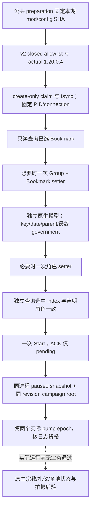

# 第一期独立机制存档的原生开局入口

2026-10-17 用户明确允许独立机制实验存档，并要求标明准备内容。本期只批准
867.1.1 的阿拔斯场景；普通自动游玩仍从 1066 罗贝尔默认入口开始。
这项授权没有取消其他场景的资格守卫，也没有把准备后的资源或礼仪变化计为正常游玩成果。

## 原版候选从哪里来

复用 [1.20.0.4 frontend producer 研究](frontend-1066-selected-model.md)。实际
Bookmark 候选来自 `CBookmarkDatabase + 0x50` 的指针集合；`SetupView + 0xC0`
存放的是 Group 指针。跨日期组时，先通过目标 Bookmark 的 Group 调原版
`SetSelectedBookmarkGroup`，再调原版 `SetSelectedBookmark`，因为前者可以选择另一个默认书签。
角色候选来自已选 Bookmark 的原生 character collection，按明确 script key 找唯一角色，
校验 parent、日期和原版最终 government getter，再以找到的 native element 调选角 setter。
Start 仍走原版可见、启用的 `start_button` callback。

这条路径已有 867 Rurik profile 和原生 ABI；真实缺口是封闭 target enum 与 Python fixture
入口只接受现有角色。新增场景只增加一个固定 profile，没有扫描 live world 角色、
没有任意 actor 参数，没有把历史 ID `34014` 当作 runtime fullref。

## 明确的批准范围

默认关闭的 CMake 选项为 `XAR_CK3_ENABLE_FAITH_E01_FRONTEND_SCENARIO_PRIVATE_V1`。
它只向 `frontend_bookmark_model_probe_v1.cpp` 增加编译定义，不向全部 runtime TU 扩散宏。
它依赖既有的 model 与 selected-bookmark Start 选项。关闭时本期四个 private step 不被识别；
Robert 的默认 target 与原有工具不变。

| 字段 | 冻结值 |
| --- | --- |
| policy schema/version | `ck3-frontend-fixture-start-policy-v2` / `2` |
| profile_id | `faith-and-power-e01-abbasid-867` |
| bookmark_key | `bm_xar_faith_h01_867` |
| character_name_key | `bookmark_xar_faith_h01_abbasid` |
| government_key | `clan_government` |
| start_date_raw | `51394920`（867.1.1；必须原生读回） |
| bookmark_group_key | `bm_group_867` |
| post_start | 独立、clan、empire；实际活角色与同帧 campaign root 一致 |

v2 在既有 preparation、profile 全输入 SHA 和日志 marker 字段之外，只加入 `profile_id`
和 `frontend_target`。这两个字段只能等于上表闭合 allowlist；v1 不因此接收 clan 或任意目标。
公共 preparation 生成器应从明确 case 数据投影 v2，不能用手写回执冒充公共 prepare。

## 一次提交及独立后验

公共 host 保持现有 `--fixture-profile --frontend-robert-bootstrap
--frontend-fixture-start-policy <policy>` 参数组合；这里的历史参数名由显式 v2 policy 分发到
`ck3_submit_frontend_fixture_scenario_start_v1`。该 MCP 工具没有参数，只在该 profile 已绑定时注册；
同一 server 不注册 Robert fixture Start。普通无 fixture-policy server 不增加本期工具。

claim 与每个 mutation 的具体 step 都在执行前落同一 `frontend-fixture-start-requests.jsonl`。
结果未知时不重发。跨日期组后的身份与选角后的身份均由独立 probe 读回；
`supported_1066_*` 是现有 wire 兼容字段名，政府必须实际等于 clan，不要求 feudal 为 true。
选中模型只证明前端选择，Start ACK 只证明收到；后续存档业务身份继续
`fixture_target_identity_proven=false`，直到业务研究另有真实映射证据。

## 验证与边界

本工作包的离线观察机器为 `machine_id: 4-8e1c2f1861`，观察时间
2026-10-17 07:59 UTC；来源为隔离 checkout 的测试命令输出与 diff。
使用目标机器已验证的 `tools/.venv/Scripts/python.exe`（MCP 2.2.0），
`test_frontend_fixture_scenario_start.py` 的 7 项测试通过，包括真实 SDK 工具注册、
额外 actor 参数拒绝、跨 Bookmark/角色各一次选择、未知 ACK 不重发、错误日期/政府拒绝、
实际 fullref 与 history ID 分离。它们用模拟 native producer，不能证明 CK3 实机成功。
第一次误用无 MCP 的全局 Python 时 SDK 项报缺依赖，6 个非 SDK 项通过；改用明确依赖环境后
新 7 项全部通过。旧 fixture 回归的结果与整合后的 native 编译、实际开局证据由主执行包追加。

同机 2026-10-17 08:03 UTC 的整合回归为 **36/36 PASS**，包括新增 scenario host 7 项、
scenario driver/MCP 7 项与既有 Robert/fixture 22 项。之前两项旧测试因未同步既有生产 wrapper
所需的诊断/owner-frame 测试输入而失败；只补测试输入，未放宽生产守卫。
完整最终输出保存在本机外置 `episode01/frontend-fixture-tests-final.log`，
此前失败输出 `episode01/frontend-fixture-tests.log` 保留。CLI 为
`tools/.venv/Scripts/python.exe -m unittest discover -s ck3_autonomous_player/tests/unit
-p test_frontend_fixture*.py -v`，隔离候选 checkout 为 `C:/fef1`；该路径仅定位本次证据。

新增 native fixture 在现有 producer 测试中覆盖本期 profile、跨 1066→867 group/bookmark
选择与独立查询；编译及运行归共享 native build 执行者，不建立第二份全量 build。
`open_kaishek` 对 native GUI ABI、Python transport 和 MCP 注册无覆盖语义，记为
`not-applicable`；场景脚本的独立解析由场景工作包记录。

本工作包没有启动 CK3/Steam、没有输入桌面、没有宣称 `.4` 实机通过。
实际开局需再次核 machine ID、当前离线画面、加载的 EXE/DLL/profile，
并另行核当前玩家的原生 live fullref、faith、rite 和圣地状态后才能用于本期结论。
