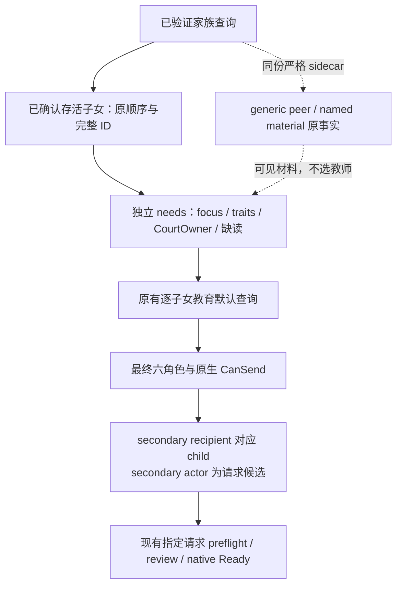

# 当前子女教育 needs 与原生请求候选

`family_education_needs_12004.py` 把现有同次家族查询中的子女读数交给
`Service._plan_private_family_education_v1`。它保留每个已确认存活实际子女的
完整 DWORD 身份、原出现顺序和 occurrence group。原生默认教育查询仍逐子女执行。
本增量是 `SOURCE_AUTHORED_NOT_RUN`；本机项目 import、测试、编译、链接和游戏操作为零。

## 实际输入与可消费值

`derive_family_education_needs_12004(inputs, *, child_relation_materials=None)`
消费当前已验证的 `family_generation_education_decision_inputs_v1`。
返回的 `rows[*].raw_character_id` 保持完整 generation；`character_id` 保持原 signed 表示。
`frame`、`known_empty`、roster 与分类完整性直接继承现有投影。

| 现有源事实 | needs 输出 | 规划器用途 |
| --- | --- | --- |
| native focus available/absent | `focus_management.state=known_absent` | 显示当前焦点缺失；仍可查询教育请求 |
| native focus available/present，key 为五教育焦点之一 | `education_focus_present` | 保留当前教育方向及对应 source components |
| native focus available/present，其他 exact key | `other_focus_present` | 保留真实焦点，不把它改成空 |
| focus unavailable 或 legacy 未观察 | `unknown`，nullable 值与原 reason | 只标记缺读；不移除子女 |
| 可用空特质子集 | 原特质叶及五 stock affinity/disaffinity | 保留已知 false/zero，避免用 unknown 替代 |
| 四叶中的部分读数缺失 | `missing_observations` 和原 `leaf_availability` | 报告具体缺失，其他字段继续可用 |
| current child CourtOwner resolved/known-null/unavailable | 原 `current_court_owner` | 保留独立 owner 事实，不选 tutor/guru |

这是 focus 管理和观测完整性分类。没有从 focus absent 推出 Guardian assignment needs，
没有引入年龄、全家族完整性或特质齐备条件。needs 状态不修改 native CanSend/Ready。

可选 `child_relation_materials` 必须来自**同一份已严格验证的家族 command/sidecar**；
这个 raw leaf 本身没有独立 frame，不能从另一请求仅按 child ID 拼接。
每个子女的 `relation_materials.observation` 是原完整拥有的 peer/material observation，
保留 peer 顺序、重复和 typed resolved/known_null/unavailable。集合未收集、子女未出现与
完整空 peer 库存分别保留。`guardian_named_material` true/false 没有升级成 HasGuardian、
完整 Guardian 列表、教育者身份或 fallback 条件。

## 从真实 query 取得请求候选

`project_family_education_request_candidate_12004(needs_row, normalized_ordinary_context)`
消费现有 strict ordinary query 的 `character_interaction_ordinary_context`。
默认查询和指定请求的最终 preflight 使用同一函数。`role_observation_available`
表示原查询 roles 可用；`pair_matches_child` 只比较最终 secondary recipient 与该子女。
当它为 true 且 secondary actor 非 null，`available=true` 并输出原完整 guardian ID。
原生 secondary actor null 是该请求角色的 known-null，不是 Character.HasGuardian 的 false。

`roles` 保留全部六角色和原 nullable 值。原始请求 recipient 可能被重定向到 ward 的
liege/employer；本函数使用最终 secondary recipient 绑定 ward，保留最终 primary role。
原 `frame`、`can_send`、`ready_to_initiate` 直接复制。已知 CanSend false 的候选仍可见；
只有现有 native readiness 与原请求 review 控制实际提交。候选身份不证明已经分配 Guardian，
也不证明 stock effect 保存的随机 educator scope。

当前源入口：

- [现有子女四叶投影](../../ck3_autonomous_player/src/xar_autoplayer/family_generation_education_inputs_v1.py)。
- [五 stock 方向与 current CourtOwner](../../ck3_autonomous_player/src/xar_autoplayer/family_generation_education_decision_v1.py)。
- [现有普通请求严格解码](../../ck3_autonomous_player/src/xar_autoplayer/bridge/ordinary_interaction_contract.py)：available roles、原生 false/true、snapshot binding。
- [实际家族教育调用](../../ck3_autonomous_player/src/xar_autoplayer/bridge/service.py)：默认查询、指定请求、review、提交。
- [guardian/educator 源与方向边界](guardian-educator-source-entry-12004.md)。

本轮新增源码只有这份薄投影与专题。50 独占 Service caller 最小接线；54 独占请求候选的
真实 educator 数值 mouth。本文件没有获取新人物、执行原生调用、增加查询或改写 point modifiers。
