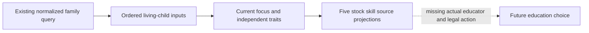

# Current-family education decision inputs

The existing current-first-heir query now projects its validated descendants
into ordered living-child inputs and five explicit education skill options.
This consumes the same response; it issues no additional game query.

The native source comes first: [education and guardians](education-and-guardians-12004.md),
[child trait inputs](child-education-point-traits-12004.md) and
[current relation projection](guardian-current-family-relation-projection-12004.md).
The frozen stock education triggers/effects define the childhood affinity groups,
independent child modifiers and ordered educator expressions used here.

The projection preserves full generation-bearing child IDs and roster occurrence
groups. An observed empty roster, an unread roster and a partly classified roster
remain distinct. Age zero remains zero; absent age is not invented. Current focus
absence is a known observation, independent of available childhood or intellect
traits. A present noneducation focus keeps its exact native key.

For diplomacy, martial, stewardship, intrigue and learning, the result retains
stock affinity/disaffinity predicates and rational source-point components.
Reached child terms stay available even while actual selected educator inputs are
missing. The ordered culture `value = 10` statement replaces prior educator
success terms in the source model; it is not treated as another additive bonus.
These are source components, not a normalized success probability or an education
outcome. Tutor/guru selection and current child Guardian equivalence remain open.

The existing Guardian capture also returns the independently available played to
current-first-heir relation facts and child inputs. A known false relation remains
false; it does not identify a child's guardian or permit an interaction.

Root adopted six production files from04/46/52/54/59. Imports, tests, native
compilation and Game operations are zero after the owner's testing cancellation.
This is source-only integration, readiness `research`; no M7 completion or live
education credit is claimed. The separate native child-material package and
future action/outcome consumers retain their own missing inputs.

[Coherent source manifest](D:/codex-ck3-background-spill/native71-continuation-20261010/continuation-52/background-g2-offline-20261011/ROOT-G2-FAMILY-EDUCATION-PYTHON-SOURCE-ADOPTION-MANIFEST.json).
