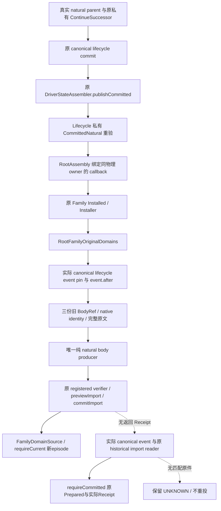

# 自然继承后接续三份 canonical Family 域

`machine_id: xenoamess-full-tower-eb9d2c1186`，2026-10-25 UTC 恢复施工。目标仍为 exact CK3 `1.20.0.4`、build `25734779`、EXE SHA-256 `98702f88a547cde2eaf29a85f93b85f68ee4cf8148336a4f7afaeb75319dd518`；本包未运行 CK3、未读取新 EXE、没有新增游戏日。本文为源码候选与实际调用链说明，编译和测试均未执行。

当前入口为 **Family39 + Lifecycle26 metadata + RA83 的源码候选**，natural cohort 尚未采用、编译或运行。39 的六个 Family raw 与34完全相同，只换依赖部署口：静态发现旧 RA71 在 preDriver install 时读未绑定的 `context.collector()` 会被既有守卫拒绝；RA83 改从实际 ManagedGame 的 machineId/generation/sessionId 构造纯路由 DATA owner，保留全部 private proof、同 writer 与每槽守卫。LC26 只把 RA71 pin 换为83，原20 Composites/实际夹具/ABI 不变。旧34/22/71保留且不得采用；这不是实际运行失败，也不是首场前置。

五个 production raw 仍与24相同，测试 helper33只补齐既有 PlanningObservation 必填字段。更早 Family22 所 pin 的 Lifecycle19 也保留为历史、不得采用：作者随后发现 cold `RootPendingUiRuntime` 的 status/current 在只读 snapshot scope 内，内嵌 import 会违反原 canonical-head 不变守卫。原 Lifecycle20 已将 cold 写入移到已有 `continueOriginal→observe` 可写续行点，包含 finished ContinueSuccessor 的 recovered/warm 分流；原 cold 观察继续只读。没有放宽原只读守卫。

## 已定位的实际断点

NativeSuccession 的具名源码链位于 `resume61/native_succession/NATURAL-FAMILY-CHAIN01.json`。当前自然 `continueSuccessor/finalizePendingSuccessor` 会更新完整 Driver、episode 和 auxiliary 中的旧 `family_marriage_ledger`，却不更新原 writer 的 `FAMILY`、`CHILD_MATRILINEAL`、`DEFAULT_MARRIAGE` 三个 `DomainBodies`。

实际 Family consumer 读取这三份 canonical body，不读取 auxiliary 中的归档替代品。旧未决记录的 episode 与新请求不同会 Stop；即使 pending/resolved 都是 null，旧 `java_next_episode` 的 owner/actor/episode 也会使 `requireCurrent` 拒绝新的自然继承帧。此前 NEXT 迁移明确要求 physical Game 改变，不能用它作为同 Game 自然继承许可。

## 源码候选和唯一接线

Family 当前正式六叶 selector（复用 natural22 的五个 production raw，仅测试选择33，不复制源码树）：

```text
D:/codex-ck3-background/ck3-java-g2-resume-r4-20261025/resume61/family_ordinary/natural39/SOURCE-DELTA39.json
8569 B
SHA-256 99daebfb8cab976bbecf164de469ea1bcf2ef3d35e5dcfc1d38a1e362105d528
```

它单向引用 Lifecycle26 metadata map（10684 B，SHA-256 `0ecd2f25d0f73d74a1fcccb5d208dc390af7e3ff1ea30f095f4ce24503de08b6`）与 RootAssembly83 map（8551 B，SHA-256 `e6e9d09bc11f139469811f92810ea6c946ae3053fa446e9ce7726ef5ec89db29`），不能混用此前 WIP raw。39只写新 metadata，不复制六个 Java 原件；34/24/22原件均保留。2026-10-26T03:09:33.546770Z 重读六个 source pin MATCH，四个 REPLACE current 前像 MATCH、两个 NEW target ABSENT；后继 Host 仍必须在采用时重验，不能覆盖更新的编译修复。RA83 基于实际 current Domain81，保留 Sway 与 CRLF 修复，不恢复旧71整叶。

| 改动 | 作用 |
| --- | --- |
| 新增 `FamilyNaturalEpisodeMigration` | 纯 full-body producer；严格同物理 owner、不同 before/after episode 和玩家、实际 lifecycle material 与旧完整 body pin。 |
| 新增 `FamilyNaturalEpisodeMigrationTest` | 五个默认 Surefire 测试方法，覆盖三域生产→序列化→实际 consumer、错类型/错身份/缺字段、partial、NEXT/natural 双向接续及历史保全。 |
| 接续 `FamilyNextEpisodeMigration` | 旧 NEXT schema 不变；现有 `requireCurrent` 识别互斥 natural marker，后来的 physical NEXT 完整归档自然 marker。 |
| 接续 `RootFamilyOriginalDomains` | 仅接受 Lifecycle 的私有 `CommittedNatural`，沿原 writer/registration/import verifier 写三域，没有新 writer。 |
| 接续 `FamilyRuntimeInstaller` 与 `RootFamilyRuntimeFactory` | 暴露 `Installed.initializeNatural(Session, CommittedNatural)`，保实际安装的同一 Family graph 与 context。 |

Lifecycle 独占 private proof、实际 publication 与真实生产 fixture；RootAssembly 独占物理 owner 对应的 callback 注册。Family 不根据 JSON、FileRef、body 相等或自建 proof 发出许可。



这些实线是已接源码关系，图不授运行通过。真实 RootPendingUiProductionChainFixture 的三域断言由 Lifecycle20 承载，本岗没有构造 private proof 替身。

## 历史、UNKNOWN 与恢复边界

新 `java_natural_episode` 使用严格 schema `xar.java.family-natural-episode-binding/v1`。旧 pending/resolved 原文、旧扩展字段、已有 history，以及旧 NEXT/natural marker 全部留在追加的历史条目中；当前两槽变成显式 null。归档项的 command/completion false 只指本次 bookkeeping 没有发送命令或授关系完成，不改写原 pending 中的事实，也不把 UNKNOWN 改判拒绝、接受或取消。

三域部分完成时，只接受实际旧 body 或该次完整、确定的 derive 结果。冷接续读取实际 canonical desired 后态，不从 body 自造 warm Prepared/Receipt；旧原文来自**实际自然 lifecycle event.after**中的三份原 BodyRef，并核 native identity，不从部分迁移后的 current state 重新猜旧输入。

这里有一个本轮已经按真实源码纠正的边界：`ALREADY_COMMITTED Receipt.head` 可以是原 event 之后的合法 canonical descendant。它不能代替原 natural event.after。Family 通过 `lifecycleMaterial` 的实际 canonical Pin 调原 `readHistoricalTransition`，核 event kind、固定 sequence/digest，再使用其 afterState。Lifecycle20 的 getter 也已接到真正 publication.after。

同样，原 `requireCommitted` 支持真实 canonical ancestor，后续同 parent UNKNOWN ACTION 合法追加不会让原自然 proof 自动失效。本包没有增加“只许 DOMAIN_IMPORT 后缀”的错误门禁。若 warm import 抛出但 Receipt 没返回，保留原 Prepared，按实际 `Layout.event(expectedSequence)` 定位 canonical Pin，再调用原 historical transition/import reader 获取真实 Receipt，最后 `requireCommitted` 核原 Prepared；没有真实匹配 event 时保持 UNKNOWN，不重复提交。

## 尚需完成的验收

Host 继续在同一 R5 mutable/output/m2 中先修当前真实编译错误。以后采用此六叶、Lifecycle26所选原20与 RA83 后，执行新 `FamilyNaturalEpisodeMigrationTest`、原 `FamilyNextEpisodeMigrationTest` 及 Lifecycle 的真实 RootPendingUi 全链命令；并将新 producer/caller 纳入实际选定来源闭包。局部通过后仍须最后一次完整构建及规定 CI。

已核对真实生产夹具的实际 JUnit caller 为 `org.xar.ck3.control.service.root.RootHostBatchAndCloseActualTest#pendingUiActualProductionChain`。它要求 ServiceLoader 提供恰一个真实 startup `PendingInputsProducer`，交付同一 Core/current/catalog，在原寿命内驱动原场景；还要求真正 RecordedFinalization、AdmittedCurrent 回调与 `requireFullCoverage`。缺该原件时抛出 `MISSING_ACTUAL_PENDING_INPUTS`，不能用测试自建 proof、跳过或软件 mock 冒充这项全链通过。新增三域断言在 Lifecycle20 所选 `RootPendingUiProductionChainFixture` 的真实最终分支。两个 application 纯测试可先运行，其通过范围不外推到这个实际 startup/原生场景。

该源码包不增加首场额外前置，不产生初始三 DATA，也不替代 Family20 与 RA 的初始 publisher 批次。当前只有源码/API/精确原件审阅，Java 类型检查、JUnit、whole fixture、SERVICE、CK3 后态和自然继承业务验收均未因此变成通过。

本次33测试继任来自另一真实软件回归发现：既有 NEXT/Commands 两类20方法首跑13过7失败，NEXT helper缺共享 snapshot必填字段；另一个浮点负例在 assert外先被 encoder拒绝。独立 fixture_test32 修复后，同一缓存新scope的20方法已全部通过，原RED保留，详见[Family测试修复记录](../maintenance/2026-10-26-family-initial-data-producer-and-test-repair.md)。该运行没有采用或运行本页34自然扩展。33仅把同样不完整的 natural request helper补成完整 synthetic frame，五个方法和全部期望不变；它的13847 B/SHA-256 `eb615de3bcde30e994bb0dee41751d9ed5da479a3de7ac86df9168062fe9ae33` 由 Lifecycle22同步 pin，仍为未运行源码候选，不能借20软件PASS授自然全链通过。
