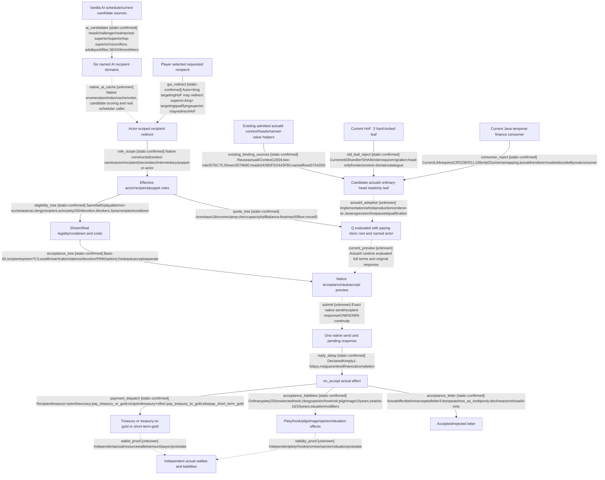

# Research plan: head-faith-gold-financing

GENERATED from the supplied research plan; no native semantics are inferred.

Question: What is the actual1.20.0.4ask-HoF candidate/redirect/legality/quote/acceptance/payment chain, and which existing native and Java boundaries block its current ordinary readonly leaf?



| Edge | Declared status | Evidence IDs | Open question |
|---|---|---|---|
| ai_candidates | static-confirmed | hof_interaction, interaction_info |  |
| native_ai_cache | unknown |  | Script names six domains and AIwilldo, but actual4 container/duplicate removal/searchorder/due-date state/caller not located. |
| gui_redirect | static-confirmed | hof_interaction, pam_effects |  |
| role_scope | static-confirmed | interaction_binding, interaction_layout, context_proof |  |
| eligibility_tree | static-confirmed | hof_interaction, religious_triggers, pam_triggers, antipope, basic |  |
| quote_tree | static-confirmed | dynamic, basic |  |
| acceptance_tree | static-confirmed | hof_interaction, acceptance, ai_values |  |
| current_preview | unknown |  | No current actual4 query; historical3v31quote/negativeeligibilityisnotactual4evidence. |
| submit | unknown |  | No submission orfinance actionimplemented;queryingacceptance doesnotauthorizeorproverequest. |
| reply_delay | static-confirmed | hof_interaction |  |
| payment_dispatch | static-confirmed | hof_effects, dynamic |  |
| acceptance_liabilities | static-confirmed | hof_effects, pam_effects, pilgrimage_modifiers, zealot_opinion, basic |  |
| acceptance_letter | static-confirmed | hof_interaction, hof_letters, refusal |  |
| wallet_proof | unknown |  | Paymentnativeeffectbodiesownedbynative_loan;scriptQ/ACK/letterdoesnotproveactualfundsorcharge;noReplayUNKNOWN. |
| liability_proof | unknown |  | Noactor/recipientbeforeaftercollected;sourceconsequencenotactualmaterialpostcondition. |
| existing_binding_sources | static-confirmed | interaction_binding, interaction_layout, heads_binding, shown_binding, named_fixed, context_proof |  |
| old_leaf_reject | static-confirmed | hof_old_provider, hof_old_mailbox, hof_old_wire |  |
| consumer_reject | static-confirmed | java_consumer, renderer |  |
| actual4_adoption | unknown |  | Nosourcecandidateedited/compiled/adopted;mustclosetrueproducer/consumer/framelifecycleandindependentpausedtermsbeforeusing. |

| Observation design | Value |
|---|---|
| mode | offline-only |
| actor_kind | engine |
| owner_scope | Currentinstalledscripttextandcurrentreusableactual4sourceonmachine xenoamess-full-tower-eb9d2c1186; noLoadedGameornewnativebodyclaims. HumanGUI/AI/bridgepathsseparate. |
| identity_kind | definition-key |
| identity_lifetime | Canonicalinteraction/scriptvalue/eventkeysbindexactsourcebytes;runtimefullCharacterIDs/post-redirectrolesandactualeventinstanceareseparate. |
| producer_trigger | on-action |
| producer | Interactionon_acceptcallshof_ask_for_gold_interaction_effectandpilgrimageeffectbeforeactorletter3;on_declinepietyrecipient/letter32;Qactualclericroot. |
| caller | Vanilla6AIrecipientdomainsorplayerrequestedrecipient-&gt;actorredirect-&gt;finallegality/quote/acceptance-&gt;nativependingresponse-&gt;acceptedpaymentandliabilities-&gt;displayletter. |
| consumer | CurrentJavaReligionTemporalFinanceGOLDordinaryheadreadonlyquery;currentwalletafteracceptedrequestrequiredforfundscredit. Old3v31liveprimitiveishistoricalonly. |
| cache_lifetime | AIcheckmonthtiers36/24/6,barony0;recipientinteractioncooldown3years;AI-to-humanrequestflags3yearsplusactortier1/2/4years;nativecandidatecacheandresponseidentityrevalidationunknown. |
| expected_signal | Scriptcurrentcandidate/redirect/acceptanceand3paymentbranches;existingexact4context/head/namedvalueproof;actualold3handlerandJavaconsumerhardlocks. |
| zero_sample_meaning | NoGamequeryoraction. Noheadinoldleafdoesnotexclude6domainsortheocraticchaplainfallback. Noobservedpaymentsdoesnotprovezeroreceivables;currentcredit0untilqualified. |
| stop_condition | Readexactnamedinstalledtext,existingmigrationproof/sourceandJavaentryonly;noEXEread/hash/scan,Game/SDK/action,JVM/buildornewgate. Writeboundedsourcecontract+generatedgraph. |
| runtime_window_ref | None |

| Evidence ID | Declared layer | File | SHA-256 | Supports |
|---|---|---|---|---|
| hof_interaction | source-contract | Z:/SteamLibrary/steamapps/common/Crusader Kings III/game/common/character_interactions/00_religious_interactions.txt | 63afe4538725929fb20bc20cbbbbc86705dba55a384755949431419265db0ac6 | HoF interaction6791-7152:6AIcandidatefamilies,redirect,availability,options,accept/send/reply andAIwilldo. |
| hof_effects | source-contract | Z:/SteamLibrary/steamapps/common/Crusader Kings III/game/common/scripted_effects/00_interaction_effects.txt | 4247f484295988b50098a43869d4c4056b7e0855bf8d5fa6ec0755cb996d7e82 | Actual accept4409-4717 payments/piety/hooks/zealots/situation;blocker5664;refusal4719. |
| pam_effects | source-contract | Z:/SteamLibrary/steamapps/common/Crusader Kings III/game/common/scripted_effects/pam_effects.txt | fc4c77974a7844c31c1271dcc2ace24b17906620a832658919aa281e42a2b94f | Redirect7982-8035 andpilgrimage2149-2172. |
| religious_triggers | source-contract | Z:/SteamLibrary/steamapps/common/Crusader Kings III/game/common/scripted_triggers/00_religious_triggers.txt | e9d0b56130464eabdcd670fa6cf814534d11c99da1e8b3fc1e69e9c3e36d2bb2 | Clergyrecipientvalidity3249-3296/display3338-3352. |
| pam_triggers | source-contract | Z:/SteamLibrary/steamapps/common/Crusader Kings III/game/common/scripted_triggers/pam_scripted_triggers.txt | 0ad98f123b6739593b9ab2c170d0e8c9b3d9d941baa9d3580296dd2139b2ea6e | AIonlyrecipientrequestblocker5756-5767;devotionorpuppet5837-5855. |
| antipope | source-contract | Z:/SteamLibrary/steamapps/common/Crusader Kings III/game/common/scripted_triggers/pam_antipope_triggers.txt | 6457fd56e3ba27e1ca5a9cd7913322c1502806505d62c360da5b13d6acec038a | Antipope/sponsor/followerclergyrecipientguard86-111. |
| acceptance | source-contract | Z:/SteamLibrary/steamapps/common/Crusader Kings III/game/common/scripted_modifiers/00_religion_scripted_modifiers.txt | 0d3fbd5d6740212f9acd318aa400560f2572f81f4562c3984c9d158e382fbc71 | Fullaskforgoldacceptance3536-3885,celestial3278-3303,PAM3330-3422. |
| hof_letters | source-contract | Z:/SteamLibrary/steamapps/common/Crusader Kings III/game/events/religion_events/religious_interaction_events.txt | 27405d1ccd6217670f5812d8cbde987ed899c04b6b7d309099e2e8fbe1809a4d | Accept3immediateshow_as_tooltipdoesnotpay;decline32immediatecallsrefusaleffect. |
| refusal | source-contract | Z:/SteamLibrary/steamapps/common/Crusader Kings III/game/common/scripted_effects/00_religious_interaction_effects.txt | 9ecc22104b057e3425673917acbefaa320833226dd02b9a6c3dca7475b5b0928 | clerical_interaction_refusal_major_effect2202-2213isAIactoronly-50opinion. |
| pilgrimage_modifiers | source-contract | Z:/SteamLibrary/steamapps/common/Crusader Kings III/game/common/modifiers/12_pam_modifiers.txt | 48b6175275b7d48a9944411544770d739fe37043ebe10dd75aae6d75ef39c92c | Pilgrimagepiety-25percent/spiritualfulfillmentloss+25percent;Christian-situationaskfundsmodifiers. |
| zealot_opinion | source-contract | Z:/SteamLibrary/steamapps/common/Crusader Kings III/game/common/opinion_modifiers/00_opinion_modifiers.txt | e921cbfec164e8b36cd3bfbdfcbc05b8152ec17cbf5b49e440d3a71d09afddb4 | Zealotdisapproval-10/10yearsdecayingstacking1316-1321. |
| influence | source-contract | Z:/SteamLibrary/steamapps/common/Crusader Kings III/game/common/script_values/07_ep3_values.txt | b4b46e562baa20f8aa7fbac91b3d8b95f6a59d053eaf6b5f28ca9d091f85c776 | mediuminfluence60. |
| interaction_info | source-contract | Z:/SteamLibrary/steamapps/common/Crusader Kings III/game/common/character_interactions/_character_interactions.info | cc2442a313a6b1a2a7fa02b92a094276edfe39c60835c3286172c5b6d7b70a37 | AIcandidatecollection/frequencymonths andscopes/declaredacceptanceinstructions. |
| interaction_binding | source-contract | Z:/ck3_mod_rewrite/ck3_autonomous_player/native_bridge/src/ck3_12004_interaction_context.cpp | 074085e993b25c95f54c846234ccada59e1fddf6fade0e8bc826146da4f8ef34 | Actual4 querybindingsalreadyindependentlymapped/typed. |
| interaction_layout | source-contract | Z:/ck3_mod_rewrite/ck3_autonomous_player/native_bridge/include/xar_bridge/ck3_12004_interaction_context.hpp | bb3b4d7dd29f5794b8bf41b2fbff4408004000bc9394046cf1f67e6c10939db6 | Actual4two-role/refresh/finalize/validator/score/hash/etcsharedbinderAPI. |
| hof_old_provider | source-contract | Z:/ck3_mod_rewrite/ck3_autonomous_player/native_bridge/src/ck3_12003_player_hof_gold_context.cpp | 8e39435183b8494cf638a843813e6cc8b308f18354061f9c6fe191d9317648d4 | Old3boundleafbindsrequestedfaithhead,optionpreparation,roles,shown,declaredcost,acceptance,namedquote;notactual4admission. |
| hof_old_mailbox | source-contract | Z:/ck3_mod_rewrite/ck3_autonomous_player/native_bridge/src/ck3_12003_player_hof_gold_mailbox.cpp | 0e223409d057c214628eb7f1bf3046bd4239950bec8ca54fd3f5cf838b77887f | Currenthandlerhardlocks3andoldbinders/framepath;actual4mustnotenteroldoffsets. |
| hof_old_wire | source-contract | Z:/ck3_mod_rewrite/ck3_autonomous_player/native_bridge/src/ck3_12003_player_hof_gold_wire.cpp | f3414aabda7d0fa31601b4f30a4b30524a1a8f2204ec8091982491a2bacd8b46 | Currentserializerold3identities;actual4routecanuseexistingrendereronlyafteractual4admittedproducer. |
| heads_binding | source-contract | Z:/ck3_mod_rewrite/ck3_autonomous_player/native_bridge/src/ck3_12004_religion_adopted_observers.cpp | d6b1bc40710569629a6ea421525dfd1810067657b0d41f512418524f6280a20f | Actual4governance.heads typedbindings2439DF0/2443F80withactual4context. |
| named_fixed | source-contract | Z:/ck3_mod_rewrite/ck3_autonomous_player/native_bridge/src/ck3_12004_gift_opinion.cpp | 26a7a85f4cb8f1ec46779142e89d567cafab7d91b6b0ce3af0ef9f30aef95e95 | Existingactual4NamedInteractionFixedExact12004scopeclone/support/evaluate/revalidation. |
| shown_binding | source-contract | Z:/ck3_mod_rewrite/ck3_autonomous_player/native_bridge/src/ck3_12004_sway.cpp | 33170cb1623fae0f0c79975b2ddba9ee544c929dd6a849b62341871c1c07aaef | Actual4wholeShown3079690alreadyindependentlymapped;notvalidator. |
| renderer | source-contract | Z:/ck3_mod_rewrite/ck3_autonomous_player/native_bridge/src/ck3_12004_adapter.cpp | 38faf84e616608b49c3c4d39698c884229347cc630f612a6af0b371ceb33b972 | Render12004BuildIdentityselectsdescriptor,rewritesversion/hash/schema/backend;doesnotqualifyold3nativecalls. |
| context_proof | source-contract | Z:/ck3_mod_rewrite_process_assets/g2-background-20261007/upstream-build-migration/prisoner/current4-context-release/ROOT-DELIVERY.json | a7e4eda7c1b1d261b978f949639e120260f748755f8350d91a1bd0220a4fb462 | Actual4completecontext/consumedlayoutsourceclosure;source-only,notnewHoFlive. |
| dynamic | source-contract | Z:/SteamLibrary/steamapps/common/Crusader Kings III/game/common/script_values/01_dynamic_values.txt | 023165e7d27d106a34f34d7726d938efa8d5dce25650ea3256e0b5ea3f73cc2a | Actor monthly income multiplier, treasury-subordinate scaling, clamps and ceil-to-five for minor/medium/major/massive. |
| basic | source-contract | Z:/SteamLibrary/steamapps/common/Crusader Kings III/game/common/script_values/00_basic_values.txt | c379cc0c58ed1574033f0e07a58697dfc6f8475c26aa4b117f2332008d4a27ef | Dynamic-gold min/caps/era factors and 3/6/12/18 income multipliers; does not prove current native monthly income value. |
| ai_values | source-contract | Z:/SteamLibrary/steamapps/common/Crusader Kings III/game/common/script_values/00_ai_values.txt | 975b0fa8d02b3342c8984050eca0387a463cd1028c68122d1bbd255f90db5fb4 | AI thresholds medium35/high50 and negatives-35/-50. |
| installation | exact-build | ../formal_release/INSTALLATION-WITNESS02.json | 49f08808eb15dd2eb2d24d05f400c7dd68cf1d4d7de14741e2efbbd7417c339c | Same-machine observed2026-10-25T21:43:36.139626Z metadata identifies1.20.0.4/build25734779/BetaKey1.20.0; reusedEXESHA/unchangedmetadataonly,notloaded. |
| java_consumer | source-contract | D:/codex-ck3-demos/2026-10-25-java-g2-complete31-h5r5/java/ck3-control/native-transport/src/main/java/org/xar/ck3/control/nativebridge/capabilities/publicmethods/religion/extensions/ReligionTemporalFinance.java | 234c0f3479694ee9047c56cf1d2b6ca4050e1ee2ca25fc807bacaa39391cc3c1 | ObservedmutableJavaL94requiresCROZIER3forGOLD/LOAN/TITLES/REPENTANCE;L109maps02schemaonly. Sourcefactnotruntimequalification;ownerinformed. |

Check result (file integrity and declarations only):

```json
{
  "schema": "xar.native-research-plan-check.v1",
  "result": "plan-consistent",
  "proof_layer": "record-structure-and-file-integrity",
  "semantic_correctness_verified": false,
  "live_execution_performed": false,
  "observation_plan_issues": [
    "offline-only plan does not define a live observation window"
  ],
  "declared_edges_by_status": {
    "counter-policy": 0,
    "inference": 0,
    "live-confirmed": 0,
    "static-confirmed": 13,
    "unknown": 6
  },
  "enumerated_native_edges": 19,
  "declared_cases_by_status": {
    "pending": 5,
    "observed": 0,
    "not-applicable": 0
  },
  "checked_evidence_files": 28,
  "limitations": [
    "Evidence layers and conclusions are author declarations; hashes bind bytes, not their truth.",
    "Counts cover this enumerated graph only, not all CK3 branches.",
    "A consistent observation plan is not authorization to run or manipulate CK3."
  ],
  "plan_sha256": "4c4278131363427651974026514e0ca22a5ff648be935b34bde43e1219583608"
}
```
