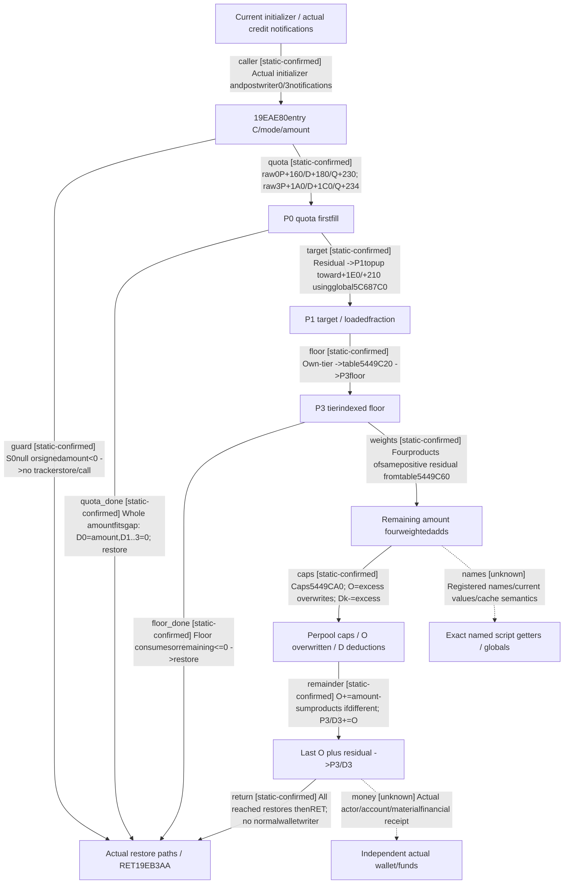

# Research plan: native-positive-budget-allocation

GENERATED from the supplied research plan; no native semantics are inferred.

Question: What actual direct control-flow and raw tracker updates occur in1323B19EAE80, and why do these updates not establish a named script getter or actual financial receipt?



| Edge | Declared status | Evidence IDs | Open question |
|---|---|---|---|
| caller | static-confirmed | initialization, gateway, base_add |  |
| guard | static-confirmed | part0, part4 |  |
| quota | static-confirmed | part1 |  |
| quota_done | static-confirmed | part1, part3, part4 |  |
| target | static-confirmed | part1, part2 |  |
| floor | static-confirmed | part2, tier |  |
| floor_done | static-confirmed | part2, part3, part4 |  |
| weights | static-confirmed | part2 |  |
| caps | static-confirmed | part2 |  |
| remainder | static-confirmed | part2 |  |
| return | static-confirmed | analysis, part2, part3, part4 |  |
| names | unknown |  | Exact global addresses andpoollayout do not prove war_chest getter or definition aliases; no heldnamedindex. |
| money | unknown |  | Tracker mutates state; no wallettransfer norreadonly query qualification. D/pools are not funds credit. |

| Observation design | Value |
|---|---|
| mode | offline-only |
| actor_kind | engine |
| owner_scope | Five exact current code intervals admitted through shared capture; no Game/native invocation or new observer binding. |
| identity_kind | definition-key |
| identity_lifetime | RVAs bind one exact image. C+20isreloaded atstages; no identity/atomic/cacheepoch equivalence assumed. |
| producer_trigger | unknown |
| producer | Current initializer seeds selector0/3 pools; several current resource-credit paths notify19EAE80 after writer call. |
| caller | Held19EAD90positive tail, application17credit paths, and Loan21gateway literal4 paths. Full financier/eventtoken remainsseparate. |
| consumer | Raw fourpool P/fouraux D/80Btarget and current quota/weights/caps; exact war_chest script getter mapping remainsunknown. |
| cache_lifetime | Direct mutation and initialization sourceknown, native calendar and complete refresh coverage unproven. |
| expected_signal | All361instructions/40localbranches cover1323B throughRET, matching actual reached successors. No semantic runtime or wholeCHAIN claim. |
| zero_sample_meaning | No sampled actor/funds. Null/negative guard is tracker skip, not zero wallet or failed prior baseADD. |
| stop_condition | Close exact direct sourceonly; no literal/xref scan or extra EXE/callee read, no Game/build/policy/newgate. Shared getter-name index unavailable remainsunknown. |
| runtime_window_ref | None |

| Evidence ID | Declared layer | File | SHA-256 | Supports |
|---|---|---|---|---|
| analysis | source-contract | AI-CHEST-POSITIVE-ALLOCATION30.json | 49c4f2fdc031bd14cbe8f4b8cafb38a7895b20eb3940f873da54d5ee13f76fc4 | 361instructions, exact arithmetic/stores/branches and sourcepart pins. |
| part0 | source-contract | D:/ck3-state/ck3-java-g2-native-static-resume61/batch05/capture01/window-004.raw | cfd22e19679329da9b10490ffb0efe217da4da9a9aa2720144c444cfc19b311d | 42B entry/actual guard targets. |
| part1 | source-contract | D:/ck3-state/ck3-java-g2-native-static-resume61/batch06/capture01/window-023.raw | af25663b838c10931656c3dd4d5a08ffda4ae2a568531ff3c012d11e0e94b91a | 181B mode/quota firstfill andactual successors. |
| part2 | source-contract | D:/ck3-state/ck3-java-g2-native-static-resume61/batch07/capture01/window-006.raw | 0ef1501d3e1713bdff4332ac9a8451c5b21635519119a4d9201202b647d2c0b9 | 1079B target/floor/weights/caps/remainder. |
| part3 | source-contract | D:/ck3-state/ck3-java-g2-native-static-resume61/batch07/capture01/window-007.raw | 2da3bb1202c4f7df99fd1783dbc3e3053614a7216764208426e6ac96ee0d480c | 10B restore bridge. |
| part4 | source-contract | D:/ck3-state/ck3-java-g2-native-static-resume61/batch06/capture01/window-024.raw | 3fb34a98f7ff08a2a4b7d0d18e20f456f9e60cca8019c08029566cdcf4ed54bd | 11B actual epilogue andRET. |
| capture0 | source-contract | ../b64_execution/BATCH05-RESULT01.json | e678f109c76662d7ca1b94429d3b84319b293debda0a601cc682714b97b89bdc | Shared finite capture completion, identities andoriginal rawrefs. |
| capture1 | source-contract | ../b64_execution/BATCH06-RESULT01.json | cede0d05a748a5715f77678f66dccd904df6938e96382fd4908309991f498aca | Shared finite capture completion, identities andoriginal rawrefs. |
| capture2 | source-contract | ../b64_execution/BATCH07-RESULT01.json | beb69b6948738f9cfb395d3c06cf3dcafe3b6711af0931a99849cad06809c8a9 | Shared finite capture completion, identities andoriginal rawrefs. |
| initialization | source-contract | AI-CHEST-STORAGE26.json | b601cbb342c540eff957bf2c780f46fddfda1a5fe0746ad3dc3aa16433e1bca4 | Already held current reset/targetstore andactualcredit call frontier. |
| tier | source-contract | Z:/ck3_mod_rewrite/ck3_autonomous_player/native_bridge/include/xar_bridge/ck3_12004_family_abi.hpp | 9f6f58cfedd60c42734eb7ca4120f6cbbe9b3f4bdefa60e618750c88c1430fe7 | Already adopted own-tier28AC690; no new enum or cachewriter claim. |
| gateway | source-contract | Z:/ck3_mod_rewrite/docs/ck3-native-ai/loan-native-target-gateway-and-event-lookup-12004-20261026.md | 4f597b9c2827184537f34672bb1f09c291a75e2a54c5f10f7ba861425be1767e | Actual gateway literal4 tail19EAE80, independent payer/recipient roles. |
| base_add | source-contract | Z:/ck3_mod_rewrite/docs/ck3-native-ai/loan-native-account-add-order-12004-20261026.md | 6eaaa63ddd3dd6cfbce1822c5261b98f2a1d1f74e9f2a300a80cd0f4dce07ef2 | Actual baseADDphysical+8beforepostwrite gates; no newwallet receipt. |
| installation | exact-build | ../formal_release/INSTALLATION-WITNESS02.json | 49f08808eb15dd2eb2d24d05f400c7dd68cf1d4d7de14741e2efbbd7417c339c | Same-machine metadata/reusedhash; no LoadedGame proof. |

Check result (file integrity and declarations only):

```json
{
  "schema": "xar.native-research-plan-check.v1",
  "result": "plan-consistent",
  "proof_layer": "record-structure-and-file-integrity",
  "semantic_correctness_verified": false,
  "live_execution_performed": false,
  "observation_plan_issues": [
    "offline-only plan does not define a live observation window",
    "the real producer trigger must be located before live sampling"
  ],
  "declared_edges_by_status": {
    "counter-policy": 0,
    "inference": 0,
    "live-confirmed": 0,
    "static-confirmed": 11,
    "unknown": 2
  },
  "enumerated_native_edges": 13,
  "declared_cases_by_status": {
    "pending": 3,
    "observed": 0,
    "not-applicable": 0
  },
  "checked_evidence_files": 14,
  "limitations": [
    "Evidence layers and conclusions are author declarations; hashes bind bytes, not their truth.",
    "Counts cover this enumerated graph only, not all CK3 branches.",
    "A consistent observation plan is not authorization to run or manipulate CK3."
  ],
  "plan_sha256": "0fa9d9e8fabf127cf89ff345b0c2b90c8fee918342e09c0aed7e6d67b965935a"
}
```
